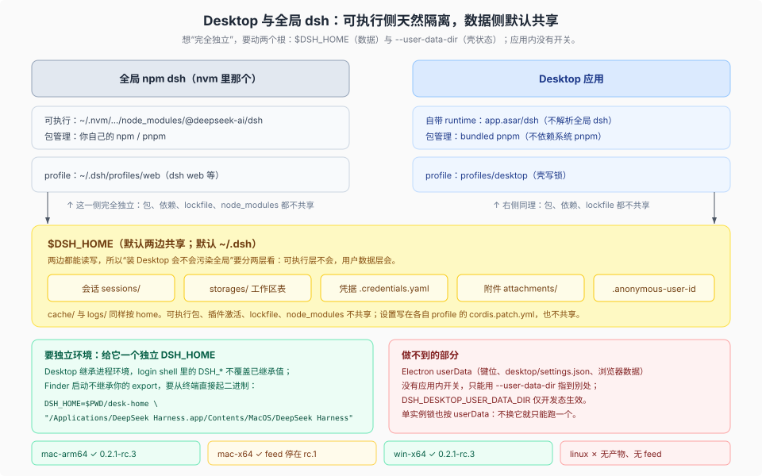

# 02 · Desktop：做到哪一步，以及隔离 / Linux / macOS 三问

源码核验基线：工作树 `8d8940e6a3`（产品树 `687f282e86` / `dsh-v0.2.1-rc.2`）；供版读数与安装包链接为本机 2026-10-25 实测。

## 版本与供版（可复现）

```sh
curl -s https://download.deepseek.com/dsh-desk/feeds/mac-arm64/nightly-mac.yml | head -3
curl -s https://download.deepseek.com/dsh-desk/feeds/mac-x64/nightly-mac.yml | head -3
curl -s -o /dev/null -w '%{http_code}\n' https://download.deepseek.com/dsh-desk/feeds/mac-arm64/latest-mac.yml
dsh --version
```

| 观测 | 结果 | 含义 |
|---|---|---|
| `mac-arm64/nightly-mac.yml` | `0.2.1-rc.3`，`2026-10-23T07:59:26Z`，348 MB | 与 npm 的 dsh **同版本号、同一天**供版 |
| `win-x64/nightly.yml` | `0.2.1-rc.3`，`2026-10-23T08:02:12Z`，289 MB | 同一版本覆盖三目标 |
| `mac-x64/nightly-mac.yml` | `0.2.1-rc.1` | **Intel 构建落后两个 RC** |
| `latest-mac.yml` | 不是 YAML（实测 404/HTML） | 该路径没有稳定 feed：目前只有 Nightly/RC 通道 |
| 本机 `dsh --version` | `0.2.1-rc.2` | 全局 CLI 与桌面互不跟随 |

版本策略不是「壳 1.0 + 内核 0.2」，而是**同版本整体发布**：Electron 与 `@deepseek-ai/dsh` 恒等版本，"A dsh upgrade is a Desktop release, even when the shell code is unchanged"（[`apps/desktop/README.md:115`](../../apps/desktop/README.md) 的 Release identity 行）。所以「桌面做得好不好」要按整个 dsh 的发版纪律评价。

## 工程成熟度（能核的部分）

| 维度 | 现状 | 出处 |
|---|---|---|
| 形态 | Electron 壳套完整 dsh Web 应用；渲染端从 `dsh-app://app/` 拿同一个 Web client；HTTP/WS 转发给已认证 Host；Node IPC 只承载生命周期 | [`apps/desktop/README.md:35`](../../apps/desktop/README.md) |
| 运行环境 | `ELECTRON_RUN_AS_NODE=1` 跑 dsh；**不依赖系统 Node/pnpm** | [`apps/desktop/README.md:116`](../../apps/desktop/README.md) |
| 离线载荷 | 自带 Python/Node/pnpm；`load_workspace_dependencies` 首次使用时离线安装；office 技能在 ASAR 外 | [`apps/desktop/README.md`](../../apps/desktop/README.md) `## Bundled workspace dependencies` |
| 打包/签名 | macOS 签名+公证、Windows EV/硬件令牌签名、blockmap、产物哈希、完成记录后才允许上传 | [`apps/desktop/packaging/README.md`](../../apps/desktop/packaging/README.md)、[`windows-signing/README.md`](../../apps/desktop/windows-signing/README.md) |
| 更新 | 启动异步查 feed，10 分钟 ±20% 抖动，失败退避到 1 小时；强制更新策略；安装前要求 Host 优雅停机 + 任务中断确认 + 失败回滚 | [`apps/desktop/README.md:272`](../../apps/desktop/README.md) 起 |
| 退出 | 关窗=隐藏（Windows 首次确认）；退出前问 Host 会不会打断任务/提醒；托盘、单实例 | [`apps/desktop/README.md:73`](../../apps/desktop/README.md) |
| CLI | 菜单 **Manage dsh Command…** 装命令（macOS 建 `/usr/local/bin/dsh`，Windows 写 PATH）；runtime 跟随桌面版本；**npm 全局 CLI 拒绝管理 desktop profile** | [`apps/desktop/README.md:59`](../../apps/desktop/README.md)、[`apps/cli/README.md:20`](../../apps/cli/README.md) |
| 数据边界 | README 原话：与 CLI 共享 `$DSH_HOME` 的 sessions、settings、credentials、workspaces、storage；**不**共享可执行包、插件激活、lockfile、`node_modules`。但按当前实现，settings 服务通过 configEditor 写 profile 的 `cordis.patch.yml`（按 profile 分开），home 下只剩旧版 `settings.yaml` 的 `.imported` 遗留——这句可能是迁移前的表述 | [`apps/desktop/README.md:363`](../../apps/desktop/README.md) |
| 遥测 | 桌面有产品分析（含 live application setting），Web 侧排除 | [`apps/desktop/README.md:33`](../../apps/desktop/README.md) |

## 明确缺口

- **只绑 `127.0.0.1`**（[`apps/desktop/README.md:37`](../../apps/desktop/README.md)）：不对外监听；要远程访问就用 `dsh web` 配反代/隧道（[`public-deployments.md`](../../docs/user/guide/public-deployments.md)）。
- **没有稳定通道**：`latest-mac.yml` 在该路径下没有 feed 文件（实测 404/HTML），目前是 preview/RC 供版。
- **Intel 构建滞后**：mac-x64 停在 rc.1。
- **Windows on ARM**：解包启动能过，但 Python 载荷仍是 x64，`load_workspace_dependencies` 可能按 `process.arch` 拒绝。
- **账号登录描述自相矛盾**：Known limitations 写「未接通」，正文又详述 PKCE 登录；至少一条是陈旧描述。

## 三问



### 隔离与全局 dsh 能否分开

**能，但要分两层看。**

| 层 | 默认行为 | 结论 |
|---|---|---|
| 可执行包 / 依赖 / lockfile / `node_modules` | 完全独立：桌面用自带 runtime（`app.asar/dsh`）与 bundled pnpm，不解析全局 npm dsh；profile 独占 `$DSH_HOME/profiles/desktop` + 写锁 | 装 Desktop **不会**动你 `~/.nvm` 里的 dsh，也不会动 `profiles/web` |
| 用户数据（会话 / 凭据 / 工作区表 / 附件 / 缓存） | 默认共享同一 `$DSH_HOME`（默认 `~/.dsh`）；**设置**写在各自 profile 的 `cordis.patch.yml`，天然分开 | 会看到同一批会话与工作区；这是设计而非 bug。数据清单见 [06 篇](./06_desktop-lab-isolation.md) |

要「完全独立」，就给它另一个 `DSH_HOME`；要「两个实例同时跑」，还要再给一个 `--user-data-dir`（Electron 的单实例锁按 userData 建）。三件绕不开的事：

1. **Electron userData 没有应用内开关**：`keybindings.json`、`desktop/settings.json`、浏览器数据都在 `app.getPath('userData')` 下，要重定位只能用 Chromium 的 `--user-data-dir`；`DSH_DESKTOP_USER_DATA_DIR` 仅开发启动器读取。
2. **不带 `--user-data-dir` 就无法双开**：第二次启动只会把第一个窗口提到前台。
3. **CLI 抢占是可选项**：Manage dsh Command 会把一个 `dsh` 命令指向桌面 runtime（macOS 在 `/usr/local/bin/dsh`，Windows 写 PATH），可能盖过 nvm 的 dsh；可 Remove。

从终端启动时 `DSH_HOME` 会被保留（登录 shell 合并会跳过 `DSH_*`），Finder 启动则不继承你的 export。完整可复制的启动方式、验证清单、隔离矩阵与限制见 [06 篇](./06_desktop-lab-isolation.md)。

### 有没有 Linux 版

**没有。** 三处独立证据：

1. [`apps/desktop/packaging/README.md:96`](../../apps/desktop/packaging/README.md) 原话："Linux is not a supported Desktop release target."
2. 打包目标类型只有三个（[`apps/desktop/scripts/package-target.ts:50`](../../apps/desktop/scripts/package-target.ts)）：`'mac-arm64' | 'mac-x64' | 'win-x64'`；没有 `package:linux` 或 `upload:linux` 脚本。
3. 发布侧同样只有三目标（[`apps/desktop/publishing/README.md`](../../apps/desktop/publishing/README.md)）；实测 `feeds/linux-x64/` 路径不存在。

electron-builder 配置里确实残留一个 `linux: { category, target: ['AppImage'] }` 段（[`electron-builder-config.mjs`](../../apps/desktop/scripts/electron-builder-config.mjs)），但没有任何脚本引用它、也没有产物与 feed——它是共享配置的脚手架，不是支持承诺。

Linux 用户今天的路是 **CLI/Web**：`npm i -g @deepseek-ai/dsh` + `dsh web`，功能面与桌面基本一致（没有托盘/自动更新/离线 Office 载荷）。

### 有没有 Mac 版

**有，两个架构。** 安装包是固定链接（实测 200）：

| 目标 | 链接 | 最近更新 | feed 版本 |
|---|---|---|---|
| Apple Silicon | `https://download.deepseek.com/desktop/dsh-latest-macos-arm64.dmg` | 2026-10-24 | `0.2.1-rc.3` |
| Intel | `https://download.deepseek.com/desktop/dsh-latest-macos-x64.dmg` | 2026-10-17 | `0.2.1-rc.1` |

- 官方下载页对 Apple Silicon 标注 **macOS 13 或更新**；Intel 版的系统要求页面没有单独标注。
- 发布版经过签名与公证，启用 hardened runtime；麦克风权限有 `NSMicrophoneUsageDescription`，主应用与 Helper 都带 `com.apple.security.device.audio-input`。
- 自动更新用 `zip` 产物 + feed，`dmg` 用于安装。

一句话：**Apple Silicon 是主线（跟得上 rc.3），Intel 能用但滞后**。

## 平台速查

| 平台 | 官方桌面包 | 备注 |
|---|---|---|
| macOS arm64 | ✅ | 主目标，跟版最快 |
| macOS x64 | ✅ | 停在 rc.1（2026-10-17） |
| Windows x64 | ✅ | NSIS 安装包 + 托盘 |
| Windows arm64 | ❌ | 仅解包启动可过，载荷仍 x64 |
| Linux | ❌ | 明确不支持；用 CLI/Web |
