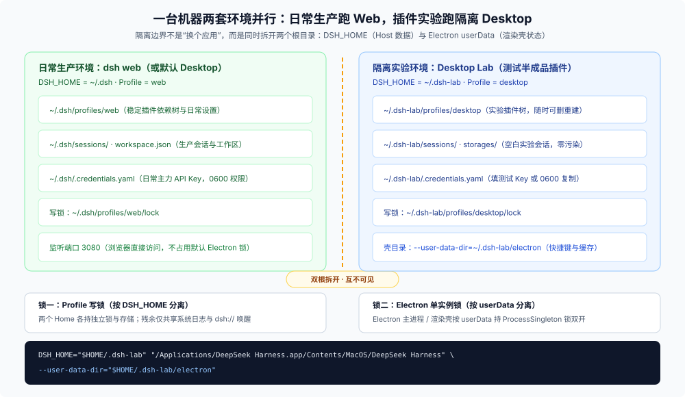
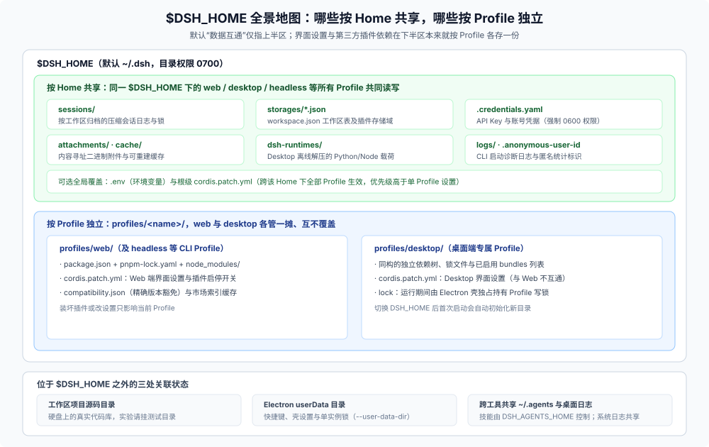

# 03 · 实操手册：双根隔离实验环境搭法与全局 CLI 安全升级

日常使用与插件开发混在一台机器上时，最常遇到两件运维实操事：**一是怎么开一个“随便折腾也不会污染日常会话与凭据”的独立 Desktop 实验实例；二是全局安装的 `@deepseek-ai/dsh` 命令行平时怎么稳妥升级、出问题怎么秒级回滚。** 本篇给出可直接照抄的两套操作手册。

---

<a id="desktop-lab-isolation"></a>

## 上篇：把实验 Desktop 关进独立沙盒（双根隔离法）

假设你日常靠 `dsh web`（或默认 Desktop）干正事，同时想再开一个专门用来测试半成品插件的实验 Desktop，要求**两边能同时开着、插件互不可见、实验会话和工作区绝不混进日常侧栏**。



### 1. 为什么必须同时改两个根目录？

很多人以为换个 Profile 就够了，或者只改其中一个参数，结果踩进坑里。要实现真正的双开与数据隔离，**`DSH_HOME` 和 `--user-data-dir` 必须成对指定，缺一不可**：

| 参数 / 环境变量 | 掌管什么 | 只漏掉它会发生什么 |
|---|---|---|
| **`DSH_HOME`** | Host 侧全部持久数据：`sessions/`、`storages/`（含工作区列表）、`.credentials.yaml`、`attachments/`、`profiles/` 与离线运行时载荷 | **数据串台（最危险）**：如果只换了 `--user-data-dir` 没换 `DSH_HOME`，虽然能弹出第二个窗口，但两个窗口后台同时读写同一份生产 `~/.dsh` 数据！ |
| **`--user-data-dir`** | Electron 壳侧状态：快捷键 `keybindings.json`、壳级 `desktop/settings.json`、Chromium 缓存，以及 **Electron 的单实例进程锁（`ProcessSingleton`）** | **无法双开且共用壳配置**：Electron 的单实例锁建在 `userData` 目录上；不传 `--user-data-dir` 时，第二次启动只会把已打开的第一个窗口提到前台并直接退出（注：`DSH_DESKTOP_USER_DATA_DIR` 仅开发启动器有效，打包版必须传 Chromium 原生参数 `--user-data-dir`） |

### 2. `$DSH_HOME` 里到底装了什么？（共享 vs 独立全景表）

理解为什么要换 `DSH_HOME`，只需看清默认 `~/.dsh` 目录内部的归属切分：



| 路径（相对 `$DSH_HOME`） | 存的是什么 | 默认归属范围 | 建实验环境时的迁移建议 |
|---|---|---|---|
| `.credentials.yaml` | API Key 与账号登录凭据（强制要求 `0600` 权限，权限过宽会被拒读） | **按 Home 共享** | 建议填独立的测试 Key；若复用现有凭据，必须用 `install -m 600` 复制 |
| `sessions/` | 按工作区归档的压缩会话日志（`session.vN.jsonl.zstd`）与会话锁 | **按 Home 共享** | 不复制，让实验环境保持空白会话列表 |
| `storages/*.json` | 键值存储域表：`workspace.json`（工作区注册表）、会话投影缓存及各插件私有表 | **按 Home 共享** | 不复制，在实验窗口里只添加测试仓库即可 |
| `attachments/`、`cache/`、`logs/` | 二进制附件、缩略图等可重建缓存、CLI 启动诊断日志 | **按 Home 共享** | 不复制 |
| `.anonymous-user-id` | 匿名统计标识 | **按 Home 共享** | 不复制（首次启动自动生成新 ID） |
| `dsh-runtimes/` | Desktop 首次调 `load_workspace_dependencies` 解压的 Python/Node 离线环境 | **按 Home 共享** | 不复制；实验环境首次用到时会自动离线解压一份 |
| `.env`、`cordis.patch.yml` | Home 级环境变量与跨 Profile 全局配置覆盖 | **按 Home 共享** | 按需新建 |
| `profiles/<name>/package.json`、`node_modules` | 该 Profile 独立安装的第三方插件依赖树与锁文件 | **按 Profile 独立** | 换 Home 后首次启动自动初始化，切勿手动搬运 `node_modules` |
| `profiles/<name>/cordis.patch.yml` | **该 Profile 的界面设置与插件启停开关** | **按 Profile 独立** | 想复用界面偏好时可单独复制此文件 |
| *（Home 外）* 工作区源码目录 | 你硬盘上的真实代码仓库 | 外部文件系统 | 切勿把生产仓库当破坏性实验靶子，给实验实例挂独立测试目录 |
| *（Home 外）* Electron `userData` | 桌面快捷键、`desktop/settings.json`、浏览器存储与单实例锁 | 外部壳目录 | 靠 `--user-data-dir` 指到 `~/.dsh-lab/electron` |

此外，`$DSH_HOME` 在文件系统上是开放目录，部分第三方插件也会直接在根下建自己的子目录或配置文件——因此**直接换整个 `DSH_HOME` 目录永远比手动挑文件清理稳得多**。

### 3. 三种可靠的启动做法（避开 `open --env` 的坑）

在 macOS 上有个极易踩的系统坑：实测 `open -g -n -a "DeepSeek Harness" --env DSH_HOME=...` 启动 `.app` 时，LaunchServices 在不少场景下**并不会把自定义环境变量透传给子进程**；直接去 Finder 或 Dock 双击图标更是完全读不到你终端 `.zshrc` 里的 `export`。与此同时，Desktop 源码（[`login-shell-environment.ts`](https://github.com/deepseek-ai/deepseek-harness/blob/master/apps/desktop/src/login-shell-environment.ts)）在合并登录 Shell 环境时专门把 `DSH_*` 列为启动器优先保留项（`LAUNCHER_OWNED_PREFIXES`）——这意味着**只要你直接拉起应用二进制并注入 `DSH_HOME`，它就一定能稳稳传进 Host 且不会被 `.zshrc` 覆盖**。

- **做法 A：在 `~/.zshrc` 里放一个终端启动函数（最省事）**
  ```sh
  dsh-lab() {
    local lab_home="$HOME/.dsh-lab"
    local app="/Applications/DeepSeek Harness.app"
    local bin
    bin="$app/Contents/MacOS/$(plutil -extract CFBundleExecutable raw "$app/Contents/Info.plist")"
    mkdir -p "$lab_home/electron" && chmod 700 "$lab_home"
    DSH_HOME="$lab_home" "$bin" --user-data-dir="$lab_home/electron" "$@" &
  }
  ```
  之后终端敲 `dsh-lab` 就起实验桌面，跟日常 `dsh web` 或默认 Desktop 同时运行、互不干扰。（Windows 同理：写一个 `.cmd` 或 PowerShell 脚本先设 `$env:DSH_HOME="$HOME\.dsh-lab"`，再带 `--user-data-dir="$HOME\.dsh-lab\electron"` 启动 `exe`。）
- **做法 B：做成可双击的 `DSH Lab.command` 启动脚本**
  不想每次敲命令的话，把下面几行存为 `~/Applications/DSH Lab.command` 并执行 `chmod +x`：
  ```sh
  #!/bin/zsh
  set -euo pipefail
  lab_home="$HOME/.dsh-lab"
  app="/Applications/DeepSeek Harness.app"
  bin="$app/Contents/MacOS/$(plutil -extract CFBundleExecutable raw "$app/Contents/Info.plist")"
  mkdir -p "$lab_home/electron" && chmod 700 "$lab_home"
  exec env DSH_HOME="$lab_home" "$bin" --user-data-dir="$lab_home/electron"
  ```
- **做法 C：正在改 DSH 源码时直接用 `pnpm run dev:desktop`**
  如 [`02` 篇](./02-plugin-install-and-dev-bypass.md) 所述，仓库自带的开发启动器天生把 Home 和浏览器数据锁在 `apps/desktop/.desktop-build/development/` 里，零配置即与 `~/.dsh` 物理隔离。

> **进阶思路（防手滑双击误入生产）**：如果你日常干活全靠终端敲 `dsh web`、装 Desktop **纯粹只为做实验**，但又老是习惯性去点 Dock 图标，可以把两边反过来——先停掉所有 `dsh` 进程，把原生产目录 `mv ~/.dsh ~/.dsh-prod`，然后在 `.zshrc` 里定义 `dsh-prod() { DSH_HOME="$HOME/.dsh-prod" dsh "$@"; }`。这样随便双击 Desktop 图标落进的默认 `~/.dsh` 天然就是实验沙盒，再也不怕点错图标把测试会话写进生产库。

### 4. 首启配置、三步验收与残余共享项

首次拉起实验实例时，`~/.dsh-lab/profiles/desktop` 会自动初始化。如果不想重新填 API Key，可按严格权限复制凭据：

```sh
mkdir -p "$HOME/.dsh-lab" && chmod 700 "$HOME/.dsh-lab"
install -m 600 "$HOME/.dsh/.credentials.yaml" "$HOME/.dsh-lab/.credentials.yaml"
```

启动后花 30 秒做一次**隔离验收**：
1. 查目录：`ls -d ~/.dsh-lab/profiles/desktop ~/.dsh-lab/electron/desktop` 均已生成；
2. 做交叉测试：在实验 Desktop 里随便新建一条对话，切回日常 `dsh web` 刷新侧栏——**看不到这条新对话**即证明数据根已彻底分家；
3. 用完清理：退出实验窗口后，确认路径无误直接 `rm -rf "$HOME/.dsh-lab"` 即可无痕撤场。

最后留心**三处操作系统级资源仍然是共享的**：
- **macOS 桌面日志文件**（`~/Library/Logs/DeepSeek Harness`）两个实例往同一处写诊断日志；
- **`dsh://` 协议唤醒句柄**归最后一次启动的实例接管（浏览器登录回跳 `dsh://open` 可能唤起另一个窗口）；
- **磁盘上的 `.app` 安装包本体只有一份**：触发应用自动更新前请先关掉实验双开实例，避免替换正在运行的应用包；若用桌面导出的 `dsh plugin --profile desktop` 命令改实验环境，前面务必加上 `DSH_HOME="$HOME/.dsh-lab"`。

---

<a id="global-cli-upgrade"></a>

## 下篇：全局 CLI（`@deepseek-ai/dsh`）安全升级与回滚手册

与自带后台更新器的 Desktop 不同，通过 npm 或 pnpm 全局安装的 `@deepseek-ai/dsh` **没有内置自升级子命令**，完全走包管理器的全局安装覆盖机制。

### 1. 选对通道：为什么日常升级用 `@latest`，插件排障偶尔见 `@next`？

核心升级命令只有一条：

```sh
npm install -g @deepseek-ai/dsh@latest
# 若你全局是用 pnpm 装的，则对应：pnpm add -g @deepseek-ai/dsh@latest
```

这里顺手解开一个很多读者看文档时的疑惑——为什么有的地方提 `@latest`，有的插件快照文档又提 `@next`？看一眼仓库的 [npm 发布流水线决策记录](https://github.com/deepseek-ai/deepseek-harness/blob/master/.agents/notes/implemented/process/2026-08-10-npm-release-sequences.md) 就全明白了：

- CI 发版脚本默认把 `alpha` 映射到 `@alpha`、`canary` 映射到 `@canary`、`rc` 预发布版映射到 **`@next`**，把正式稳定版映射到 **`@latest`**；同时支持发布负责人通过 `--dist-tag latest` 把验证就绪的 RC 版本显式提升为默认推荐通道。
- 因此对**日常使用全局 CLI 的用户**来说，**固定装 `@latest` 最稳妥**：它永远指向官方当前对外主推的版本（正式版，或预览期已签发的最新主推 RC），绝不会误拉进半成品的 `@alpha` / `@canary`；而只有当你在独立插件仓里需要第一时间追刚打出 tag、尚未提升到 `latest` 的新 RC 内部包时，才会去查 `@next`。

### 2. 升级前后的四个必知细节

1. **自己把关 Node 版本（`^22.19.0 || >=24.0.0`）**：DSH 要求 Node `^22.19.0` 或 `>=24.0.0`（注意 Node 23 不在支持范围内）。由于早期发布到 npm 的包元数据里未附带 `engines.node` 字段（`2026-09-30` 实测快照），`npm install -g` 可能不会自动替你拦截过老的 Node，升级前先敲 `node -v` 核对一眼。
2. **先停在跑进程，防 `~/.npm` 历史权限报错**：全局覆盖安装会直接替换 `node_modules/@deepseek-ai/dsh/` 下的文件，建议先关掉正在运行的 `dsh web`；若遇到历史遗留的 `~/.npm` 缓存目录含 root 属主文件报 `EPERM`，执行 `sudo chown -R "$(id -u):$(id -g)" "$HOME/.npm"`（或临时加 `--cache "$TMPDIR/npm-cache"`）即可绕过。
3. **秒级无损回滚**：因为会话、凭据、工作区和各 Profile 插件全都住在 `~/.dsh/` 下，全局 CLI 包本身完全无状态。万一新版本在你的环境里水土不服，直接指定升级前记下的旧版本号重装即可原样回退：
   ```sh
   npm install -g @deepseek-ai/dsh@<旧版本号>
   ```
4. **升完顺手看一眼升级迁移指南**：DSH 处于 `pre-stable` 阶段，凡涉及 CLI 参数、`cordis.yml` 键名或配置行为的外部可见破坏性变更，都会按版本号记录在仓库的 [`docs/upgrade-guide/`](https://github.com/deepseek-ai/deepseek-harness/tree/master/docs/upgrade-guide) 目录下（例如某组件拆为可选 Bundle 后需手动开启）。

### 3. 一键复核升级脚本：`upgrade-dsh-global.sh`

本目录随附了一份兼容 macOS 默认 Bash 3.2 的运维脚本 [`upgrade-dsh-global.sh`](./upgrade-dsh-global.sh)，把上面整套动作固化成了自动化检查流（识别 npm/pnpm 全局安装路径 → 检查在跑进程 → 探测源可达性与 `~/.npm` 缓存权限 → 对比 `dist-tags` 并按仓库规则校验当前 Node 版本 → 打印摘要确认后安装 → 校验 `dsh --version` 与 `dsh --help` 冒烟 → 输出精确回滚命令并列出对应版本的 `docs/upgrade-guide/` 条目）：

```sh
# 1) 只做全套环境与目标版本预检，不执行任何写入
bash _faq_on_digested/23_standalone-vs-web-release-forms/upgrade-dsh-global.sh --dry-run

# 2) 交互式升级（每个关键步骤提示确认）
bash _faq_on_digested/23_standalone-vs-web-release-forms/upgrade-dsh-global.sh

# 3) 免交互升级（若遇缓存权限问题会自动改走临时缓存，绝不自动跑 sudo）
bash _faq_on_digested/23_standalone-vs-web-release-forms/upgrade-dsh-global.sh --yes
```

> 核验状态见 [核验基线登记](../00-baseline.md)。
