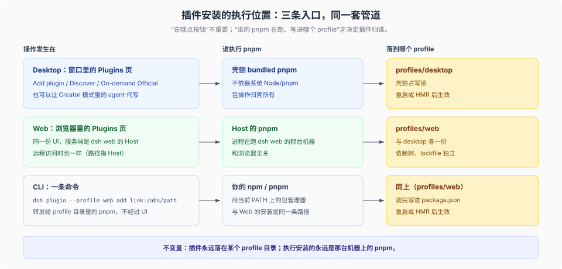

# 04 · 插件安装途径：同一套管道，三种入口

源码核验基线：工作树 `8d8940e6a3`（产品树 `687f282e86` / rc.2）。

## 一条不变量

**插件的落点永远是某个 profile 目录**（`package.json` 里的依赖 + `cordis.patch.yml` 里的层），执行安装的永远是某台机器上的 pnpm。入口形态差异只改变「谁触发、哪个 profile」。



## Desktop：六种装法

| # | 途径 | 执行者 | 落点 | 备注 |
|---|---|---|---|---|
| 1 | Plugins 页 **Add plugin**（包名+版本 / Git / tarball / **绝对本地路径**） | 壳侧 bundled pnpm | `$DSH_HOME/profiles/desktop` | 先 `pluginManager.inspect` 读源；registry 探测 npm/npmmirror（1500 ms，缓存 5 分钟）；脚本被拦时列出待批准包；装完可 **Enable now** |
| 2 | **Discover**（实验 bundle「Custom plugin markets」）+ index URL | 同上 | 同上 | 官方**不带任何 index 源**；市场是第三方 JSON |
| 3 | **On-demand Official**（Official/Experimental 列表按需装） | 同上 | 同上 | 发布版装 `package@<运行的 DSH 版本>`；源码 Web / 开发桌面改成 `link:<工作区包目录>`（[`plugin-manager:50`](../../packages/boot/plugin-manager/README.md)） |
| 4 | **Creator 模式 / `plugin_manager` 工具** | 模型发起，壳侧 pnpm 执行 | 同上 | 让 agent 写插件并安装；结果带 `nextStep`、重启原因 |
| 5 | **Desktop 自带 CLI**：Manage dsh Command… → `dsh plugin --profile desktop add …` | Desktop runtime 的 pnpm | 同上 | **npm 全局 CLI 会拒绝** desktop profile（[`apps/cli/README.md:20`](../../apps/cli/README.md)） |
| 6 | 手工改 profile（开发用） | 你自己 | 同上 | 壳持有 profile 写锁；改完重启或靠 HMR |

边界引文：plugin-manager 的 Known Limitations 写「Desktop package operations remain owned by the Desktop shell」——哪怕从浏览器点到同一个 Plugins 页，Desktop 上的包操作仍由壳执行。

## CLI / Web：同一条管道的另一个入口

| 入口 | 执行者 | 落点 |
|---|---|---|
| 浏览器里的 Plugins 页（`dsh web` 提供的同一个 UI） | 该 Host 进程的 pnpm | `$DSH_HOME/profiles/web` |
| `dsh plugin --profile web add <spec>`（转发给 profile 目录里的 pnpm） | 你的 npm / pnpm | 同上，写进 `package.json` |
| 手工改 `profiles/web/package.json` + `cordis.patch.yml` | 你自己 | 同上 |

```sh
# 未发布的本地插件目录，直接以 link 装进 profile（不经过 npm）
dsh plugin --profile web add link:/Users/me/src/my-dsh-plugin

# 本地 tarball 交付
pnpm pack && dsh plugin --profile web add ./my-dsh-plugin-0.1.0.tgz
```

注意 `dsh plugin` 只管「装进某个 profile」，不管你从哪个目录敲；`--profile` 决定落到哪份依赖树。

## 三种入口的差别只在「谁触发」

| 入口 | 触发者 | 什么时候生效 |
|---|---|---|
| Desktop Plugins 页 | 你点按钮，壳执行 | 装完可直接 Enable；需重启的会提示 |
| Web Plugins 页 | 你点按钮，Host 执行 | 同上 |
| `dsh plugin` / `pnpm` | 命令行 | 重启 Host（或 HMR 开着时自动重载） |

## 装完之后的生效边界

- **有 HMR**：可替换插件更新后直接生效；不可热重载时报 `restart-required`。
- **移除自启动以来运行的 bundle**：没有 HMR 时不能真正删除，安装会覆盖它并报告需要重启。
- **安装失败**：profile 清单与 lockfile 回滚；pnpm 已下载的文件可能残留。
- **安装成功 ≠ 能激活**：激活失败会保留依赖与选择，需要修复或重装。
- **版本门槛**：`engines.dsh`（未声明时退回 `@deepseek-ai/dsh*` peer 范围）对外部插件生效；不兼容要显式豁免。
