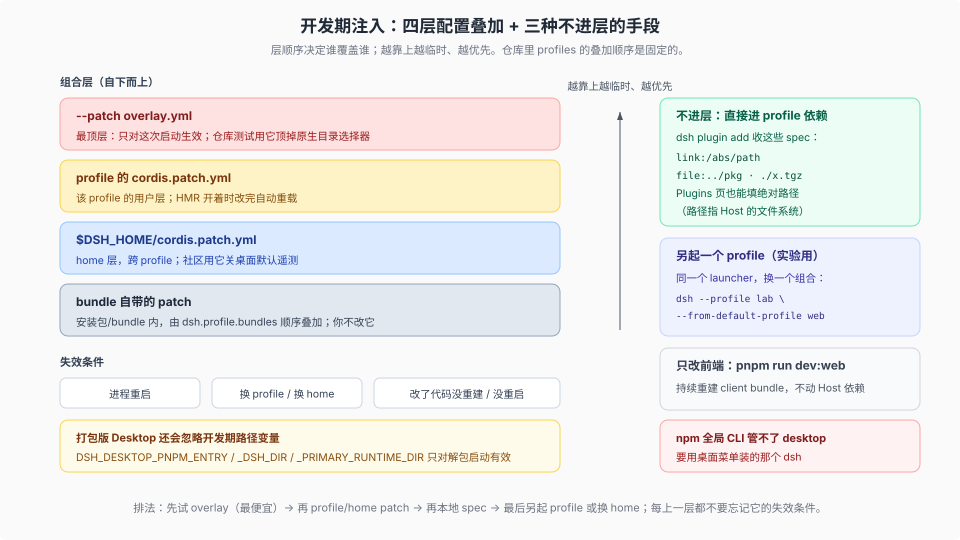

# 05 · 开发期注入：四层叠加 + 三种绕开正式发布的手法

源码核验基线：工作树 `8d8940e6a3`（产品树 `687f282e86` / rc.2）。

## 层顺序是固定的

profile 的组合顺序（[`apps/cli/README.md:41`](../../apps/cli/README.md) 的 The tree composes over an empty root 列表）：

```text
bundle 自带 patch（按 dsh.profile.bundles 顺序）
→ profile 的 cordis.patch.yml
→ home 的 $DSH_HOME/cordis.patch.yml
→ --patch overlays（最后一个赢）
```



## 四层叠加：谁覆盖谁

| 层 | 来自哪里 | 适用形态 | 失效条件 |
|---|---|---|---|
| bundle 自带 patch | `dsh.profile.bundles` 列出的包，按顺序叠 | 所有 profile | 你不改它；换 bundle 版本就变 |
| profile 的 `cordis.patch.yml` | `profiles/<name>/`，用户层 | Web / Desktop | 换 profile 或删文件；HMR 开着会自动重载 |
| `$DSH_HOME/cordis.patch.yml` | home 层，跨 profile | Web / Desktop | 影响该 home 下所有 profile |
| `--patch overlay.yml` | 启动参数，最顶层 | Web / headless / SDK | 仅本次启动；重启回到原树 |

## 三种不进层的手法

| # | 手法 | 生效位置 | 适用形态 | 失效条件 |
|---|---|---|---|---|
| 1 | 本地 spec：`link:/abs/path`、`file:…`、`./x.tgz`（CLI 的 `dsh plugin add`，或 Plugins 页填绝对路径） | profile 依赖层（写进 `package.json`） | CLI / Web / Desktop | 路径失效、包未构建、peer 不匹配 |
| 2 | 另起 profile 或换 home：`dsh --profile lab --from-default-profile web` / `DSH_HOME=… dsh web` | 整套组合 | Web / Desktop | 新 profile / 新 home 是另一套依赖与设置 |
| 3 | 只改前端：`pnpm run dev:web` 持续重建 client bundle | client 插件层 | Web | 只重建前端产物，不动 Host 依赖 |

> 开发桌面 / 源码 Web 的**官方条目**还会显示 `link:<工作区包目录>`：它同样写进 profile 依赖，只是来源是本地工作区而不是 npm。同一份 UI 里，打包版显示 `package@版本`，开发态显示 `link:…`（[`plugin-manager:50`](../../packages/boot/plugin-manager/README.md)）。

## 可以直接抄的例子

```sh
# 1) 用测试 overlay 顶掉原生目录选择器（仓库自带，做浏览器自动化时必备）
pnpm dsh web --patch apps/web/tests/pin-browse-picker.overlay.yml

# 2) 未发布的插件目录，直接以 link 装进 profile（不经过 npm）
dsh plugin --profile web add link:/Users/me/src/my-dsh-plugin

# 3) 本地 tarball 交付
pnpm pack && dsh plugin --profile web add ./my-dsh-plugin-0.1.0.tgz

# 4) 另起一个实验 profile，不碰 web 的依赖与设置
dsh --profile lab --from-default-profile web

# 5) 开发桌面：一次性 home，官方条目直接 link 到工作区包
pnpm run dev:desktop     # 默认 home: apps/desktop/.desktop-build/development/home
pnpm run start:desktop   # 复用已构建产物，不再 build
```

overlay 的最小形态是「禁一行、插一行」，模板见 [`apps/web/tests/pin-browse-picker.overlay.yml`](../../apps/web/tests/pin-browse-picker.overlay.yml)：

```yaml
- id: directory-picker
  disabled: true
- insert:
    - id: directory-picker-browse
      name: '@deepseek-ai/dsh-host-directory-picker-browse'
```

## home 层补丁：社区关桌面遥测的那一招

```yaml
# $DSH_HOME/cordis.patch.yml（社区给出的写法，首次启动前生效）
- id: desktop-product-telemetry
  disabled: true
- id: product-analytics
  disabled: true
```

`disabled: true` 只是不加载该行，不改代码；升级不会覆盖你自己的 patch 文件（它们在 profile/home 层，不在安装包里），但**打包版桌面会忽略 `DSH_DESKTOP_PNPM_ENTRY`、`DSH_DESKTOP_DSH_DIR`、`DSH_DESKTOP_PRIMARY_RUNTIME_DIR` 这类开发期路径变量**，别指望用它们改打包后的行为。

一个容易踩的副作用：设置页写的是 profile 的 `cordis.patch.yml`（`configEditor.documentPath`）。同一行一旦被 home 层 patch 或 `--patch` 覆盖，设置页会拒绝保存，并报 `Configuration for "<id>" is overridden by a home patch or command-line overlay`（[`config-editor/src/index.ts:140`](../../packages/boot/config-editor/src/index.ts)）。

## 五个坑

1. **npm 全局 CLI 管不了 desktop profile**。`dsh plugin --profile desktop …` 在 npm CLI 下被拒；先用桌面菜单装它自带的命令（[`apps/cli/README.md:20`](../../apps/cli/README.md)）。
2. **「发布版」和「开发版」看到的官方源不同**。打包版是 `package@<版本>`，源码 Web / 开发桌面是 `link:<工作区目录>`；同一份 UI，装出来的东西不一样。
3. **`--patch` 只对本次启动有效**。把它当长期方案的人，会在下一次重启后怀疑插件「自己坏了」。
4. **另起 profile 不会继承 web 的设置**。`--from-default-profile` 是复制模板，不是复制你的配置；要迁移得自己搬 `cordis.patch.yml`。
5. **换 home 后不会自动带上凭据与工作区**。新 home 是空的；凭据要 `install -m 600` 复制，工作区要在 UI 里重新添加。

## 排序建议

先试 overlay（最便宜、可回滚）→ 再 profile/home patch（持久但按 home 生效）→ 再本地 spec / link（真正进入依赖图）→ 最后另起 profile 或换 home（最重，但能一次性验证整套组合）。每上一层，都先想清楚它的失效条件。
