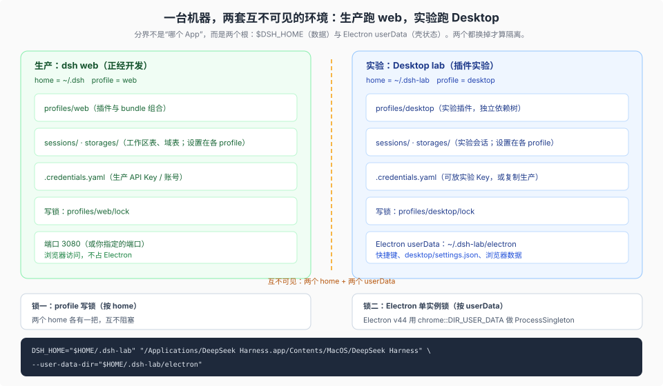
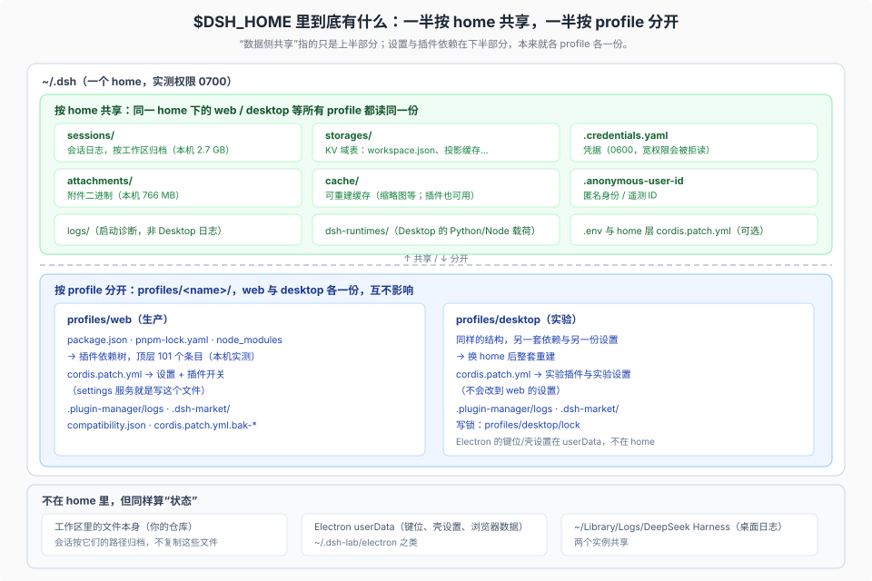

# 06 · 把 Desktop 关进实验室：一套可复制的隔离 runbook

目标场景：**Desktop 只做插件实验，`dsh web` 是正经开发**，两边数据不混、插件不混、最好还能同时开着。

源码核验基线：工作树 `8d8940e6a3`（产品树 `687f282e86` / rc.2）；Electron 单实例锁行为按 pinned 版本 `v44.7.0` 的上游源码核对；`open --env` 传送环境变量在本机实测**不生效**。



## 结论

默认已经隔离了「可执行包 / 插件依赖 / 设置」——三者都按 profile（设置写在 profile 的 `cordis.patch.yml`）；要把**会话、凭据、工作区表这类数据**也分开，改一个根就够：给 Desktop 一个独立的 `DSH_HOME`。再加一个 `--user-data-dir`，是为了让**两个实例能同时跑**（Electron 的单实例锁按 userData 目录建，不是按 App）。

一句话版本（三行，先解析出可执行文件名，避免不同构建的可执行名不一致）：

```sh
APP="/Applications/DeepSeek Harness.app"
BIN="$APP/Contents/MacOS/$(plutil -extract CFBundleExecutable raw "$APP/Contents/Info.plist")"
DSH_HOME="$HOME/.dsh-lab" "$BIN" --user-data-dir="$HOME/.dsh-lab/electron"
```

## 验证到什么程度

| 结论 | 证据 |
|---|---|
| `DSH_HOME` 决定 Host 的数据根 | 源码：[`home-paths:135`](../../packages/util/home-paths/src/index.ts)、[`base cordis.patch.yml:141`](../../packages/bundle/base/cordis.patch.yml)、[`paths.ts:17`](../../apps/desktop/src/paths.ts) |
| 启动时给的环境变量不会被登录 shell 覆盖 | 源码：[`login-shell-environment.ts`](../../apps/desktop/src/login-shell-environment.ts) 的 `LAUNCHER_OWNED_PREFIXES` |
| 单实例锁按 userData 隔离，`--user-data-dir` 可双开 | 源码：[Electron v44.7.0 `electron_api_app.cc`](https://github.com/electron/electron/blob/v44.7.0/shell/browser/api/electron_api_app.cc#L1064) 用 `chrome::DIR_USER_DATA` |
| `open --env` 不传递变量 | 本机实测（2026-10-25）：script-app dump `env` 只看到 launchd 默认 `PATH` |
| 命令在真机上跑通 | **未验证**：本机没有安装 Desktop（`/Applications` 下无该 App），所以命令与首启流程按源码与文档编写，未实跑 |

## 为什么是这两个变量

| 变量 | 作用域 | 不设的后果 |
|---|---|---|
| `DSH_HOME` | Host 的会话、存储表（含工作区注册表）、凭据、附件、缓存、`profiles/`、运行载荷 | 与生产 `~/.dsh` 共用一份数据；实验会话混进生产列表 |
| `--user-data-dir` | Electron 壳：`keybindings.json`、`desktop/settings.json`、浏览器数据、单实例锁 | 第二次启动只会把第一个窗口提到前台（`ProcessSingleton` 合并） |

两条都有源码依据：

- `DSH_HOME`：`resolveDshHome()` 读 `DSH_HOME`（[`packages/util/home-paths/src/index.ts:135`](../../packages/util/home-paths/src/index.ts)）；Desktop 的路径全部挂在它下面（[`apps/desktop/src/paths.ts:17`](../../apps/desktop/src/paths.ts)）；Host 的 `sessions` / `storages` 由 base bundle 用 `dshHomePath(...)` 求值（[`packages/bundle/base/cordis.patch.yml:141`](../../packages/bundle/base/cordis.patch.yml)、`:185`）。
- 环境能传到 Host：Electron 主进程把 `process.env` 作为基底，合并登录 shell 环境时**跳过** `DSH_*`（[`apps/desktop/src/login-shell-environment.ts`](../../apps/desktop/src/login-shell-environment.ts) 的 `LAUNCHER_OWNED_PREFIXES`），所以启动时给的值不会被 `.zshrc` 覆盖。
- 单实例锁：`RequestSingleInstanceLock` 用 `chrome::DIR_USER_DATA` 建 `ProcessSingleton`（[Electron v44.7.0 `electron_api_app.cc`](https://github.com/electron/electron/blob/v44.7.0/shell/browser/api/electron_api_app.cc#L1064)），而 `--user-data-dir` 改的正是这个目录。

## 为什么不用 `open --env`

本机实测（macOS，2026-10-25）：`open -g -n -a <app> --env DSH_HOME=...` 之后，被启动的进程环境里**没有**该变量（用一个以 shell 脚本为 `CFBundleExecutable` 的测试 .app dump `env` 验证，只看到 launchd 的默认 `PATH`）。

所以别指望 `open --env`，用下面任一方式，它们都把变量直接放进进程环境。

## 方案 A：终端函数（推荐）

```sh
# ~/.zshrc
dsh-lab() {
  local home="$HOME/.dsh-lab"
  local app="/Applications/DeepSeek Harness.app"
  local bin
  bin="$app/Contents/MacOS/$(plutil -extract CFBundleExecutable raw "$app/Contents/Info.plist")"
  mkdir -p "$home/electron"
  DSH_HOME="$home" "$bin" --user-data-dir="$home/electron" "$@" &
}

# 生产用法不变
dsh web
```

`dsh-lab` 启动实验实例；它跟你的 `dsh web` 同时跑，互不阻塞。

## 方案 B：双击启动的 `.command`

适合不想动 shell 配置、或想把「实验环境」做得像独立 App 的人：

```sh
#!/bin/zsh
# ~/Applications/DSH Lab.command
set -e
home="$HOME/.dsh-lab"
app="/Applications/DeepSeek Harness.app"
bin="$app/Contents/MacOS/$(plutil -extract CFBundleExecutable raw "$app/Contents/Info.plist")"
mkdir -p "$home/electron"
echo "DSH lab home: $home"
exec env DSH_HOME="$home" "$bin" --user-data-dir="$home/electron"
```

```sh
chmod +x "$HOME/Applications/DSH Lab.command"
```

双击会开一个 Terminal 窗口并保持前台（日志可见，便于实验）。实例在前台进程组里，关掉 Terminal 通常会连带结束它——对实验场景这往往是想要的。

## 方案 C：源码 Desktop（最彻底的实验室）

如果实验内容就是插件本身，直接用开发态：

```sh
pnpm run dev:desktop    # home: apps/desktop/.desktop-build/development/home
pnpm run start:desktop  # 复用已构建产物
```

它天生隔离：home、Electron browser data 都在 `.desktop-build/development/` 下，不碰 `~/.dsh`；插件页的官方条目还会直接 `link:` 到工作区包（[`plugin-manager:50`](../../packages/boot/plugin-manager/README.md)）。代价是要先构建、且是解包运行。

## 直接双击图标会怎样（最常见的翻车点）

**在没有实验实例运行时，双击会落到默认 `~/.dsh`，隔离失效。** 原因是三层叠加：

1. 双击是 LaunchServices 启动，不继承你终端里的 `export DSH_HOME`；
2. 就算写进 `.zshrc`，Desktop 合并登录 shell 环境时也**显式跳过 `DSH_*`**（`LAUNCHER_OWNED_PREFIXES`，见 [`login-shell-environment.ts`](../../apps/desktop/src/login-shell-environment.ts)）；
3. 所以只有「启动器显式把变量放进进程环境」这一条路（方案 A/B/C）。

**插件的隔离不会破，破的是数据隔离**——这决定了后果的严重程度：

| 你担心的 | 实际发生 |
|---|---|
| 实验插件污染生产 web | 不会：仍装进 `~/.dsh/profiles/desktop`，碰不到 `profiles/web` |
| 设置互相覆盖 | 不会：设置在各 profile 的 `cordis.patch.yml` |
| 实验会话混进生产 | **会**：同一个 home，`sessions/` 是同一份 |
| 凭据、工作区、附件、缓存 | **会**：同一份 |
| 更隐蔽的 | lab 实例开着时点 Dock，macOS 通常只是把已有窗口提到前台；但用 `open -n` 或再执行一次二进制时，因为 userData 不同，会**另起一个默认 home 的实例**，两个窗口并存，很容易装错地方 |

想避免，只有两种安排：**要么永远用启动器开实验**（上面的方案 A/B/C），**要么反过来——让双击天然就是实验**。

## 反过来：让「双击」就是实验

既然你的分工是「Desktop = 实验，web = 生产」，也可以把默认位置让给实验：

```sh
# 0) 先停掉所有 dsh 进程（web 服务、headless），确认没有写者在跑
pgrep -fl "dsh"        # 校对着看，别误杀别的进程

# 1) 一次性：把现有生产数据整体挪到独立 home
mv "$HOME/.dsh" "$HOME/.dsh-prod"

# 2) 之后生产一律带 home（写进 ~/.zshrc）
dsh-prod() { DSH_HOME="$HOME/.dsh-prod" dsh "$@"; }
dsh-prod web
```

两个注意点：`profiles/web/node_modules` 里若有 `link:` 指向 `~/.dsh` 内部的依赖，挪完会失效（重装即可）；挪之前先确认 `~/.dsh` 没有别的进程在写。

这样：

- **双击 Desktop** → 用 `~/.dsh`（首次启动会新建），天然是实验环境，不需要任何启动器；
- **生产 web** → `dsh-prod web`，数据全在 `~/.dsh-prod`；
- 全局 `dsh` 的默认 home 变成实验侧，误敲命令也不会碰生产。

代价是**纪律换边**：所有生产命令都要走 `dsh-prod`（或显式 `DSH_HOME`），而实验侧随便点。考虑到你「Desktop 靠点、生产靠终端」，这一边通常更好记。

两条路的取舍：

| | 默认 home = 生产（方案 A/B） | 默认 home = 实验（反过来） |
|---|---|---|
| 双击 Desktop | 落生产，必须记得用启动器 | ✅ 天然实验 |
| `dsh` / `dsh web` 裸敲 | 落生产 | 落实验；生产要 `dsh-prod` |
| 迁移成本 | 无 | 一次性 `mv`（凭据/会话/工作区一起走） |
| 适合 | 生产也在 GUI 里点 | 生产主要在终端（你的用法） |

## 首次启动会发生什么

> 本节及下面的验证清单按**方案 A/B**写（默认 home = 生产，实验用 `~/.dsh-lab`）。如果你选了「反过来」，把文中的 `~/.dsh-lab` 读成实验侧的默认 `~/.dsh`，把生产侧读成 `~/.dsh-prod` 即可，命令结构一样。

1. 新 home 下自动初始化 `profiles/desktop`（[`project-manager.ts:175`](../../apps/desktop/src/project-manager.ts) 的 `initProfile`）。
2. 因为新 home 没有 `.credentials.yaml`，会出现欢迎界面/API Key 页。三种选择：
   - 直接填一个**实验专用** Key（推荐，和生产计费/用量分开）；
   - 复制生产凭据（注意权限，见下）；
   - `~/.dsh-lab/.env` 里写 `DEEPSEEK_API_KEY=...`——`.env` 会作为 user 环境层读入（[`app-boot:246`](../../packages/boot/app-boot/src/index.ts)），但桌面端优先级是「已保存凭据 > 环境」。
3. 工作区列表是空的，把插件仓加进去即可；会话列表也是空的。

复制凭据时保持权限，`credentials-local` 会拒绝 group/other 可读的文件：

```sh
mkdir -p "$HOME/.dsh-lab" && chmod 700 "$HOME/.dsh-lab"
install -m 600 "$HOME/.dsh/.credentials.yaml" "$HOME/.dsh-lab/.credentials.yaml"
```

## 验证清单

```sh
# 1) 两套 home 是否分开
ls -d ~/.dsh ~/.dsh-lab
ls ~/.dsh-lab/profiles/desktop            # 实验 profile
ls ~/.dsh-lab/electron/desktop/settings.json   # 实验壳设置（首启后才有）

# 2) 生产实例仍在自己的 home 上跑
curl -s http://127.0.0.1:3080/manifest.webmanifest | head -3

# 3) 两个进程同时在（每个实例会带自己的 host 子进程）
pgrep -fl "dsh-desktop-host" | wc -l
```

再做一个「隔离自证」：在实验实例里新建一个会话；回到生产 web 刷新会话列表，应该看不到它。

## 数据侧到底有哪些东西

先把「数据」定义清楚：**`$DSH_HOME` 下除执行物以外的一切**。而执行物本身也按 profile 分。一个 home 里同时存在两种归属：

- **按 home 共享**：同一 home 下的 `web` / `desktop` / `headless` 等所有 profile 读同一份；
- **按 profile 分开**：`profiles/<name>/`，各 profile 各一份（设置与插件就在这里）。

另外还有两类状态既不在 home 也不在 profile：**工作区里的文件本身**，以及 **Electron 的 userData**（只在 Desktop 存在）。



| 路径（相对 `$DSH_HOME`） | 内容 | 归属 | 敏感度 | 迁移建议 |
|---|---|---|---|---|
| `.credentials.yaml` | API Key / 账号凭据（YAML，0600，宽权限会被拒读） | home | 高 | 要带就 `install -m 600`；否则在实验环境重新填 |
| `.anonymous-user-id` | 匿名身份 / 遥测 ID | home | 中 | 不必带；复制会让两边同 ID |
| `sessions/` | 会话日志：`<workspace>/<sessionId>/session.vN.jsonl.zstd` + `session.lock` | home | 高（含对话全文） | 可整目录带；同版本可读 |
| `storages/*.json` | KV 域表：`workspace.json`（工作区注册表）、`session_projcache.json`、插件域表 | home | 中 | 工作区表可带；投影缓存可重建，不建议带 |
| `attachments/v1/` | 附件二进制 | home | 高 | 按需带 |
| `cache/` | 可重建缓存（附件缩略图等；插件也用它） | home | 低 | 不带 |
| `logs/` | CLI 启动诊断日志 | home | 低 | 不带 |
| `dsh-runtimes/` | Desktop 的 Python/Node 载荷（首次使用时安装） | home | 低 | 不带；实验 home 会另装一份 |
| `.env`、home 层 `cordis.patch.yml` | 用户环境层与跨 profile 覆盖层 | home | 中 | 按需带（注意 `.env` 里可能有 Key） |
| `profiles/<name>/package.json`、`pnpm-lock.yaml`、`node_modules` | 插件依赖树 | profile | 中 | 换 home 会重建；不要手搬 |
| `profiles/<name>/cordis.patch.yml` | **设置 + 插件开关**（`settings` 服务写的就是这个文件） | profile | 中 | 想复制配置就带它 |
| `profiles/<name>/.plugin-manager/logs`、`.dsh-market/`、`compatibility.json` | 安装日志、市场缓存、版本豁免 | profile | 低 | 不带 |
| 工作区里的文件 | 你的仓库本身 | 外部 | 高 | 不复制；在 UI 里重新添加工作区 |
| Electron userData | 键位、`desktop/settings.json`、浏览器数据 | 外部（壳） | 中 | 用 `--user-data-dir` 指到实验目录 |
| `~/Library/Logs/DeepSeek Harness` | 桌面日志 | 外部 | 低 | 两个实例共享 |

一个实测到的细节：**home 是开放命名空间**。第三方插件会直接往 home 根写东西——本机就有 `llm-deepseek/`、`auto-approval-llm/`、`plugins/`、`dimagent-oauth.json`、`backups/` 这类目录与文件。所以「数据」没法靠白名单穷举；**隔离最稳的做法是换 home，而不是逐个删文件**。

「共享」在实践中的四个后果：

1. 实验里新建的会话，生产 web 的侧栏里能看到（只要同一个 home）。
2. 两边用同一份凭据：实验里换了 Key，生产也跟着变。
3. 工作区注册表共用：实验里添加/删除工作区，生产列表同变。
4. 附件与缓存共用：删缓存会影响两边（但不影响数据正确性）。

而**设置（`cordis.patch.yml`）和插件（`profiles/*`）不共享**——这也解释了为什么「同一个 home 下换 profile」只能隔离插件与设置，不能隔离会话与凭据。

## 隔离矩阵

> 同样按方案 A/B 写（生产 = `~/.dsh`，实验 = `~/.dsh-lab`）；选了「反过来」就把两列对调。

| 内容 | 生产 `dsh web` | 实验 Desktop lab | 是否隔离 |
|---|---|---|---|
| 可执行包 / 依赖 | `~/.nvm/.../dsh` | App 自带 runtime | ✅ 天然隔离 |
| 插件 / bundle 组合 | `~/.dsh/profiles/web` | `~/.dsh-lab/profiles/desktop` | ✅ 天然隔离 |
| 设置（`cordis.patch.yml`） | `~/.dsh/profiles/web/cordis.patch.yml` | `~/.dsh-lab/profiles/desktop/cordis.patch.yml` | ✅ 天然隔离（按 profile） |
| 会话 | `~/.dsh/sessions` | `~/.dsh-lab/sessions` | ✅ 换 home 后 |
| 工作区注册表 / 域表 | `~/.dsh/storages` | `~/.dsh-lab/storages` | ✅ 换 home 后 |
| 凭据 | `~/.dsh/.credentials.yaml` | `~/.dsh-lab/.credentials.yaml` | ✅ 换 home 后 |
| 附件 / 缓存 | `~/.dsh/attachments`、`cache` | `~/.dsh-lab/...` | ✅ 换 home 后 |
| 匿名身份 / 遥测 ID | `~/.dsh/.anonymous-user-id` | `~/.dsh-lab/.anonymous-user-id` | ✅ 换 home 后 |
| 快捷键 / 壳设置 / 浏览器数据 | 无（web 没有） | `~/.dsh-lab/electron` | ✅ 用 `--user-data-dir` |
| 日志（桌面） | `~/Library/Logs/DeepSeek Harness` | 同一个目录 | ❌ 共享（只是日志） |
| `dsh://` 协议 | 两个实例都会注册，后启动的生效 | 同左 | ❌ 共享 |

## 已知限制（踩之前先知道）

1. **不带 `--user-data-dir` 就没法同时开**：第二次启动只会在第一个窗口里被合并（Electron 单实例锁按 userData）。要同时跑，两个目录都得给。
2. **两条命令必须成对**：只换 `DSH_HOME` 会给「另一个 home 的 Host」但共用壳设置与浏览器数据；只换 `--user-data-dir` 会得到「另开一个窗口但还在生产 home」——后者最危险，等于两个窗口写同一份数据。
3. **更新期间别双开**：两个实例跑同一份 App bundle，自动更新会替换磁盘上的 bundle；更新前先退出实验实例。
4. **`dsh://open` 归最后启动的实例**：从浏览器点回链时可能落到另一个实例。
5. **自带的 `dsh` 命令要带 `DSH_HOME`**：`dsh plugin --profile desktop …` 默认指向 `~/.dsh`，想改实验环境必须先 `DSH_HOME="$HOME/.dsh-lab"`，否则是在动生产数据。
6. **首次用 `load_workspace_dependencies` 会在实验 home 再放一份载荷**（`~/.dsh-lab/dsh-runtimes/...`），占磁盘但不联网。
7. **Windows 同理**：用快捷方式或脚本先设 `DSH_HOME`（cmd 用 `set`，PowerShell 用 `$env:`），再带 `--user-data-dir=%USERPROFILE%\.dsh-lab\electron` 启动 exe。

## 想撤销时

```sh
# 退出实验实例后，先确认要删的是实验目录，再删
ls -d "$HOME/.dsh-lab"          # 方案 A/B：实验目录
# ls -d "$HOME/.dsh"            # 「反过来」方案：实验目录是默认位置
rm -rf "$HOME/.dsh-lab"
```

⚠️ 两种安排下「实验目录」不是同一个路径：方案 A/B 删 `~/.dsh-lab`；反过来则删 `~/.dsh`（生产在 `~/.dsh-prod`）。**删之前一定先 `ls` 确认**——删错等于删掉生产数据。

`dsh://` 注册会随下一次正常启动回到默认实例；日志目录不受影响。
