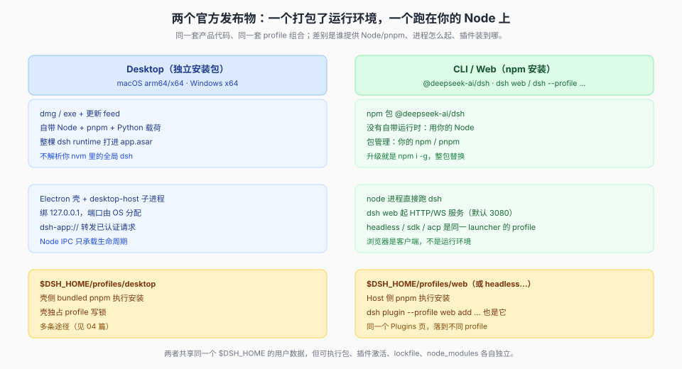

# Answer 23 · 能「装成应用」的只有两个：桌面 App 与 CLI/Web

源码核验基线：本仓库工作树 `8d8940e6a3`（产品树 = `687f282e86`，`dsh-v0.2.1-rc.2`）；桌面供版与数据目录在本机 `@deepseek-ai/dsh@0.2.1-rc.2` 的 live 实例（`127.0.0.1:3080`）与官方 feed 上实测对照，日期 2026-10-25。

## 一分钟结论

DSH 对外只有两种「装成应用」的发布物：**Desktop**（Electron 壳，macOS arm64/x64 + Windows x64，签名公证、自带 Node/pnpm/Python，走 Nightly feed 自动更新）和 **CLI/Web**（npm 包 `@deepseek-ai/dsh`，跑在你自己的 Node 上，`dsh web` 起浏览器界面）。两者共享同一套产品代码与同一套 profile 组合，差别是**谁提供运行环境**、**进程怎么起**、**插件落到哪个 profile**。真正需要留意的不是「装哪个」，而是**用户数据侧**：默认共享同一个 `$DSH_HOME`，想实验/生产彻底分开，得给 Desktop 换一个 home（见 [06 篇](./06_desktop-lab-isolation.md)）。

## 分篇目录

| # | 分篇 | 回答什么 |
|---|---|---|
| 01 | [两个发布形态先拆词](./01_two-shells.md) | `standalone` 的三个含义；官方到底有几份产物；一张矩阵分清打包物 / 进程 / 执行者 / 插件落点 |
| 02 | [Desktop：成熟度、隔离、Linux 与 macOS](./02_desktop.md) | 版本与供版读数、发布工程做到哪、哪些是硬缺口；**与全局 dsh 能否隔离、有没有 Linux 版、Mac 版** |
| 03 | [社区反应：数字与原话](./03_community.md) | star / 下载 / 讨论量，桌面贴里的四类抱怨与两类认可，以及「官方不带市场源」的生态后果 |
| 04 | [插件安装途径：同一管道，三种入口](./04_plugin-paths.md) | Desktop 的六种装法、CLI/Web 的三条入口、装完之后的生效边界 |
| 05 | [开发期注入：四层叠加 + 三种绕开正式发布的手法](./05_dev-injection.md) | `--patch` / profile patch / home patch / 本地 spec / link / 另起 profile；每种失效条件与五个坑 |
| 06 | [把 Desktop 关进实验室：隔离 runbook](./06_desktop-lab-isolation.md) | 两个根（`DSH_HOME` + `--user-data-dir`）怎么设、数据侧到底有哪些东西、直接双击为什么会失效、怎么验证、哪些仍共享 |

## 关键图

| 图 | 一句话 |
|---|---|
| [两个官方发布物](./figures/01-two-shells.svg) | 同一套代码，两种运行环境 |
| [Desktop 与全局 dsh 的隔离边界](./figures/02-desktop-isolation.svg) | 可执行侧天然隔离；数据侧默认共享，要独立得动 `$DSH_HOME` |
| [插件安装的执行位置](./figures/03-plugin-landing.svg) | 三条入口，同一套管道 |
| [开发期注入的层顺序](./figures/04-injection-layers.svg) | 越靠上越临时、越优先；每层都有自己的失效条件 |
| [两套互不可见的环境](./figures/05-desktop-lab-layout.svg) | 生产 web 与实验 Desktop 各自的 home / userData / 锁 |
| [`$DSH_HOME` 的数据地图](./figures/06-home-data-map.svg) | 哪些按 home 共享、哪些按 profile 分开 |

## 判据表：想干什么，走哪条

| 目标 | 选哪个形态 | 插件装在哪 | 入口 |
|---|---|---|---|
| 日常在电脑上用、要托盘/自动更新/离线载荷 | Desktop | `$DSH_HOME/profiles/desktop` | Plugins 页 / Discover / 桌面自带 CLI |
| 只想要「点开就能用」，不装 Electron | `dsh web` + 浏览器 | `$DSH_HOME/profiles/web` | Plugins 页 / `dsh plugin --profile web` |
| 要和现有全局 dsh 完全分开、并同时开着 | Desktop + 独立 `DSH_HOME` + `--user-data-dir` | 新 home 下的 `profiles/desktop` | [06 篇的 runbook](./06_desktop-lab-isolation.md) |
| 想要一个干净的单次运行，不碰现有数据 | `DSH_HOME=$(mktemp -d) dsh web --port 3090`（新 home 没有凭据，需要重新登录/填 Key） | 临时 home 的 profile | 命令行 |
| 开发期验证一个没发布的插件 | 任意源码形态 | 由你选的层决定 | `--patch` / `link:` / 开发桌面 |
| 让 agent 自己写插件 | Desktop / Web 的 Creator 模式 | 当前 profile | Plugins 页 → Let the agent create a plugin |

## 未验证与已知边界

- **「稳定通道不存在」是从一条 URL 的响应推断的**（`latest-mac.yml` 返回的不是 YAML，实测 404/HTML），不排除稳定版走别的发布路径；需要发布方确认。
- **社区项目只引用其自述与公开数字**，未审计源码。
- **HN 评论是抽样**（桌面贴 228 条里取了 40 余条），主题归类是归纳而非统计。
- 桌面 README 里「账号登录未接通」与「详细登录流程」并存，本文按「该条目可能是特定构建的陈旧描述」处理，未在实机验证。
- **本机未安装 Desktop**：隔离 runbook 的机制部分已按源码与本机实验核对，命令未真机实跑（见 06 篇的验证表）。

## 引用清单

仓库内：

- [`apps/desktop/README.md`](../../apps/desktop/README.md) — 形态、runtime、更新、CLI、Known limitations
- [`apps/desktop/packaging/README.md`](../../apps/desktop/packaging/README.md) — 目标平台、签名、发行版命令
- [`apps/desktop/publishing/README.md`](../../apps/desktop/publishing/README.md) — feed、固定下载、上传审计
- [`apps/desktop/src/paths.ts`](../../apps/desktop/src/paths.ts) — desktop profile 与锁
- [`apps/cli/README.md`](../../apps/cli/README.md) — 入口模式、profile、desktop 保留名
- [`apps/cli/reference/README.md`](../../apps/cli/reference/README.md) — `web` 的 `--host/--port/--public-url/--trusted-host/--tls-*`
- [`packages/util/home-paths/src/index.ts`](../../packages/util/home-paths/src/index.ts) — `DSH_HOME` 解析
- [`packages/bundle/base/cordis.patch.yml`](../../packages/bundle/base/cordis.patch.yml) — `sessions` / `storages` 根
- [`packages/boot/plugin-manager/README.md`](../../packages/boot/plugin-manager/README.md) — 安装/启用/移除、发布版 vs 开发版的源
- [`packages/client/ui-plugin-manager/README.md`](../../packages/client/ui-plugin-manager/README.md) — Plugins 页交互
- [`docs/user/guide/plugin-market.md`](../../docs/user/guide/plugin-market.md) — 官方不带 index 源
- [`docs/user/develop/basic/publish.md`](../../docs/user/develop/basic/publish.md) — `dsh plugin add`、`link:`、tarball
- [`apps/web/tests/pin-browse-picker.overlay.yml`](../../apps/web/tests/pin-browse-picker.overlay.yml) — overlay 最小模板
- [`_digested/surfaces-entrypoints/03-桌面入口.md`](../../_digested/surfaces-entrypoints/03-桌面入口.md) — 桌面入口的装载路径
- [`_digested/runtime-profiles/06-desktop.md`](../../_digested/runtime-profiles/06-desktop.md) — desktop profile

外部（访问日期 2026-10-25）：

- [HN: DeepSeek Harness Desktop for macOS and Windows](https://news.ycombinator.com/item?id=49929489) — 417 分 / 228 评论
- [HN: DeepSeek Harness developer preview](https://news.ycombinator.com/item?id=49285244) — 747 分 / 314 评论
- [GIGAZINE, 2026-10-05](https://gigazine.net/gsc_news/en/20261005-deepseek-harness/) — 桌面版上线
- [官方下载页](https://deepseek.com/en/download/) — macOS / Windows 桌面包
