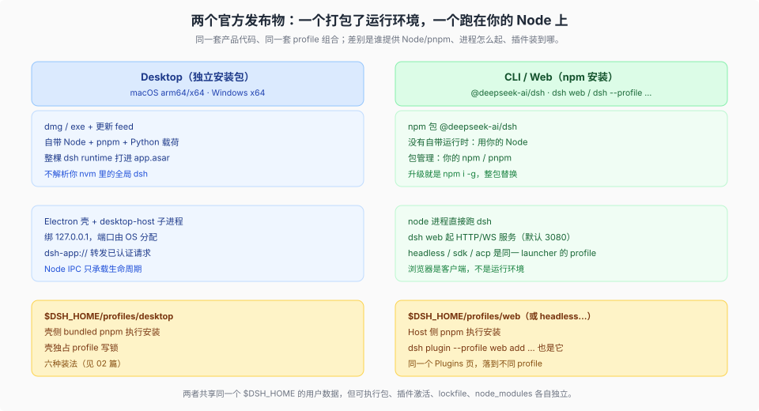
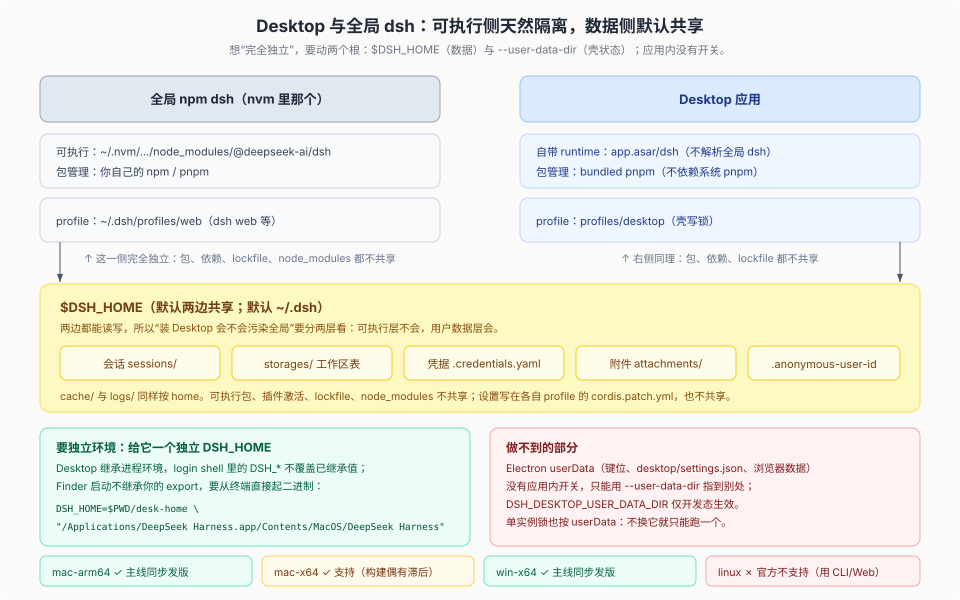

# Answer 23 · 一套内核、两份应用发布物：可执行与插件按 Profile 天然隔离，用户数据按 `$DSH_HOME` 默认共享

## 一句话结论

先把仓库里容易撞车的 `standalone` 一词拆清：源码文档提 standalone 有时指不叠 `dsh-base` 的 `sdk-minimal` 模板，有时指不属于任何对话轮次的独立会话事件；而面向用户**真正能安装运行的应用发布物只有两份**——**Desktop 桌面端**（Electron 独立安装包，自带 Node / pnpm / Python 运行环境）和 **CLI / Web 包**（npm 包 `@deepseek-ai/dsh`，跑在你自己的 Node 上，用 `dsh web` 启动浏览器界面）。

两者运行的是**同一套产品代码与 Profile 组装树**。用好它们只需抓住一条核心分界：

- **可执行程序、插件依赖树（`node_modules`）与界面设置按各自的 Profile 天然隔离**，互不覆盖；
- **会话日志、API 凭据、工作区列表和附件默认共用同一个 `$DSH_HOME`（`~/.dsh`）**——想在同一台机器上把实验环境与日常环境彻底分开并同时双开，必须成对重定位 `DSH_HOME` 和 Electron 的 `--user-data-dir`。

---

## 一、两份官方发布物正面对比

| 维度 | Desktop（独立桌面安装包） | CLI / Web（`@deepseek-ai/dsh`） |
|---|---|---|
| **打包内容** | `dmg` / `exe` 安装包，内置 Electron、独立 Node、pnpm、Python（含 Office 依赖轮子）及整棵 `app.asar/dsh` 运行时 | 纯 npm 包（Python SDK 的 wheel 内置的也是同一个 `dsh` 启动器），无自带 Node 运行时 |
| **进程与网络** | Electron 主进程 + `ELECTRON_RUN_AS_NODE=1` 启动的 `desktop-host` 子进程；严格绑死 `127.0.0.1` 随机端口，通过 `dsh-app://` 转发 | 系统 `node` 直接运行 `dsh`；`dsh web` 默认监听 `3080`，支持配置公网反代与 TLS，也支持 `headless` / `sdk` / `acp` 模式 |
| **谁执行装插件** | 桌面应用内置的 pnpm（不依赖系统 `PATH` 上的 Node/pnpm） | 当前机器 `PATH` 上的 pnpm（由 Web Host 或 `dsh plugin` 调用） |
| **插件与设置落点** | `$DSH_HOME/profiles/desktop`（Electron 独占写锁） | `$DSH_HOME/profiles/web`（或 `headless` 等对应 Profile 目录） |
| **升级方式** | 启动时异步轮询 Nightly 更新源，支持任务排空确认与失败回滚；与内核严格同版本号发版 | 手动运行 `npm install -g @deepseek-ai/dsh@latest`（或 `pnpm add -g`）整包替换 |
| **平台支持** | **macOS arm64** 与 **Windows x64** 为主线同步发版；**macOS x64（Intel）** 支持但构建偶有滞后；**Linux 官方不支持** | 凡满足 Node `^22.19.0 \|\| >=24.0.0` 的 macOS / Linux / Windows 均可运行（Linux 用户的官方主力形态） |

---

## 二、可执行隔离 vs 数据共享：三个最易踩空的陷阱

1. **装 Desktop 不会搞乱 nvm 里的全局 `dsh`，但两边默认读写同一批会话与凭据**
   Desktop 只认自己 `app.asar/dsh` 里的代码和 `$DSH_HOME/profiles/desktop`，绝不会动你 `~/.nvm` 下的全局包与 `profiles/web`。唯一会让两者在终端产生交集的是桌面菜单里的可选功能 **`Manage dsh Command…`**（macOS 会创建 `/usr/local/bin/dsh`，可能排在 nvm 前面，点 Remove 即可恢复）。但在数据层，两边默认共用 `~/.dsh` 下的 `sessions/`、`.credentials.yaml` 和 `storages/workspace.json`；而界面设置保存在各自 `profiles/<name>/cordis.patch.yml` 中，天然互不影响。
2. **npm 全局 `dsh` 管不了 `desktop` Profile，且双击图标读不到终端环境变量**
   敲 `dsh --profile desktop` 或用 npm 版 `dsh plugin --profile desktop ...` 会被 CLI 直接拒绝（见 [`apps/cli/README.md`](https://github.com/deepseek-ai/deepseek-harness/blob/master/apps/cli/README.md)）；管理桌面插件要么走桌面窗口内的 Plugins 页，要么先装桌面菜单导出的命令并在**退出 Desktop 释放写锁后**执行。此外，从 Finder/Dock 双击打开应用不会继承 `.zshrc` 里的 `DSH_HOME`，做隔离实验必须从启动器直接拉起二进制。
3. **全局 CLI 升级与用户数据完全解耦，认准 `@latest` 即可秒级回滚**
   全局 npm 包本身无状态，升级或重装旧版本都不会触碰 `~/.dsh`。日常升级固定跑 `npm install -g @deepseek-ai/dsh@latest`（避开 `@alpha` 实验通道）；本目录随附带 Node 版本校验与 `~/.npm` 缓存权限自愈旁路的 [`upgrade-dsh-global.sh`](./upgrade-dsh-global.sh)。

---

## 三、插件安装与开发期免发版路线速览

正式装插件不管走哪扇门（Plugins 页手动添加、Discover 第三方 JSON 索引、On-demand Official 官方按需开关、Creator 模式让模型代装，或 `dsh plugin` 命令行），最终都是由宿主机 pnpm 写进目标 Profile。而在本地开发调试时，不必发 npm 包即可按四档由轻到重注入（详见 [`02` 篇](./02-plugin-install-and-dev-bypass.md)）：

- **单次临时覆盖（最轻）**：启动时挂 `dsh web --patch ./overlay.yml`（位于四层配置最顶端，关掉进程即恢复原状；可用 `--dump-config` 静态验真）。
- **跨 Profile 持久覆盖**：写进 `$DSH_HOME/cordis.patch.yml`（优先级高于单个 Profile 的 `cordis.patch.yml`，常用于首次启动前全局关掉桌面遥测）。
- **本地未发版包进依赖树**：执行 `dsh plugin --profile web add link:/绝对路径`（或本地 `pnpm pack` 出的 `.tgz`），或在 Plugins 页直接填宿主机绝对路径。
- **源码级热开发**：在 DSH 仓库内跑 `pnpm run dev:web`（持续增量重建前端 bundle）或 `pnpm run dev:desktop`（自动隔离在 `.desktop-build/development/` 下）。

---

## 四、按场景速查：你想干什么，直接走哪条路？

| 你的目标 | 推荐形态与做法 | 插件 / 数据落在哪 |
|---|---|---|
| 日常在本机开箱即用，需要系统托盘、自动更新与内置 Python Office 环境 | 安装 **Desktop**（macOS / Windows） | `$DSH_HOME/profiles/desktop` |
| 在 Linux 上主力使用，或需要绑定端口做远程/隧道访问 | 安装 `@deepseek-ai/dsh`，运行 `dsh web` | `$DSH_HOME/profiles/web` |
| 临时起一个干净空白的 Web 实例做一次性验证，不碰现有会话 | `DSH_HOME=$(mktemp -d) dsh web --port 3090` | 临时目录（需重新填 Key） |
| 同一台电脑日常跑 `dsh web`，同时常驻一个彻底隔离的实验 Desktop | 给 Desktop 成对传独立 `DSH_HOME` + `--user-data-dir`（见 [`03` 篇](./03-isolated-lab-and-cli-upgrade.md#desktop-lab-isolation)） | `~/.dsh-lab` 与 `~/.dsh-lab/electron` |
| 本地正在开发插件，想免发 npm 包直接挂载验证 | 挂 `--patch` 或跑 `dsh plugin --profile web add link:/绝对路径`（见 [`02` 篇](./02-plugin-install-and-dev-bypass.md)） | 当前测试 Profile |
| 稳妥升级本机全局安装的 `dsh` CLI 并在异常时回滚 | 运行本目录 [`upgrade-dsh-global.sh`](./upgrade-dsh-global.sh) 或 `npm i -g @deepseek-ai/dsh@latest` | 不改动 `$DSH_HOME` |

---

## 五、诚实边界

- **当前仍处 `0.x-rc` 预览期，尚无独立稳定版更新流**：
  打包版 Desktop 默认固定轮询 Nightly 更新源（`nightly.yml` / `nightly-mac.yml`）；按 [`apps/desktop/publishing/README.md`](https://github.com/deepseek-ai/deepseek-harness/blob/master/apps/desktop/publishing/README.md) 规则，只有正式稳定版发版时才会额外生成 `latest.yml` / `latest-mac.yml`，因此在首个正式版落地前该地址返回 404 属于正常设计现象。
- **Desktop 不承担远程服务端角色**：
  桌面端 Host 强制只监听 `127.0.0.1`；任何跨设备或团队共享部署都应使用 `dsh web` 搭配反向代理（见 [`public-deployments.md`](https://github.com/deepseek-ai/deepseek-harness/blob/master/docs/user/guide/public-deployments.md)）。
- **官方发布物不内置插件市场源**：
  [`plugin-market.md`](https://github.com/deepseek-ai/deepseek-harness/blob/master/docs/user/guide/plugin-market.md) 明确声明官方不附带任何市场索引；安装第三方插件等同于授予同进程 Node 本地执行权限，需自行甄别来源。

---

## 继续阅读

| 你想细看哪一块 | 去哪篇看 |
|---|---|
| Desktop 与 CLI/Web 的架构细节、各操作系统支持现状、自动更新与社区真实反馈 | [`01-desktop-vs-cli-web-maturity.md`](./01-desktop-vs-cli-web-maturity.md) |
| 插件的 6 种安装入口、生效边界，以及四层配置覆盖与本地免发版调试手法 | [`02-plugin-install-and-dev-bypass.md`](./02-plugin-install-and-dev-bypass.md) |
| 实操手册：双根隔离的实验 Desktop 搭法（含 `$DSH_HOME` 全景清单）+ 全局 CLI 安全升级与回滚 | [`03-isolated-lab-and-cli-upgrade.md`](./03-isolated-lab-and-cli-upgrade.md) |
| 仓库权威源码入口、发布文档与外部实测快照出处汇总 | [`reference.md`](./reference.md) |
| 想把写好的插件规范打包发出去，或基于 DSH 分发定制工作台？ | [FAQ 24 · 插件发布与数据归属](../24_plugin-publishing-and-data/answer.md) · [FAQ 26 · 定制工作台分发](../26_harness-distribution/answer.md) |

> 核验状态见 [核验基线登记](../00-baseline.md)。
