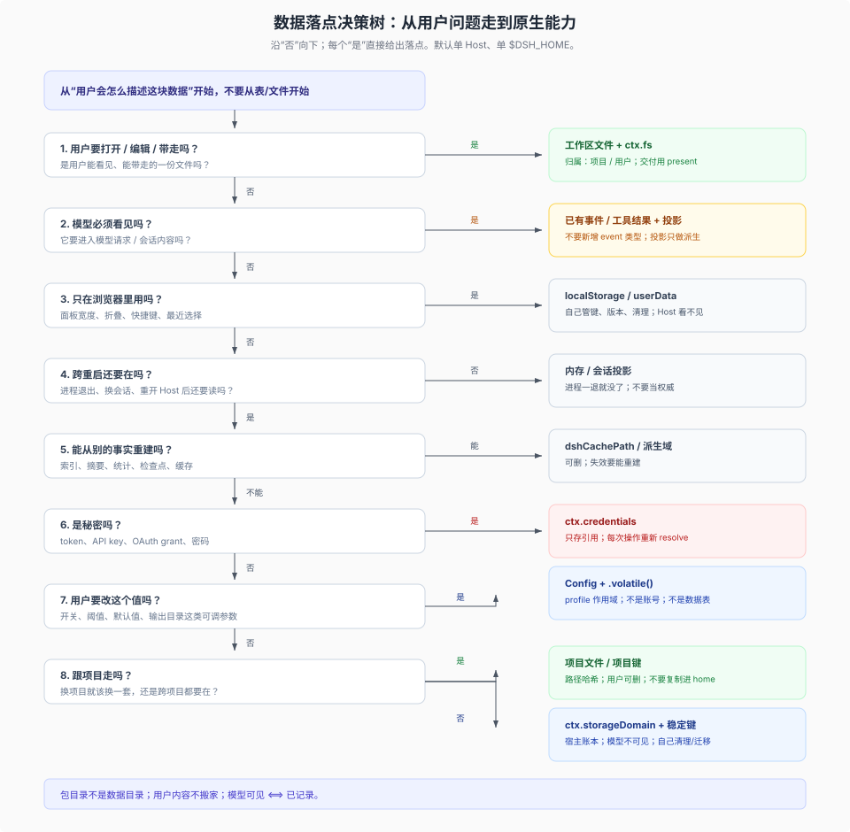

# 24 · 插件发布与数据落点：先分清发布物，再决定数据归属

这是一篇**自足**的说明：发布形态、发布要求、渠道版本、智能体定义、数据落点与数据设计，都在本目录的十篇里回答。入口只做一件事——让你先判断“我现在要发的这个东西属于哪一层”，再按需翻分篇。

不熟悉 DSH？先看三张图：[01 的三层与五种贡献](./figures/01-three-roles.svg)、[05 的数据地图](./figures/05-data-map.svg)、[10 的落点决策树](./figures/10-decision-tree.svg)；图后回到下面的 30 秒结论。

本篇回答三个问题：

1. **作者到底交付什么？** plugin、bundle、profile、preset、skill、client、MCP 各是什么角色，谁会被安装并自动启用。
2. **DSH 会拦什么、不会拦什么？** 六项检查、三种失败方式；哪些是硬门禁，哪些只是装后坏，哪些只是质量线。
3. **数据该放在哪？** workspace / home / session 的导航三分，6+2 的实现切法，以及删除、保留、迁移的边界。

## 30 秒结论

1. **作者唯一会被自动选入 profile 的发布物是 bundle。** 它是 npm 包，`package.json` 的 `dsh.bundle.patch` 指向一份或多份 Cordis patch；普通包也能安装，但只是依赖，不会自动启用。
2. **bundle 可以承载五种贡献**：行为插件、Web UI、preset、bundled skill、MCP 配置。贡献与包不是一一对应；一个包可以同时有多个子路径入口。
3. **发布合格是六项检查，不是一条门禁。** 失败分三类：拒绝/跳过/拒行、装后坏、只降级。把“README 写得不好”误当成“DSH 不让我发布”，或把“入口形式混用”误当成“安装器会拦住我”，都是常见失真。
4. **智能体 = Host 共享的 agent loop + 会话选中的 preset + 该会话的数据。** preset 是 `@deepseek-ai/dsh-agent-preset` 的一行声明，不是程序、不是目录、不在运行时被改写。
5. **数据不在包里。** 先按 workspace / home / session 导航；实现时按 09 篇的 6+2 切法。包目录是唯一会被升级整体替换的位置，不能放可变用户数据。
6. **删除/保留没有统一 GC。** 插件没有核心“数据根”，session 日志没有删除 API，附件不自动回收，插件也没有统一卸载契约；作者必须自己设计并写进 README。
7. **数据设计先写数据卡，再选 API。** 一块事实一张卡：谁拥有、关于谁、活多久、谁必须看见、谁是权威、用什么原生能力、键是什么、卸载留什么。具体步骤见 [10 篇](./10-data-design-advisor.md)。

## 一页决策画布

先填这八格，再翻对应章节：

| 格 | 问题 | 结论方向 | 去哪里 |
|---|---|---|---|
| **交付物** | 我交付的是代码、配置、定义、资源，还是数据？ | 代码 → 插件包；只接线 → 配置型 bundle；定义 → preset 行；资源 → skill/locale/icon；数据 → 包外 | [01](./01-publishable-forms.md) / [08](./08-packaging-flexibility-and-ecosystems.md) |
| **运行身份** | 它会被安装、被加载，还是只被读取？ | 安装单位是包；运行实例是行；preset 是选择；skill 是被发现 | [01](./01-publishable-forms.md) |
| **发布门** | DSH 会拒绝，还是装后坏，还是只降级？ | patch/入口解析、版本、已声明 Config 是硬面；入口形式与构建产物装后坏；元数据只降级 | [02](./02-package-contract.md) |
| **版本承诺** | 我承诺支持哪些 DSH？ | 优先 `engines.dsh`；没有它才回退 DSH peer；`manifestVersion` 不是门 | [02](./02-package-contract.md) / [03](./03-channels-and-versions.md) |
| **智能体定义** | 这个智能体由哪些子插件组成？ | preset 行 + 子插件行；共享服务留 Host | [04](./04-readonly-agent-definition.md) |
| **只读资产** | 哪些知识随包走，哪些让用户编辑？ | 随包走只读 skill；可编辑经验放项目/用户 skill 根或 `AGENTS.md` | [04](./04-readonly-agent-definition.md) / [05](./05-data-planes.md) |
| **数据归属** | 谁拥有、关于谁、活多久、谁必须看见、谁是权威？ | workspace / home / session 导航；再按 6+2 与八条规则细化；落到插件用数据卡 | [05](./05-data-planes.md) / [09](./09-agent-data-cuts.md) / [10](./10-data-design-advisor.md) |
| **验收** | 我能不能重复证明它装得上、起得来、不串数据？ | 先 T0 + T3，再 T1/T2/T5，最后 T4/T6/T7/T8 | [07](./07-testing-and-acceptance.md) |

## 十个发布判断

1. **发布的是包，加载的是行。** 包负责安装、元数据、保护与移除；行负责这一次组合里的实例。移除要移除包或覆盖层，不能只“删一行”。
2. **只有 bundle 会被自动启用。** 普通 npm 包能被 `dsh plugin add` 装成依赖，但不会进 `dsh.profile.bundles`，也不会自动激活。
3. **把门禁和质量线分开。** 硬面只有 patch、入口解析、版本、已声明 Config；README、许可证、测试、图标、SemVer 是质量线，不通过不会立刻报错，但会留下维护债。
4. **入口形式是装载正确性，不是安装门禁。** named `apply` 与 default service class 混用，通常不在安装时拒绝，而是在第一次访问未注入的服务时崩。
5. **版本只说 `engines.dsh`。** 写了它，peer 范围被忽略；没写才回退到全部 `@deepseek-ai/dsh*` peer。`dsh.manifestVersion` 没有读取方，`dsh.compatibility` 不是 DSH 字段。
6. **数据不进包。** 安装/升级是 remove + install，`files` 会裁剪，link 安装又指向 checkout；写进包目录的用户数据没有持久性契约。
7. **preset 是声明，不是程序。** 新增/覆盖都走 bundle patch；覆盖替换整段 `config`，不是深合并；已有 Agent 钉住启动时的 revision，新 Agent 用当前定义。
8. **行 id、preset id、Config 字段、skill 名、domain 名都是 API。** 用户会按它们覆盖、选择、恢复或打开；改名要先想迁移。
9. **市场是目录，不背书。** DSH 只校验 index 格式，不验证作者、主页或来源；`http:` 源可被网络路径上的任何人篡改。
10. **真实安装形状优先于源码直跑。** 只有 tarball/registry 安装才暴露 `files`、`exports`、peer 解析和 `allowBuilds` 的差异。

## 发布六项检查速查

完整表见 [02 篇](./02-package-contract.md) 与 [06 篇](./06-skeleton-and-checklists.md) 的检查表。

| # | 检查 | 谁在检查 | 失败方式 | 典型现象 |
|---|---|---|---|---|
| 1 | 入口形式（named `apply` / default service） | Loader / 模块加载 | 装后坏 | 命名空间被丢弃、`inject` 失效 |
| 2 | patch 存在且能解析 | `dsh plugin` / profile 启动 | 拒绝/跳过 | `not-bundle`、`skippedBundles` |
| 3 | 自包含（入口、`./client`、构建产物） | Node 解析 / `pnpm pack` | 装后坏 | 模块找不到、tarball 缺文件 |
| 4 | `engines.dsh` 或 DSH peer 匹配 | 安装预检 + 启动/重载 | 拒绝/跳过/拒行 | 版本诊断、`skippedBundles` |
| 5 | 已声明 `Config` 的行内配置 | 插件激活 | 拒绝/跳过行 | 激活失败，随行的重要性升级 |
| 6 | 元数据（locale、icon、description） | 读 Display 元数据的消费者 | 只降级 | 回退标题、空描述、缺图 |

一句话：**1、3 是“装后坏”，2、4、5 是“拒绝/跳过/拒行”，6 是“只降级”。** 这张分类表比“DSH 会不会拒绝”更有用，因为作者要修的东西不同。

## 数据：三归属是导航，6+2 是实现

workspace / home / session 回答的是“大致在哪”；一旦要决定“谁拥有、关于谁、活多久、谁必须看见、谁是权威”，就要用 09 篇的 6+2。把 6+2 落到一个具体插件上的步骤、数据卡与原生能力地图见 [10 篇](./10-data-design-advisor.md)：

| 24 的平面 | 放什么 | 所有者 | 物理位置 / 服务 | 可变性 | 模型可见 | 章节 |
|---|---|---|---|---|---|---|
| **D 定义** | bundle patch、preset 行、Config 默认值、工具边界 | 包作者 / 部署者 | `package.json` + patch + preset | 只读（按 revision） | 间接 | [04](./04-readonly-agent-definition.md) / [09](./09-agent-data-cuts.md) |
| **C 代码** | 插件模块、`./client`、provider 代码 | 包作者 | 包目录 | 只读（随版本替换） | 间接 | [09](./09-agent-data-cuts.md) |
| **W workspace** | 项目文件、项目 `AGENTS.md`、项目技能 | 项目 | 会话工作目录及其项目根 | 可读写 | 按需 | [05](./05-data-planes.md) / [09](./09-agent-data-cuts.md) |
| **U home** | 用户 `AGENTS.md`、用户技能 | 用户 | `$DSH_HOME` + `~/.agents` | 可读写 | 按需 | [05](./05-data-planes.md) / [09](./09-agent-data-cuts.md) |
| **S session** | 事件日志、preset 选择、附件引用 | 会话 | `$DSH_HOME/sessions/...` | 只追加 | 是 | [05](./05-data-planes.md) / [09](./09-agent-data-cuts.md) |
| **H host state** | workspace 记录、会话旁路元数据、插件 KV | 宿主 / 插件 | `$DSH_HOME/storages` + `ctx.storageDomain` | 可读写（schema 校验） | 否 | [05](./05-data-planes.md) / [09](./09-agent-data-cuts.md) |
| **K cache** | 请求图片缓存、解析结果、临时产物 | 运行时 | `$DSH_HOME/cache` + `dshCachePath` | 可丢弃 | 否 | [09](./09-agent-data-cuts.md) |
| **X credentials** | token、API key、OAuth grant | 用户 | `$DSH_HOME/.credentials.yaml` + 凭据服务 | 受权限保护 | 否 | [05](./05-data-planes.md) / [09](./09-agent-data-cuts.md) |



这张图是入口版；数据卡的十个问题、原生能力与边界图的十二种落点、完整说明见 [10 篇](./10-data-design-advisor.md)。

几个容易混的边界：

- **定义与代码不是数据。** 它们随包发布、随版本替换，运行时只读；不要为了“让用户能改”把数据塞进 patch 或包目录。
- **投影不是 session 的权威数据。** `ctx.sessionProjections` 从日志派生、可重建；日志才是模型可见历史的权威。
- **附件、spill、导出不是普通平面。** 附件在 `$DSH_HOME/attachments/v1`，内容寻址、不可变、本地后端不自动 GC；spill 默认在 OS 临时目录，启动后一次性清理（`cleanupPeriodDays`）；`present` 只记路径，不复制字节。
- **settings 是 profile 作用域，不是账号作用域。** 它写当前 profile 的 `cordis.patch.yml`；换 profile 就是另一份配置。跨 profile 共享偏好要用 home 域，不能指望 `Config`。

## 数据归属五问与八个判定

先问五个问题（详见 [09 篇 §1](./09-agent-data-cuts.md)）：

1. **谁拥有？** 项目、用户、会话、插件、宿主、浏览器/设备（Host 之外），还是没人（派生）？
2. **关于谁？** 一次调用、这次会话、这个项目、这个人/这台机器，还是这个安装？
3. **能活多久？** 一次 turn、一次会话、一个项目、一个 profile、一个 home，还是可重建/永久？
4. **谁必须看见？** 模型、用户、插件、浏览器，还是没人（只有安全边界）？
5. **谁是权威？** 定义、日志、文件、KV，还是可重建的缓存？

再按 [09 篇 §5](./09-agent-data-cuts.md) 的八个问题落点：

```text
1. 模型必须看见吗？          是 → S；否 → 继续
2. 只在浏览器里用吗？        是 → localStorage / userData；否 → 继续
3. 跨重启吗？                否 → K 或内存；是 → 继续
4. 能重建吗？                是 → K / 派生层；否 → 继续
5. 是 secret 吗？            是 → X；否 → 继续
6. 跟项目绑定吗？            是 → W（文件）或 H（项目记录）；否 → 继续
7. 是用户可调参数吗？        是 → Config（profile）；否 → 继续
8. 用户要能读/改内容吗？     是 → U；否 → H
```

这和 [10 的决策树](./10-data-design-advisor.md) 是同一组判断；10 先排除用户文件、再问模型可见性与浏览器；用户可调参数落到 Config；顺序不同，结论一致。

一条覆盖多数情况的规则：**用户拥有的字节留在用户能看见、能带走的地方；插件只拥有索引、游标、偏好、学到的事实和缓存，并且必须说清楚它跟谁走、什么时候删。**

## 保留与删除：四个必须回答的问题

这四件事没有平台兜底，必须写进 README（逐项设计见 [10 篇 §7](./10-data-design-advisor.md)）：

- **没有“插件数据根”。** `$DSH_HOME/plugins/<id>/` 只是本机惯例，没有核心契约；插件要么用 `ctx.storageDomain`，要么自造目录并自己负责清理、迁移、卸载残留。
- **session 日志没有删除 API。** 归档只是从导航里隐藏；插件不要把“归档会话”实现成删日志。
- **附件不自动 GC。** 本地附件后端保留所有对象；删日志或删 workspace 记录都不会回收附件。
- **插件没有统一卸载契约。** 卸载 bundle 不会自动清 domain、settings、凭据或自造目录；作者要写清“卸载后什么还在、谁来清”。

## 按问题快速分流

| 你的问题 | 先读 | 再读 |
|---|---|---|
| 我现在要发一个包，最少做什么？ | [02](./02-package-contract.md) | [06](./06-skeleton-and-checklists.md) / [07](./07-testing-and-acceptance.md) |
| 我的包装上了但没反应 | [02 的失败模式](./02-package-contract.md) | [03 的安装成功之后](./03-channels-and-versions.md) |
| 我该发 npm、Git、tarball 还是市场？ | [03 的渠道选择](./03-channels-and-versions.md) | [08 的分发性质](./08-packaging-flexibility-and-ecosystems.md) |
| 我要交付一个专用智能体 | [04](./04-readonly-agent-definition.md) | [06 的 preset 骨架](./06-skeleton-and-checklists.md) |
| 用户的经验/记忆放哪？ | [05 的经验落点](./05-data-planes.md) | [09 的状态判定](./09-agent-data-cuts.md) |
| 我要给插件设计数据，从哪开始？ | [10 的数据卡与七步](./10-data-design-advisor.md) | [09 的 6+2](./09-agent-data-cuts.md) / [07 的 T5](./07-testing-and-acceptance.md) |
| 我不知道数据该放哪个平面 | [09 的八问](./09-agent-data-cuts.md) | [10 的原生能力地图](./10-data-design-advisor.md) |
| 旧的 `agent.cordis.yml` / `dsh.compatibility` 怎么写？ | [06 的迁移节](./06-skeleton-and-checklists.md) | [02 的版本门](./02-package-contract.md) |
| 灵活度怎么打包，别人怎么做？ | [08](./08-packaging-flexibility-and-ecosystems.md) | [07 的测试矩阵](./07-testing-and-acceptance.md) |
| 我只有一小时，先测什么？ | [07 的时间预算](./07-testing-and-acceptance.md) | [02 的检查表](./02-package-contract.md) |

## 反模式清单

**发布面（7 条）：**

- 把普通 npm 包当插件发：没有 `dsh.bundle`，装上只是依赖，不会自动启用。
- 把入口形式当安装门禁：没有在安装时被拒，就以为“混用没问题”，到运行时才坏。
- 用 `dsh.compatibility` 写版本矩阵：DSH 不读；用 `engines.dsh`。
- 把 `manifestVersion` 当版本门：它没有读取方。
- 用 `link:` 或 `--patch` 当正式发布形态：路径一移就失效，也不进 profile 管理。
- 覆盖别层时只写增量 `config`：覆盖是整段替换，丢掉的字段不会自动合并。
- 在市场 index 里写“保证兼容”：安装时以包 manifest 为准，index 只是展示/推荐。

**数据面（5 条）：**

- 把用户数据写进包目录或 `import.meta.url` 旁边：升级替换、`files` 裁剪、多 profile 各一份。
- 模块级 `Map` 当会话缓存：多会话串、HMR 不清理、卸载泄漏。
- 追加自定义 session event 类型，或依赖 `plugin:` 记录：缺少声明插件的读取方可能拒绝重开会话。
- 把 `$DSH_HOME` 下的自造文件当插件数据根：没有 schema、迁移、变更事件，卸载也不清理。
- 把 settings 当账号级配置：换 profile 就丢。

## 阅读路线

- **作者，30 分钟**：[02](./02-package-contract.md) → [06](./06-skeleton-and-checklists.md) 的骨架与检查表 → [07](./07-testing-and-acceptance.md) 的“一小时”清单。
- **数据设计，45 分钟**：[10](./10-data-design-advisor.md) 的数据卡与七步 → [05](./05-data-planes.md) 的路径表 → [09](./09-agent-data-cuts.md) 的 6+2 与八问。
- **维护者/架构，2 小时**：[01](./01-publishable-forms.md) → [03](./03-channels-and-versions.md) → [04](./04-readonly-agent-definition.md) → [05](./05-data-planes.md) → [09](./09-agent-data-cuts.md) → [10](./10-data-design-advisor.md)。
- **Agent 要做一次发布**：读本文件的八格与六项检查 → [02](./02-package-contract.md) → [06](./06-skeleton-and-checklists.md) 的检查表 → [07](./07-testing-and-acceptance.md) 的 T0/T3；不要先读 08。
- **只想看结论**：[answer](./answer.md) 的一分钟版与三张判据表。

## 目录结构

```text
24_plugin-publish-and-agent-data-planes/
├── 00-index.md                 # 本文件：发布决策入口
├── question.md                 # 问题从哪来、不回答什么
├── answer.md                   # 一分钟结论 + 三张判据表
├── 01-publishable-forms.md     # plugin / bundle / profile / preset / skill / client / MCP
├── 02-package-contract.md      # 六项检查、三种失败方式
├── 03-channels-and-versions.md # 六种渠道、engines.dsh、豁免
├── 04-readonly-agent-definition.md
├── 05-data-planes.md           # 三归属、八条规则
├── 06-skeleton-and-checklists.md
├── 07-testing-and-acceptance.md
├── 08-packaging-flexibility-and-ecosystems.md
├── 09-agent-data-cuts.md       # 六种切法、6+2 平面
├── 10-data-design-advisor.md   # 数据卡、原生能力与边界、切法对照、键、生命周期、archetype
├── reference.md                # 证据等级与来源登记
└── figures/                    # 十张 SVG
```

## 章节地图

| # | 文件 | 一句话 |
|---|---|---|
| 00q | [question](./question.md) | 问题从哪来、为什么不能一句话回答 |
| 00 | [answer](./answer.md) | 一分钟结论、三张判据表、快问快答、被纠正的说法 |
| 01 | [可发布形态](./01-publishable-forms.md) | plugin 是行、bundle 是包；profile、preset、skill、client、MCP 的角色 |
| 02 | [插件包的发布要求](./02-package-contract.md) | 六项检查、三种失败方式；哪些会被拒绝，哪些只是装后坏或降级 |
| 03 | [发行渠道与版本依赖](./03-channels-and-versions.md) | npm / Git / tarball / link / 市场 / 官方目录；`engines.dsh`、peer 回退、豁免 |
| 04 | [智能体的只读定义层](./04-readonly-agent-definition.md) | agent = Host loop + preset + session；定义为何不被改写、改它为何只影响新 Agent |
| 05 | [数据层三种归属](./05-data-planes.md) | workspace / home / session 的边界、路径表、八条规则与反模式 |
| 06 | [骨架与检查表](./06-skeleton-and-checklists.md) | 可照抄的 repo 骨架、manifest/patch/preset 例子、发布前清单、旧写法迁移 |
| 07 | [测试与验收](./07-testing-and-acceptance.md) | T0–T8 测试矩阵；一小时/一天/一周预算 |
| 08 | [灵活度与生态](./08-packaging-flexibility-and-ecosystems.md) | 分发/组合/定义/资源四种性质；五个时点；Dify、HF、MCP、Claude Code、VS Code 对照 |
| 09 | [数据切法](./09-agent-data-cuts.md) | 六种切法；6+2 平面；状态判定；迁移清单 |
| 10 | [数据设计顾问](./10-data-design-advisor.md) | 数据卡、原生能力与边界、6+2 与五个家对照、作用域/键、常见 archetype、生命周期/迁移、评审清单 |
| — | [证据登记](./reference.md) | 来源、等级、关键主张的对应关系 |

## 术语

| 词 | 含义 |
|---|---|
| **bundle** | 声明 `dsh.bundle.patch` 的 npm 包；唯一会被自动选入 profile 并作为一层管理的作者发布物 |
| **plugin** | 被 patch 行 `name` 引用的运行时模块；一个插件实例是一行，不是一个包 |
| **profile** | 用户侧的运行组合；`$DSH_HOME/profiles/<name>` 下的依赖 + 有序 bundle 列表 + 用户覆盖层 |
| **preset** | `@deepseek-ai/dsh-agent-preset` 的一行声明；会话按 id 选择，Agent 按 revision 持有 |
| **skill** | 给模型的按需指令资源；有 bundled / project / deployer / user 四种所有权 |
| **平面** | 数据的落点分类；本篇用 6+2：D/C/W/U/S/H + K/X |
| **门禁** | DSH 会拒绝、跳过或拒行的硬检查；与“质量线”相对 |
| **质量线** | 不通过不会立刻报错，但会造成维护债的发布要求 |
| **三归属** | workspace / home / session 的导航三分；不是实现模型 |
| **6+2** | D 定义 / C 代码 / W workspace / U home / S session / H host state，加 K cache / X credentials |
| **home（本篇）** | 本篇的 home 指 `$DSH_HOME` 用户数据根；不是“五个家”里的“家” |
| **五个家 / 家** | 另一套切法：内容 / 历史 / 状态 / 派生 / 客户端；与本篇 6+2 的对应见 [10 篇 §13](./10-data-design-advisor.md) |
| **P0–P4** | 五种数据承诺：纯引用 / 会话派生 / 用户可见文件 / 宿主账本 / profile 配置（含凭据）；见 [10 篇 §3](./10-data-design-advisor.md) |
| **数据卡** | 一块事实的十格设计卡：事实、拥有者、关于谁、寿命、可见性、权威、落点、键、删除、迁移 |
| **原生能力** | 随 DSH 发行或由 Host 提供的服务/插件，例如 `ctx.fs`、`ctx.storageDomain`；不是第三方依赖 |
| **`$DSH_HOME`** | 用户数据根（默认 `~/.dsh`），可用 `DSH_HOME` 覆盖；与共享的 `~/.agents` 分开 |

## 证据等级

本篇采用 **C/H/P/S/R/U** 分级，只对关键判断标注；完整来源与“哪条结论由哪份材料支持”见 [reference](./reference.md)。

**C** 当前合同（docs / 源码 / 测试） · **H** 历史事实（Note / 旧文档） · **P** 提案（未实现） · **S** 第三方源码阅读 · **R** README / 作者声明 · **U** 未确认。

只有 C 能写成“DSH 现在如何”；H 只能写“当时如何”；P 不能当已实现；S/R/U 不能冒充合同。发生冲突时按 **C > R > H > S > U** 取信，并在正文注明冲突点。

## 边界与未确认

- **基线**：DSH 行为结论按 `dsh-v0.2.1-rc.3`（`1f81c047fc48fa190a683e469daa699857e9afe8`）核验；市场、npm、Git 托管与 Desktop 壳侧安装只按仓库文档与生成器描述记录，未联网实测。
- **外部生态**：Dify、Hugging Face、MCP、Claude Code、OpenAI、VS Code、Obsidian 的对照按 2026-10-25 公开文档记录，未逐项实测；不构成 DSH 契约。
- **客户端 UI 状态**：本篇只在数据边界处点到为止：纯 UI 状态（面板宽度、折叠、快捷键）是 `localStorage` / `userData` 的客户端边界，不是 DSH 数据服务；客户端存储选型不在本篇展开。
- **多租户/跨机器同步**：不在本篇范围；单 Host、单 `$DSH_HOME` 账户。
- **单独分发**：目录内引用用相对路径；目录外引用按 [question](./question.md) 的约定用 GitHub URL。本篇结论不依赖其他 FAQ。
- **不是产品文档**：本篇是研究语料，不是 DSH 官方文档；产品行为以仓库 `docs/`、包 README 与源码为准。
