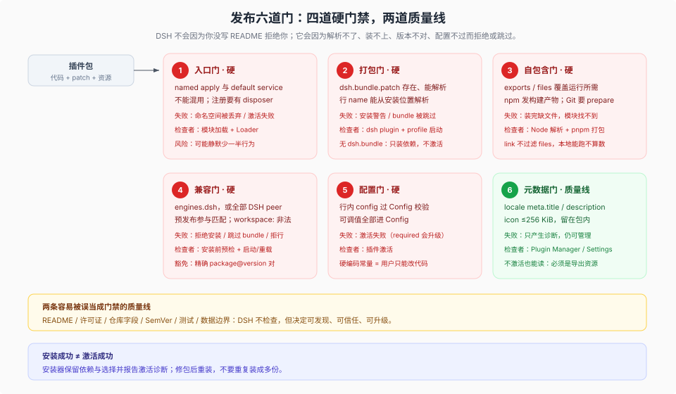

# 02 · 插件包的发布要求：六项检查，三种失败方式

## 一句话

DSH 真正会**拒绝、跳过或拒绝装载**的硬门禁只有四类：patch 存在且能解析、入口模块能被 Node 解析、`engines.dsh`（或 DSH peer）匹配、声明了 `Config` 时行内配置能过校验。另外两项检查不属于硬门禁：入口导出形式错了通常不会在安装时被拒绝，而是装载后坏掉；元数据错了只降级。六项检查合起来才是完整的发布面；README、许可证、测试是质量线。把这些失败方式混成“DSH 会拒绝”，是发布讨论里最常见的失真。



## 0. 先看全景

| # | 检查 | 检查什么 | 谁在检查 | 失败方式 |
|---|---|---|---|---|
| 1 | 入口形式 | named `apply` 或 default service class，不混用 | Loader / 模块加载 | **装载正确性**：命名空间被丢弃、`inject` 失效，通常不在安装时拒绝 |
| 2 | patch / 打包 | `dsh.bundle.patch` 存在且能解析 | `dsh plugin` / profile 启动 | **拒绝或跳过**：`not-bundle`、安装警告、`skippedBundles` |
| 3 | 自包含 | 入口与（声明 `dsh.client` 时的）`./client` 能解析；构建产物存在 | Node 解析 / `pnpm pack` | **装后坏**：模块找不到、tarball 缺文件 |
| 4 | 兼容 | `engines.dsh`，或全部 `@deepseek-ai/dsh*` peer 范围 | 安装预检 + 启动/重载 | **拒绝/跳过/拒行**；未改动的既有依赖只警告，启动仍拒绝 |
| 5 | 配置 | **声明了** `Config` 时，行内 `config` 能过校验 | 插件激活 | **拒绝/跳过行**：激活失败，随行的重要性升级 |
| 6 | 元数据 | locale、icon、description | 读 Display 元数据的消费者 | **只降级**：回退或诊断，插件仍可管理 |

图与上表按三种失败方式着色：**红 = 拒绝/跳过/拒行**（第 2、4、5 行），**黄 = 不拒绝但装后坏/不可用**（第 1、3 行），**绿 = 只降级**（第 6 行）。

“行的重要性”不是行上的字段，而是启动器的全局必需 id 集合。必需插件失败会让启动**丢弃已挂载的插件并以非零码退出**，这不是配置事务回滚；可选插件失败通常只警告，但它可能让必需的消费者无法激活，从而仍然启动失败（[app-boot README](../../packages/boot/app-boot/README.md)）。`dsh plugin add` 成功也不等于激活成功：插件管理器会保留依赖与选择，把激活诊断报出来。

## 1. 入口：装载正确性，不是安装门禁

DSH 对插件的最小定义是：一个导出 `apply` 函数的模块（JS 或构建后的 TS），框架加载时调用它并传入 `ctx`。服务型包则默认导出 service class。**两种形式不能混用**——混用时 Loader 会丢掉函数插件的命名空间，`inject` 等导出失效；这有事故记录（[postmortem 0001](../../docs/postmortem/0001-acp-default-export-drops-inject.md)）。

```ts
export const name = 'acme-expert'
export const inject = ['tools', 'systemPrompt']   // 可选
export const Config = Schema.object({ /* ... */ }) // 可选
export function apply(ctx: Context, config: Config) { /* ... */ }
```

关键点：

- **混用不会在安装时被拒绝。** 它通常在第一次访问未注入的服务时才崩，所以这是“装载正确性”要求，不是“DSH 会拒绝你发布”的门禁。
- 依赖的服务要么进 `inject`，要么用 `ctx.inject([...], ...)` 可选等待；不要直接读 `ctx.<service>` 赌它存在。可选服务用 `ctx.get(name)`。
- 每个注册都要有 disposer；用 `ctx.effect()` / `ctx.on()`，不要把清理留给“进程退出”。

## 2. patch：bundle 的身份证

### 2.1 最小 bundle

```json
{
  "name": "@acme/dsh-review-pack",
  "version": "0.1.0",
  "type": "module",
  "main": "index.js",
  "exports": { ".": "./index.js", "./package.json": "./package.json" },
  "files": ["index.js", "cordis.patch.yml"],
  "dsh": { "bundle": { "patch": "./cordis.patch.yml" } }
}
```

```yaml
- insert:
    - id: acme-review
      name: '@acme/dsh-review-pack'
```

- `patch` 是相对包根的路径；也可以是有序数组，启动器按顺序当一层应用。**patch 由启动器按包目录直接读取，不经过 `exports`。**
- 行 `name` 用包名（或子路径），不要用相对源码路径——安装后的代码在 profile 的 `node_modules` 里，相对路径会指错地方。
- `files` 是 `pnpm pack` / 发布时的裁剪清单：它决定 tarball 里有什么，安装时不再二次过滤；链接安装不打包，所以 `files` 不生效。patch 或入口漏掉会让装后不可用；locale/icon 漏掉只降级元数据。

### 2.2 覆盖与 id 稳定性

patch 可以按 `id` 覆盖前层（例如 `dsh-web-app` 覆盖 `dsh-base` 的行）。覆盖会替换整段 `config`，不是深合并；作者要重述想保留的每个字段（[publish.md](../../docs/user/develop/basic/publish.md)）。

由此产生两条发布纪律：

1. **行 id 一旦发布就当作 API。** 用户会在自己的 profile patch 里按 id 覆盖你；改名等于破坏用户配置。
2. **默认值要选用户大概率会保留的。** 用户覆盖你的行时不该被迫抄一整段配置；把可调项留给 `Config`，把默认值设合理。

### 2.3 一个包，多个入口

同一个包可以导出多个插件入口，每个入口一行，各自 `config`、各自启用。子路径插件（如 `@acme/pack/search`）不是包根：它不读 `package.json` 的 `icon` 与 `description`，显示元数据只能走自己的 `./search/locale/*.json` 与 `./search/icon`。这条差异在写元数据时最容易踩。

## 3. 自包含：发布物不能依赖你的工作区

DSH 的安装模型是“把包装进 profile 的依赖树”，不是“复制你的 repo”。因此：

- **npm 发布必须带构建产物**（`lib/` 或打包后的 `index.js`）。直接发 `src/*.ts`，用户装到的是 Node 不能直接执行的源码。
- **Git 安装拿到的是源码，不会自动构建。** 作者要提供自包含的 `prepare` 脚本（不假设旁边有 monorepo），用户还要在 profile 的 `pnpm-workspace.yaml` 里为该包开 `allowBuilds`；否则 pnpm 会拒绝执行构建脚本（[publish.md](../../docs/user/develop/basic/publish.md)）。仓库内对阈值有两种写法（`publish.md` 写 pnpm ≥10，plugin-manager README 与根 `packageManager` 写 pnpm 11）；以安装方的实际版本为准。
- **不要引用仓库内的 `workspace:*` 路径、`vendor/`、共享 tsconfig 或 sibling 包**。发布后这些都不存在。
- **代码型 bundle 的入口必须导出；`./client` 在声明 `dsh.client` 时必须导出。** patch 不走 `exports`；`locale/*.json`、`icon`、`package.json` 由元数据读取方**可选**解析，缺了只回退或产生诊断，不会让插件装不上（[package-meta.ts](../../packages/boot/app-boot/src/package-meta.ts)）。
- **校验真实打包结果**：`pnpm pack` 后看 tarball 里的文件列表，或 `npm publish --dry-run`。链接安装不会暴露 `files` 漏项；链接包若入口在 `lib/`，改 `src/` 仍需先构建。

## 4. 兼容：唯一的硬版本门

### 4.1 两种声明，一个判定

```json
{
  "engines": { "dsh": ">=0.2.0 <0.3.0", "node": ">=22.19" },
  "peerDependencies": {
    "@deepseek-ai/cordis": "^0.2.0",
    "@deepseek-ai/dsh-tools": "^0.2.0"
  }
}
```

判定顺序（[app-boot README](../../packages/boot/app-boot/README.md)）：

1. 有 `engines.dsh`：**只看它**，peer 范围被忽略。
2. 没有 `engines.dsh`：每个 `@deepseek-ai/dsh` 与 `@deepseek-ai/dsh-*` 的 peer 范围都必须匹配运行版本。
3. 两者都没有：不施加约束。

细节：

- 预发布版本参与范围匹配；`engines.dsh` 写精确的预发布版本是允许的。
- `workspace:` 协议在 `engines.dsh` 里非法；在 peer 里，`workspace:^`、`workspace:~`、`workspace:*` 都指运行中的 DSH 版本。
- 空范围、非法范围、非字符串 `engines.dsh`、非对象 `engines`、非字符串 peer 范围都算不兼容/畸形；非法范围不会被诊断成“语法错误”，只是不满足。
- 不满足时：安装预检（registry spec 用 `pnpm view`，本地目录读 `package.json`）在 pnpm 之前拒绝；`plugin_manager` 安装后会对改动的直接依赖再查一遍，不通过就恢复 `package.json` 与 `pnpm-lock.yaml`；兼容性拒绝还会重装恢复后的 lockfile，使 `node_modules` 回到原形状。启动时跳过 bundle 或在行级拒绝。注意 `dsh plugin add` 走 CLI 的 pnpm 路径，失败不保证回滚（见 03 篇）。

**一处证据冲突要说明。** `packages/util/package-manifest/README.md` 的 Known Limitations 与 `2026-09-10-public-package-manifest` 决策记录都写着“当前安装器与加载器不强制 `engines.dsh`”。这句话**对 `engines.dsh` 已过时**，只对 `dsh.manifestVersion` 成立。当前源码 `packages/boot/app-boot/src/plugin-compatibility.ts` 实现了 `engines.dsh` 优先、peer 回退的判定，`publish.md`、app-boot README 与 plugin-manager README 也都按“强制”描述。判定以源码与这三个产品文档为准，不要引用那两处旧结论。

### 4.2 共享实例：peer + dev 双写

凡是必须与宿主共享同一实例的 DSH 包（`cordis`、service 定义、被宿主注入的单例），要同时写进 `peerDependencies` 与 `devDependencies`：

- `peerDependencies` 告诉安装位置“这个实例由宿主提供”；
- `devDependencies` 让你的类型检查和独立测试能跑。

只在 `dependencies` 里写，会出现两份实例，`instanceof`、服务注册、事件命名空间都可能对不上。独立版本的三方库、无状态的工具库才放 `dependencies`（[publish.md](../../docs/user/develop/basic/publish.md)）。

### 4.3 `manifestVersion` 与豁免

- `dsh.manifestVersion: 1` 是 manifest 格式标识，与 npm 包版本、会话格式版本都无关。**它没有任何读取方**：仓库里只有类型声明与文档表格，安装器、加载器、plugin-manager 都不读它；写上是为了让格式演进有据可依（[package-manifest types.ts](../../packages/util/package-manifest/src/types.ts)）。
- 不兼容时可以用精确版本豁免：profile 的 `compatibility.json` 里把 `package-name@version` 映射到精确的 DSH 运行版本列表。豁免不继承：插件升级或 DSH 升级都要重新授权；授权时只能指名当前运行版本，撤销时可以清历史授权；授权前要提示崩溃与数据损坏风险（[plugin-manager README](../../packages/boot/plugin-manager/README.md)）。
- `compatibility.json` 畸形时**不会阻止启动**：读取方接受仍合法的记录，逐条报告被拒绝的记录，然后把文件当只读；授权/撤销会拒绝，要求用户手工修复。缺失文件等于没有豁免。

## 5. 配置：条件门，不是无条件门

**`Config` 是可选导出。** 没有声明 `Config` 的插件照样加载；只有声明后，行内 `config` 才必须通过校验，失败时按该行是必需还是可选处理。

```ts
export const Config = Schema.object({
  model: Schema.string().default('deepseek-chat'),
  maxRounds: Schema.natural().default(8),
  workspaceSubdir: Schema.string().default('.acme'),
})
```

把可调值放进 `Config` 是 DSH 主仓的贡献纪律（“No hardcoded tunables in plugins”），也是外部插件的质量线，不是安装门禁。它的实际价值：

- 用户只能通过 patch 覆盖你的 `config`；没有 Config 字段，他只能改你的代码。
- `--dump-config-schema` 与配置编辑器读取已声明的 Config schema；**`plugin_manager` 不生成 schema**，它只管 bundle / 行 / 安装。注意 `--dump-config-schema` 会 **import** 每个组合模块来读 schema，只对已经信任的插件运行。
- 覆盖是整段替换，不是深合并；Config 字段越少、默认值越稳，用户越不需要抄长配置。

## 6. 元数据：只降级，不拒绝

DSH 在**不执行插件代码**的前提下读取显示元数据：Plugin Manager、Settings、官方目录都靠它。来源有三层：

1. `locale/<language>.json` 里的 `meta.title` 与 `meta.description`；
2. `package.json` 的 `name` 与 `description`（缺省回退）；
3. `package.json` 的 `icon` 字段，或导出的 `<specifier>/icon`。

规则（[package-meta.ts](../../packages/boot/app-boot/src/package-meta.ts)）：

- 英文文件必须是 `locale/en.json`；其他语言文件与它同目录，文件名是语言 id。
- **这些资源都通过 `exports` 解析**：包根要导出 `./package.json`（否则标题回退成完整 specifier、描述为空），每个语言文件都要被 `./locale/*.json` 覆盖（漏一个可能让整段文字退化为只有 `error`），`./icon` 也要导出。
- 图标只能是 SVG、PNG、JPEG、WebP，≤256 KiB，必须留在包目录内；绝对路径、URL、指向包外的 symlink 都会被拒。
- 缺字段回退到包名与 `package.json.description`；没有图标就用面板默认图。
- **错误分两种**：图标读取失败会保留已解析的文字并附 `error`；locale 文件名/JSON 解析失败等外层错误只返回 `error`，不保留文字。两种都不会让插件不可管理。
- 官方目录更严：必须是公开的 `@deepseek-ai/dsh-*` bundle，英文与中文的 title/description 都要有，且必须有图标（[官方目录生成器](../../scripts/gen-official-bundle-catalog.ts)）。

最小例子：

```json
{ "meta": { "title": "Review Pack", "description": "Adds a review workflow and its tools." } }
```

```json
{
  "exports": {
    ".": "./index.js",
    "./locale/*.json": "./locale/*.json",
    "./icon": "./icon.svg",
    "./package.json": "./package.json"
  },
  "files": ["index.js", "cordis.patch.yml", "locale/*.json", "icon.svg"]
}
```

外部作者的三条实用建议：

- `package.json.description` 写“这个包贡献什么”，因为 `listBundles` 直接把它当 bundle 的一行说明；
- locale 里的 title/description 写“用户看到的名字与能力”，不要写营销口号；
- 图标自己画或使用可再分发许可证的素材，保留署名要求。DSH 官方插件另有 artwork 规范，外部插件不强制。

## 7. 文档、许可证、仓库字段：不是门禁，但决定可维护性

一个可维护的包至少要在 `package.json` 里有：

```json
{
  "description": "One sentence: what capability this bundle contributes.",
  "repository": { "type": "git", "url": "git+https://github.com/acme/dsh-review-pack.git", "directory": "." },
  "license": "MIT",
  "publishConfig": { "access": "public" }
}
```

README 建议按 DSH 自己的包 README 结构写，但不必抄它的全部栏目。开头一段 Summary（说明它贡献什么、何时用，不单列标题），然后六节：

1. **Install**：包名、最小安装命令、需要的 profile。
2. **What it contributes**：bundle 行、preset id、工具名、UI 位置。
3. **Configuration**：每个 Config 字段、默认值、会变的行为。
4. **Data**：读写哪些路径、属于 workspace 还是 home、升级时会不会动。
5. **Compatibility**：`engines.dsh`、已测试的 DSH 版本、已知限制。
6. **Uninstall**：移除后哪些数据保留、哪些需要手动清。

第 4、5 节是外部插件最容易缺、用户最需要的两节；第 2 节决定用户能不能一眼看出“装上后多了什么”。

## 8. 六项检查速查（完整四张表见 06 篇 §6）

### A · 会被拒绝 / 跳过 / 拒行的

- [ ] `package.json` 有 `dsh.bundle.patch`，路径存在且 YAML 能解析。
- [ ] 没有 `dsh.bundle` 的包不会被当作插件：要么补声明，要么只当普通依赖。
- [ ] patch 里每个 `name` 都能从安装位置解析到模块。
- [ ] `engines.dsh` 或全部 `@deepseek-ai/dsh*` peer 范围与目标 DSH 匹配。
- [ ] 声明了 `Config` 的行，其 `config` 能过校验。
- [ ] 安装后没有激活失败；失败时按行的重要性处理。

### B · 不会被拒绝，但装完会坏

- [ ] 入口只导出一种形式：named `apply` 或 default service class。
- [ ] npm 发布带构建产物；Git 安装有自包含 `prepare`。
- [ ] 入口导出可解析；声明 `dsh.client` 时 `./client` 可解析。
- [ ] `pnpm pack` 后的文件列表包含入口、patch 与运行所需资源。
- [ ] 链接包已构建入口文件，而不只是 `src/`。
- [ ] 每个注册都有 disposer；卸载后无残留。

### C · 质量线（不通过不会立刻报错，但会留下维护债）

- [ ] 可调值全部进 `Config`，没有硬编码常量。
- [ ] 行 id 稳定；覆盖行为文档化。
- [ ] README 有 Install / What it contributes / Configuration / Data / Compatibility / Uninstall。
- [ ] `locale/en.json`、`locale/zh.json` 有真实 title/description。
- [ ] 图标 ≤256 KiB、留在包内、有再分发许可。
- [ ] 语义化版本；破坏性变更升 minor/major 并写迁移说明。
- [ ] 不把数据写进包目录；不依赖绝对路径或 `~`。
- [ ] 有一条真实 composition 测试：从干净 profile 安装、激活、调用、卸载。

## 9. 常见失败模式

| 现象 | 根因 | 修法 |
|---|---|---|
| 装上了但没反应 | 包没有 `dsh.bundle`，或 patch 没插行 | 加 `dsh.bundle.patch`；确认行 `name` |
| `install_bundle` 直接回滚 | 包没有 `dsh.bundle`，服务端按 `not-bundle` 拒绝 | 补 bundle 声明；或改用 CLI 当普通依赖 |
| 启动报模块找不到 | 发布包缺入口文件，或 `./client` 没导出 | `pnpm pack` 看列表；补构建产物/导出 |
| 行为少了一半 | default 与 named export 混用 | 只保留一种形式 |
| 用户覆盖后你的默认值丢了 | 覆盖是整段替换 | 文档写明要重述的字段；减少必填项 |
| 升级后配置失效 | 行 id 或 Config 字段改名 | 把 id/字段当 API；写迁移说明 |
| 装完立刻失败但依赖还在 | 安装成功、激活失败 | 读激活诊断；修包后重装，不要重复装 |
| 本地能跑、发布不能跑 | link 不打包，`files` 漏项，源码未构建 | 用 `pnpm pack` + 干净 profile 验证 |

## 10. 结论

发布一个插件包，不是“把代码推到 npm”就完了。它是一组六项检查，但六项的失败方式不同：

- **会拒绝/跳过**：patch 解析、模块解析、版本匹配、已声明 Config 的校验；
- **不拒绝但会坏**：入口形式、构建产物、client 导出、链接包的构建状态；
- **只降级**：locale、图标、description。

把这三类分开，就不会把“我的 README 写得不好”误当成“DSH 不让我发布”，也不会把“入口形式混用”误当成“安装器会拦住我”。
