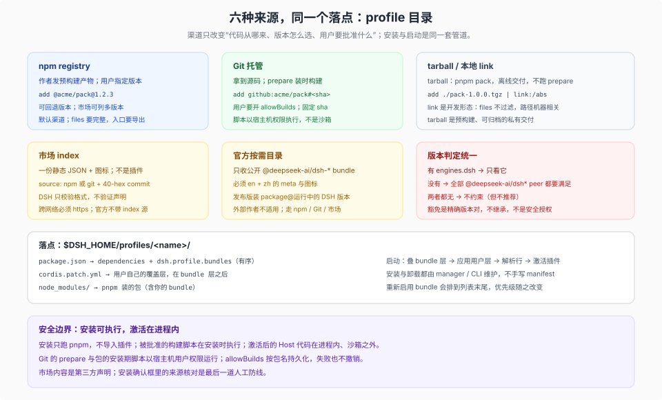

# 03 · 发行渠道与版本依赖：同一条落点，六种来源

## 一句话

不管从哪个安装渠道来，插件的落点都是**某个 profile 目录**（`package.json` 的依赖 + `cordis.patch.yml` 的层）。执行安装的是**该 profile 所属应用提供的包管理器**：普通 CLI/Web 用 profile 目录里的 pnpm，Desktop 等 application-owned profile 由壳提供的包管理器调用。渠道差异只改变“代码从哪来、版本怎么选、用户要批准什么”。版本依赖则统一由 `engines.dsh`（或回退的 DSH peer 范围）判定，安装预检、安装后与启动/重载各查一次。



## 1. 六种来源

| 渠道 | 作者要准备 | 用户怎么装 | 代码形态 | 版本选择 |
|---|---|---|---|---|
| npm registry | 构建产物 + 完整 manifest + 发布 | `dsh plugin add @acme/pack@1.2.3` | 预构建 | 精确版本或范围 |
| Git 托管 | 源码 + 自包含 `prepare` 脚本 | `dsh plugin add github:acme/pack#<sha>` | 源码，装时构建 | 提交 sha |
| tarball | `pnpm pack` 产物 | `dsh plugin add ./pack-1.0.0.tgz` | 预构建 | 包内 `package.json.version` |
| 本地目录 | 可运行的目录 | `dsh plugin add link:/abs/path` | 链接 checkout | 无（跟随工作区） |
| 市场 index | 静态 JSON + 图标 | Discover 页选版本安装 | 由 index 指向 npm 或 Git | 推荐：最高兼容非预发布版；也允许装任一列出版本 |
| 官方目录 | DSH 官方维护 | Plugins 页按需安装 | 官方预构建 | `package@<运行版本>` |

前四种是“spec”层面的差异；后两种是“发现层”的差异。前五种是外部作者可用的渠道；官方目录只收第一方 bundle，外部作者不可发布。安装最终都收敛到同一个包操作与同一套兼容性检查，只是执行器由应用提供。

## 2. npm：默认渠道

作者侧：

- `package.json` 完整：`name`、`version`、`type`、`exports`、`files`、`description`、`repository`、`license`、`engines.dsh`。
- 发布前构建好 `lib/` 或打包产物；`files` 覆盖它们。
- `publishConfig.access` 按 scope 设置；scoped 包默认私有，要显式 public。
- 版本用 SemVer；预发布用 `-rc.N` / `-alpha.N` 之类，DSH 的范围匹配会让预发布参与比较。

用户侧：

```sh
dsh plugin --profile web add @acme/dsh-review-pack@1.2.3
dsh plugin --profile web add @acme/dsh-review-pack        # 跟随 registry 的 latest
```

`dsh plugin` 首次使用会初始化一个 base-backed profile（`@deepseek-ai/dsh-base` 作为第一个 bundle），然后把包追加到 `dsh.profile.bundles`。发布版安装器对官方按需包使用 `saveExact: true`；外部包默认按 spec 记录。

一次安装的真实步骤（来自 `plugin-manager` 的 operations）：

1. 对命令里点名的 spec 做预检：本地路径读 `package.json`，registry spec 用 `pnpm view` 解析出版本与 `engines`/`peerDependencies`；不满足就在 pnpm 之前拒绝，什么都不下载。
2. 跑 pnpm；只有 exit 0 且没有被静默超时终止，才继续对账。
3. 对本次新增或改动的直接依赖做安装后兼容检查（含 bundle 的组件 manifest）。不满足就恢复 `package.json` 与 `pnpm-lock.yaml`，并重装恢复后的 lockfile（使 `node_modules` 回到原形状），退出 1。
4. 对声明了 `dsh.bundle.patch` 的新依赖：先解析每个 patch 文件，再把包名追加到 `dsh.profile.bundles`。patch 解析失败会报错，也不会成为一层。
5. 没有 `dsh.bundle` 的新依赖：`dsh plugin add` 只打警告、留作普通依赖；`plugin_manager.install_bundle` 以 `not-bundle` 拒绝并回滚。
6. 移除依赖时，从 bundle 列表里去掉对应名字；如果某个依赖已不再声明 bundle，也一并去掉。

所以“安装成功”至少包含“pnpm 成功 + 兼容检查通过 + patch 可解析 + bundle 已追加”四件事；缺一件都只算“包在磁盘上”。

补充四条边界：

- `plugin_manager.install_bundle` 一次只接受**一个**目标；一次安装改变多个直接依赖会报 `ambiguous-install`。CLI 的 `dsh plugin add a b` 可以多包。
- 只有 `plugin_manager` 会在失败时恢复 `package.json` 与 `pnpm-lock.yaml`；兼容性拒绝还会重装恢复后的 lockfile。`dsh plugin add` 的 pnpm 失败或 patch 解析失败**不保证回滚**。
- 空文件或只有注释的 patch 是非法的（顶层必须是数组）；没有行就写 `[]`。bundle 的空 patch 会让它进 `skippedBundles`，用户 patch 的空文件会让启动失败。
- 解析是**安装优先**的：profile 依赖不能遮蔽 in-box bundle 名（例如 `@deepseek-ai/dsh-base`）。

适用：稳定分发、需要版本回退、希望市场能列出多个版本。

## 3. Git：源码直装，必须处理构建

```sh
dsh plugin --profile web add github:acme/dsh-review-pack#3f9c2e1d8a4b6c0e7f1a2b3c4d5e6f708192a3b4
```

Git 安装拿到的是源码，不是构建产物。因此：

- **作者**必须提供自包含的 `prepare` 脚本，在安装后构建发布入口；不能假设旁边有 monorepo、共享 tsconfig 或 `vendor/`。
- **用户**必须在 profile 的 `pnpm-workspace.yaml` 里为该包开 `allowBuilds`，否则 pnpm 会拒绝执行脚本，第一次 `add` 失败（仓库内有两处写 pnpm ≥10：`publish.md` 与 CLI reference；plugin-manager README 写 pnpm 11；根 `packageManager` 是版本 pin，不是阈值。以安装方实际版本为准）。
- **固定提交 sha**，不要用分支名；否则一次 push 就能改变用户下次安装执行的代码。

`allowBuilds` 的本质是“允许这个包在安装时以宿主机用户权限执行代码”。它与 agent 的沙箱无关，也不受 profile 的权限模式保护。只对信任的源码开，并尽量用预构建渠道替代。

适用：内部插件、需要跟随源码、尚未发版；不适合作为面向不特定用户的默认渠道。

## 4. tarball：预构建、离线交付

```sh
pnpm pack
dsh plugin --profile web add ./acme-dsh-review-pack-1.0.0.tgz
```

tarball 是“没有 registry 也想发预构建产物”的最简形式：不运行 Git 的 `prepare`，版本由包内 manifest 决定。**但如果包声明了 `install` / `postinstall` 等生命周期脚本，pnpm 仍会拦下并要求 `allowBuilds`**；只有预构建且无生命周期脚本的 tarball 才完全不需要。适合私有交付、离线环境、审阅归档。

注意：tarball 在 `pnpm pack` 时已按 `files` 裁剪，安装不会再过滤；打包前要确认文件列表。

## 5. 本地 link：开发期形态，不是发布形态

```sh
dsh plugin --profile web add link:/abs/path/to/dsh-review-pack
# 或
dsh plugin --profile web add ./dsh-review-pack
```

- 链接安装直接指向 checkout，**`files` 不过滤**；源码改动在下一次启动/重组后反映。若入口在 `lib/`，改 `src/` 仍需先构建。
- 链接包保留自己的 `node_modules`；需要与宿主共享的 DSH 包要按 peer + dev 双写。
- 它适合开发与验收，不适合交付：路径是机器相关的，checkout 一移动就失效。

## 6. 市场：一个静态 JSON 目录

市场**源**不是 DSH 托管的服务，而是一份由第三方托管、DSH 只校验格式的 index 文件；`dsh-plugin-market` 是随 DSH 发布的实验服务，负责读取这些源。打开实验 bundle **Custom plugin markets** 后，Plugins 页出现 Discover，Creator 模式多一个只读的 `plugin_market` 工具。DSH 官方不带任何 index 源。

### 6.1 发布一份 index

- UTF-8 JSON，默认上限 128 MiB（`maxBytes` 可配），2xx 响应，不跟随重定向。
- 放在任意静态主机（GitHub Pages、GitLab Pages、对象存储 + https 都行）。
- 图标可以内联为 base64 `data:` URL（解码后 ≤32 KiB），也可以是 URL；相对图标相对 index URL 解析。
- 同源的 `http:` 图标允许；跨源绝对图标 URL 必须 `https:`。
- `format: 1`；`title` 必填；`plugins` 必填；每个 plugin 至少一个 version。
- `title` / `description` 等文本是 `LocalizedText`：字符串，或按小写语言 id 键控的对象；对象必须含 `en`。
- `metadata.categories` / `labels` / `sortKeys` 是声明表：插件引用未声明的 id 会让整份 index 被拒；插件 `name` 必须是合法 npm 名且在 index 内唯一。

最小片段：

```json
{
  "format": 1,
  "title": { "en": "Team plugins", "zh": "团队插件" },
  "plugins": [
    {
      "name": "@acme/dsh-review-pack",
      "title": "Review Pack",
      "description": "Adds a review workflow and its tools.",
      "icon": "icons/review.svg",
      "author": "Acme",
      "homepage": "https://github.com/acme/dsh-review-pack#readme",
      "repository": { "url": "https://github.com/acme/dsh-review-pack" },
      "versions": [
        { "version": "1.2.0", "publishTimestamp": 1790476800, "source": { "type": "npm" }, "engines": { "dsh": ">=0.2.0 <0.3.0" } },
        { "version": "1.1.0", "publishTimestamp": 1788000000, "source": { "type": "npm" } }
      ]
    }
  ]
}
```

版本字段的语义：

- `version`：精确 SemVer，插件内唯一；
- `publishTimestamp`：Unix 秒；
- `source`：`{ "type": "npm", "registry"?: url }` 或 `{ "type": "git", "url": https-url, "commit": 小写 40-hex, "path"?: dir }`；
- `engines.dsh`：该版本支持的 DSH 范围；缺省表示任意。

DSH 安装 npm 版本为 `name@version`（有 `registry` 就先问它）；Git 版本为 `git+<url>.git#<commit>`，子目录再加 `&path:/<path>`。

Discover 卡片默认推荐“与运行 DSH 兼容的最高非预发布版”；如果该插件没有任何非预发布版，就取最高兼容预发布版。任一列出版本也可以手动安装。index 里的 `engines.dsh` 只是展示/推荐用的声明；安装时会重新读包自身 manifest 的 `engines.dsh` 或 peer 范围，所以两者不一致时以包为准。

### 6.2 生成与校验

仓库带一个参考生成器：输入一行一个 npm 包名或 https Git 仓库 URL，输出 `index.json` 与 `icons/`。它只下载和读取文件，不安装、不执行代码，并把缓存放在 `.plugin-market-cache`。生成器从每个插件的最高版本取标题、描述、图标、作者、主页；对 npm 只列未废弃且声明 `dsh.bundle` 的版本；对 Git 找默认分支上的 bundle 包与 `vX.Y.Z` / `X.Y.Z` / `<name>@X.Y.Z` 标签。

DSH 会拒绝整份 index（只要有一条规则不满足），并在 **Manage index sources…** 下显示 JSON 路径；格式校验库是 `@deepseek-ai/dsh-plugin-market-index`。

### 6.3 市场不背书

市场由第三方写标题、描述、图标、作者与来源；DSH 只校验文件格式，不验证这些声明。`http:` 源可被网络路径上的任何人篡改，包括它列出的安装 spec，所以跨网络必须用 `https:`。安装前在确认框里核对来源。

## 7. 官方目录：只收第一方 bundle

官方按需目录由 DSH 自己维护，准入条件很硬：

- 必须是公开的 `@deepseek-ai/dsh-*` 包；
- 必须声明 `dsh.bundle`；
- 不能随 DSH 发行版一起安装（按需提供）；
- 必须有英文与中文的 `meta.title` / `meta.description`；
- 必须有图标；
- 由 `scripts/gen-official-bundle-catalog.ts` 生成，`verify-official-bundle-catalog` 校验新鲜度。

发布版安装器给出 `package@<运行中的 DSH 版本>`；源码 Web 与开发桌面改成 `link:<工作区包目录>`。外部作者不能通过这条渠道发布，只能走 npm / Git / 市场。

还要区分三个相邻状态：**optional** 是随 DSH 安装包一起装、默认关闭、永远不可移除的 bundle；**on-demand** 是公开目录里默认不装、按需从 registry 或源码 link 安装的条目；**official** 是 `listBundles` 的列表状态（`optional || 目录条目`），不是 `package.json` 字段。别把“在官方列表里”当成一种 manifest 声明。

## 8. 版本依赖：判定语义

### 8.1 谁在读

| 字段 | 读取方 | 时机 |
|---|---|---|
| `engines.dsh` | 安装前预检（registry spec 走 `pnpm view`，本地目录读 manifest）、bundle 加载、行准入 | 安装 / 启动 / 重载 |
| `@deepseek-ai/dsh*` peer | 同上，仅在没有 `engines.dsh` 时 | 同上 |
| `dsh.manifestVersion` | 仅类型声明，没有读取方 | 不作为版本门禁 |
| `compatibility.json` | 安装器 / 启动器 | 拒绝后的显式豁免 |

### 8.2 判定规则

- 有 `engines.dsh`：只看它，peer 被忽略。
- 无 `engines.dsh`：所有 DSH peer 范围都要满足。
- 两者都无：不约束。
- 预发布参与匹配；空范围、非法范围、`workspace:` 写进 `engines.dsh` 都算不满足。
- 拒绝信息按 `engines.dsh` 或 peer 包名列出未满足项；不满足的 bundle 会被跳过并记入 `skippedBundles`，不满足的行会被拒绝装载。还有一条温和路径：一次安装没有改动某个依赖、而它本来就不兼容时，安装只警告、不会因此失败；该依赖保持安装，但启动时仍会被拒绝，直到获得精确版本豁免。
- 安装前能查的（registry 名字、本地目录）在 pnpm 之前就拒绝；Git / tarball 要等 fetch 之后才能判断，`plugin_manager` 失败会恢复 manifest 与 lockfile（兼容性拒绝还会重装恢复后的 lockfile），CLI 路径不保证回滚。

### 8.3 豁免

不兼容时有且只有一条路：精确版本豁免。写入 profile 的 `compatibility.json`，键是 `package-name@version`，值是精确的 DSH 运行版本列表——一个键可以列多个精确运行时版本，但**授权时只能指名当前运行版本**，撤销时可以清历史授权。

- 不继承：插件升级、DSH 升级都要重新授权。
- 不改变依赖、不改变 bundle 选择、不改变 patch。
- 授权必须提示“可能崩溃或数据损坏”，并拿到用户对**这一对**版本的明确同意。
- 可以用 `plugin_manager` 的 `list_version_exemptions` / `set_version_exemption`，或 CLI 的 `version-exemptions` / `allow-version` / `revoke-version`。
- `compatibility.json` 畸形**不阻止启动**：合法记录仍生效，被拒记录逐条报告，文件转为只读；授权/撤销会拒绝，直到用户手工修复。缺失文件等于没有豁免。

对插件作者的含义：**不要靠豁免来支持一个不兼容的版本。** 豁免是用户的逃生门，不是作者的兼容策略。

### 8.4 范围怎么选

- 预稳定期（当前）优先 `>=0.2.0 <0.3.0` 这类“宽 minor、窄 major”的范围；不要精确钉死一个小版本，否则每次上游 RC 都逼你发版。
- 只声明你真正测过的下界；上界至少覆盖下一个 minor。
- 如果插件依赖某个在 RC 之间变过的 API，把范围收窄并在 README 写明“已测试到哪个 DSH 版本”。
- 升级 DSH 后先跑真实安装形状的测试，再放宽范围。

## 9. 安装成功之后

| 事件 | 结果 |
|---|---|
| 安装失败 | `plugin_manager` 恢复 manifest 与 lockfile；兼容性拒绝会重装恢复后的 lockfile，使 `node_modules` 回到原形状；普通 pnpm 失败可能残留已下载文件；CLI 的 pnpm/patch 失败不保证回滚 |
| 安装成功、激活失败 | 依赖与选择保留，插件不可用；修包后重装 |
| 无 HMR | 新包/新行要重启才生效 |
| 有 HMR | 配置变更即时重组；profile 目录或 linked 目标的已加载文件变化会在下一次重组时替换对应插件。`package.json`-only 变化不检测；替换失败不回滚；模块替换依赖 Node loader internals |
| 替换已安装包 | `already-installed` 只在 HMR 下、且 spec 相同（含 git/tarball 保存的 spec）时拒绝；不同的 git/tarball spec 可在包名确定后覆盖并重组；无 HMR 时覆盖后报 `restart-required` |
| 移除 bundle | 取消选择、停止其插件；包文件可能保留。startup-only profile 不能移除正在运行的 bundle（`stop-profile`），要停进程后用 CLI |
| 禁用 bundle | 只取消选择，依赖仍在；重新启用会排到列表末尾，可能改变优先级 |

最后一条容易被忽略：**重新启用会追加到 `dsh.profile.bundles` 末尾**，覆盖优先级随之改变。作者不应该依赖“我的层永远在前面”。

## 10. 安全边界

- **`dsh plugin add` 只调用包管理器；`plugin_manager.install_bundle` 默认在同一次调用里应用并激活，所以插件代码会在该操作中执行。** `dsh plugin add` 只是跑 pnpm，不 import 任何插件；npm/tarball 安装不带生命周期脚本时也不需要构建许可。真正的执行有两处：被批准的安装/构建脚本在安装时以宿主机用户权限运行；插件被激活后，Host 代码在进程内执行，与宿主同权。插件管理器的原文是“installed Host code executes in-process outside the workspace sandbox”。
- **`plugin_manager` 的每个动作需要 `danger-full-access` 或逐次审批**；审批不会改变会话的权限模式。低权限模式下 `ask` 会请求审批，`never`/拒绝/无审批通道则不会执行。
- **带 `install`/`postinstall` 的 tarball 仍需要 `allowBuilds`**；“npm/tarball 不需要构建许可”只适用于无生命周期脚本的预构建产物。
- **构建脚本以宿主机用户权限执行**，`allowBuilds` 的授权按包名持久化，另一次安装失败也不会撤销。
- **市场内容是第三方声明**，DSH 不验证作者、主页、来源的真实性。
- **桌面壳的包操作归壳所有**，即使你从浏览器点同一个 Plugins 页，执行的也是壳侧 pnpm（[FAQ 23](https://github.com/ethan-jiang-1/deepseek-harness/blob/ethan/_faq_on_digested/23_standalone-vs-web-release-forms/04_plugin-paths.md)）。
- **版本豁免不是安全授权**，它只跳过兼容性检查，不放宽任何权限。

## 11. 渠道选择建议

| 场景 | 建议 |
|---|---|
| 面向外部用户的正式发布 | npm + 市场 index；范围声明 `engines.dsh` |
| 内部团队、频繁迭代 | 私有 registry 或 Git + 固定 sha + `allowBuilds` |
| 离线/审计环境 | `pnpm pack` 的 tarball |
| 开发验收 | `link:` 本地目录 |
| 只想让别人发现你 | 市场 index 列出 npm / Git 版本，不托管代码 |
| 第一方能力 | 官方按需目录（外部作者不适用） |

## 12. 结论

渠道不是发布形态的分类，而是**代码来源与信任级别**的分类。DSH 对它们的要求是同一套：一个能解析的 spec、一个能装的包、一个能过的版本检查、一个能激活的 patch。作者的真正选择是：预构建还是源码、公开还是私有、固定版本还是跟随范围、让用户批准构建还是直接给成品。

版本依赖则是这份选择里最需要克制的地方：`engines.dsh` 是承诺，不是装饰；豁免是用户的逃生门，不是作者的兼容手段。
