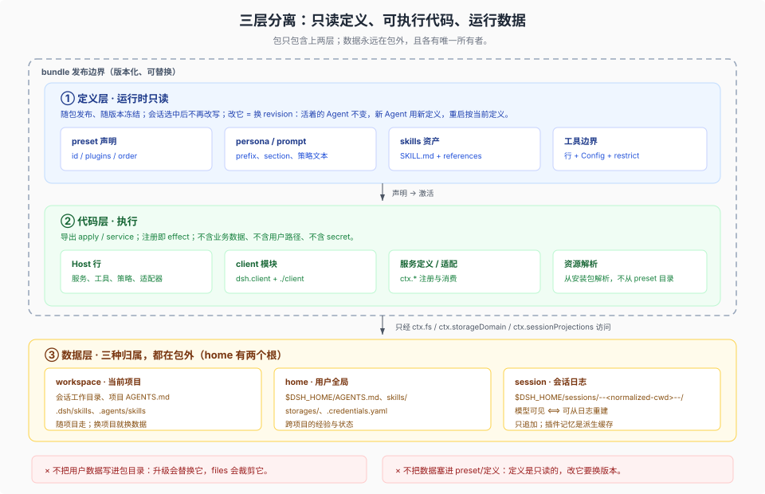

# 04 · 智能体的只读定义层：preset 不是程序，是一行声明

## 一句话

一个智能体 = **Host 共享的 agent loop** + **会话选中的 preset** + **该会话的数据**。preset 是 `@deepseek-ai/dsh-agent-preset` 的一行声明式配置，不是可执行程序，也不是目录；它的全部内容是“这个智能体由哪些子插件组成”。定义在运行时不被改写：registry 不写声明、不接受 YAML 回写；用户要改，只能通过更高优先级的 bundle/profile patch 覆盖它。



## 1. 为什么“插件往往是一个智能体”这个说法只对一半

对的一半：一个专家插件确实会交付“自己的工具、提示词、技能、隔离上下文”。这四样恰好是 preset 的职责。

不对的一半：preset 本身不是插件，也不是包。它是一行普通插件行：

```yaml
- id: preset-review
  name: '@deepseek-ai/dsh-agent-preset'
  config:
    id: review
    plugins:
      - id: persona
        name: '@deepseek-ai/dsh-persona'
      - id: tool-bash
        name: '@deepseek-ai/dsh-tool-bash'
```

`agent-preset` 包的 README 说得很直接：它“Define an Agent’s child plugins in ordinary Cordis YAML”；`agent-preset-registry` 则明确“Definitions are ordinary plugin rows; the registry neither scans directories nor accepts preset paths”。所以 preset 的发布单位仍然是 bundle patch，而不是一个新的可执行入口。

## 2. 机械形态：字段、行 id、出厂例子

`@deepseek-ai/dsh-agent-preset` 的 `config` 只有五个字段：

| 字段 | 必填 | 含义 |
|---|---|---|
| `id` | 是 | 稳定的 preset 标识；会话保存的是它 |
| `plugins` | 是 | 子插件行列表（Cordis entry list） |
| `name` | 否 | 展示名 |
| `description` | 否 | 展示描述 |
| `order` | 否 | 花名册排序 |

Loader 行 id 约定为 `preset-<id>`。出厂 Web 的四个预设就是 `@deepseek-ai/dsh-web-app` 的 `presets/*.patch.yml`，随该 bundle 的 `dsh.bundle.patch` 列表加载；`agent-preset-registry` 的 `default` 指向默认预设。

一个 preset 子行可以带自己的 `config`、`disabled`、`group`、`isolate`。`plugins` 是完整的子列表，不是增量——这点在“改预设”时是最大的坑。

## 3. “只读”到底指什么

“只读”不是说用户永远不能定制，而是说**已发布的声明不在原地被改写**。具体有五层：

1. **registry 不写声明。** `agent-preset-registry` 的 `read` 只把子列表渲染成 YAML 给客户端看；“nothing accepts YAML back”。它没有“保存 preset”的接口。
2. **Plugin Manager 的 preset 行只读。** 插件页可以启用/禁用普通行，但 agent-preset 行不在可切换范围；要改就装一个 bundle。
3. **新增或覆盖都是 bundle patch。** `insert` 一个 `@deepseek-ai/dsh-agent-preset` 行，或按 `preset-<id>` 覆盖已有一行，装进 profile 后生效。
4. **覆盖替换整段 `config`。** 覆盖者必须重述 `id`、`plugins` 和所有想保留的字段；未来上游对内置 preset 的改动不会自动合并进用户覆盖。
5. **会话按 id 绑定，按 revision 持有。** 声明激活时创建一个 registry 拥有的 scope 与 in-memory Loader tree；更新/移除声明会退休旧 revision。已有 Agent、子 Agent、临时历史读取继续持有引用，直到最后一个引用释放。进程重启后，恢复用的是该 id 的**当前定义**；定义缺失会被拒绝。

所以“改 preset 只影响新会话”这句话需要精确化：

- **同一进程内**：已有 Agent 继续用它启动时的 revision；新 Agent 用当前定义。
- **进程重启后**：所有会话都按当前定义恢复；旧 revision 不会跨进程保留。
- **覆盖后**：完整子列表被替换，不是差量合并。

## 4. Host 行与 preset 行怎么分工

`editing-cordis-compositions` skill 给的判据：

> Host plugins supply shared services: tools and prompt registries, the Agent loop, sessions, persistence, settings, sandbox policy, model routes, and subagent backends. Preset plugins contribute scoped tools, persona, prompt sections, and policies to those registries.

翻成一张表：

| 能力 | 放 Host 行 | 放 preset 行 |
|---|---|---|
| 共享服务、loop、持久化、沙箱策略、模型路由 | ✅ | ❌（会变成每个 agent 一份） |
| 工具、persona、prompt section、策略 | 可以（全局默认） | ✅（按 agent 定制） |
| 需要 `isolate` 的服务提供者 | 不建议 | ✅，但提供者与消费者必须同一 realm |
| 每个 agent 不同的工具集 | ❌ | ✅（`ctx.tools.restrict` 或不同子行） |
| 跨 agent 共享的状态 | ✅ | ❌（preset scope 会隔离） |

两条硬规则：

- **preset 里的服务提供者与其消费者必须放进同一个 `cordis:group` 隔离 realm。** entry 级 `isolate` 不会穿过 Agent 注册 scope 传播；组外的普通 lookup（包括 `agent.ctx`）仍然选中 Host realm。
- **scope 控制贡献与可见性，`isolate` 控制服务实例。** 不要把两者混用：只加 `isolate` 不加组，消费者可能找不到提供者；只加组不加 `isolate`，服务实例仍可能来自 Host。

激活时还会做审计：import 失败、缺服务、全局泄漏服务都会拒绝挂载；等待 Host 服务的行会保持挂载，并在 Host Loader 树稳定后重审，所以启动顺序不决定结果。失败的声明仍留在花名册上，但不能被新会话绑定。

## 5. 只读知识：skills 应该放哪

preset 挂技能的标准姿势是两行：`skill-filesystem`（发现本地技能根）+ `tool-skill`（把 catalog 与加载工具给模型）。出厂 `standard` preset 就是这两行。

技能有三种所有权，格式相同、归属不同：

| 所有权 | 位置 | 谁改 | 生命周期 |
|---|---|---|---|
| bundled | 包内 `assets/` 或 `skills/`，由 provider 注册 | 包作者 | 随包版本；升级替换 |
| project | `<projectRoot>/.dsh/skills`、`.agents/skills` | 项目维护者 | 随仓库；可提交 |
| user | `$DSH_HOME/skills`、`~/.agents/skills` | 用户 | 跨项目；升级 DSH 不动 |

bundled skill 的正文每次加载会重读文件，但文件属于包目录；改它既不持久（升级会替换），也不受支持。**用户可编辑的经验不要放包内**；包只发“与版本绑定的只读知识”，把可编辑入口留给项目或用户根。

同理，preset 的资产（模板、参考文件、脚本）应从**已安装的包**解析，而不是从 preset 目录或 `$DSH_HOME` 的某个约定路径解析。`editing-cordis-compositions` 的原话是“Resolve assets from installed packages rather than a preset directory”。

## 6. 为什么定义层必须稳定

Agent 的系统提示前缀、工具目录、prompt section 都是 KV cache 的一部分。preset 的 revision 一变，新 Agent 的前缀就变；已运行的 Agent 保持原样，所以不会在中途把缓存打穿。`agent-preset-registry` 的 Model Experience 写得很清楚：

> Existing Agents retain their plugins and prompts. New Agents build their prefixes from the current definition.

这条机制带来两个设计约束：

- **不要把频繁变化的东西放进 preset。** 例如“当前时间”“今天的任务列表”“用户的临时偏好”；这些应该走 `agent.inject()`、user context 或工具结果。
- **不要指望“改 preset 立刻影响正在跑的会话”。** 需要即时生效的行为应该做成 Host 服务或工具，通过事件/工具调用进入会话，而不是改定义。

## 7. 定义层不该出现什么

| 不该出现 | 为什么 | 应该放哪 |
|---|---|---|
| 用户数据、项目路径、绝对路径 | 定义随包分发，换机器就错 | Config / 运行时解析 / 数据层 |
| secret、token、API key | patch 会被复制、分享、进 git | 凭据服务或环境变量引用 |
| 每个用户不同的值 | preset 是共享定义 | 用户设置 / storage domain |
| 可变状态、缓存、计数器 | 定义是只读的，没有写回通道 | 会话事件 / storage domain / 投影 |
| 大段会频繁改的提示词 | 改一次就要发版、换 revision | prompt section + Config，或 skill |
| 平台/机器相关的分支 | 定义应在不同部署上同构 | `!!js` 条件仅用于配置/disabled，且要可解释 |

`!!js` 在 preset 里是允许的，但只应出现在插件配置或 `disabled` 上；Loader 在激活子插件时求值。不要把 `!!js` 当模板语言写业务逻辑。

## 8. 失败模式

| 现象 | 原因 | 处理 |
|---|---|---|
| 新会话看不到这个 preset | 声明行没装、id 重复、激活失败 | `plugin_manager list_plugins` 看 `preset-<id>` 行与诊断 |
| 会话恢复失败 | 日志里的 preset id 在当前定义里不存在 | 恢复该 bundle，或提供同 id 的定义 |
| 工具少了一半 | 覆盖时只写了增量 `plugins` | 覆盖必须重述完整子列表 |
| 服务找不到 | 提供者与消费者不在同一 `cordis:group` realm | 同组 + `isolate` |
| 升级后行为变了 | 覆盖没跟上上游的新子行 | 覆盖是快照，不是继承；升级时人工对齐 |
| 以为 preset 是沙箱 | 文档明确“Presets are not security sandboxes” | 安全边界靠 sandbox / approval / 工具面 |

## 9. 结论

把“智能体”当插件发布，发布的其实是一个 bundle 里的两类东西：

- **定义**：一行 `@deepseek-ai/dsh-agent-preset`，列出这个智能体的子插件；
- **只读资产**：这些子插件引用的包内技能、模板、prompt 资源。

定义不是程序，不在运行时被改写，不携带数据；它通过 id 被会话选择，通过 revision 被已有 Agent 持有，通过 bundle patch 被新增或覆盖。把这条线守住，智能体的“只读部分”和“数据部分”就不会长在一起。

下一篇把数据部分展开：workspace、`$DSH_HOME`、session 三种归属，各自的确切路径、写入者与升级行为。
