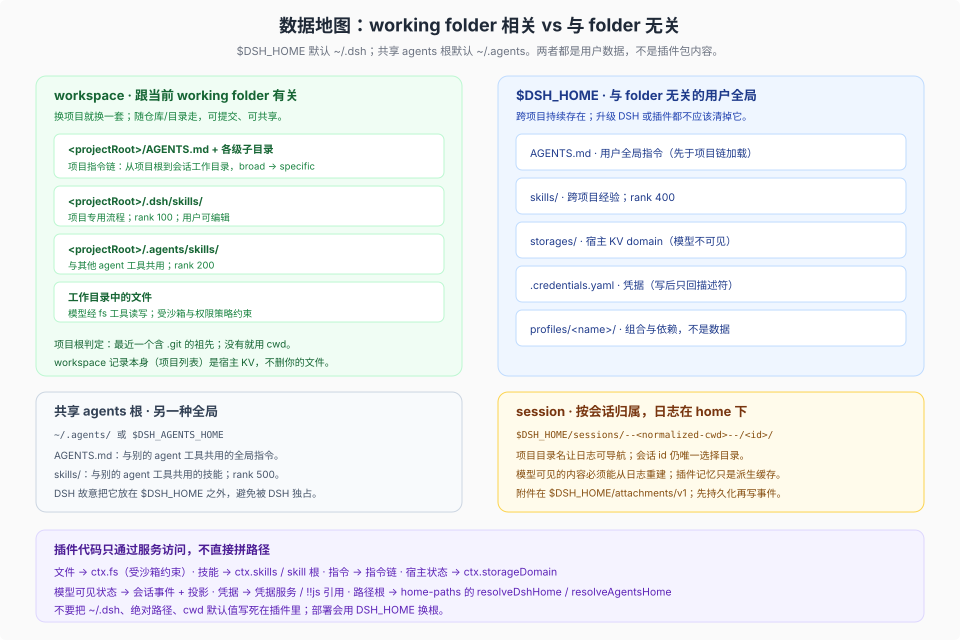

# 05 · 数据层：workspace、home、session 三种归属

## 一句话

数据不属于插件包。按归属粗分有三类：**workspace**（跟当前 working folder 有关）、**home**（与 folder 无关的用户全局）、**session**（一次会话的日志与投影）。这是导航用的粗分，不是排他分区：`home` 实际有两个根（`$DSH_HOME` 与共享的 `~/.agents`），`$DSH_HOME` 内部又按用途分给不同包。插件只能通过服务访问它们；把数据写进包目录、模块全局或自造事件类型，都会在升级、重放或多会话并发时坏掉。



## 1. 三种归属（home 有两个根）

| 归属 | 回答的问题 | 典型内容 | 生命周期 |
|---|---|---|---|
| workspace | 这个项目里有什么 | 工作目录文件、项目 `AGENTS.md`、项目技能 | 随仓库/目录；用户自己管理 |
| home | 这台机器上的用户是谁、积累了什么 | 全局指令、用户技能、宿主 KV、凭据、profile | 跨项目、跨会话；DSH 升级不应清掉 |
| session | 这一次对话发生了什么 | 会话日志、投影、附件引用、preset 选择 | 随会话；只追加 |

`$DSH_HOME` 默认 `~/.dsh`，可用环境变量覆盖；共享 agents 根默认 `~/.agents`，可用 `DSH_AGENTS_HOME` 覆盖。两者都是用户数据根，不是插件安装目录。**把 `~/.agents` 当成 `$DSH_HOME` 的子目录是错的**：DSH 故意把它放在外面，因为别的 agent 工具也读同一个 `AGENTS.md` 与 `skills/`。

## 2. workspace：跟当前 working folder 有关

### 2.1 工作目录不是进程 cwd

每个会话有一个**有效工作目录**，默认是启动目录，可通过 `working_directory` 工具或 SDK 修改。它是会话级状态，不是进程级状态；已有 shell 进程保留自己的目录。改目录会提交事件、进入 user context，并在下一次请求前重新加载适用的项目指令链。

所以插件里**不要用 `process.cwd()` 代表会话工作目录**。要读当前目录，用 `ctx.workingDirectory.get(session)` 或会话投影；要解析相对路径，以该目录为基准。

### 2.2 项目根与指令链

项目根是最近的、包含 `.git` 的祖先；没有就用当前目录。`dsh-agent-instructions` 加载的链是：

1. `$DSH_HOME/AGENTS.md`（用户全局）
2. `<agentsHome>/AGENTS.md`（共享全局）
3. 项目根到会话工作目录之间每一级的 `AGENTS.md` / `CLAUDE.md`（broad → specific）
4. 项目目录中同目录的 `AGENTS.local.md` / `CLAUDE.local.md`（可选附加；只有项目作用域有 local overlay，用户全局根没有）

内容是**durable baseline message**：第一次请求注入，之后由成功的 `read`/`write`/`edit` 触达更深目录、或 resume 时刷新；没有 watcher。有字节预算，超预算先丢更宽的整文件，再截断最具体的文件。它不是系统提示的一部分，而是普通的 sourced user message，所以能重放、压缩、恢复。

对插件作者的含义：项目级“经验”可以通过这条链进入模型，**不需要也不应该由插件自己拼一段提示词**。插件若要贡献全局规则，应该发布 skill 或让用户写 `AGENTS.md`，而不是在代码里硬编码一段“项目约定”。

### 2.3 项目级技能

| 根 | rank | 说明 |
|---|---|---|
| `<projectRoot>/.dsh/skills` | 100 | DSH 专用项目技能 |
| `<projectRoot>/.agents/skills` | 200 | 与其他 agent 工具共用 |

技能格式是 `<name>/SKILL.md` 或 `<name>.md`，必须在根目录顶层；嵌套 `**/SKILL.md` 故意不发现。frontmatter 必填 `name`（kebab-case）与 `description`，可选 `whenToUse`、`metadata`、`disable-model-invocation`、`user-invocable`。

项目技能的所有权是项目：可以提交、可以 review、可以随分支变化。插件不应该往这里写东西；如果插件需要“项目级状态”，应该让用户显式创建文件，或通过 storage domain 存宿主状态。

### 2.4 workspace 记录不是文件管理器

`dsh-workspace` 维护的是“项目列表 + 每个目录下的会话分组”，不是文件本身。删除一个 workspace 记录不会删除目录，也不会删除会话历史；隐藏会话只是不参与分组。插件不要把“删除项目”实现成“删目录”。

## 3. home：与 folder 无关的用户全局

`$DSH_HOME` 下与插件作者最相关的内容：

| 路径 | 内容 | 插件怎么用 |
|---|---|---|
| `AGENTS.md` | 用户全局指令 | 不要写；让用户维护 |
| `skills/` | 跨项目技能，rank 400 | 不要写；插件只读/发现 |
| `storages/` | 宿主 KV 后端根 | 通过 `ctx.storageDomain`，不直接读写文件 |
| `.credentials.yaml` | 凭据引用 | 通过凭据服务；不要读文件 |
| `sessions/` | 会话日志 | 通过 `ctx.sessionPersistence` |
| `attachments/v1/` | 附件 | 通过 attachment 服务 |
| `profiles/<name>/` | 组合、依赖与当前 profile 的 settings 写入 | 不要手写；用 `dsh plugin` / `plugin_manager` |
| `cache/` | 缓存 | 通过 `dshCachePath`，可清理 |
| `cordis.patch.yml` | 机器级覆盖层 | 用户维护；插件不应改 |

`profiles/<name>/cordis.patch.yml` 也承接 settings 写入：`Config` 中标了 `.volatile()` 的字段由设置页写回**当前 profile**，作用域是 profile，不是账号。换 profile 就是另一份配置；跨 profile 共享的偏好不能用 `Config`，要用 home 域单例。

共享 agents 根（`~/.agents`）是另一种全局：它的 `AGENTS.md` 与 `skills/` 故意放在 `$DSH_HOME` 之外，因为别的 agent 工具也读它。DSH 不会把它当成自己的私有目录。

### 3.1 经验（experience）放哪

“经验”不是第五种存储，它是“下一次会话要读到的文本或记录”。DSH 里没有内置的语义记忆服务；可选落点只有四种，按可审计性排序：

| 形态 | 位置 | 谁写 | 何时进入模型 | 适合 |
|---|---|---|---|---|
| 全局规则/偏好 | `$DSH_HOME/AGENTS.md`、`~/.agents/AGENTS.md` | 用户 | 每次会话的 baseline | 少而稳定的偏好 |
| 可复用流程 | `$DSH_HOME/skills/<name>/SKILL.md`、`~/.agents/skills` | 用户或经批准的工具 | 按需加载（catalog + skill 工具） | 多步骤经验、领域检查表 |
| 项目经验 | 项目 `AGENTS.md`、`.dsh/skills` | 项目维护者 | 进入该项目时 | 与仓库绑定的事实 |
| 结构化记忆 | `ctx.storageDomain` 或外部 memory MCP | 插件/服务 | 经工具显式读取 | 需要检索、去重、打分的记忆 |

四条纪律：

- **人能读的优先。** 规则与流程用 Markdown，用户可以 review、diff、删除；只有确实需要检索结构时才上 KV 或外部 memory。
- **不要静默追加全局指令。** 插件自动往 `$DSH_HOME/AGENTS.md` 里写内容，等于给未来所有会话注入提示词；必须是用户显式动作，或写到单独的可审阅文件。
- **项目经验进仓库，跨项目经验进 home。** 不要把项目事实写进 `$DSH_HOME`，也不要把个人偏好提交进项目。
- **记忆也要有生命周期。** 文件可以 review/prune；storage domain 要声明版本与清理策略；会话日志不是记忆，它只负责重放。

仓库里的 MCP memory 例子就是按这个原则放的：它把 JSONL 写到 `$HOME/.dsh-mcp-reference-memory.jsonl`，而不是装好的 npm 包目录（[mcp-memory 指南](https://github.com/deepseek-ai/deepseek-harness/blob/1f81c047fc48fa190a683e469daa699857e9afe8/docs/user/guide/mcp-memory.md)）。

### 3.2 宿主 KV：storage domain

`ctx.storageDomain` 提供 schema 校验、写后持久、变更事件的 KV domain。它适合“必须跨重启、但不属于会话日志”的宿主状态：工作区记录、会话旁路元数据、插件自己的配置缓存等。

关键语义：

- 读是同步的、来自已验证的内存；写先落盘再改内存，然后发 `domain/changed`。
- 每个 domain 有一条写链，`put` / `delete` / `update` 不交错。
- 打开时校验全部记录；坏记录会以 `invalid-record` 拒绝打开，而不是静默跳过。
- 它**不产生工具、prompt 或 session event**，所以模型看不见；要让模型看见，必须由消费者显式渲染。
- 句柄生命周期归调用方；插件卸载时用 `ctx.effect` 的 disposer `close()`。
- 没有自动迁移：存储里的 domain 版本与当前 spec 不一致会以 `version-mismatch` 拒绝打开；改 schema 要自己迁移数据。

这不是“插件的私有数据库”。domain 名字与 schema 是包级契约；多个消费者打开同一 domain 会得到 `already-open`。

**也没有“插件数据根”。** DSH 没有 `$DSH_HOME/plugins/<id>/` 的契约；`plugins/` 只是本机惯例。插件要么用 domain，要么自造目录，并自己负责路径、清理、迁移、卸载残留。domain 名是静态的，一个 Host 里一个名字只能打开一次；项目级切分靠记录键，不能按 workspace 建 domain。

## 4. session：一次会话的日志

### 4.1 日志是唯一真源

**对模型可见的会话内容而言**，日志是唯一真源：模型看到的任何东西都必须能从已提交的会话事件重建，fork、resume、replay、compaction 都从日志派生。插件内存里的状态只是派生缓存，进程一退就没了。这句不要外推成“所有数据都从日志派生”：workspace 记录、凭据、附件、技能文件都各自有自己的权威存储。

因此：

- 要让模型看见的状态 → 写成会话事件（优先用已有事件类型与投影），或在请求前通过 `agent.inject()` 注入并留下事件。
- 只是宿主自己用的状态 → storage domain。
- 事件类型是兼容契约：**第三方插件不要新增 `SessionEventMap` 类型，也不要 append 新 `type`。** 读取方只接受带 `ignorable: true` 的未知事件，而 live `Session.append()` 不能设置该标记，所以缺少声明插件的读取方会拒绝重开会话。`appendPluginRecord()` 的 `plugin:` 记录保留给 DSH 实验包，且会话格式迁移只尽力保留，不是第三方扩展点。要保存状态，用已有事件、`ctx.sessionProjections` 的纯函数 fold、`agent.inject()` 或 storage domain。内部代码若用 `@messageProjection` 改变派生消息，需要声明并注册 `SessionMessageProjection`；它是更强的契约，但不能让旧读取方安全理解一个新类型。
- 不要用 `session/event` 监听 + 全量重扫来维护状态；用 `ctx.sessionProjections` 的纯函数 fold，未变化时返回同一引用。

### 4.2 目录布局

```
$DSH_HOME/sessions/
  --<normalized-cwd>--/          # 可读的项目目录，或 _no-cwd/
    <encoded-id>/                # 会话自己的目录
      <generation files>         # 只追加的世代；默认 zstd，compression: 'none' 时为 JSONL
```

项目目录名让日志可导航；cwd 归一化后相同的会话共享项目目录，但会话 id 仍然唯一选择目录。历史格式以不可变世代保留，读取时迁移，写时发布后继，不覆盖源文件。日志**没有删除 API**：它会一直累积在 root 下，直到外部手动清理；插件不要把“归档会话”实现成删日志。

**这解释了“数据跟 working folder 有关”的一半**：日志物理上住在 home，但按会话创建时 `SessionHeader.cwd` 分组。这个目录名是**导航键，不是身份**：编码会替换分隔符并截断，故意有损；会话 id 才是身份。项目移动不会搬日志；改工作目录也不会把会话移到新项目目录或新 workspace——成员身份锚定原始 cwd。插件不应该依赖这个路径做业务逻辑。

### 4.3 附件

浏览器草稿可能只在内存；一旦 host 接受用户消息，图片会在写 user event 之前移动到 `$DSH_HOME/attachments/v1`。规则是“先持久化，再写事件”。插件处理附件时应通过 attachment 服务取引用，不要自己拼路径。

附件是内容寻址、不可变的；本地后端把对象放在 `$DSH_HOME/attachments/v1`，**保留所有对象，没有自动 GC**。删会话日志或删 workspace 记录不会回收附件，对象会变成孤儿。消费者不得解析附件 id 或据此拼路径；要交付用户文件，写工作区文件再 `present`，不要把附件库当项目文件库。

spill 不是附件：`ctx.spillStore` 把大段文本放到 OS 临时目录，启动后一次性清理（`cleanupPeriodDays`）；它是模型/工具的上下文管理产物，不是用户交付物。`present` 只记路径，不复制字节——用户要打开、编辑、带走的东西应写工作区文件。

## 5. 八条数据规则

**R1 · 包目录不是数据目录。** 安装与升级是 remove + install，包目录会被替换；`files` 会裁剪；link 安装又直接指向 checkout。写进包目录的用户数据没有持久性契约。

**R2 · 一个事实一个家。** 项目事实放 workspace，用户全局事实放 home，会话事实放 session。不要为了“方便”在三处各存一份。

**R3 · 模型可见 ⟺ 可从日志重建。** 任何进入模型请求的东西都必须能从已提交事件重建；否则 fork/replay 会得到不同结果。

**R4 · 不要新增 session event 类型。** 用已有事件、`ctx.sessionProjections`、`agent.inject()` 或 storage。第三方新增 `type` 会让缺少声明插件的读取方拒绝重开会话：未知事件只有在 `ignorable: true` 时才会被接受，而 live `Session.append()` 不能设置该标记。`plugin:` 记录只限 DSH 实验包，不是通用扩展点；`@messageProjection` 是内部更强契约，不是第三方的安全替代。

**R5 · 宿主状态用 storage domain，不用模块全局。** 模块级 `Map`、`globalThis`、`Symbol.for` 都隐藏了所有者；多会话、多 profile、HMR 下会串。

**R6 · 路径必须显式。** 用 `resolveDshHome()` / `resolveAgentsHome()` / `ctx.workingDirectory.get(session)`，不要把 `~/.dsh`、`process.cwd()` 或绝对路径写死。部署会用 `DSH_HOME` 或 `DSH_AGENTS_HOME` 换根。

**R7 · 经验放技能根或 AGENTS.md，不放包。** 包只发只读的、与版本绑定的知识；可编辑经验属于项目或用户。

**R8 · secret 走凭据，不进 patch、locale、README 或会话文本。** 配置里只放引用（如 `apiKeyEnv`），每次操作重新解析，不要跨操作缓存；`!!js` 引用既有凭据可以，复制明文不行。凭据文件按权限管理，不是隔离边界——agent 的工具进程以你的 OS 用户运行。

## 6. 选路径的决策树

```text
这份数据是模型必须看见的吗？
├── 是 → 它属于这次会话 → 写成会话事件/投影，或经 agent.inject 注入
└── 否 → 它需要跨重启吗？
    ├── 否 → 内存缓存即可，但要有所有者与清理
    └── 是 → 它跟当前项目绑定吗？
        ├── 是 → 用户可见的项目文件（workspace），或项目级技能
        └── 否 → 宿主 KV domain（home），或用户级技能/AGENTS.md
```

再问两个问题：

- **换一台机器还要吗？** 要 → home；不要 → workspace 或 session。
- **升级插件后还要吗？** 要 → 绝不能放包目录；不要 → 也不要放包目录，放缓存并声明可清理。

## 7. 生命周期：什么会动，什么不会

| 操作 | workspace 文件 | home 数据 | session 日志 | 包目录 |
|---|---|---|---|---|
| DSH 升级 | 不动 | 不动 | 可能读旧格式并写后继世代 | 替换 |
| 插件升级 | 不动 | 不动 | 不动 | 替换；有 HMR 时下一次重组替换已加载模块，无 HMR 时需重启 |
| 移除 bundle | 不动 | 不动 | 不动 | 从 profile 依赖中移除；下载缓存可能残留 |
| 禁用 bundle | 不动 | 不动 | 不动 | 依赖仍在，只是不选层 |
| 项目移动/改名 | 路径变 | 不动 | 仍在旧 cwd 的项目目录下 | 不动 |
| 删除 workspace 记录 | **不删** | 不动 | 不删 | 不动 |
| 清理缓存 | 不动 | `cache/` 可删 | 不动 | 不动 |

结论：**包目录是唯一会被升级整体替换的位置，所以它不能放可变用户数据。** 其余三个位置各有明确的生命周期；插件要做的是选对位置，并把选择写进 README。只读资产可以随包发布，但它们不是用户数据。

## 8. 反模式

| 反模式 | 后果 | 正确做法 |
|---|---|---|
| 写 `import.meta.url` 旁边的 `data/` | 升级丢失；`files` 裁剪；多 profile 各一份 | storage domain 或 workspace 文件 |
| 模块级 `Map` 当会话缓存 | 多会话串；HMR 不清理；卸载泄漏 | 会话投影 / `ctx.effect` 清理 |
| `process.cwd()` 当会话目录 | `working_directory` 改了还读旧目录 | `ctx.workingDirectory.get(session)` |
| `join(os.homedir(), '.dsh')` | 忽略 `DSH_HOME`，多环境互相污染 | `resolveDshHome()` |
| 追加自定义 event 类型，或依赖 `plugin:` 记录 | 缺少声明插件的读取方可能拒绝重开；迁移只尽力保留 | 已有事件 + 投影 + `agent.inject` + storage |
| 只存 storage，不写事件 | 模型可见但不可重放；fork 不一致 | 事件优先，storage 只存宿主侧 |
| secret 写进 Config 默认值 | patch 被分享即泄漏 | 凭据引用 / 环境变量 |
| 用 `node:fs` 直接改 workspace | 绕过 fs 策略、沙箱与审计 | `ctx.fs` |
| 把 workspace 记录当文件管理器 | 删记录以为删了目录 | 明确“记录 ≠ 文件” |
| 把 `$DSH_HOME/plugins/<id>` 当插件数据根 | 没有契约、没有清理/迁移；卸载留垃圾 | `ctx.storageDomain`，或自造目录并写清清理说明 |
| 把 settings 当账号级配置 | 换 profile 就丢；用户以为“配一次全生效” | home 域单例，或明确只对当前 profile 生效 |
| 把附件库当项目文件库 | 附件不跟项目走、无 GC、用户找不到 | 工作区文件 + `present` |

## 9. 宿主代码与沙箱的边界

- **Host 插件在进程内执行，位于 workspace 沙箱之外。** 插件管理器明确写出这条边界；插件代码与宿主同权，能做 sandbox 之外的事。
- **沙箱只管文件效果，而且只管“改”。** `workspace-write` 只允许改会话工作区或平台临时目录；`read-only` 拒绝写入，仅保留 `/dev/null` 等必要 sink；`danger-full-access` 不限制修改。读、列目录、只读 watch 在所有模式下都按本地文件系统行为工作；网络与进程可见性也不在这个词汇表里。审批策略决定 `ask` 还是拒绝。
- **不要用宿主代码替模型绕过沙箱。** 如果插件替模型读写工作区文件，它应当走 `ctx.fs`，让策略、审计、观测事件都成立；否则用户以为沙箱在保护他，实际没有。
- **安装可以执行构建脚本，激活才执行插件代码。** 装包、跑构建脚本、激活 Host 代码都在沙箱之外；安装本身不 import 插件，但被批准的 `prepare`/`install`/`postinstall` 会以宿主机用户权限执行。这是“只装信任来源”的根本原因，不是文档措辞。

## 10. 结论

数据层的设计不是“把文件放哪”的偏好问题，而是所有权问题：

- **workspace** 属于项目，换项目就换一套；
- **home** 属于用户，跨项目积累经验与状态；
- **session** 属于这次对话，模型可见的东西必须能从日志重建。

插件包只发代码与只读定义；它通过服务访问这三种数据，并把“我读写什么、属于谁、升级后怎样”写进 README。做到这一点，“智能体代码”和“智能体数据”就自然分离了。

## 11. 证据

- Home 解析：[home-paths README](https://github.com/deepseek-ai/deepseek-harness/blob/1f81c047fc48fa190a683e469daa699857e9afe8/packages/util/home-paths/README.md)
- 技能根与来源：[skill-filesystem README](https://github.com/deepseek-ai/deepseek-harness/blob/1f81c047fc48fa190a683e469daa699857e9afe8/packages/skill/skill-filesystem/README.md)
- 指令链与预算：[agent-instructions README](https://github.com/deepseek-ai/deepseek-harness/blob/1f81c047fc48fa190a683e469daa699857e9afe8/packages/context/agent-instructions/README.md)
- 宿主 KV：[storage-domain README](https://github.com/deepseek-ai/deepseek-harness/blob/1f81c047fc48fa190a683e469daa699857e9afe8/packages/storage/storage-domain/README.md)
- settings 作用域：[settings README](https://github.com/deepseek-ai/deepseek-harness/blob/1f81c047fc48fa190a683e469daa699857e9afe8/packages/settings/settings/README.md)
- 会话日志布局：[session-persistence-jsonl README](https://github.com/deepseek-ai/deepseek-harness/blob/1f81c047fc48fa190a683e469daa699857e9afe8/packages/session/session-persistence-jsonl/README.md)
- 工作目录：[working-directory README](https://github.com/deepseek-ai/deepseek-harness/blob/1f81c047fc48fa190a683e469daa699857e9afe8/packages/session/working-directory/README.md)
- 工作区记录：[workspace README](https://github.com/deepseek-ai/deepseek-harness/blob/1f81c047fc48fa190a683e469daa699857e9afe8/packages/workspace/workspace/README.md)
- 附件保留：[attachment-local README](https://github.com/deepseek-ai/deepseek-harness/blob/1f81c047fc48fa190a683e469daa699857e9afe8/packages/attachment/attachment-local/README.md)
- spill：[spill-local README](https://github.com/deepseek-ai/deepseek-harness/blob/1f81c047fc48fa190a683e469daa699857e9afe8/packages/spill/spill-local/README.md)
- 凭据：[credentials-local README](https://github.com/deepseek-ai/deepseek-harness/blob/1f81c047fc48fa190a683e469daa699857e9afe8/packages/credentials/credentials-local/README.md)
- 默认根：[base cordis.patch.yml](https://github.com/deepseek-ai/deepseek-harness/blob/1f81c047fc48fa190a683e469daa699857e9afe8/packages/bundle/base/cordis.patch.yml)
- 插件状态规则：[practices.md](https://github.com/deepseek-ai/deepseek-harness/blob/1f81c047fc48fa190a683e469daa699857e9afe8/packages/preset/agent-preset/skills/cordis-plugin-development/references/practices.md)
