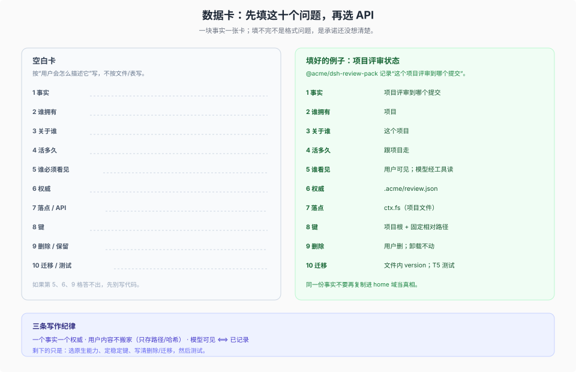
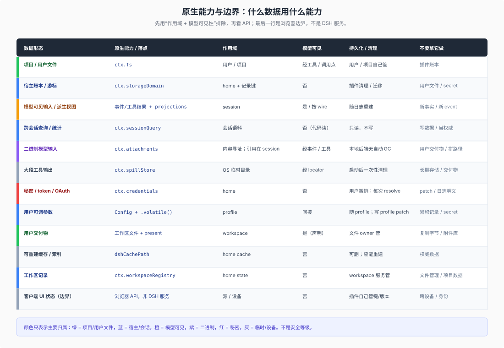
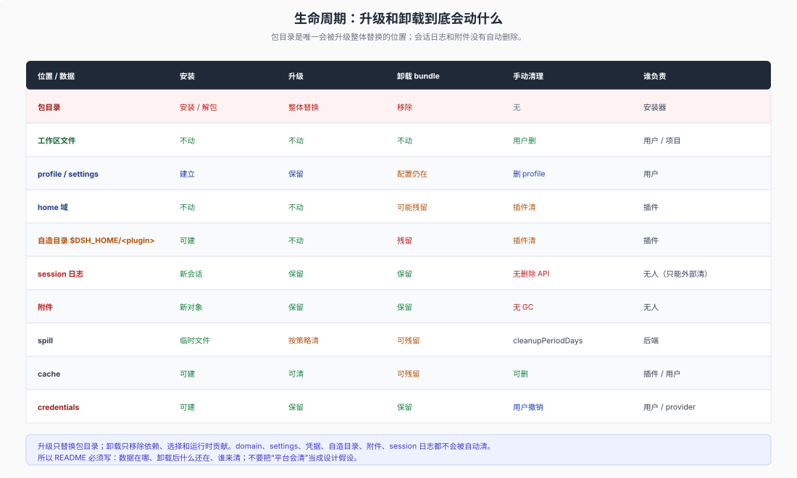

# 10 · 插件数据设计顾问：只用 DSH 原生能力，怎么安排数据

## 这一篇回答什么

[05 篇](./05-data-planes.md)回答“三种归属与路径”，[09 篇](./09-agent-data-cuts.md)回答“6+2 切法与状态判定”。这一篇把它们变成插件开发时的**操作顺序**：先写数据卡，再选原生能力，再定键、生命周期、迁移和测试。

约束只有一条：**只用 DSH 自己的结构，以及随 DSH 发行的原生插件能力。** 不靠第三方插件、外部数据库或自造平台。找不到合适的原生能力时，宁可缩小承诺，也不要偷偷造一个“插件数据库”。

本篇有四张图：数据卡、原生能力地图、落点决策树、生命周期。先看图建立直觉，再看文字和表；图和表说的是同一件事，只是给不同熟悉程度的读者。

读图前先对齐五个词：

| 词 | 一句话 |
|---|---|
| `ctx` | Host 传给插件的上下文；`ctx.fs`、`ctx.storageDomain` 是挂在它上面的服务。 |
| bundle / plugin | bundle 是包；plugin 是包被 patch 行引用后的运行时实例。 |
| session | 一次对话；模型可见内容以会话日志为权威。 |
| workspace | 一条“项目登记记录”，不是目录本身。 |
| `$DSH_HOME` | 用户数据根（默认 `~/.dsh`）；`~/.agents` 是共享 agents 根。 |

## 1. 先写数据卡，不要先建表

数据卡是给“一块事实”写的，不是给“一个文件”写的。一块事实一张卡；填不完，说明还没想清楚。只读定义、代码、技能不是数据，走 D/C，不进这张卡。



| 字段 | 要回答的问题 | 例子 |
|---|---|---|
| **事实** | 一句话：它是什么？ | “这个项目上次评审到哪个提交” |
| **谁拥有** | 用户、项目、会话、插件，还是没人（派生）？ | 项目 |
| **关于谁** | 一次调用、这次会话、这个项目、这个人/这台机器，还是这个安装？ | 这个项目 |
| **活多久** | turn、session、project、profile、home，还是可重建？ | 跟项目走 |
| **谁必须看见** | 模型、用户、插件、浏览器，还是没人？ | 用户可见；模型经工具读 |
| **权威** | 冲突时谁说了算？ | 项目里的文件 |
| **落点 / API** | 用哪个原生能力？ | `ctx.fs` 写项目文件 |
| **键** | 怎么找到它？ | 项目根 + 固定相对路径 |
| **删除 / 保留** | 谁删、何时删、卸载后留什么？ | 用户删；卸载不动 |
| **迁移 / 测试** | 结构变了怎么办？怎么证明？ | 文件内 `version`；07 的 T5 |

三条写作纪律：

- **一个事实一个权威。** 同一份事实不要同时在项目文件和 home 域里都声称是真相；另一处只能是引用、哈希或可重建的索引。
- **用户内容不搬家。** 用户已有的文件留在原地，插件存路径 + 版本/哈希；不要复制进 `$DSH_HOME` 当真相。
- **模型可见 ⟺ 已记录。** 任何要进入模型请求的东西，必须能从会话日志重建；否则 fork/replay 会得到不同结果。

## 2. 原生能力地图

这张表是“什么数据用什么能力”的第一落点。更细的语义见 05/09 篇与 [reference](./reference.md)。



| 你要解决的问题 | 原生能力 | 权威 / 作用域 | 模型可见 | 持久化 / 清理 | 不要拿它做 |
|---|---|---|---|---|---|
| 读写项目或用户文件 | `ctx.fs` | 用户 / 项目；路径经 `resolve` 成不透明 target | 经工具/调用点 | 用户/项目自己管 | 插件账本、secret、模型可见历史 |
| 宿主结构化状态 | `ctx.storageDomain` | home + 记录键；`single` / `per-record` | 否 | 插件自己清理、迁移 | 用户文件、secret、模型可见状态 |
| 模型可见的会话状态 | `ctx.sessionProjections` | session；纯同步 fold，可重建 | 按 surface / wire | 框架驱动，随日志重建 | 新事实、宿主账本、secret |
| 跨会话读取/统计/搜索 | `ctx.sessionQuery` | 会话语料；live-preferred，只读 | 否（代码读取） | 只读，不写 | 写数据、当权威存储 |
| 二进制模型输入 | `ctx.attachments` | 内容寻址、不可变；引用在会话事件 | 经事件/工具 | 本地后端保留所有对象，无自动 GC | 用户交付物、按路径拼对象 |
| 大段工具输出/临时文本 | `ctx.spillStore` | 本地 provider 默认 OS 临时目录；locator 不透明 | 经 locator/工具 | 启动后一次性清理 | 长期数据、用户交付物 |
| 秘密、token、OAuth grant | `ctx.credentials` | home；引用/记录由 provider 管 | 否 | 用户撤销；每次操作重新解析 | 普通配置、日志、patch 明文 |
| 用户可调参数 | `Config` + `.volatile()` | profile；settings 写当前 profile 的 `cordis.patch.yml` | 间接（被插件使用） | 随 profile；不是账号 | 累积记录、大块内容、secret |
| 用户交付物 | 工作区文件 + `present` | workspace；只记路径 | 是（声明） | 文件归项目/用户 | 复制字节、私有 home、附件库 |
| 可重建缓存/索引 | `dshCachePath` / 派生域 | home cache 或派生域 | 否 | 可删、应能重建 | 权威数据、用户可见内容 |
| 工作区记录/会话分组 | `ctx.workspaceRegistry` | home state；id + canonical path | 否 | workspace 服务 | 文件管理、项目数据 |
| 浏览器纯 UI 状态（边界） | `localStorage` / `userData`（浏览器 API，不是 DSH 服务） | 源/设备；Host 看不到 | 否 | 插件自己管键/版本/清理 | 跨设备、模型可见、身份 |

最后一行不是 DSH 原生能力，而是浏览器/设备边界；列出来是因为插件最容易把它误当数据服务。读这张表的顺序：**先问“谁拥有、谁必须看见”，再看“持久化/清理”，最后才看 API 名字。** 反过来先挑 API，通常会把“项目文件”塞进 home 域，或把“插件账本”塞进会话事件。

表中的能力优先用 docs、核心包与稳定的随包插件；标了 experimental 的包可以读源码、借模式，但不要写进长期发布依赖。

## 3. 七步落点

1. **列事实。** 按“用户会怎么描述它”列，不按文件/表列。每一块事实写一张数据卡。
2. **定承诺。** 先选“不存（纯引用）/ 派生 / 项目文件 / home 账本 / profile 配置 / 秘密 / 临时”之一。承诺定了，API 才有唯一答案。
3. **定四坐标。** 谁拥有、关于谁、活多久、谁必须看见；四个答案不能互相矛盾。
4. **选原生能力。** 用第 2 节的表；如果没有一个能力同时满足权威、可见性和生命周期，拆成两块数据，不要硬塞。
5. **定键。** 用稳定标识；不要把路径、workspace id 或 `process.cwd()` 直接当长期键。见第 4 节。
6. **定生命周期。** 谁创建、谁更新、谁删除、卸载留什么；见第 6 节。没有平台 GC 的，自己写清理说明。
7. **定迁移与测试。** 版本、兼容读、一次性迁移、失败可见、旧数据保留；测试至少覆盖 07 篇的 T5 与 §8.4。


这张图是 09 篇五问的展开版：先排除用户交付物，再问模型可见性，并多出“用户可调参数 → Config”一支；提问顺序不同，结论一致。用户全局文件（`$DSH_HOME/AGENTS.md`、`skills/`、`~/.agents`）由用户维护，插件只读，不要走“用户可见 → 写文件”的分支。

第 2 步的“承诺”可以压成一张小表：

| 承诺 | 典型场景 | 原生落点 | 主要代价 |
|---|---|---|---|
| 不存 / 纯引用 | 读用户已有的文件、配置 | `ctx.fs` + 路径/哈希 | 原文件可能被改/删；不能“学习” |
| 派生 | 统计、用量、索引、检查点 | `ctx.sessionQuery` / `ctx.sessionProjections` | 不能存新事实；回填有成本 |
| 项目文件 | 项目记忆、检查表、报告 | `ctx.fs` | 仓库污染、手改、多人冲突 |
| home 账本 | 插件状态、游标、学到的索引 | `ctx.storageDomain` | 孤儿、换机器丢、用户看不见 |
| profile 配置 | 开关、阈值、默认值 | `Config` + `.volatile()` | 只对当前 profile 生效 |
| 秘密 | token、API key、OAuth | `ctx.credentials` | 需要 provider/用户授权 |
| 临时 | 大输出、可重建缓存 | `ctx.spillStore` / `dshCachePath` | 会被清掉，不能当权威 |

## 4. 作用域与键

**作用域先于存储。** 选错作用域，换什么 API 都别扭。

| 作用域 | 稳定标识 | 适合 | 坑 |
|---|---|---|---|
| session | `SessionId` | 这次对话的临时/派生状态 | 日志无删除 API；`header.cwd` 不可变，当前目录可改 |
| workspace | `WorkspaceId` + canonical path | 项目级记录、项目内文件 | `WorkspaceId` 是生成的 uuid，删了重加会换；长期键用路径哈希 |
| profile | profile 目录名 / entry id | settings、启用项、默认值 | 不是账号；换 profile 就是另一份 |
| home | `$DSH_HOME` | 跨项目账本、凭据、缓存 | 换机器/换 home 不跟随；多 Host 共享要自己处理可见性 |
| agents home | `~/.agents` | 与其他 agent 工具共享的技能/指令 | 是共享根，不是 DSH 私有目录 |
| device/browser | 源 / `userData` | 纯 UI 状态 | Host/模型看不到；换端口/浏览器就没了 |

**键的几条硬规则：**

- **会话：** 用 `SessionId`，不要用会话目录名或 `cwd` 当身份；目录名是导航键，编码有损。
- **项目：** 长期键用 canonical path 的哈希，带前缀（如 `w_`），不要直接用 `WorkspaceId`；`WorkspaceId` 只适合“这个工作区记录还在”的进程内/记录内引用。
- **域记录：** JSON 的 `per-record` 后端会把记录键变成文件路径的一段，必须匹配 `[a-zA-Z0-9_-]+`；路径、`session:<id>` 这类含 `/`、`:` 的键会被拒绝。其他后端不保证这个限制，但为了可移植，建议所有 `per-record` 键都按路径安全字符设计。`single` 布局的键是不透明字符串，可以用路径，但不要因此把路径当身份。
- **域本身：** 域名是静态的，一个 Host 里一个名字只能打开一次；不能按 workspace 动态建域，项目级切分靠记录键。
- **文件：** 用 `ctx.fs.resolve` 得到不透明 target；显示用 `displayPath`，比较用 `contains`；不要解析 `targetKey`。写入要带 `createIfAbsent` / `replaceIfVersion` 守卫时，处理 `FS_STALE_VERSION`，不要无条件覆盖。
- **路径：** 用 `ctx.workingDirectory.get(session)`、`resolveDshHome()`、`resolveAgentsHome()`；不要 `process.cwd()`、`os.homedir()`、硬编码 `~/.dsh`。

## 5. 权威与派生

- **一个事实一个家。** 项目事实、用户全局事实、会话事实各归一处；不要为了“方便”在三处各存一份。
- **副本只能是派生。** 索引、摘要、向量、检查点都可以有，但必须能从权威重建，并在权威变化时失效。
- **用户内容只存引用。** 路径 + 版本/哈希足够；不要把用户文件复制进 home 当真相。用户在原文件里改了，你的副本就开始撒谎。
- **模型可见必须可重建。** 优先用已有事件类型与 `ctx.sessionProjections`；需要在请求前注入时用 `agent.inject()` 并留下 sourced 事件。第三方不要新增 `SessionEventMap` 类型，也不要依赖 `plugin:` 记录。未知事件只有带 `ignorable: true` 才被读取方接受，而 live `Session.append()` 不能设置它。
- **缓存要能删。** 删掉缓存后行为不变，才能叫缓存；如果删了会丢用户数据，它其实是权威，应按权威设计。

## 6. 常见插件数据 archetype

| Archetype | 权威 | 原生落点 | 键 | 清理 / 注意 |
|---|---|---|---|---|
| 项目记忆 / 检查表 | 项目 | `ctx.fs` 写项目文件 | 固定相对路径 + 文件内 `version` | 用户删；不要复制进 home |
| 用户偏好 / 默认值 | profile | `Config` + `.volatile()` | entry id / 字段 | 换 profile 就是另一份；跨 profile 用 home 域 |
| 跨会话统计 / 用量 | 无（派生） | `ctx.sessionQuery` + projection | `SessionId` / 时间范围 | 不存新事实；删会话就跟着变 |
| 会话工作集 / 临时状态 | 会话 | 内存或 `ctx.sessionProjections` | `SessionId` | 模型可见就走事件；不要塞 storage domain |
| 宿主账本 / 游标 | 插件 | `ctx.storageDomain` | 稳定记录键（`w_` + 哈希） | 自己迁移/清理；模型不可见 |
| 索引 / 缓存 | 无（可重建） | `dshCachePath` 或派生域 | 源版本/哈希 | 可删；失效要能重建 |
| 秘密 / OAuth | 用户 / provider | `ctx.credentials` | `CredentialRef` / `CredentialKey` | 每次操作重新解析；不进日志 |
| 二进制模型输入 | 附件服务 | `ctx.attachments` | `AttachmentId`（不透明） | 无自动 GC；不解析 id、不拼路径 |
| 大段工具输出 | 临时 | `ctx.spillStore` | `SpillLocator`（不透明） | 会被清理；不是用户交付物 |
| 用户交付物 | 项目 / 用户 | 工作区文件 + `present` | 路径 | 只记路径；不复制字节 |
| 每项目运行时 | 插件 / 部署 | 没有原生 scope；记录键或自造目录 | 路径哈希 | 自造目录要写清理/迁移；不要伪造 per-workspace 域 |

**“每项目运行时”要特别小心。** DSH 没有“每个 workspace 一套插件实例/域”的原生 scope；`DomainSpec` 没有 scope 字段，插件实例是宿主级。需要项目级状态时，用记录键；需要真正隔离的运行时，属于自造架构，必须在 README 写清路径、并发、清理和信任边界。

## 7. 生命周期与迁移

**先接受四个空白：** 没有插件数据根、session 日志没有删除 API、附件不自动 GC、卸载没有统一清理契约。这四件事必须由作者回答。

| 数据 | 谁删 | 默认保留 | 作者要做什么 |
|---|---|---|---|
| 包目录（不是数据） | 安装器 | 升级替换 / 卸载移除 | 绝不放用户数据 |
| 项目文件 | 用户 / 项目 | 跟仓库 | 文件内版本；README 写归属 |
| home 域 | 插件 | 直到插件清理 | `close()`、迁移、卸载说明 |
| 自造目录 `$DSH_HOME/<plugin>` | 插件 | 直到插件清理 | 写路径、清理、迁移；卸载会残留 |
| profile settings | 用户 / profile | 跟 profile | 不把累积数据放这里 |
| session 日志 | 没有 API | 永久累积 | 不删、不改 header、不加新类型 |
| 附件 | 没有 GC | 永久 | 不承诺自动回收；不拼路径 |
| spill | 清理策略 | 临时 | 不当长期存储 |
| cache | 插件 / 用户 | 可删 | 可重建 |
| 凭据 | 用户 / provider | 直到撤销 | 只存引用；不进日志 |
| 客户端 UI | 插件 | 跟浏览器/设备 | 自己管键、版本、清理 |



**迁移的最小剧本：**

1. 先决定“兼容读”还是“换域/换文件”：只加可选字段 → 升版本 + `compatibleVersions`（仅 `per-record`）；改语义/拆表 → 新域名或新文件 + 一次性迁移。
2. 迁移代码放在插件启动时：读旧 → 写新 → 校验条数与抽样 → 保留旧数据一个版本周期。
3. 派生数据可用 `invalidRecords: 'backup-and-skip'`（仅 JSON `per-record`）；权威数据保持 fail loud。
4. 在隔离的 `DSH_HOME` 里演练：旧数据 → 新版本启动 → 读回 → 再降级一次，确认不会写坏旧文件。
5. 迁移要可重复、可校验、可中断；宁可 fail loud，也不要静默重建。
6. README 写清“升级时做什么、卸载后留什么”。

## 8. 并发、多会话与清理

- **每个域一条写链。** `put` / `delete` / `update` 不交错；但**没有跨进程串行化**：JSON 后端没有文件锁，SQLite 竞争写会 `busy`；`domain/changed` 只在本进程，多 Host 共享 home 要自己处理可见性。
- **会话日志有租约。** 不要直接改 header、不要物理删目录、不要用“重扫日志”维护状态；用投影的纯函数 fold。
- **文件写入用守卫。** `createIfAbsent` / `replaceIfVersion` 处理并发；`FS_STALE_VERSION` 要重新读后再决定，不要吞掉。
- **注册即效果。** domain 句柄、监听器、定时器都走 `ctx.effect()` 的 disposer；HMR/卸载时 `close()`。
- **不要模块级可变状态。** 多会话、多 profile、HMR 下会串；状态放投影、域或显式实例。
- **键里带会话/项目。** 同一插件被多个会话/项目使用时，记录键要能区分；不要用“当前目录”做隐式键。

## 9. 安全与隐私

- **Host 插件在进程内、沙箱之外执行。** 插件代码与宿主同权；沙箱只管文件效果，而且只管“改”。不要用宿主代码替模型绕过 `ctx.fs`。
- **秘密只存引用。** `CredentialRef` / `CredentialKey`；每次操作重新解析；不写进 patch、locale、README、日志、测试 fixture。文件权限挡其他用户，不挡同 uid 的模型工具。
- **少收集、明示 egress。** 只拿完成功能所需的数据；不要把用户内容默认上传到未声明的第三方；README 的 Data 节写清读写、归属、外发。
- **路径不可信。** 用户给的路径先 `lstat`/`resolve`，不要跟随可疑 symlink，不要把 `displayPath` 当本地绝对路径。
- **附件/spill 也是用户内容。** 它们可能含敏感数据；保留/外发/日志都要按用户内容处理。

## 10. 客户端状态是边界

如果插件有 Web client：

- **纯 UI 状态**（面板宽度、折叠、快捷键、最近选择）放 `localStorage` / `userData`；它按源/设备隔离，Host 和模型看不到。键名、版本、清理都由插件自己管。
- **session-derived 事实**（标题、模型、preset、统计）用 `ctx.sessionProjections` 的 wire view；不要复制到 `localStorage`，否则会造第二个权威。
- **不要把身份放客户端。** 用户/项目身份不要只存在浏览器；换端口、换浏览器、清站点数据就没了。

## 11. 测试与评审清单

设计完成后，逐条过：

- [ ] 每块事实都有数据卡；一张卡只有一个权威。
- [ ] 包目录没有写入；没有 `import.meta.url` 旁边的 `data/`。
- [ ] 模型可见的内容能从已有事件/投影重建；没有新增 event 类型或 `plugin:` 记录。
- [ ] 作用域和键稳定；没有用 `process.cwd()`、`os.homedir()`、`workspaceId` 当长期键。
- [ ] 域有版本与迁移方案；`per-record` 键合法；没有按 workspace 建域。
- [ ] 用户内容只存引用/哈希；没有把用户文件复制进 home 当真相。
- [ ] secret 走凭据引用；日志、patch、README、fixture 无明文。
- [ ] 附件/spill/交付物各归其位；没有把附件当项目文件库。
- [ ] settings 只当 profile 配置；没有把累积数据塞进 `Config`。
- [ ] 删除/保留/卸载写进 README；没有承诺平台会替你清。
- [ ] 并发：域写链、文件守卫、disposer、HMR 都覆盖；没有模块级可变状态。
- [ ] 测试覆盖 07 篇的 T5 与 §8.4；在隔离 `DSH_HOME` 里跑过升级/卸载。

## 12. 一个数据卡例子

插件：`@acme/dsh-review-pack`。它提供评审工具、检查表技能和一个 Web 卡片。

| 事实 | 谁拥有 / 关于谁 | 寿命 / 可见 | 权威 / 落点 | 键 | 删除 / 迁移 |
|---|---|---|---|---|---|
| 检查表定义 | 包作者 / 包 | 随包 / 只读 | 包内 `assets/skills`，provider 注册 | skill 名 | 随包版本 |
| 项目评审状态 | 项目 / 项目 | 跟仓库 / 用户+模型 | 项目文件 `.acme/review.json`，`ctx.fs` | 项目根 + 固定相对路径 | 用户删；文件内 `version` |
| 用户严重级别阈值 | 用户 / profile | 跟 profile / 间接 | `Config` + `.volatile()` | entry id / 字段 | 换 profile 另一份 |
| 跨项目使用统计 | 无 / 会话语料 | 可重建 / 否 | `ctx.sessionQuery` + projection | `SessionId` | 删会话跟着变 |
| 模型输入图片 | 会话 / 这次对话 | 不可变 / 模型 | `ctx.attachments` | `AttachmentId` | 无 GC；不拼路径 |
| 解析缓存 | 运行时 / 缓存 | 可删 / 否 | `dshCachePath('acme-review')` | 内容哈希 | 可清空 |
| API token | 用户 / home | 直到撤销 / 否 | `ctx.credentials` | `CredentialRef` | 用户撤销 |
| 评审报告 | 项目 / 项目 | 跟仓库 / 用户 | 工作区文件 + `present` | 路径 | 用户删 |

对应的 README `Data` 节可以写成：

```markdown
## Data
- Reads: project files through ctx.fs; project instructions through the agent-instructions chain.
- Writes: `<project>/.acme/review.json` (version 1); no writes to the package directory.
- Host state: none.
- Session: derives from existing tool/result events; no custom event type.
- Home: none; no global AGENTS.md or skill writes.
- Cache: `dshCachePath('acme-review')`, safe to delete.
- Secrets: credential reference `acme.token`; never logged or exported.
- Upgrade/uninstall: project files remain; cache may be cleared. The package directory is never a data location.
```

## 13. 结论

**数据设计不是“选一个 API”，而是先说清承诺，再让原生能力去兑现承诺。** 一块事实一张数据卡；一个事实一个权威；用户内容留在用户处；模型可见的必须可重建；删除/保留/迁移写进 README。

只用 DSH 原生能力时，最常见的正确落点是：项目文件走 `ctx.fs`，宿主账本走 `ctx.storageDomain`，模型可见派生走 `ctx.sessionProjections`，跨会话读走 `ctx.sessionQuery`，秘密走 `ctx.credentials`，临时大文本走 `ctx.spillStore`，交付物走工作区文件 + `present`。没有原生能力覆盖的，缩小承诺，或明确写成“自造目录 + 自己清理”，不要假装它是平台能力。

## 14. 证据

- 文件与工作目录：[filesystem.md](https://github.com/deepseek-ai/deepseek-harness/blob/1f81c047fc48fa190a683e469daa699857e9afe8/docs/subsystems/filesystem.md)、[working-directory README](https://github.com/deepseek-ai/deepseek-harness/blob/1f81c047fc48fa190a683e469daa699857e9afe8/packages/session/working-directory/README.md)
- 宿主 KV：[storage.md](https://github.com/deepseek-ai/deepseek-harness/blob/1f81c047fc48fa190a683e469daa699857e9afe8/docs/subsystems/storage.md)、[storage-domain README](https://github.com/deepseek-ai/deepseek-harness/blob/1f81c047fc48fa190a683e469daa699857e9afe8/packages/storage/storage-domain/README.md)
- 会话与投影：[persistence.md](https://github.com/deepseek-ai/deepseek-harness/blob/1f81c047fc48fa190a683e469daa699857e9afe8/docs/subsystems/persistence.md)、[session-projection.md](https://github.com/deepseek-ai/deepseek-harness/blob/1f81c047fc48fa190a683e469daa699857e9afe8/docs/subsystems/session-projection.md)
- 跨会话查询：[session-query.md](https://github.com/deepseek-ai/deepseek-harness/blob/1f81c047fc48fa190a683e469daa699857e9afe8/docs/subsystems/session-query.md)
- 附件与 spill：[attachment.md](https://github.com/deepseek-ai/deepseek-harness/blob/1f81c047fc48fa190a683e469daa699857e9afe8/docs/subsystems/attachment.md)、[spill.md](https://github.com/deepseek-ai/deepseek-harness/blob/1f81c047fc48fa190a683e469daa699857e9afe8/docs/subsystems/spill.md)
- 配置与凭据：[settings.md](https://github.com/deepseek-ai/deepseek-harness/blob/1f81c047fc48fa190a683e469daa699857e9afe8/docs/subsystems/settings.md)、[credentials.md](https://github.com/deepseek-ai/deepseek-harness/blob/1f81c047fc48fa190a683e469daa699857e9afe8/docs/subsystems/credentials.md)
- 交付物与工作区：[deliverables.md](https://github.com/deepseek-ai/deepseek-harness/blob/1f81c047fc48fa190a683e469daa699857e9afe8/docs/subsystems/deliverables.md)、[workspace.md](https://github.com/deepseek-ai/deepseek-harness/blob/1f81c047fc48fa190a683e469daa699857e9afe8/docs/subsystems/workspace.md)
- 同目录：[05 的路径表](./05-data-planes.md)、[07 的 T5/§8.4](./07-testing-and-acceptance.md)、[09 的 6+2 与五问](./09-agent-data-cuts.md)
