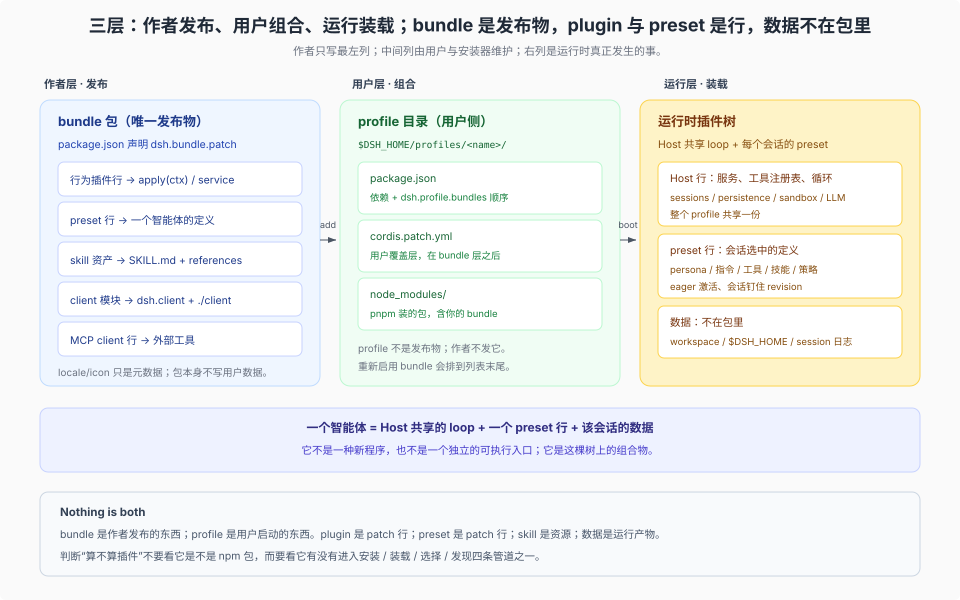

# Answer 24 · 发布的是 bundle，跑起来的是 plugin，选中的是 preset，数据三者都不是

## 一分钟结论

**DSH 作者侧会被自动选入 profile 并作为一层管理的发布物只有一种：bundle。** 它是一个 npm 包，`package.json` 的 `dsh.bundle.patch` 指向一份或多份 Cordis patch；用户把它装进某个 profile，profile 按 `dsh.profile.bundles` 的顺序叠层启动。普通 npm 包也能安装，但只是依赖，不会自动启用。profile 是用户侧的运行组合，不是作者发布的东西——产品文档的原话是 “A bundle is what you author and distribute; a profile is what a user boots... Nothing is both.”（[publish.md](../../docs/user/develop/basic/publish.md)）

**bundle 里可以装两种代码形态与三种非代码贡献：**

| 贡献 | 在 bundle 里的形态 | 运行时身份 |
|---|---|---|
| 行为插件 | 导出 `apply(ctx)` 或 service class 的模块，被 patch 行 `name` 引用 | plugin |
| Web UI | `dsh.client` + `exports["./client"]`，由 Host Loader 中已启用的行挂载 | client module |
| 智能体定义 | `@deepseek-ai/dsh-agent-preset` 的一行 `config.plugins` | preset |
| 只读知识 | 包内 `SKILL.md` + `references/`，由 skill provider 行注册 | skill（bundled） |
| 外部工具 | 配置型 bundle 插入 `@deepseek-ai/dsh-mcp-client` 一行 | MCP tools |

**可变用户数据从来不在 bundle 里。** 只读资产（`SKILL.md`、`references/`、locale、icon、模板）可以随包发布；用户数据的主归属有三类：会话工作区（working folder）、`$DSH_HOME` 用户目录（外带共享的 `~/.agents`）、会话日志；另有 host state 平面与 cache、credentials 两个旁路，见 [09 篇](./09-agent-data-cuts.md)。插件要读写数据，必须通过 `ctx.fs`、`ctx.storageDomain`、`ctx.sessionProjections` 这些服务，并明确它是 workspace 相对还是 home 相对；不能写进包目录，也不能藏在模块全局变量里。

**DSH 会拒绝、跳过或拒绝装载的主要是四类：** patch 不可解析、入口模块解析不到、`engines.dsh`（或 DSH peer）不匹配、**声明了 `Config` 时**行内配置校验失败。入口形式混用通常不会在安装时拦住，而是装载后坏掉；元数据错了只降级。README、图标、测试、许可证、SemVer 纪律、数据边界都是质量线，不是门禁；但它们决定插件能否被发现、被信任、被升级。

## 一张图先分清三层

- **作者层**：写 bundle（包 + patch + 资源），不写 profile。
- **用户层**：profile 决定哪些 bundle、什么顺序；`cordis.patch.yml` 是用户自己的覆盖层。
- **运行层**：Loader 把 patch 叠成插件树；会话从 preset 里取自己那份只读定义；数据从 workspace、home、session 三个位置读。

## 三张判据表

### 表 A · 你要交付的东西，应该做成哪种形态

| 你想交付 | 做成 | 不要做成 |
|---|---|---|
| 新工具、服务、策略、模型适配 | plugin 包 + bundle patch 行 | 新可执行入口、独立 CLI |
| 一个专用智能体（人设 + 工具 + 技能） | bundle 里的 preset 声明行 + 子插件行 | 复制一份 Host、fork agent-loop |
| 只有流程知识、领域经验 | 包内 bundled skill；可编辑经验放 workspace/home 的 skill 根 | 塞进系统提示词的硬编码长文 |
| 只有外部工具连接 | 配置型 bundle（插 MCP client 行） | 自己写一个 MCP 协议实现 |
| 新 Web 面板 / 卡片 | `dsh.client` 模块 + Host Loader 中挂载该包的已启用行 | iframe 页面、替换应用根节点 |
| 只在本机试一下 | `--patch` overlay 或 `link:` 安装 | 当成正式发布形态 |

### 表 B · 一个“合格”插件包的六项检查

| 面 | DSH 会拒绝 / 跳过 | 不拒绝但会坏，或只是质量线 |
|---|---|---|
| 入口 | 入口模块必须能被解析 | 混用 named `apply` 与 default service 会丢命名空间、`inject` 失效 |
| patch / 打包 | patch 路径可读且能解析；无 `dsh.bundle` 不被当插件 | `files` 漏 patch/入口会装后坏；locale/icon 漏项只降级 |
| 自包含 | 入口、`./client`（声明 `dsh.client` 时）必须能解析 | 构建产物缺失、tarball 裁剪漏文件会装后坏 |
| 兼容 | `engines.dsh` 或全部 `@deepseek-ai/dsh*` peer 范围满足 | 声明 `manifestVersion: 1`、Node `engines` |
| 配置 | **只有声明了 `Config`** 才校验行内 `config` | 所有可调值进 Config，不写死常量 |
| 元数据 | 无硬门禁 | 坏元数据回退或产生诊断，插件仍可管理 |

运维（安装/启用/移除结果可解释、README 写清边界）不占这六项检查，它属于质量线。

### 表 C · 数据放哪

| 数据 | 归属 | 位置 | 插件怎么碰 |
|---|---|---|---|
| 当前项目文件 | workspace | 会话工作目录及其项目根 | `ctx.fs` / 模型工具；只有“改”受沙箱限制 |
| 项目级经验 | workspace | `<projectRoot>/.dsh/skills`、`.agents/skills`、项目 `AGENTS.md` | skill 发现、指令链，不写进包 |
| 跨项目经验 | home | `$DSH_HOME/skills`、`$DSH_HOME/AGENTS.md`、`~/.agents/skills` | 用户维护；插件只读/注册 |
| 宿主结构化状态 | host state（物理在 home） | `$DSH_HOME/storages` 的 KV domain | `ctx.storageDomain`，模型不可见 |
| 模型可见历史 | session | `$DSH_HOME/sessions/--<normalized-cwd>--/<encoded-id>/` | 优先已有事件 + 投影；第三方不要新增 event 类型或 `plugin:` 记录 |
| 凭据 | credentials（物理在 home） | `$DSH_HOME/.credentials.yaml` 或环境变量 | 凭据服务 / `!!js` 引用；每次操作重新解析 |

## 九篇分读

| # | 分篇 | 一句话 |
|---|---|---|
| 01 | [可发布形态](./01-publishable-forms.md) | plugin 实例是行、bundle 是包；profile、preset、skill、client、MCP 各是什么角色 |
| 02 | [插件包的发布要求](./02-package-contract.md) | 六项检查、三种失败方式；哪些会被拒绝，哪些只是装后坏或降级 |
| 03 | [发行渠道与版本依赖](./03-channels-and-versions.md) | npm / Git / tarball / link / 市场 index / 官方目录；`engines.dsh`、peer 回退、豁免与升级 |
| 04 | [智能体的只读定义层](./04-readonly-agent-definition.md) | agent = Host loop + preset + session；定义为何运行时不被改写、改它为何只影响新 Agent |
| 05 | [数据层三种归属](./05-data-planes.md) | workspace / home / session 的边界、路径表、八条数据规则与反模式 |
| 06 | [骨架与检查表](./06-skeleton-and-checklists.md) | 可直接照抄的 repo 骨架、manifest/patch/preset 例子、发布前清单、旧写法迁移 |
| 07 | [测试与验收](./07-testing-and-acceptance.md) | T0–T8 测试矩阵；打包、契约、组合、真实安装、模型可见、数据隔离、兼容、UI、供应链；一小时/一天/一周预算 |
| 08 | [灵活度与生态](./08-packaging-flexibility-and-ecosystems.md) | 分发/组合/定义/资源四种性质、五个决策时点；Dify、Hugging Face、MCP、Claude Code、VS Code 对照 |
| 09 | [数据切法](./09-agent-data-cuts.md) | 六种切法；6+2 平面（定义/代码/workspace/home/session/host state + cache/credentials）；迁移清单 |

## 三个最容易被说错的点

**“把插件装成应用”是 FAQ 23 的问题，不是本篇的问题。** 应用发布物只有 Desktop 与 CLI/Web 两种；插件只是装进它们的某个 profile。两者不要混在一起谈。

**“preset 是一个目录”已经过时。** 旧版的 `$DSH_HOME/.agent-presets/<id>/agent.cordis.yml` 已经没人读；现在是 bundle patch 里的一行 `@deepseek-ai/dsh-agent-preset` 声明。FAQ 13 里“一个 `agent.cordis.yml` 目录”的写法要按 [06 篇的迁移节](./06-skeleton-and-checklists.md#9-旧写法迁移) 更正。

**“`dsh.compatibility` 版本矩阵”不是 DSH 字段。** DSH 读的是 `engines.dsh`，没有该字段时回退到全部 `@deepseek-ai/dsh*` peer 范围。第三方自造的 `dsh.compatibility` 不会被安装器或启动器读取。

## 快问快答

| 问题 | 短答 |
|---|---|
| 只发一个 preset，需要写代码吗？ | 不需要。配置型 bundle 只要有 `package.json` + patch；但用户要能装上、能看见，仍需要 `dsh.bundle.patch` 与（可选的）locale/icon。 |
| 插件能不能在 `$DSH_HOME` 下自己建目录存数据？ | 不要手写 profile 或 `node_modules`；宿主状态用 storage domain，用户可见经验放 skills/AGENTS.md。 |
| 要不要同时写 `engines.dsh` 和 DSH peer？ | `engines.dsh` 优先，写了就只看它；peer 仍用于共享实例与类型检查，共享包要 peer + dev 双写。 |
| 数据放包目录行不行？ | 不行。包目录会被升级整体替换，`files` 会裁剪，link 安装又指向工作区。 |
| 市场是官方商店吗？ | 不是。它是一份第三方静态 JSON，DSH 只校验格式，不验证作者、主页或来源。 |
| Desktop 和 Web 要分别发插件吗？ | 不用分别发；同一个 bundle 装进不同 profile。差异在安装入口与 `$DSH_HOME`，见 FAQ 23。 |
| 能不能不发布、只在本地用？ | 可以，`--patch` overlay 或 `link:` 安装；但它们不是正式发布形态。 |

## 五个被纠正的常见说法

写这套文档时，最容易顺着旧材料说错的五句，都以当前源码/产品文档为准改正了：

| 常见说法 | 实际 | 依据 |
|---|---|---|
| “`Config` 是发布硬门禁” | `Config` 是可选导出；没声明照样加载，声明了才校验行内 config。可调值进 Config 是质量线 | [02 篇 §5](./02-package-contract.md) |
| “`dsh.manifestVersion` 被强制” | 没有任何读取方；强制的是 `engines.dsh` / DSH peer | [02 篇 §4.3](./02-package-contract.md) |
| “安装插件就会执行插件代码” | `dsh plugin add` 只跑包管理器；`plugin_manager.install_bundle` 默认在同一次调用里应用并激活，所以插件代码会在该操作中执行。被批准的构建脚本在安装时执行，激活的 Host 代码在进程内执行 | [03 篇 §10](./03-channels-and-versions.md) |
| “HMR 不会替换已加载模块” | profile/linked 包的已加载文件变化会在下一次重组时替换对应插件；无 HMR 才需要重启 | [03 篇 §9](./03-channels-and-versions.md) |
| “数据只有三种归属” | 三种是粗分；`~/.agents` 是刻意的第四个根，`$DSH_HOME` 内部还按用途分给不同包 | [05 篇 §1](./05-data-planes.md) |

还有一句是旧写法而不是旧结论：`dsh.compatibility` 不是 DSH 字段；`agent.cordis.yml` 预设目录也没有读取方。迁移见 [06 篇 §9](./06-skeleton-and-checklists.md#9-旧写法迁移)。

## 证据与边界

仓库内主要证据：

- 发布模型：[publish.md](../../docs/user/develop/basic/publish.md)、[app-boot README 的 profiles 节](../../packages/boot/app-boot/README.md)、[plugin-manager README](../../packages/boot/plugin-manager/README.md)
- manifest 类型：[package-manifest types.ts](../../packages/util/package-manifest/src/types.ts)
- 元数据解析：[package-meta.ts](../../packages/boot/app-boot/src/package-meta.ts)、[plugin-market 指南](../../docs/user/guide/plugin-market.md)
- 智能体定义：[agent-preset README](../../packages/preset/agent-preset/README.md)、[editing-cordis-compositions skill](../../packages/preset/agent-preset/skills/editing-cordis-compositions/SKILL.md)、[standard preset](../../packages/bundle/web-app/presets/standard.patch.yml)
- 数据层：[skill-filesystem README](../../packages/skill/skill-filesystem/README.md)、[agent-instructions README](../../packages/context/agent-instructions/README.md)、[storage-domain README](../../packages/storage/storage-domain/README.md)、[session-persistence-jsonl README](../../packages/session/session-persistence-jsonl/README.md)、[home-paths README](../../packages/util/home-paths/README.md)
- 渠道：[plugin-market 指南](../../docs/user/guide/plugin-market.md)、[plugin-manager README 的版本兼容节](../../packages/boot/plugin-manager/README.md)

边界：

- 市场、npm、Git 托管与 Desktop 壳侧安装的具体行为，只按仓库文档与生成器阅读，未联网实测。
- 本机未安装 Desktop；涉及 Desktop 的差异一律引用 FAQ 23，不在本篇重新判断。
- “什么算好插件”的多数条目是质量判断而不是 DSH 强制；各篇会在表头标明。
- `package-manifest` README 与 2026-09-10 决策记录里“不强制 `engines.dsh`”的结论已过时；当前以 `plugin-compatibility.ts` 与 app-boot/plugin-manager/publish 三份产品文档为准。
