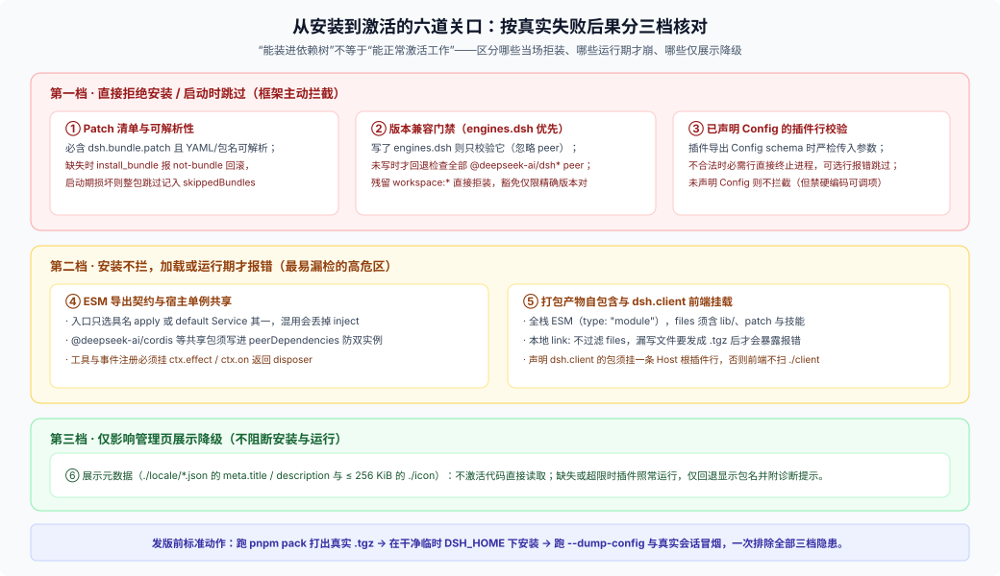
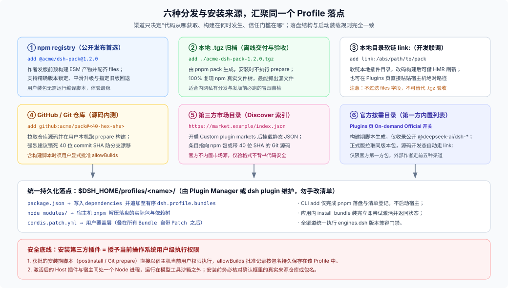

# 01 · 包形态、六项检查与分发渠道

本篇把“怎样才算一个合法、装上能跑的 DSH 包”拆成三件事讲透：`package.json` 里哪些字段真正被 DSH 读取、安装与启动时的六项检查各自怎么失败、以及六种分发渠道该怎么选。

---

## 一、`package.json` 里的 DSH 字段：哪些真有读取方？

公开清单类型定义在 [`packages/util/package-manifest/src/types.ts`](https://github.com/deepseek-ai/deepseek-harness/blob/master/packages/util/package-manifest/src/types.ts)。作为外部插件作者，你真正需要关心的是下面四个位置：

```json
{
  "name": "@acme/dsh-review-pack",
  "version": "1.0.0",
  "type": "module",
  "exports": {
    ".": { "types": "./lib/index.d.ts", "default": "./lib/index.js" },
    "./client": { "types": "./lib/client.d.ts", "default": "./lib/client.js" },
    "./locale/*.json": "./locale/*.json",
    "./icon": "./icon.svg",
    "./package.json": "./package.json"
  },
  "files": ["lib", "cordis.patch.yml", "assets/skills", "locale", "icon.svg"],
  "dsh": {
    "manifestVersion": 1,
    "bundle": {
      "patch": ["./cordis.patch.yml"]
    },
    "client": {
      "platform": "web",
      "inject": ["@deepseek-ai/dsh-client-ui-conversation"]
    }
  },
  "engines": {
    "dsh": ">=0.2.0 <0.3.0",
    "node": ">=22.19"
  },
  "peerDependencies": {
    "@deepseek-ai/cordis": "^0.2.0",
    "@deepseek-ai/dsh-tools": "^0.2.0"
  }
}
```

逐项核对真实行为：

1. **`dsh.bundle.patch`（必填，决定它是不是 Bundle）**：可以是单个相对路径字符串或按序叠加的路径数组。只要缺了 `dsh.bundle`：
   - 命令行 `dsh plugin --profile web add <pkg>` 只会把它装进 profile 的 `dependencies`，不会写进 `dsh.profile.bundles`，包里代码完全不会激活；
   - 应用内或工具层的 `install_bundle` 会把刚装上的依赖回滚掉，并返回 `not-bundle`。
2. **`dsh.client`（可选，前端界面扩展）**：声明 `platform`（如 `"web"`）、可选的 `inject` 客户端服务依赖、`immediately` 和 `external`，并把构建好的前端入口导出在 `./client`。注意一个极易踩的坑：**前端模块扫描器只扫描当前 Profile 中“已被 Host 插件行启用”的包**。如果你的包只出现在某个 `agent-preset` 的子插件列表里，或者只有 `dsh.client` 却没在 `cordis.patch.yml` 里挂一条 Host 行，前端根本不会加载 `./client`。
3. **`engines.dsh` 与 `peerDependencies`（版本兼容门禁）**：由 [`plugin-compatibility.ts`](https://github.com/deepseek-ai/deepseek-harness/blob/master/packages/boot/app-boot/src/plugin-compatibility.ts) 统一判定：
   - **只要写了 `engines.dsh`，就只校验 `engines.dsh`**（开启 `includePrerelease: true`，因此 `>=0.2.0 <0.3.0` 能匹配 `0.2.1-rc.3`；若残留未替换的 `workspace:*` 则直接判为不兼容），此时 `peerDependencies` 里的范围不会参与门禁；
   - **只有在没写 `engines.dsh` 时**，系统才会回退检查所有 `@deepseek-ai/dsh` 与 `@deepseek-ai/dsh-*` 的 `peerDependencies` 必须全部满足；
   - `@deepseek-ai/cordis` 不参与上述兼容门禁计算，但**所有要与宿主共享单例或服务的包（含 `@deepseek-ai/cordis` 和各 `@deepseek-ai/dsh-*` 服务定义包）都必须写进 `peerDependencies` 并在开发期写进 `devDependencies`**，切勿只塞进 `dependencies` 导致装出双份实例。
4. **哪些字段没有读取方或不属于插件作者**：
   - `dsh.manifestVersion: 1`：类型里有定义，当前运行时还没有强校验读取方，保留作前向兼容即可；
   - `dsh.profile`：属于用户 `$DSH_HOME/profiles/<name>/package.json` 的组合清单（见 [FAQ 26](../26_harness-distribution/answer.md)），普通插件包不要写；
   - `dsh.compatibility`：社区流传的自定义字段，DSH 源码从不读取。

---

## 二、六项检查：哪些当场拒绝，哪些装完才坏？

“能装上”和“能激活工作”在 DSH 里是分开的两步。下面这张图把六项检查按真实失败后果分成了红、黄、绿三档：



### 1. 红档：直接拒绝、整包跳过或单行拦截

- **Patch 结构与可解析性**：`dsh.bundle.patch` 指向的 YAML/JSON 文件必须存在且语法合法，patch 里引用的包名必须能从该 Bundle 的安装位置解析。若在 Profile 启动阶段发现某已选 Bundle 损坏或不兼容，`app-boot` 会跳过整个 Bundle 并将其列入 `skippedBundles` 诊断，其余 Bundle 按原顺序继续启动。
- **版本兼容与精确豁免**：安装预检和每次启动/热重载都会跑兼容判定。如果用户强行测试超范围插件，只能由用户在当前 profile 的 `compatibility.json` 里登记精确的 `<package>@<version> → [<runtimeVersion>]` 豁免对——只要插件或 DSH 任何一方升了一个小版本，豁免立即失效。它是用户的临时逃生门，绝不能当成作者偷懒不写兼容范围的借口。
- **声明了 `Config` 的插件行**：如果插件导出了 Cordis/Schema `Config`，激活时会严格校验 patch 传入的 `config`；校验失败时，必需行（如核心 loop / runtime）直接终止启动，普通可选行报错并跳过该行。如果插件压根没导出 `Config`，框架不会替你猜哪些字段合法——但把可调阈值硬编码在常量里违反 DSH 插件规范。

### 2. 黄档：安装一路绿灯，用起来才崩（最危险）

- **入口导出混用**：Cordis 插件入口要么具名导出 `export function apply(ctx, config)`（配 `export const inject`、`export const Config`），要么 `export default class MyService extends Service`。**绝对不要同时写 `export default` 和顶层具名 `export const inject`**——ESM 加载器走到 `default` 分支时会直接丢掉外层模块命名空间上的 `inject`，导致服务未就绪就裸跑，直到首次调用才抛空指针错误。同时，一切工具、命令、监听器注册都必须通过 `ctx.effect()` / `ctx.on()` 返回清理函数（disposer），否则热重载或停用插件时会留下僵尸注册。
- **打包自包含缺失**：DSH 要求全栈 ESM（`"type": "module"`）。发往 npm 或打成 `.tgz` 的包必须预构建好 JS/d.ts 产物，并确保 `package.json` 的 `files` 完整覆盖 `lib/`、patch 文件、`assets/skills/**`、`locale/*.json` 和图标。本地用 `link:` 调试时不会走 `files` 过滤，必须在发版前用 `pnpm pack` 检验真实产物。

### 3. 绿档：只降级、不阻断功能

- **多语言与图标元数据**（[`package-meta.ts`](https://github.com/deepseek-ai/deepseek-harness/blob/master/packages/boot/app-boot/src/package-meta.ts)）：Plugin Manager 在不激活插件代码的前提下，通过包 `exports` 读取 `./locale/<lang>.json`（含 `meta.title`、`meta.description`）和 `./icon`（SVG / PNG / JPEG / WebP，体积 ≤ 256 KiB，路径不得逃出包目录）。漏写或超限不会阻止插件运行，只会回退显示包名或 `package.json.description`，并在诊断里记一条提示。

---

## 三、六种分发渠道与安全边界

所有渠道的终点都是同一个目录：`$DSH_HOME/profiles/<name>/`（更新其 `package.json` 的 `dependencies` 与 `dsh.profile.bundles`，并把包放进 `node_modules/`）。渠道之间的区别只在于**代码怎么来、构建在哪跑、谁来把关**：



| 渠道 | 安装写法示例 | 构建发生地 | 适用场景与关键限制 |
|---|---|---|---|
| **npm registry** | `dsh plugin --profile web add @acme/pack@1.2.0` | 作者发版前预构建 | **外部公开发布首选**。支持精确版本选择、升级与回退；无需用户在装包时跑编译脚本。 |
| **Tarball（`.tgz`）** | `dsh plugin --profile web add ./acme-pack-1.2.0.tgz` | 作者打包前预构建 | **私有/离线交付与发版前验收标准形态**。安装时不跑 `prepare`，完全复现 npm 安装后的文件树。 |
| **本地 `link:`** | `dsh plugin --profile web add link:/abs/path/to/pack` | 本地开发实时构建 | **仅限作者本机联调**。支持文件变更后在下一次重组时 HMR 刷新，但不过滤 `files`、路径绑死本机。 |
| **Git 仓库** | `dsh plugin --profile web add github:acme/pack#<40位sha>` | 用户本机装包时跑 `prepare` | **未发 npm 的内测或源码直装**。强烈建议锁死完整 commit SHA；若含 `prepare` 构建，用户必须批准 `allowBuilds`（按包名持久化在 profile 中，即使安装失败也不会自动撤销）。 |
| **第三方市场索引** | 在设置页添加 `https://.../index.json` | 取决于条目指向 npm 还是 Git | 本质是一份静态 JSON 索引 + 图标（详见 [`plugin-market.md`](https://github.com/deepseek-ai/deepseek-harness/blob/master/docs/user/guide/plugin-market.md)）。跨网络必须走 HTTPS；Git 条目强制 40 位十六进制 SHA。**DSH 只校验索引格式，绝不验证作者身份或代码安全。** |
| **官方按需目录** | 应用内 Plugins 页官方列表直装 | 官方发版流水线预构建 | 由 [`gen-official-bundle-catalog.ts`](https://github.com/deepseek-ai/deepseek-harness/blob/master/scripts/gen-official-bundle-catalog.ts) 生成，只收录公开 `@deepseek-ai/dsh-*` 官方包（强制中英双语 meta 与合规图标），安装时对齐当前运行的 DSH 版本。外部团队不可用。 |

> **CLI 安装 vs 应用内安装的细微差别**：运行 `dsh plugin --profile <name> add` 时，CLI 只负责调用 pnpm 落盘依赖并更新 `package.json` 的 `dsh.profile.bundles`，当时并不会启动宿主导入插件代码（若目标 profile 正在后台运行，需重启或触发重载才生效）；而在运行中的 Web/Desktop 应用里点安装（或调用 `plugin_manager` 的 `install_bundle`），安装器会在装包后立即尝试应用 patch 并返回 `applied` / `restart-required` / `overridden` / `failed` 状态。
