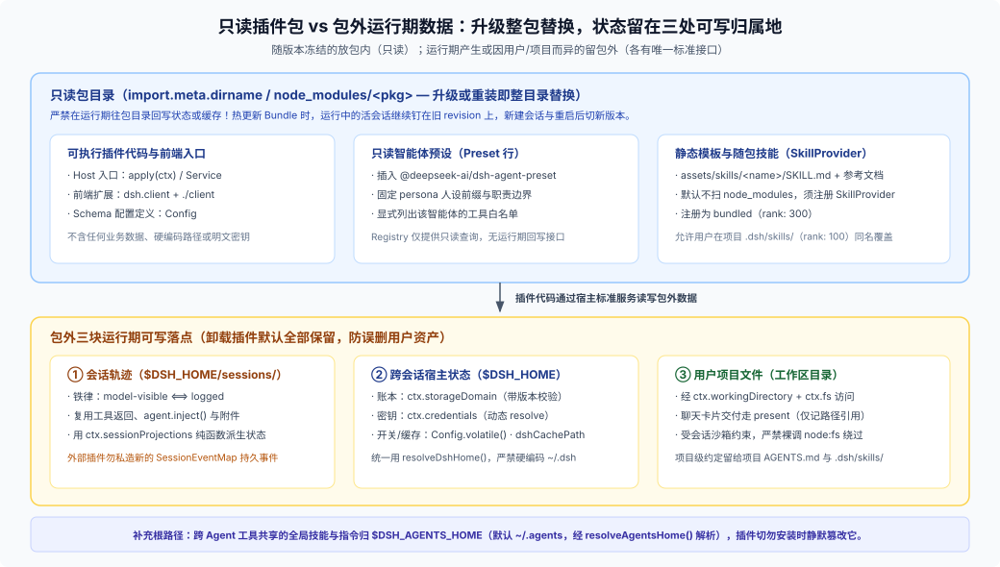

# 02 · 只读智能体定义：Preset、随包技能与指令链组装

写一个“领域专家智能体”并发布出去，最容易犯的架构错误就是把它当成一个“自带私有目录、边跑边改自身配置文件的独立程序”。在 DSH 里，智能体没有独立进程，它的定义层是完全只读的。



---

## 一、Preset 的本质：插在根上的一行声明

在当前架构中，一个可选智能体就是向 Loader 根部插入一条 `@deepseek-ai/dsh-agent-preset` 插件行（见 [`agent-preset` README](https://github.com/deepseek-ai/deepseek-harness/blob/master/packages/preset/agent-preset/README.md) 与官方 [`standard.patch.yml`](https://github.com/deepseek-ai/deepseek-harness/blob/master/packages/bundle/web-app/presets/standard.patch.yml)）：

```yaml
# presets/reviewer.patch.yml
- insert:
    - id: preset-reviewer
      name: '@deepseek-ai/dsh-agent-preset'
      config:
        id: reviewer
        name: Code Reviewer
        description: 结合团队检查单审查变更并输出结构化问题单
        order: 20
        plugins:
          - id: persona
            name: '@deepseek-ai/dsh-persona'
            config:
              prefix: 你是一名严格的代码审查专家，审查前先按需加载相关检查单技能。
          - id: tool-fs
            name: '@deepseek-ai/dsh-tool-fs'
          - id: skill-filesystem
            name: '@deepseek-ai/dsh-skill-filesystem'
          - id: tool-skill
            name: '@deepseek-ai/dsh-tool-skill'
          - id: reviewer-tool
            name: '@acme/dsh-review-pack/tool'
```

把握四个关键规则：

1. **子插件列表是白名单，不会自动继承 `standard`**：`config.plugins` 里写了什么，选中这个 preset 的会话就拥有什么工具和上下文注入器。你没写 `tool-bash`，它就没有命令执行工具；你想要标准文件读写或技能工具，就显式把 `@deepseek-ai/dsh-tool-fs`、`@deepseek-ai/dsh-tool-skill` 列出来，并在自己 Bundle 的 `dependencies` / `peerDependencies` 中声明好对应依赖。
2. **不要试图往别人的 `preset-standard.config.plugins` 里“局部追加一项”**：Loader 叠层时，普通插件行的 `config` 是**整块对象替换**，不是深层数组合并。想给现有 preset 增减工具，要么完整重述整份 `config`，要么新增一个独立的 `preset-<id>` 行。
3. **Host 行与 Preset 行的职责切分**（见 [`editing-cordis-compositions` SKILL](https://github.com/deepseek-ai/deepseek-harness/blob/master/packages/preset/agent-preset/skills/editing-cordis-compositions/SKILL.md)）：
   - **放 Host 根行**：跨会话共享的底层服务（如 `ctx.skills` 注册表、数据库连接池、后台守护任务、前端 `dsh.client` 宿主包挂载）；
   - **放 Preset `plugins` 子树**：按智能体身份定制的人设（`persona`）、专属模型工具（如 `@acme/dsh-review-pack/tool`）、特定技能源或权限收口。如果某组插件需要通过 Cordis `isolate` 隔离内部服务实例，务必把服务提供方与消费方包在同一个 `cordis:group` 内。
   - **注意非 Web Profile 的重复挂载**：`dsh-web-app` 默认禁用了 `dsh-base` 挂在根上的通用工具行，改由各个 preset 按需挂载；如果你的 Bundle 还要装进纯 `headless` 等直接在根上启用了 base 工具行的 profile，要先用 `dsh --profile <name> --dump-config` 检查，避免同一个工具在根上和 preset 里重复注册两遍。
4. **Revision 钉住机制（为什么升级不会搞崩正在跑的对话）**：[`agent-preset-registry`](https://github.com/deepseek-ai/deepseek-harness/blob/master/packages/preset/agent-preset-registry/README.md) 在启动时即刻挂载各 preset 的插件子树。当你在运行期升级 Bundle 或修改 patch 触发重载时：
   - **正在运行或已驻留内存的 Agent 实例继续钉在旧 revision 上**，工具集与提示词中途不变；
   - **新创建的会话**立即绑定最新 revision；
   - **进程重启后恢复历史会话**时，按当前最新的同名 preset 定义重新装配（若原 preset 已被卸载，需用户改选或恢复安装）。
   - 当前 Registry 只暴露 `list` / `read` / `select` 只读能力，没有运行期“写回保存 preset”的接口（部分旧注释提到的 Web 保存编辑器并未落地）。

---

## 二、随包发布技能（`SKILL.md`）：为什么放在 `assets/` 里自动扫不到？

很多作者把 `assets/skills/my-skill/SKILL.md` 打进 npm 包后，发现模型根本看不见这个技能。原因是 [`skill-filesystem`](https://github.com/deepseek-ai/deepseek-harness/blob/master/packages/skill/skill-filesystem/README.md) 默认只按优先级扫描用户的**六个本地目录根**，绝不会去扫 `node_modules`：

| 优先级（`rank` 越小越优先） | 扫描目录根 | 归属与用途 |
|---|---|---|
| `100` | `<projectRoot>/.dsh/skills/` | 当前项目专属的 DSH 技能（随代码库提交共享） |
| `200` | `<projectRoot>/.agents/skills/` | 当前项目跨 Agent 工具共用的技能 |
| `300` | `bundled`（通过 `BUNDLED_SKILL_RANK` 注册） | **随插件包发布的内置只读技能** |
| `400` | `$DSH_HOME/skills/` | 用户在当前 DSH 环境下的跨项目个人技能 |
| `500` | `~/.agents/skills/`（或 `$DSH_AGENTS_HOME/skills/`） | 用户在本机多个 Agent 工具间共享的全局技能 |
| 额外配置 | `skill-filesystem` 显式配置的附加目录 | 部署侧手动指定的本地目录 |

因此，要把技能稳妥地随 Bundle 一起分发，标准做法是在包里写一个几十行的 `SkillProvider` 子入口（例如 `@acme/dsh-review-pack/skill`），用 `new URL('../assets/skills/my-skill/SKILL.md', import.meta.url)` 解析包内只读文件并调用 `ctx.skills.registerProvider(...)` 注册（完整代码见 [`04-plugin-walkthrough-and-checklists.md`](./04-plugin-walkthrough-and-checklists.md)）。这样做有三个直接好处：

- **路径完全自包含**：不管包被装在哪个 profile 的 `node_modules` 还是软链在开发目录，`import.meta.url` 都能准确定位 `SKILL.md` 及其同级 `references/` 目录；
- **优先级恰当（`rank: 300`）**：用户随时可以在自己的项目 `.dsh/skills/`（`rank: 100`）放一份同名技能覆盖你的默认流程，而不需要去改你的安装包；
- **升级干净**：发新版本直接替换随包技能，用户本地自建的技能毫发无损。

---

## 三、指令链（`AGENTS.md`）与包内人设怎么配合？

除了 preset 里的 `persona` 和随包 `SKILL.md`，DSH 还会通过 [`agent-instructions`](https://github.com/deepseek-ai/deepseek-harness/blob/master/packages/context/agent-instructions/README.md) 自动加载磁盘上的 `AGENTS.md` 指令链（作为会话起始的持久基准消息注入，受字节预算约束）：

1. 用户全局：`$DSH_HOME/AGENTS.md` → `~/.agents/AGENTS.md`（或 `$DSH_AGENTS_HOME/AGENTS.md`）；
2. 项目层级：从项目根（最近含 `.git` 的祖先目录，无则取会话工作目录）一路向下到当前会话工作目录的各级 `AGENTS.md`（由宽到窄叠加）。

**给插件作者的分工准则**：

- **永恒不变的角色职责与安全边界** → 写进 preset 的 `persona` 配置；
- **按任务按需展开的长篇规范、模板与参考样例** → 做成随包 `SKILL.md` + `references/`，省下每轮对话的基础上下文窗口；
- **跟具体代码仓或团队习惯绑定的约定** → 留给用户在项目 `AGENTS.md` 或 `.dsh/skills/` 里自己维护，插件绝不要在安装或启动时偷偷往用户的 `$DSH_HOME/AGENTS.md` 里塞内容。
