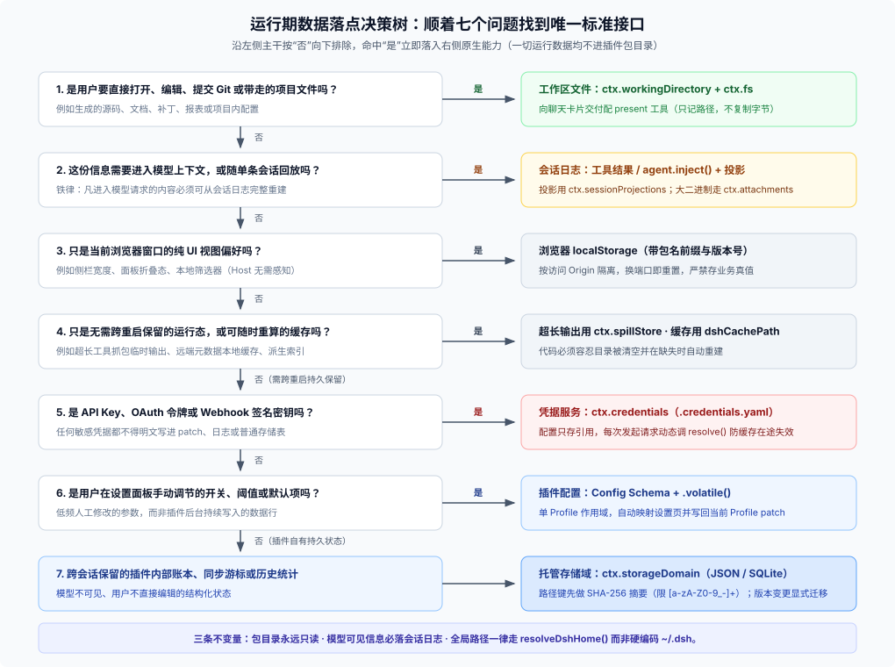
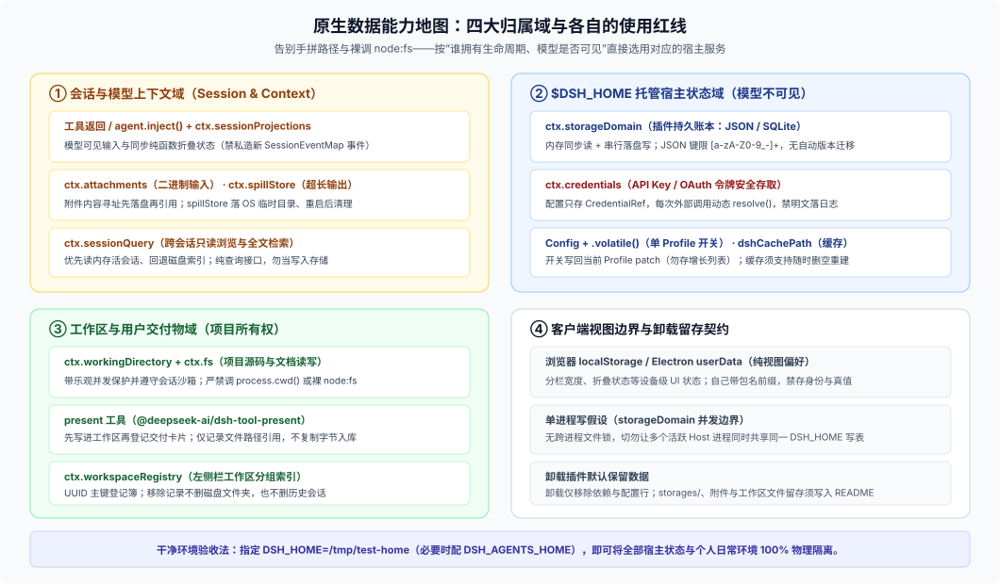

# 03 · 运行期数据落点：会话日志、`$DSH_HOME` 托管存储与工作区文件

写插件最怕“顺手找个目录就写文件”：写进包目录会在升级时被清空，写进 `~/.dsh` 硬编码路径会在多环境隔离时串库，把模型可见状态只放内存则会破坏会话恢复。

其实不用背任何复杂的分类代号，只要从**“用户和模型怎么看待这份数据”**顺着问下来，每一块数据在 DSH 里都有唯一对应的原生接口：

---

## 一、全场景能力对照表

在深入各落点细节前，可以把常见的数据形态和 DSH 原生能力按下表一次对齐：

---

## 二、落点一：会话日志与模型可见状态（`SessionEventMap` + 投影）

DSH 的核心铁律是 **`model-visible ⟺ logged`**：任何拼进模型请求上下文的信息，都必须能从 `$DSH_HOME/sessions/--<normalized-cwd>--/<sessionId>/` 的会话日志里完整重建（见 [`docs/subsystems/session.md`](https://github.com/deepseek-ai/deepseek-harness/blob/master/docs/subsystems/session.md)）。

作为外部插件作者，处理会话态时遵循三条实操准则：

1. **不要私造新的 `SessionEventMap` 持久事件类型**：会话日志格式承担跨版本兼容与 TypeScript / Python 双 SDK 同步投影的契约（非 `ignorable: true` 的未知事件在读取端会触发兼容问题）。外部插件应复用现成的落盘通道——**工具执行返回结果**、**通过 `agent.inject()` 注入的受控上下文消息**，或二进制输入专用的 **`ctx.attachments`**（内容寻址且不可变，必须先持久化拿到引用再写事件，本地后端不做自动垃圾回收）。
2. **会话内结构化状态用 `ctx.sessionProjections` 折叠派生**：如果你需要在后端或前端展示“本轮对话累计扫了多少文件、当前检查单勾到了第几项”，注册一个同步纯函数投影（[`session-projection.md`](https://github.com/deepseek-ai/deepseek-harness/blob/master/docs/subsystems/session-projection.md)），从既有工具调用与结果事件实时 fold 出状态，并通过 `wire` 暴露给前端卡片。一旦修改投影数据结构，记得递增 `stateVersion`。
3. **跨会话检索走只读的 `ctx.sessionQuery`，超长输出走 `ctx.spillStore`**：
   - `ctx.sessionQuery` 提供优先读内存活跃会话、回退读磁盘索引的只读浏览与全文检索（全文能力取决于挂载的查询 Provider），绝不要把它当写入库；
   - 工具产生了几十 KB 的日志或抓包输出时，调用 `ctx.spillStore.saveText(...)` 拿到不透明 locator 给模型按需分段读取——底层落在操作系统临时目录，进程启动后会按 `cleanupPeriodDays` 清理，**不能存用户交付物**。

---

## 三、落点二：`$DSH_HOME` 托管非会话状态（账本、凭据、配置与缓存）

凡是**模型不需要直接看见、但跨会话或重启后仍要保留**的宿主侧状态，都归在 `$DSH_HOME`（默认 `~/.dsh`，代码中务必通过 `@deepseek-ai/dsh-home-paths` 的 `resolveDshHome()` 获取，严禁硬编码 `~/.dsh`）：

### 1. 插件持久账本：`ctx.storageDomain`（基于 JSON 或 SQLite）

[`@deepseek-ai/dsh-storage-domain`](https://github.com/deepseek-ai/deepseek-harness/blob/master/packages/storage/storage-domain/README.md) 在底层 `ctx.storage`（支持 `storage-json` 与 `storage-sqlite` 两种后端）之上提供带静态 Schema 校验的键值域：

- **读写语义**：打开域（`open`）时一次性校验并加载进内存，后续读取是零 I/O 同步内存读；写入按域串行排队，先落盘成功再更新内存并触发进程内 `domain/changed` 事件。
- **键名可移植约束**：在 `storage-json` 的 `per-record` 布局下，记录键会直接映射成文件名片段，必须严格匹配 **`[a-zA-Z0-9_-]+`**（[`per-record-unit.ts`](https://github.com/deepseek-ai/deepseek-harness/blob/master/packages/storage/storage-json/src/per-record-unit.ts)）。若业务键是项目绝对路径或 URL，先做 SHA-256 十六进制摘要再当记录键，切勿直接拿原始路径当 key。
- **版本演进与并发边界**：
  - **无自动迁移**：打开域时若磁盘版本与代码声明的 `version` 不一致，会直接报 `version-mismatch` 失败（同进程重复打开同名域也会报 `already-open`）。破坏性改表时，要么采用带版本号的新域名（如 `acme.review.v2`）并在启动时显式读取旧域完成迁移，要么在同一版本内保持向后兼容的可选字段。
  - **单进程假设**：JSON 后端无跨进程文件锁，SQLite 后端在多进程争抢写时会报 `busy`，`domain/changed` 也只在当前进程内广播——不要让多个活跃 Host 进程同时共享同一个 `$DSH_HOME` 写同一个域。
- **没有官方“插件私有裸目录”契约**：DSH 核心并没有定义 `$DSH_HOME/plugins/<id>/` 这样的标准目录。除非你引入的第三方原生库强制要求独立 SQLite 文件路径，否则一律优先走 `ctx.storageDomain`；确需自建子目录时，必须在 README 写明完整路径、备份与手动清理方式。

### 2. 密钥与令牌：`ctx.credentials`

API Key、Webhook 签名密钥与 OAuth 令牌一律走 [`ctx.credentials`](https://github.com/deepseek-ai/deepseek-harness/blob/master/docs/subsystems/credentials.md)（默认落 `$DSH_HOME/.credentials.yaml`）：

- 配置层只保存不透明的 `CredentialRef` 或通过 `CredentialKey` 读写记录，**绝不把明文写进 `cordis.patch.yml`、会话日志或 `storageDomain`**；
- 每次发起外部请求时动态调用 `resolve()` 获取最新值（空字符串视同未配置），不要在插件启动时把密钥缓存在模块全局变量里——否则用户在设置页撤销或轮换密钥后插件仍拿着旧值；
- 注意宿主机同用户下的进程都具备读取本地凭据文件的系统权限，本地文件权限不是隔离恶意插件的边界。

### 3. 用户可调开关与可丢弃缓存

- **单 Profile 设置（`Config` + `.volatile()`）**：给插件 `Config` schema 标上 `.volatile()` 的字段会自动出现在设置界面，修改后写回**当前 Profile** 的 `$DSH_HOME/profiles/<name>/cordis.patch.yml`（见 [`settings` README](https://github.com/deepseek-ai/deepseek-harness/blob/master/packages/settings/settings/README.md)）。注意它是 Profile 级而非跨 Profile 账号级，也不要拿它存不断增长的历史记录列表。
- **可重建缓存（`dshCachePath`）**：远端拉取的元数据缓存、可随时重算的本地索引放进 `dshCachePath` 派生路径；代码必须容忍该目录随时被用户清空并自动重建。
- **纯前端界面偏好**：分栏宽度、折叠状态等只跟当前浏览器/设备有关的纯 UI 状态直接用浏览器 `localStorage`（自带包名前缀与版本号），Host 端无须感知。

---

## 四、落点三：工作区文件与交付物（`ctx.fs` + `present`）

只要一份数据在用户嘴里叫“我的代码、我的文档、我的导出报表、我的项目配置”，它就属于**工作区（Workspace）**，而不属于插件内部存储：

1. **永远从会话取目录，经 `ctx.fs` 读写**：
   - 会话初始根目录记录在不可变的 `header.cwd`，运行期当前工作目录由 [`ctx.workingDirectory`](https://github.com/deepseek-ai/deepseek-harness/blob/master/packages/session/working-directory/README.md) 维护——**绝不能调 `process.cwd()`**（它只是宿主启动时的当前目录）。
   - 读写用户项目文件统一走 [`ctx.fs`](https://github.com/deepseek-ai/deepseek-harness/blob/master/docs/subsystems/filesystem.md)，并用 `createIfAbsent` / `replaceIfVersion` 做乐观并发保护（不要自己拆解不透明的 `targetKey`）。在模型工具里直接调 `node:fs` 会绕过会话沙箱写边界，属于高危违规。
2. **向用户突出展示产出文件用 `present`**：生成报告、图表或补丁文件后，先把它写进工作区目录，再配合 [`@deepseek-ai/dsh-tool-present`](https://github.com/deepseek-ai/deepseek-harness/blob/master/packages/deliverables/tool-present/README.md) 登记交付。`present` 只在日志里记录文件路径引用供 UI 渲染预览卡片，不会把文件字节复制进附件库。
3. **区分“工作区目录”与“工作区注册记录”**：`ctx.workspaceRegistry` 只是 `$DSH_HOME` 里登记“左侧边栏有哪些项目分组”的薄索引（生成 UUID 作为 `WorkspaceId`），用户在界面里移除一个 Workspace 记录**不会删除磁盘上的项目文件夹，也不会删除历史会话**。

---

## 五、备份、隔离与卸载留存：给用户的透明账单

设计插件数据时，把卸载和迁移后的真实残留想清楚并在 README 写明：

- **卸载插件不会自动清数据**：执行 `dsh plugin remove` 或应用内卸载 Bundle 时，插件管理器只移除 `package.json` 依赖、`dsh.profile.bundles` 选择项和运行期挂上的插件行；**`$DSH_HOME/storages/` 里的域数据、`$DSH_HOME/attachments/` 里的附件以及工作区里生成的文件都会原样保留**。这是为了防止误删用户资产或导致重装丢数据。
- **隔离测试零污染**：只要在启动或验收时指定独立的 `DSH_HOME=/tmp/test-home`（若涉及跨工具共享技能再加 `DSH_AGENTS_HOME=/tmp/test-agents`），就能把配置、存储域、凭据和会话日志与个人日常环境 100% 隔开。
