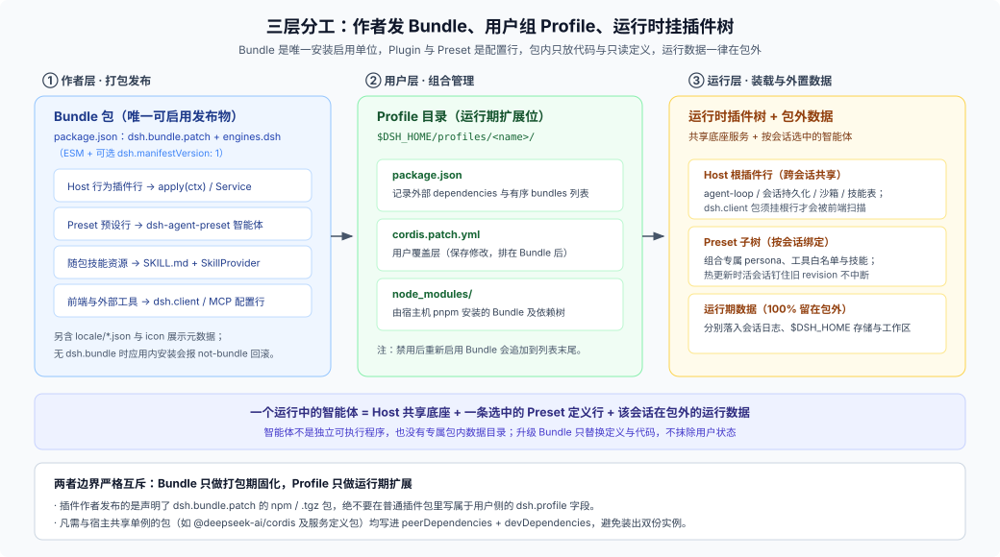

# Answer 24 · 插件发布与数据边界：Bundle 唯一发布物、六项门禁与三块数据落点

## 一句话结论

在 DSH 里，**作者唯一能发布并被安装器自动启用的交付物是声明了 `dsh.bundle.patch` 的 Bundle 包**——Cordis 行为插件、智能体预设（preset）、随包技能、前端扩展（`dsh.client`）和外部 MCP 配置都作为这个包里的声明或资源交付；而**包内永远只放代码与只读定义，一切运行期数据都留在包外**，按归属分别落进**会话日志**、**`$DSH_HOME` 托管非会话存储**和**工作区目录**。

---

## 一、什么才算可发布的 DSH 包？

很多作者第一次发包时最大的困惑是：“我的包明明能 `import`，为什么装进 DSH 没反应，或者本地 `link:` 正常、发到 npm 就崩？”先把作者发布、用户组合与运行装载三层分工看清：



1. **Bundle 包才是安装与启用单位**：`package.json` 必须声明 [`dsh.bundle.patch`](https://github.com/deepseek-ai/deepseek-harness/blob/master/packages/util/package-manifest/src/types.ts)（单个路径或有序数组）：
   ```json
   {
     "name": "@acme/dsh-expert-pack",
     "type": "module",
     "dsh": { "bundle": { "patch": ["./cordis.patch.yml"] } },
     "engines": { "dsh": ">=0.2.0 <0.3.0" }
   }
   ```
   没有 `dsh.bundle` 的普通 npm 包在 `dsh plugin add` 下只会被写进 `dependencies` 而不启用；在应用内 `install_bundle` 下则会直接回滚并报 `not-bundle`。
2. **智能体不是独立可执行程序，而是 Bundle 里的一行预设声明**：向 Loader 根部插入一条 `@deepseek-ai/dsh-agent-preset` 行，就把人设、工具子集和技能组装成可选智能体。
3. **前端扩展依赖 Host 行挂载**：`dsh.client` 只是一纸声明，前端模块扫描器只会扫描**已被 Host 根插件行启用**的包；如果包只挂在某个 preset 的子插件树里，前端构建根本扫不到 `./client`。

### 六项检查与三种真实失败方式

别把所有检查都想成“不合规 DSH 就会当场报错拦住”。从安装到运行共有六道关口，失败表现分三类（详见 [`01-package-forms-and-channels.md`](./01-package-forms-and-channels.md)）：

| 失败分类 | 涉及检查项 | 实际表现与核对重点 |
|---|---|---|
| **直接拒绝 / 跳过** | **① Patch 解析**<br>**② 版本兼容**<br>**③ 已声明的 `Config`** | ① `dsh.bundle.patch` 缺失、YAML 损坏或插件行包名无法解析时，拒绝安装或在启动时整包记入 `skippedBundles`。<br>② **只要写了 `engines.dsh`，系统就只看它并完全忽略 `peerDependencies`**；未写 `engines.dsh` 时才回退检查全部 `@deepseek-ai/dsh` 与 `@deepseek-ai/dsh-*` peer（不含 `@deepseek-ai/cordis`，但它仍须双写进 `peer` + `dev` 以共享单例）。<br>③ 插件导出了 `Config` schema 且行配置不合法时激活失败；未声明 `Config` 的插件不做配置拦截。 |
| **装时不拦、用时才坏** | **④ 入口导出形式**<br>**⑤ 打包自包含与前端挂载** | ④ 混用具名 `export function apply` 与 `export default Service` 会静默丢掉 `inject` 依赖声明（见 [事故复盘 0001](https://github.com/deepseek-ai/deepseek-harness/blob/master/docs/postmortem/0001-acp-default-export-drops-inject.md)）。<br>⑤ 本地 `link:` 不过滤 `files` 字段，一旦漏写 `lib/` 或 `assets/skills/**`，发成 `.tgz`/npm 后才会报找不到模块或技能；`dsh.client` 未被 Host 行挂载也会静默不生效。 |
| **仅展示降级** | **⑥ 展示元数据** | `locale/*.json`、`description` 或 `icon`（上限 256 KiB）缺失或超限时，插件照常工作，仅在管理页回退显示包名或附带诊断提示。 |

### 支持的分发渠道与安全底线

所有渠道最终都落进用户的 `$DSH_HOME/profiles/<name>/`，区别只在于构建时机与信任门槛：

| 渠道 | 推荐用途 | 关键约束 |
|---|---|---|
| **npm registry** | 外部公开发布默认渠道 | 必须预构建 ESM 产物并配齐 `files`；支持多版本安装与回退 |
| **离线 `.tgz`** | 内网/离线交付、发版前验收 | `pnpm pack` 产物，装包时不跑 `prepare`，最能暴露漏文件问题 |
| **本地 `link:`** | 作者本机联调 | 支持文件改动后 HMR 刷新，但不过滤 `files`、路径绑死当前机器 |
| **Git 仓库** | 源码直装或小范围内测 | 建议锁死 40 位 commit SHA；含 `prepare` 构建时用户须显式批准 `allowBuilds` |
| **第三方市场索引** | 团队或社区聚合发现 | 静态 HTTPS `index.json`，DSH 只校验格式、不背书代码安全 |
| **官方按需目录** | 第一方可选能力分发 | 仅收公开 `@deepseek-ai/dsh-*` 包，外部作者不可提交 |

> **安全提醒**：获批的安装期脚本以宿主机当前用户权限执行；激活后的 Host 插件与宿主同处一个 Node 进程、运行在模型工具沙箱之外。

---

## 二、只读智能体定义 vs 运行期数据放哪？

判断插件里的任何文件或状态该往哪放，只需守住一条分水岭：**随版本发布、运行期不改写的是“只读定义”，放进包里；运行期产生或因用户而异的是“运行数据”，必须留在包外。**

### 1. 只读定义：随包冻结、按会话钉住版本

Preset 声明、系统提示词片段和随包附带的 `SKILL.md` 都属于只读定义（详见 [`02-preset-and-readonly-definitions.md`](./02-preset-and-readonly-definitions.md)）：

- **包内技能不会自动被扫描**：DSH 默认只扫 `$DSH_HOME/skills`、`~/.agents/skills` 和项目下 `.dsh/skills`、`.agents/skills` 等六个本地目录根。随包发布的 `assets/skills/` 必须通过一行轻量 `SkillProvider` 插件（基于 `import.meta.url` 定位）显式注册为 `bundled` 技能（优先级 `rank: 300`，既能开箱即用，又允许用户在项目 `.dsh/skills/` 下覆盖）。
- **热更新不冲掉活会话**：升级 Bundle 或修改 preset 后，已创建的智能体会继续钉在旧 revision 上跑完，新建智能体与进程重启后才切换到当前定义。切勿在运行期往 `node_modules` 包目录或 preset 配置里回写状态——下次升级或重装会直接覆盖它。

### 2. 运行期数据：三块真实落点速查表

DSH 里承接运行数据的原生落点只有三处，按“谁读、谁管生命周期”直接对号入座（详见 [`03-runtime-data-placement.md`](./03-runtime-data-placement.md)）：

| 数据落点 | 适用什么数据 | 标准访问接口 | 核心约束与生命周期 |
|---|---|---|---|
| **会话日志**<br>（`$DSH_HOME/sessions/`） | 会话内需要让模型看见的上下文、工具结果与随日志折叠的会话视图 | 既有工具返回、`agent.inject()`、`ctx.sessionProjections`；二进制走 `ctx.attachments` | 严守 **`model-visible ⟺ logged`**（凡进模型请求必能从日志重建）；外部插件不要私造新的 `SessionEventMap` 持久事件，优先复用既有事件 + 同步纯函数投影。 |
| **`$DSH_HOME` 托管存储**<br>（非会话全局状态） | 跨会话插件账本/游标、API 密钥、单 profile 可调开关、可丢弃缓存 | 账本：`ctx.storageDomain`（JSON / SQLite）<br>密钥：`ctx.credentials`<br>开关：`Config` + `.volatile()`<br>缓存：`dshCachePath` | 模型不可见；`storageDomain` 自带 schema 与版本校验（版本不匹配直接报错，无自动迁移，卸载插件**不会**自动清理数据）；密钥只存引用、每次使用动态 `resolve`；超长临时输出用 `ctx.spillStore`。 |
| **工作区文件**<br>（会话 `workingDirectory`） | 用户要直接打开、编辑、提交 Git 或带走的文档、代码与交付产物 | `ctx.fs`（配合 `ctx.workingDirectory`）；向聊天卡片交付走 `present` 工具 | 归用户与项目所有，换项目即换数据；写操作受会话沙箱策略约束，不要在工具里用裸 `node:fs` 绕过 `ctx.fs`；`present` 只记录文件路径、不复制字节。 |

---

## 三、五个最常见的误判

1. **还在找 `agent.cordis.yml`、`$DSH_HOME/.agent-presets/` 或 `dsh.compatibility`**：这些早期或外部自创写法在当前 DSH 中没有任何读取方。预设一律写 `@deepseek-ai/dsh-agent-preset` 行，兼容声明一律写 `engines.dsh`。
2. **以为写了 `engines.dsh` 还会叠加校验 `peerDependencies`**：不会。`evaluatePluginCompatibility` 一旦读到 `engines.dsh` 就以它为唯一依据（含预发布号匹配，`workspace:` 视为不满足）。
3. **只用本地 `link:` 测试就发版**：`link:` 直接软链源码目录，完全绕过 `package.json` 的 `files` 白名单。发版前必须跑一次 `pnpm pack` 并在干净临时 `DSH_HOME` 下安装 `.tgz` 验收。
4. **把用户业务文件或 API Key 塞进 `ctx.storageDomain`**：`storageDomain` 存的是模型不可见、用户不直接编辑的宿主账本（且 JSON `per-record` 键只允许 `[a-zA-Z0-9_-]+`）；用户文件该走 `ctx.fs` 落工作区，密钥必须走 `ctx.credentials`。
5. **硬编码 `~/.dsh` 或 `process.cwd()`**：部署侧随时会通过环境变量切换 `DSH_HOME`，一个进程也能同时挂多个不同目录的会话。全局根统一用 `resolveDshHome` / `resolveAgentsHome`，会话目录统一查 `ctx.workingDirectory`。

---

## 继续阅读

| 你想深入查什么 | 去哪篇看 |
|---|---|
| `dsh.bundle` / `dsh.client` / `engines.dsh` 字段细节、六道门禁与六种分发渠道对比 | [`01-package-forms-and-channels.md`](./01-package-forms-and-channels.md) |
| Preset 行组装、随包 `SKILL.md` 注册、指令链加载顺序与 revision 生命周期 | [`02-preset-and-readonly-definitions.md`](./02-preset-and-readonly-definitions.md) |
| 运行期数据落点决策树、`storageDomain` / 会话投影 / `ctx.fs` / 凭据的实操模式与演进规则 | [`03-runtime-data-placement.md`](./03-runtime-data-placement.md) |
| 可直接照抄的最小可发布插件骨架、干净 `DSH_HOME` 验收脚本、旧写法迁移与发版前检查单 | [`04-plugin-walkthrough-and-checklists.md`](./04-plugin-walkthrough-and-checklists.md) |
| 对应的 DSH 源码、子系统文档与历史变更索引 | [`reference.md`](./reference.md) |

> 核验状态见 [核验基线登记](../00-baseline.md)。若你要把多个 Bundle 与定制 Profile 打包成面向终端用户的独立工作台，请转读 [FAQ 26 · 定制工作台与发行组装](../26_harness-distribution/answer.md)。
