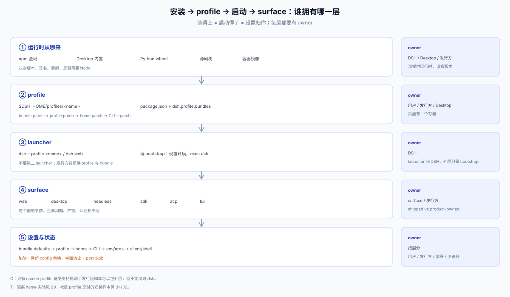

# 50 · 生命周期：为 DSH 插件定一套从打包到卸载的做法

## 这一节讲给谁、为什么存在

> **角色：作者面规范（C/T）。** 写给要给 DSH 写插件、并把它交到用户手里的人。覆盖打包、发布、安装、初始化、特殊初始化、配置、启动、更新、卸载与文档十段。这一节给的是**一套推荐做法**，不是可用选项的清单；选项在别处，这里只回答「应该怎么写，以及不这么写会在换场景时付什么代价」。

理由只有一条：**不给规矩，插件就会各自发明。**

发明不是恶意，是省事：打包时自定义一个插件清单、安装时自己决定落到哪、初始化时自己造一个"首次运行"标记、配置时自己发明一套开关、卸载时自己决定数据留不留。每一套在写它的那个场景里都说得通，问题出在下一个场景：

| 换场景 | 自造做法要付的代价 |
|---|---|
| web → desktop | 自建的安装入口在 Desktop 上根本不存在；profile 归属也不同 |
| 本地 checkout → registry 分发 | 依赖仓库相对路径的产物装不进别人的机器 |
| 单人自用 → 第三方安装 | 没有版本声明、没有元数据、没有卸载说明，别人不敢装也不会装 |
| 一个部署 → 多个部署 | 硬编码的端口、路径、开关改不动 |

第二层代价更隐蔽：**放弃生态的既有习惯**。DSH 的 Plugins 页、`plugin_manager`、profile 组合、设置表单、升级说明，都只接住**按约定写**的插件；自己另造一套，等于把这些现成机制全部关掉，也放弃用户和 coding agent 已经形成的认知——他们不会为你学一套新词。

一句话：**守 DSH 的约定 = 可迁移 + 可借力。** 这两件事是同一件事的两面。

## 最短路径：一个插件从写到交付

只做最小可用交付，五步：

1. **打成 bundle**：`package.json` 写 `dsh.bundle.patch` 与 `engines.dsh`，补 `description` 与 `icon`。缺这一步，后面全部接不住。
2. **写 README**：按 [75](./75-plugin-readme.md) 的骨架回答装 / 验 / 配 / 升 / 卸 / 数据六件事。
3. **让人装得上**：安装说明默认一句「在 Plugins 页安装 X」；CLI 只作 `dsh web` 的自动化，并标注清楚。
4. **让它不挑场景**：不假设 profile 名、不假设 Desktop、不自己造「首次运行」标记；默认值放 bundle patch。
5. **交付前自检**：干净 `DSH_HOME` 装一遍 → `--dump-config` 看到自己的 row → 启动正常 → 卸载后数据说明与实际一致。

五步不覆盖全部细节，但盖住了绝大多数插件出错的地方；其余按下面的总表查章节。

## 生命周期规矩总表

左边一列是 DSH 只提供这一种的机制，右边是作者该做的事，以及不这么做要付的代价。

| 阶段 | DSH 的机制 | 作者该做 | 不这么做的代价 |
|---|---|---|---|
| **打包** | npm 包 + `dsh.bundle.patch` 贡献一层配置 | 只发 bundle；`patch` 指向一份或有序几份 patch | 自造插件清单进不了 Plugins 页、`dsh plugin`、`plugin_manager` |
| **发布** | registry / tarball / git 三种产物形态；准入看 `engines.dsh` 或 DSH peers | 声明 `engines.dsh`；发预构建产物 | 版本一升就装不上；git 装法的构建审批会挡住用户 |
| **安装** | Plugins 页 / `plugin_manager` / `dsh plugin`，写的是 profile 的两个文件 | 让用户走这三个入口；不教他手改 manifest | 手改的 profile 与工具状态漂移，下次工具一写就打架 |
| **初始化** | profile 首建由 `initProfile` 做，已有文件一律不覆盖 | 假定 profile 已存在；不做自己的"首启"标记 | 两套首启状态互相打架，重装行为不可预测 |
| **特殊初始化** | 没有插件级迁移钩子；只有存储的版本接受集与发行版级一次性导入 | 一次性动作自己保证幂等，凭据必须可判定 | 重入一次就可能覆盖用户数据 |
| **配置** | `Config` schema + 五层 patch；patch 对 `config` 是**整份替换** | 默认值进 bundle patch；可变项做成 Config 字段；`.volatile()` 的才上设置页 | 硬编码常量让部署改不动；只写一项让必填字段丢失 |
| **启动** | named profile；失败分级由 app-boot 判定（optional 警告 / required 停止） | 不做第二个 launcher；不为插件写启动脚本 | 绕过 launcher 的入口不受支持，也拿不到启动诊断 |
| **更新** | 卸载再安装；bundle 成员变化要重启；**没有命令级回滚** | 文档写清「要重启」与「回退是重装旧版本」 | 文档写"可回滚"，用户回不去 |
| **卸载** | 只回收包与 patch 层，数据一律留下 | 自己文档化数据位置与清理方式 | 用户以为删了，其实还在 |
| **文档** | Plugins 页读 `package.json` 与导出的 locale；README 有固定形 | 按骨架写，交代装 / 验 / 配 / 升 / 卸 / 数据 | 用户和 agent 都得读源码才知道怎么用 |

这张表是索引，不是展开：后面各章展开其中七段。另三段的**机制**归 `10-foundations`，本篇只给做法、不重写它们——profile 首建与「装成功」的三个状态见 [18](../10-foundations/18-install-upgrade.md)，存储版本、接受集与迁移剧本见 [12](../10-foundations/12-state-storage.md)，卸载后各类数据的 owner 见 [18](../10-foundations/18-install-upgrade.md) 的卸载与保留一节。

读法：本章用**发行方**指把这些插件交付出去的那一方，用 **Harness 发行版**指它交付的那一份。如果你一个人写一个插件、自己发布，你就是发行方——没有第四种角色，只是称呼不同。只写单插件、没有自己的 profile 时，你交付的是插件而不是发行版；下面各章按需跳读。

## 范围与相邻章节

**范围。** 只采用 DSH 约定内的分发、安装、初始化、配置、启动、更新与卸载。不研究、不对比、不教程化：新 bin、自建 Tauri/Electron/托盘、发布 profile、wildcard bind。替换 `web-startup` 是约定内的 provider 替换（disable + insert），但必须重实现全部 web flags；见 [40](./40-profile-integration.md)。

| 想要 | 去哪 |
|---|---|
| 三轴模型、所有权表、受支持与禁止的边界 | [10](./10-model.md) |
| 装 / 起 / 配 / 首启的阶段判据（外部参考层，15 张样本） | [37](../30-external/37-lifecycle-stages.md) |
| 官方发布物只有 Desktop 与 CLI/Web 两份 | [23](../../../23_standalone-vs-web-release-forms/answer.md) |
| profile 交付形态与装配状态 | [34](../30-external/34-profile-delivery-forms.md) · [35](../30-external/35-profile-assembly-ownership.md) |
| 从 profile 到发行版工作流 | [90](../90-advisor/00-index.md) |

## 总表之外，几条最常踩的

总表已经覆盖的不再重复；下面这些是它放不进去的坑。

- **安装的自由度主要在"谁提供 dsh 运行时"和"profile 怎么初始化"**：npm 全局、Desktop 自带运行时、Python wheel、源码树，四种 runtime 来源对应不同的更新/签名/隔离责任；容器/镜像属于部署包装，不算第五种来源。
- **设置的灵活性在层级，不在开关数量**：bundle patch → profile patch → home patch → CLI `--patch` → app args/env → 客户端状态/Desktop shell 设置。最容易踩的两个坑是"整份 config 被替换"和"字面值让 app 参数失效"。
- **发行方拥有 bundle、默认值与文档；只有 shell/自托管才拥有安装器。** 不拥有 launcher、profile 写者或第二套更新。同一 profile 的并发写、两个更新器是主要故障源。
- **分发单位决定签名/校验/更新责任**：bundle、安装器、Desktop、容器、wheel、离线 tarball 各有 owner；安装文档要与发布物同版本。
- **bundle 在 roster ≠ patch 生效**：新增 row 必须 `insert:`；裸 `- id` 是 override target。
- **web 命令行归 `web-startup`**：发行版自定义 flag 需要替换 provider 并重实现全部 web flags；漏实现不报错，只会静默忽略该 flag——缺 TLS 即明文 listener，缺 `public-url` 只广告 listener origin，缺 `trusted-host` 则代理 authority 不被信任。
- **session 创建 ≠ UI 选中**：Host `sessionController.create` 只创建/attach；全新客户端可能自动落到最近工作区的可复用 blank，返回用户保持 `dsh.sessions.current`；确定性要用 client `uiWorkspace.openSession`。

## 章节地图

| 文件 | 回答什么 |
|---|---|
| [10 模型](./10-model.md) | 三轴模型、所有权表、受支持/可能/禁止的边界 |
| [20 安装路径](./20-install-paths.md) | 应用内/CLI/Electron 通道；运行时来源、profile 初始化、bundle 安装、模板重置 |
| [30 启动面](./30-launch-surfaces.md) | CLI 语法、组合顺序、Web/headless/SDK/ACP/TUI、官方 Desktop 特例 |
| [40 profile 安排](./40-profile-integration.md) | 模板、bundle、startup 插件、命令行所有权、workspace/session、设置、更新 |
| [50 设置层](./50-settings.md) | 默认值/覆盖/Settings UI/env/客户端/Desktop shell 设置；两个实验陷阱 |
| [60 分发打包](./60-packaging.md) | bundle/安装器/官方 Desktop/容器/wheel/离线 tarball；版本、签名、校验 |
| [70 安装文档](./70-install-docs.md) | 发行版安装手册的十段骨架、边界、错误写法 |
| [75 插件 README](./75-plugin-readme.md) | 单个插件的 README 与安装说明：宿主读你哪些字段、骨架、必答七问、反例 |
| [80 决策](./80-decision.md) | 模板 × bundle × 设置矩阵、检查清单、失败模式 |
| [90 证据](./90-evidence.md) | DSH 源码/docs、隔离 profile 实验与证据等级 |

第一次写插件：走上面的最短路径，再读 [75](./75-plugin-readme.md) 与 [20](./20-install-paths.md)。要把整份发行版交出去：加读 [60](./60-packaging.md) 与 [70](./70-install-docs.md)。只想知道某个坑怎么来的：[90](./90-evidence.md) 有 34 条隔离实验。

## 证据口径

- **C**：当前 DSH docs/types/implementation（CLI reference、Desktop README、app-boot、web bundle、SDK/ACP、architecture）。
- **T**：在 `DSH_HOME=$(mktemp -d)` 的隔离 home 里执行的启动/配置实验，不碰用户 profile 与 Session。
- 外部 profile 交付样本见 [34](../30-external/34-profile-delivery-forms.md)/[36](../30-external/36-profile-evidence-ledger.md)；本目录只做 C/T，不自行引用 S/R。

## 边界

- 只覆盖 DSH 约定内的分发、安装、初始化、配置、启动、更新与卸载；不设计新 bin、第二层 launcher/桌面壳、发布 profile 目录或 wildcard bind。
- 实验只在 macOS、DSH 仓库 checkout 与 `mktemp -d` 的隔离 home 上做；Windows/Linux 路径、Desktop 与安装器没有跑。
- 34–37 的外部 profile 交付只作对照，不是依赖背书；具体 package 采用前另核兼容、license 与数据生命周期。
- 应用内 Plugins 页的 Desktop 侧行为来自 docs 与源码阅读，本机没有 Desktop，所以那部分是 C 不是 T。
