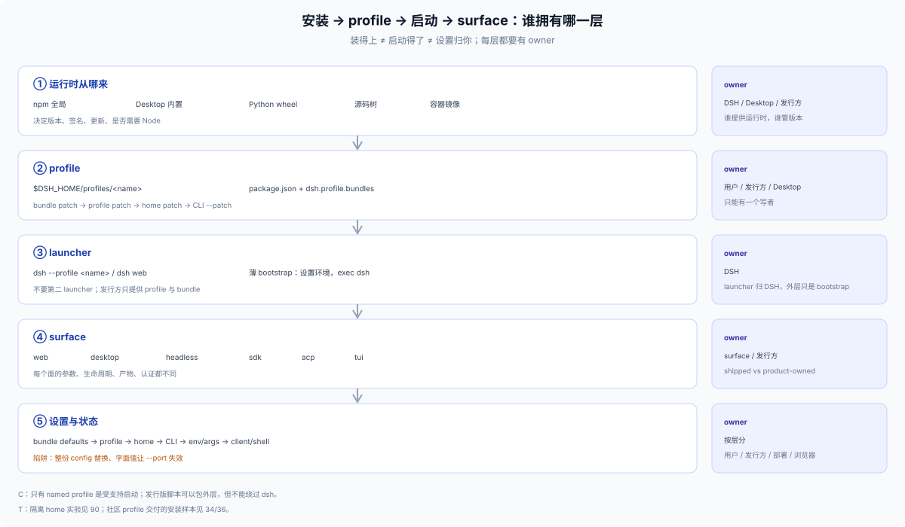

# 10 · 模型：named profile 是唯一入口

## 结论

DSH 支持的 Node 应用启动只有一种：**named `dsh` profile**（[architecture](https://github.com/deepseek-ai/deepseek-harness/blob/master/docs/architecture.md#application-launch)）。发行版不发明第二个启动入口，只在这套模型上做六个决定；完整定义与判据见 [10 六轴](../10-foundations/10-taxonomy.md)。

| 轴 | 本节的回答 | 展开在哪 |
|---|---|---|
| 运行时 | dsh 从哪来：npm 全局、Desktop 内置、Python wheel、源码树 | 本节「运行时」；[60](./60-packaging.md) |
| profile | 用 shipped 模板、自定义具名 profile，还是 application-owned profile | 本节「profile」；[20](./20-install-paths.md)、[40](./40-profile-integration.md) |
| patch 层 | bundle patch → profile patch → home patch → CLI → env/args → client | [50](./50-settings.md) |
| app surface | profile 选中哪个 surface，带哪些 client plugins | [30](./30-launch-surfaces.md)、[40](./40-profile-integration.md) |
| Harness home 与数据 | 哪些状态共享、哪些自建、卸载留什么 | [10-foundations](../10-foundations/11-storage-channels.md)；[18](../10-foundations/18-install-upgrade.md) |
| 生命周期 | 装/更/卸的入口与数据清理责任 | 本节「所有权」；[20](./20-install-paths.md)–[70](./70-install-docs.md) |

发行版**不**发布新的 DSH 启动可执行文件、不自建 launcher、不把 profile 当发布物。外层最多是一个薄 bootstrap：设置环境、确保 profile 存在、`exec dsh --profile <name>`。

## 运行时

| 问题 | 选项 | 发行方要做的判断 |
|---|---|---|
| dsh 从哪来？ | npm 全局、Desktop 内置、Python wheel、源码树 | 写清版本 floor（`engines.dsh` 或 DSH peers），在装包前检测而不是装完才坏 |

容器/镜像属于部署包装，不是第五种运行时来源。

## profile

三种控制态，控制权依次收紧（[app-boot README](https://github.com/deepseek-ai/deepseek-harness/blob/master/packages/boot/app-boot/README.md#profiles)）：

| 控制态 | 谁拥有 | 发行方能改 | 用户能改 |
|---|---|---|---|
| shipped template（`web`/`headless`/`sdk`/`acp`） | DSH | 只能建议 | 可整体重置 |
| 自定义具名 profile（`--from-default-profile <template>`） | 发行方 | bundle 顺序与默认 patch | 可覆盖 patch、增删 bundle |
| application-owned profile（Desktop 保留的 `desktop`） | 应用 | 独占 | 不经 CLI profile lookup |

先选定控制态，再谈其余五轴；选错的话后面每一轴都要补丁。

## 受支持 / 不在这条路上

| 类别 | 例子 | 状态 |
|---|---|---|
| 受支持 | `dsh <name>` / `dsh --profile <name>`；`web`/`headless`/`sdk`/`sdk-minimal`/`acp`；自定义 profile + 有序 patch | C：唯一受支持的 Node 应用启动 |
| 不在主路径 | 新 bin、`node dist/server.js`、package bin、demo、SDK argv escape | 禁止/绕过 launcher |
| 特殊 | 官方 Desktop（`desktop` profile，Electron 独占） | C：官方发布物，不是发行版模板 |

## 所有权

| 对象 | 归谁 | 发行方要做什么 |
|---|---|---|
| dsh 运行时 | 用户/Desktop/Python/源码 | 声明版本 floor，检测版本 |
| 安装通道 | 应用内 Plugins 页（跨面）/ CLI（面绑定，不能 `desktop`） | 文档写一句；不要只写 `--profile web` |
| profile | 用户/应用内安装（CLI 仅 web） | 首次创建、幂等修复；不覆盖已有 patch/依赖 |
| bundle | 发行方 | 自包含、声明 `dsh.bundle.patch`、engines/peer、版本 |
| 默认值 | 发行方 bundle patch | 随 bundle 发布；可被 profile/home/CLI 覆盖 |
| 用户设置 | profile patch / Settings UI | 提供设置页或文档；不要两套真值 |
| home patch | 用户/机器 | 发行方不要静默写 |
| 端口/token | dsh web | 文档写默认/参数；远程用反代/TLS |
| 更新 | 用户/Plugin Manager；只有 shell 才用安装器 | 走 `dsh plugin`；bundle 成员变化要重启；回退 = 重装旧版本（没有命令级回滚） |
| 卸载/数据 | 用户/发行方 | `dsh plugin remove` 不清数据；发行方自建数据单独说明 |

## 组合顺序

```
bundle patch（按 dsh.profile.bundles 顺序）
  → profile cordis.patch.yml
  → home $DSH_HOME/cordis.patch.yml
  → CLI --patch（按 argv 顺序）
```

- 后层覆盖前层；patch 对目标 row 的 `config` 是整份替换。
- bundle 名先从 dsh 安装解析，再从 profile `node_modules`；in-box bundle 永远和当前 dsh 同源。
- 缺 profile 的 shipped 模板会自动初始化；自定义名字 `dsh plugin` 只装 base。
- 启动失败会报告 required plugin/缺失服务；bundle 加载失败会 skip 并报告，profile/user patch 错误直接失败。

## 设置层

```
Config schema 默认值 → bundle patch → profile patch → home patch → CLI --patch → app args/env → client/shell
```

发行版默认值放 bundle patch；首启/用户设置写 profile patch；机器级偏好留 home patch；app 参数只有 row 保留 `!!js` 表达式时才压过 config。详见 [50](./50-settings.md)。


