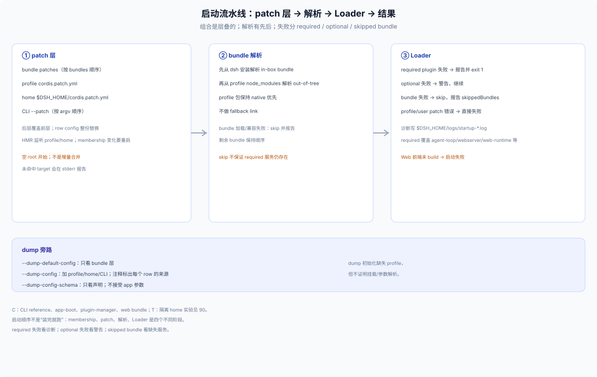
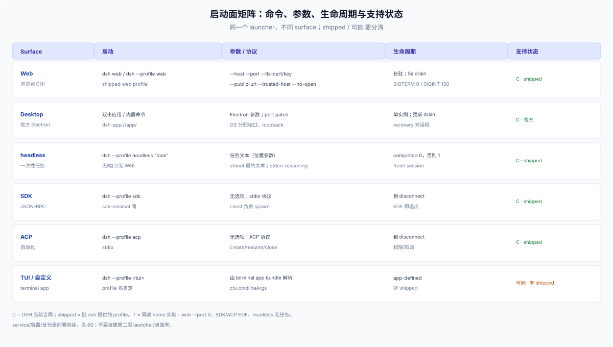

# 30 · 启动：CLI 语法、组合顺序与 surfaces

## 启动流水线

启动不是“装完就跑”：patch 层叠 → bundle 解析 → Loader 挂载 → 结果。dump 是旁路，不证明挂载或参数解析。



## CLI 语法

```sh
dsh <name>                      # 等价 dsh --profile <name>
dsh --profile <name> [app-args] # 启动 named profile
dsh web                         # web 的 shorthand
dsh plugin --profile <name> …   # 管理命令，不是 profile
```

- `plugin` 紧跟在 `dsh` 后是管理命令；要启动名为 plugin 的 profile 必须写 `--profile plugin`。
- launcher flags 在前，遇到第一个不认识的 token 就把它和后面全部交给 app（`ctx.cmdlineArgs`）。
- `--` 由 launcher 消费一次；app 需要字面 `--` 时写 `-- --`。
- 重复 `--profile`、shorthand 后再给 `--profile` 都拒绝。
- `--dump-default-config`（bundle 层）、`--dump-config`（加 profile/home/CLI）、`--dump-config-schema` 互斥；dump 不接受 app 参数。
- `--from-default-profile` 用 shipped 模板替换自定义 profile；破坏性，只用于首次/救援。

## 命令行所有权

web profile 的 app args 整条归 shipped `web-startup`。发行版想加 `--project` 这类 flag，shipped parser 会先拒绝：

```
error: unknown option '--project'   (exit 1)
```

再加一个 startup 插件不能“扩展”它——两个 parser 看同一份 args。web profile 上要加发行版 flag，路径是 disable `web-startup` + insert 发行版 provider，自己解析 web + 发行版 flags 并 `provide('webStartup', …)`；代价是重实现 web flag 语义并跟随升级——漏实现不报错，只会静默忽略该 flag：缺 TLS 时 listener 是明文（默认 loopback），缺 `public-url` 时只广告 listener origin，缺 `trusted-host` 时代理 authority 不被信任。替代：profile-as-mode、config/env、非 Web surface。详见 [40](./40-profile-integration.md)。

## 启动顺序

1. 解析 profile 目录与 manifest；
2. 按 `dsh.profile.bundles` 顺序叠 bundle patch；
3. 叠 profile patch、home patch、CLI `--patch`；
4. 解析 bundle：先从 dsh 安装，再从 profile `node_modules`；
5. 启动 Loader、挂载 plugins；
6. required plugin 失败 → 报告并退出；可选失败 → 警告；bundle 加载失败 → skip 并报告。

HMR 开启时监听 profile/home patch，串行重载但不做事务：候选失败不提交，正在服务的树继续用旧 patch 集；只有本次新引入的失败才抛错。DSH 明确说「不是对兄弟变更的事务性回滚」。没有 HMR 就重启生效；bundle membership 变化（`dsh plugin add/remove/update`）一律要重启 profile。

## 生命周期

- 第一次 SIGINT/SIGTERM 给 plugin tree 最多 5 秒 dispose；SIGTERM 是 supervisor 的普通停止，exit 0；SIGINT 报 130；第二次信号强制退出。
- `web` 打印带 token 的启动 URL，默认开浏览器；SSH/`--no-open` 抑制。
- `headless` 一次性：stdout 最终文本，stderr reasoning，completed 0/否则 1。
- `sdk`/`acp` 走 stdio 到 disconnect；没有 app 选项。
- `desktop` 由 Electron 独占：CLI 不能 boot/config-dump；npm CLI 不能管理它的插件。

## Surfaces

| Surface | 启动 | 参数 | 说明 |
|---|---|---|---|
| Web | `dsh web` / `--profile web` | `--host/--port/--tls-cert/--tls-key/--public-url/--trusted-host/--no-open` | 长驻；token URL；需要前端产物 |
| headless | `--profile headless "task"` | 任务文本 | 无端口、无 Web；一次性 |
| SDK | `--profile sdk` / `sdk-minimal` | 无；stdio JSON-RPC | client spawn；EOF 退出 |
| ACP | `--profile acp` | 无；stdio ACP | 自动化 client |
| TUI/自定义 | `--profile <tui>` | 由 terminal app bundle 解析 | 不是 shipped surface |
| Desktop | 官方应用 | Electron/port patch | 保留 profile；发行版不要占用 |

**service/容器/反代**不是新 surface：它们只是 `dsh web` 的部署包装，见 [60](./60-packaging.md)。

## Web

启动后打印 `dsh web:` 行，root URL 带一次性 token；默认打开浏览器，SSH 会话或 `--no-open` 抑制。`--host` 只接受一个具体本地地址，wildcard 被拒；`--port 0` 让 OS 选端口；`--public-url` 只做广告，不授予信任，代理 authority 还要 `--trusted-host`；TLS 证书对必须成对，启动失败不回落 HTTP。

`--port`/`--host` 等 app 参数只有在 row 保留 `!!js ctx.webStartup.…` 表达式时才优先于 config；用户 patch 把 config 换成字面值后，参数会被忽略（实验见 [50](./50-settings.md)）。

## Desktop

Desktop 与 Web 共用同一个 Plugins 页，安装动作没有 profile 参数；CLI 的 `--profile web` 不会命中 `desktop`。Electron 壳，不是第五个 CLI profile：`desktop` 名字保留，CLI 拒绝 boot/config-dump；npm CLI 不能管理它的插件，Desktop 安装的命令在应用关闭时可以。Electron 在访问 profile 前拿进程级单实例锁，独占 `profiles/desktop`；核心 dsh 从 `resources/app.asar/dsh` 解析，不复制进 profile；监听默认 OS 分配端口，绑定 `127.0.0.1`，页面走 `dsh-app://app/`；更新要等 analytics intake、锁 API admission、drain 任务，失败有原生 recovery。

Desktop 的 shell 设置（如 update test popup）在 Electron `userData/desktop/settings.json`，**不受 `DSH_HOME` 重定位**；Host 环境在 macOS/Linux 通过登录 shell 的 `env -0` 读取，Windows 继承注册表环境。

## headless / SDK / ACP

三者都是 profile，不是独立 bin：

- headless：一个 fresh persisted session，提交任务、等 quiescence、flush，stdout 只打印最终文本，stderr 打印 reasoning；`completed` exit 0，否则 1；无任务是用例错误。
- SDK：stdio newline-delimited JSON-RPC；`sdk` 是 base+sdk-app，`sdk-minimal` 是独立 bundle；client 负责 spawn `dsh`；没有选项。
- ACP：stdio ACP，自动化 client 可创建/恢复/关闭 session、挂 MCP、发提示、回答权限；没有选项。

实验：stdin 关闭时 SDK/ACP 直接 exit 0，说明 stdio surface 以连接生命周期为准。

## TUI / 自定义 profile

CLI 的示例里有 `dsh --profile tui --resume <id>`，但 `tui` 不是 shipped profile：需要一个 terminal app bundle 被装进该 profile。发行版如果要做 TUI，交付物仍是 profile + bundle，不是新 bin；启动参数由该 app bundle 通过 `ctx.cmdlineArgs` 解析。

## 启动失败与诊断

- required plugin 失败：打印 failed/pending/缺失服务，写 `$DSH_HOME/logs/startup-*.log`，exit 1。
- 可选插件失败：警告，继续。
- bundle 加载/兼容失败：skip 该 bundle，保留顺序，报告 `skippedBundles`；不保证剩余组合能提供 required 服务。
- profile/user patch 错误：直接失败。
- Web 前端未 build：启动失败并提示 `pnpm run build`；源码树不检查新鲜度，旧 bundle 可能跑旧前端。
- 端口占用：listener 报 `EADDRINUSE`；Desktop 有专门 recovery。

## 实验（T）

| 实验 | 结果 |
|---|---|
| `dsh web --port 0 --no-open` | OS 分配端口，打印 `dsh web: http://127.0.0.1:<port>/?token=…` |
| `dsh --profile web --help` | web app 参数；launcher 未启动 |
| `dsh --profile desktop --dump-config` | 拒绝：Electron 独占 |
| `dsh --profile headless` | 用例错误：需要 task |
| `dsh --profile sdk` / `acp` + stdin EOF | exit 0 |
| `dsh --profile web --dump-config --port 8080` | 拒绝：dump 不接受 app 参数 |


