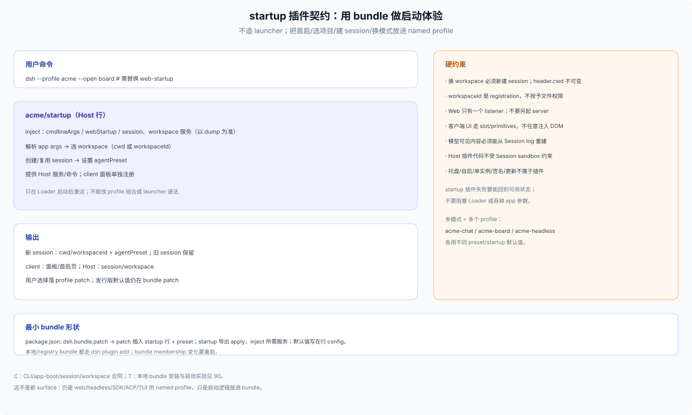
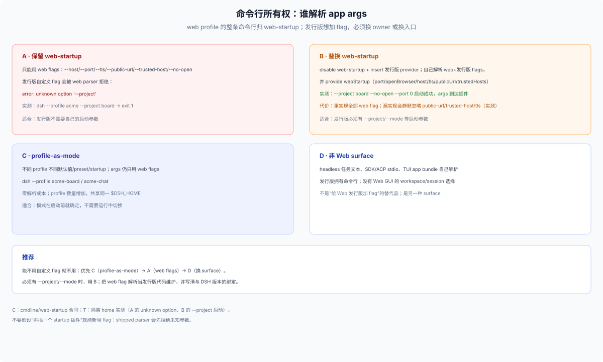
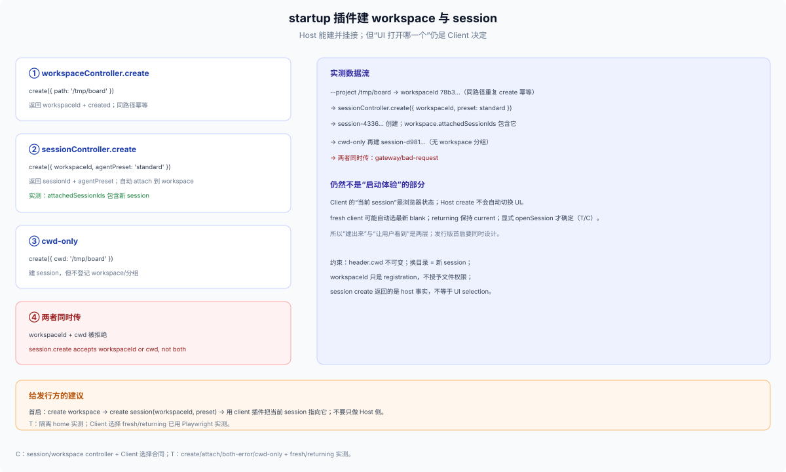
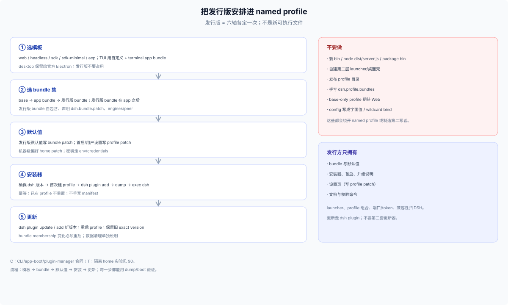

# 40 · 把发行版安排进 named profile

## 一句话

发行版不是另一个可执行文件：它在 DSH 既有模型上把六轴各定一次（见 [10 六轴](../10-foundations/10-taxonomy.md)），用户启动的永远是一个 named profile。

## 选模板

下表是 CLI 自动化建 profile 的命令；发行版用户默认在应用内 Plugins 页安装。

| Surface | 首次建 profile | 说明 |
|---|---|---|
| Web | `dsh --profile <name> --from-default-profile web` | base + web-app；之后 `dsh --profile <name> --port …` |
| headless | `--from-default-profile headless` | base + headless；一次性任务 |
| SDK | `--from-default-profile sdk` / `sdk-minimal` | base + sdk-app，或 standalone minimal |
| ACP | `--from-default-profile acp` | base + acp-app |
| TUI/自定义 | 自定义 profile + terminal app bundle | 不是 shipped surface；参数由 app bundle 解析 |
| Desktop | 不能用 | `desktop` 保留给官方 Electron；发行版不要占用 |

`dsh plugin` 对自定义名字只初始化 base；Web/SDK/ACP 发行版必须先选模板或显式加入对应 app bundle。

## 选 bundle

- **base**：公共核心（模型、工具、Session、设置、凭据等）。
- **app bundle**：`web-app`、`headless`、`sdk-app`、`sdk-minimal`、`acp-app`。
- **发行版 bundle**：你自己的 `dsh.bundle.patch`，通常只插发行版 rows、preset、默认值；不要复制 app bundle。
- **顺序**：base → app bundle → 发行版 bundle；发行版 bundle 的 patch 在 app 之后，默认值才压得住。
- **解析**：in-box bundle 先从 dsh 安装解析，再找 profile 的 `node_modules`；发行版 bundle 要自包含、声明 `engines.dsh`/peer。
- **pin**：dsh floor、发行版 bundle 精确版本、lock/digest；升级窗口写清。

## 用 bundle 里的 startup 插件做启动体验

不靠外部 launcher，也可以把“首启、选项目、开新 session、恢复上次、换模式”做成发行版体验——但边界比“插一个 startup 插件”更窄。



`acme/startup` 是 **Host 行**：它能解析 args、建 workspace/session、提供 Host 服务；client 面板、slot、当前 session 选中是另一个 **client plugin**。把两者混在一个“startup 插件”里，会得到 Host 侧建了 session 但 UI 不显示的半成品。

### 命令行所有权（实测）

- web profile 的 app args 整条归 shipped `web-startup`。传 `--project board`：`error: unknown option '--project'`，exit 1。
- 再插一个 startup 插件**不能**新增 flag：两个 parser 看同一份 args，shipped parser 会先拒绝未知参数。
- web profile 上要加发行版 flag，路径是 **disable `web-startup` + insert 发行版 provider**：自己解析 web + 发行版 flags，并 `provide('webStartup', …)`。实测 `dsh --profile acme --project board --no-open --port 0` 能启动，args 到达插件。
- 代价：web flags（host/port/tls/public-url/trusted-host/no-open）的解析与语义要自己维护，并跟随 DSH 升级。**漏实现不会报错**：实测只实现 project/port/no-open 时，`--public-url`/`--trusted-host`/`--tls-cert/--tls-key` 都被静默忽略，boot 仍打印 `http://127.0.0.1:…`——缺的是 TLS 与对外广告，不是“少个功能”。
- 完整实现后可用：实测 provider 解析 host/port/tls/public-url/trusted-host/no-open；TLS 启动打印 `https://127.0.0.1:<port>/?token=…`，token URL 返回 303；`--public-url` 打印广告 URL；`--host 0.0.0.0` 被 provider 拒绝并启动失败。
- 替代：profile-as-mode（不同 profile 不同默认值）、config/env、非 Web surface（headless/SDK/ACP 自己解析）。



### workspace 与 session（实测）

- `workspaceController.create({ path })` 返回 `workspaceId`；同路径重复 create 幂等。
- `sessionController.create({ workspaceId, agentPreset })` 返回 `sessionId`，并自动 attach 到该 workspace（`attachedSessionIds` 包含新 session）。
- `sessionController.create({ cwd })` 也能建 session，但不登记 workspace/分组。
- 两者同时传：`session.create accepts workspaceId or cwd, not both`。
- **建出来 ≠ 用户看到**：`ClientSessions` 的注释明确“view selection remains outside the Controller”；Host `create` 不会自动切换 UI。
- Client 侧的选择动作是 `ctx.uiWorkspace.openSession(sessionId)`；selection 持久化在 `dsh.sessions.current`。
- 浏览器实测（Playwright）：**全新 context**（无 current）打开 Web，UI 自动选中了 Host 新建的 blank session，localStorage current 就是它；**预置 current 为旧 session 后重载**，UI 保持旧 session，新建 session 没有被选中。也就是说：Host create 不改 Client 选择；全新客户端可能靠“最近工作区的 blank”自动落位，返回用户不会。要确定性，client 插件显式 `openSession`。



### 可行边界

| 体验 | 结论 | 证据 |
|---|---|---|
| 首启/onboarding | Host 可做，UI 需 client 面板 | C |
| 选/换 workspace | Host 可 create + attach；换目录 = 新建 session | T |
| 新建 session | Host 可 create（workspaceId 或 cwd） | T |
| 创建/复用 + 选中 session | Host `create` 可复用 blank；UI 选中是 Client；resume 未测 | T/C |
| 发行版自定义 app args | 不能直接加；需替换 `web-startup` 并重实现 web flags | T |
| 多模式发行版 | 多个 named profile；零解析成本 | C |
| 自定义 Web 面板 | 客户端 slot/primitives | C |
| 端口/TLS | web flags/config；一个 listener | C |
| 多窗口/托盘/自启/更新/签名 | 不属于 profile/plugin | C |

### 最小 startup 行

只读 app args（不替换 web-startup）：

```yaml
- id: acme-startup
  name: '@acme/dsh-product/startup'
  inject: [cmdlineArgs]
```

要新增发行版 flag，替换 web-startup：

```yaml
- id: web-startup
  disabled: true
- insert:
    - id: acme-startup
      name: '@acme/dsh-product/startup'
```

注意：patch 新增 row 必须用 `insert:`；裸 `- id` 是 override target，找不到目标时只报 `entry "..." not found`，bundle 仍在 roster 里（见 [20](./20-install-paths.md) 与 [80](./80-decision.md)）。

### 结论

- **Host 侧可做**：读 args（前提是拥有 parser）、create workspace、create session、attach、set preset。
- **Host 侧不做**：UI 选中哪个 session、OS 窗口/托盘/自启/更新/签名。
- **发行版优先级**：profile-as-mode → 只用 web flags → 万不得已再替换 `web-startup`；首启体验必须同时设计 client 侧选择。

## 默认值与设置

| 层 | 发行版怎么用 |
|---|---|
| bundle patch | 发行版默认值（端口、主题、preset、开关）；随 bundle 版本发布 |
| profile patch | 首次运行/设置页写这里；用户可改 |
| home patch | 机器级偏好（同 home 所有 profile）；发行版不要静默写 |
| CLI `--patch` | 本次启动/诊断；不持久化 |
| env/`.env`/credentials | 部署、代理、密钥；不要写进 profile patch |
| 客户端 localStorage | UI 状态；换 origin 会丢 |
| Desktop shell 设置 | 只在官方 Desktop；`userData`，不受 `DSH_HOME` 重定位 |

Settings UI（`Config.volatile()`）写当前 profile patch；发行版的设置页应复用这一层，或明确自己的 store 与迁移，不要两套真值。

## 安装方式

**默认：发 bundle，让用户在应用内 Plugins 页装。** 安装说明只需要一句：

> 在 DSH 的 **Plugins** 页安装 `acme-product`（`dsh web` 与 Desktop 通用）。

**CLI 是面绑定的自动化**：可管理显式非 `desktop` profile；面向 web/Desktop 的安装说明默认 Plugins 页，CLI 只作 web 自动化，必须紧跟“仅 `dsh web`”：

```sh
dsh plugin --profile web add @acme/dsh-product@1.2.3
```

**自托管/安装器是可选项**，只在发行版不是插件（shell/自带运行时）或明确只支持 web 时用。它不能管理 Desktop profile；不要写 `--profile desktop`。

```sh
# 仅自托管/web：确保 dsh 版本
dsh --version
# 首次建 profile（破坏性：只对全新 profile）
dsh --profile acme --from-default-profile web --dump-default-config
# 装发行版 bundle（走 dsh plugin，不手写 manifest）
dsh plugin --profile acme add @acme/dsh-product@1.2.3
# 校验组合与真启动
dsh --profile acme --dump-config
dsh --profile acme --no-open --port 0
```

安装器要幂等：已有 profile 不重置；已有数据不覆盖；失败能重跑；`--from-default-profile` 只在“全新 profile”或显式救援时用。**应用内装才是跨面路径；安装器只覆盖它自己能碰到的那个 profile。**

## 启动入口（薄 bootstrap）

外层最多是一个薄 bootstrap：

- 设置 `DSH_HOME`、PATH、代理、凭据环境；
- 确保 profile 存在（不存在才建）；
- 检查 dsh/bundle 版本；
- `exec dsh --profile <name> "$@"`，把 app 参数原样传下去。

不要再包第二层 launcher/桌面壳；桌面体验用官方 Desktop，Web 用 named profile。

## 更新与卸载

- bundle 更新：应用内 Plugin Manager（默认）或 CLI `dsh plugin --profile <name> update`（仅 web 自动化）；**重启 profile** 才生效。
- profile 锁：安装/更新走 `dsh plugin` 或 Plugin Manager；不要并发写。
- 回滚：**没有命令级回滚**；保留旧 exact version/enabled，回退是把旧版本重装一次；写清 crash window。
- 卸载：`dsh plugin remove` 只移除 bundle/dependency；用户数据、Session、Workspace registration 不清；发行版自建数据要单独说明。

## 反模式

| 反模式 | 问题 |
|---|---|
| 新 bin/`node dist/server.js`/package bin | 绕过 dsh launcher，不是受支持启动 |
| 自建第二层 launcher/桌面壳 | 第二个 launcher、第二套更新/签名/profile 写者 |
| 发布 profile 目录 | 覆盖用户 patch/依赖；profile 是用户侧组合 |
| 手写 `dsh.profile.bundles` | 与 `dsh plugin` 状态漂移 |
| base-only profile 期待 Web | 没有 web-app row/端口/页面 |
| 把 config 写成字面值 | 丢必填字段；`--port` 等 app 参数失效 |
| 0.0.0.0 绑定 | Web 拒绝 wildcard；远程要反代/TLS/trusted-host |
| 两套设置真值 | 设置页/发行版 store/profile patch 漂移 |


