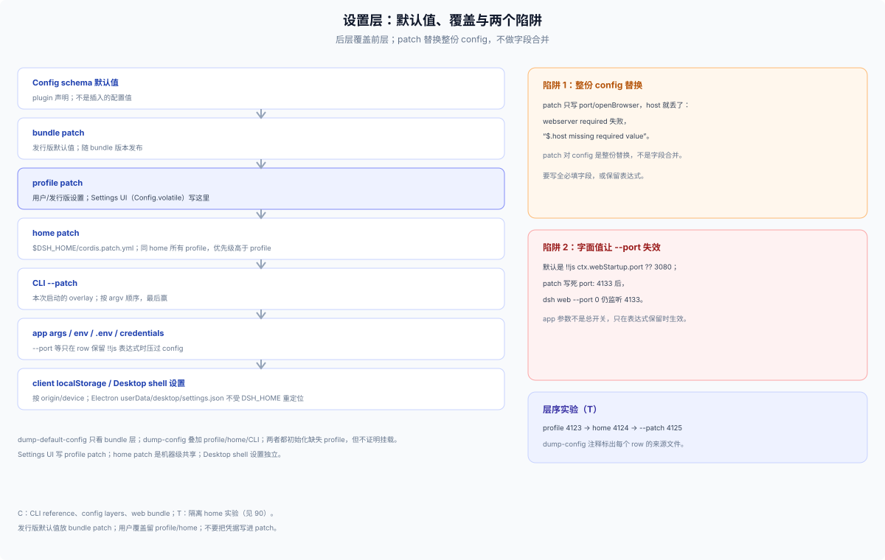

# 50 · 设置层：默认值、覆盖与两个实验陷阱

## 层级与优先级

```
Config schema 默认值
  → bundle patch（发行版默认值）
  → profile patch（用户/发行版设置；Settings UI 写这里）
  → home patch（同 home 所有 profile）
  → CLI --patch（本次启动）
  → app args / env / .env / credentials
  → 客户端 localStorage / Desktop shell settings
```

- 后层赢；patch 对目标 row 的 `config` 是**整份替换**，不是字段合并。
- `!!js` 表达式保留时，app 参数（如 `--port`）优先于 config；用户 patch 换成字面值后，参数失效。
- Settings UI 的 `Config.volatile()` 写当前 profile patch，不自动跨 profile；home patch 是机器级共享。C 依据：`packages/settings/README.md` 明确“changes persist through the active profile’s Cordis patch”，表单只暴露 active、唯一寻址 entry 的 volatile 字段，并拒绝 stale write。
- Desktop shell 设置（如 update test popup）在 Electron `userData/desktop/settings.json`，`DSH_HOME` 不重定位它。

## 设置归谁

| 设置 | 位置 | owner | 说明 |
|---|---|---|---|
| 发行版默认值 | bundle patch | 发行方 | 随 bundle 版本发布 |
| 用户设置 | profile patch | 用户/发行版设置页 | Settings UI 写这里 |
| 机器级偏好 | `$DSH_HOME/cordis.patch.yml` | 用户/机器 | 同 home 所有 profile |
| 本次覆盖 | `--patch` | 调用者 | 不持久化 |
| 启动参数 | `ctx.cmdlineArgs` | app bundle | 只在 row 保留表达式时压过 config |
| 环境 | `DSH_HOME`、`.env`、credentials、`DSH_PERMISSION_MODE`、`DSH_TOOLS_MODE`、telemetry/proxy | 用户/部署 | 启动时读取 |
| 客户端状态 | localStorage（按 origin） | 浏览器/device | 换 origin 就丢 |
| Desktop shell | `userData/desktop/settings.json` | Electron | 与 DSH 设置分开 |

## 两个实验陷阱（T）

**1）字面值让 app 参数失效。**

默认 web 的 `webserver.port` 是 `!!js ctx.webStartup.port ?? 3080`。profile patch 写死：

```yaml
- id: webserver
  config:
    port: 4133
    # host/tls/compression 被整份替换掉
```

`dsh --profile web --no-open --port 0` 仍监听 **4133**：row 不再读 `ctx.webStartup.port`。`--port` 不是“总开关”，它只在表达式保留时生效。

**2）整份 config 替换会丢必填字段。**

同一个 patch 只写 `port`/`openBrowser` 时，`host` 缺失，required plugin 失败：

```
webserver (required)
ValidationError: invalid config:
  - $.host missing required value
```

解决：patch 要么写全 `host/port/tls/compression/...`，要么只覆盖非必填字段并保留表达式；不要用“只写我想改的那一项”的心态改整份 config。

## 层序实验（T）

| 层 | 写入 | dump-config 结果 |
|---|---|---|
| profile patch | `port: 4123` | 4123 |
| + home patch | `port: 4124` | 4124（home 赢 profile） |
| + `--patch overlay.yml` | `port: 4125` | 4125（CLI overlay 最后） |

`--dump-config` 的注释会列出每个 row 被哪些文件 patch 过；`--dump-default-config` 只看 bundle 层；两者都会初始化缺失的 profile 文件，但**不证明挂载或参数解析**。

## 首启与默认值

- 发行版默认值放 bundle patch，随 bundle 版本发布；用户覆盖留 profile/home patch。
- 首次安装可以用 `--from-default-profile` 生成干净 profile，但这是**替换**：依赖和用户 patch 会被清空。
- 发行版自己的首启向导/设置页应写 profile patch 或发行版自有状态，不要假装是 DSH 全局设置。
- 设置迁移要版本化：旧 settings 路径、旧 profile patch 字段、旧 client origin 都要有迁移/作废策略（见 [35](../30-external/35-profile-assembly-ownership.md) 的更新/资产）。

## 启动相关设置清单

- 端口/主机/TLS/public-url/trusted-host/openBrowser：Web 启动参数与 config 表达式。
- `DSH_HOME`：profile、Session、凭据、日志的根；独立 home 是最干净的隔离。
- `DSH_PERMISSION_MODE`、`DSH_TOOLS_MODE`：进程级启动行为。
- telemetry/代理/凭据：env、`.env`、credentials 三层；不要把凭据写进 profile patch。
- Desktop：登录 shell env probe、`userData` 设置、update channel；与 CLI 的 `$DSH_HOME` 共享数据但可执行包分离。


