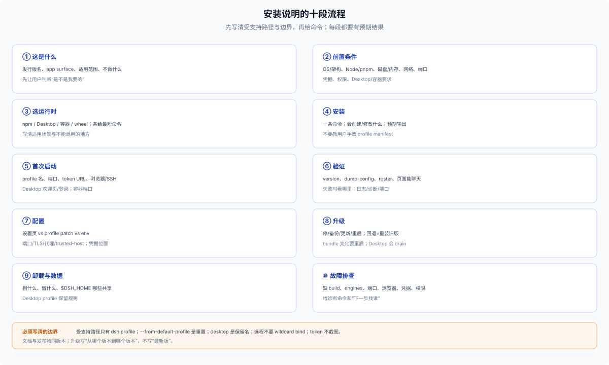

# 70 · 安装与使用说明：文档该写什么

## 文档骨架

一份能用的安装/使用说明至少覆盖十段：

1. **这是什么**：发行版名、app surface（Web/Desktop/CLI/SDK）、适用范围、不做什么。
2. **前置条件**：OS/架构、Node/pnpm 版本、磁盘/内存、网络、端口、凭据、是否需要管理员权限；写清支持的 dsh 版本范围。engines/peer 不匹配时安装会在写入 package 依赖前拒绝（profile 脚手架可能已初始化）；不要默认让用户加 exemption，确需时给 exact package + dsh version 的命令和风险说明。
3. **选运行时**：npm 全局 / 官方 Desktop / wheel / 源码；容器是 `dsh web` 的部署包装，单独写。
4. **安装**：默认一句“在 Plugins 页安装 X（web 与 Desktop 通用）”；CLI 只作 web 自动化，并紧跟“仅 `dsh web`”。说明会创建/修改什么（profile、home、依赖），给出预期输出。
5. **首次启动**：profile 名、端口、token URL、浏览器/SSH、`--no-open`；Desktop 的欢迎页/登录。
6. **验证**：`dsh --version`、`--dump-config`、profile roster、页面能聊天；失败时看哪里。
7. **配置**：设置页 vs profile patch vs env；端口/TLS/代理/trusted-host；凭据放哪。
8. **升级**：停/备份/更新/重启；bundle membership 变化要重启；Desktop 更新会 drain。DSH 没有命令级回滚，回退是把旧版本重装一次——升级前记下当前版本与 lockfile。
9. **卸载与数据**：删什么、留什么、`$DSH_HOME` 哪些共享；Desktop profile 的保留规则。
10. **故障排查**：缺 build、engines 不匹配、端口占用、浏览器打不开、凭据缺失、权限被拒。

## 必须写清的边界

- **受支持路径**：应用内 Plugins 页（跨面）；启动 `dsh --profile <name>` / `dsh web`（web）；headless/SDK/ACP 没有 Plugins 页，安装用 CLI 显式 profile。不要暗示 package bin、demo 或自建 launcher 是支持的。
- **profile 名字**：用户装到哪个 profile；`desktop` 是保留名，CLI 不能 boot；`plugin` 要用 `--profile plugin`。
- **安装入口**：应用内 Plugins 页（跨面）；CLI `dsh plugin --profile <name> add <spec>` 只作 web 自动化；不要教用户手改 `dsh.profile.bundles`。
- **`--from-default-profile` 是重置**：只用于首次/救援；会删除依赖和用户 patch；升级不要用。
- **数据位置**：`$DSH_HOME`、profile、Session、附件、凭据、客户端 localStorage；哪些跨 profile 共享。
- **安全**：token URL 不截图/不进日志；远程用反代 + TLS + `--trusted-host`，不要 wildcard bind；凭据不要写进 profile patch。
- **平台**：Desktop 有 macOS/Windows；Linux 走 npm 或容器部署；TUI 需要 terminal app bundle。

## 三条最短路径模板

**npm + Web**（面向 Desktop 时，安装一句仍是 Plugins 页；下面 CLI 仅 web）

安装：在 **Plugins** 页安装 `@acme/dsh-product`（web 与 Desktop 通用）。

```sh
# 前置：Node ^22.19 || >=24，pnpm
npm install -g @deepseek-ai/dsh
# 首次：用 web 模板建自定义 profile（破坏性，只在全新 profile 上用）
dsh --profile acme --from-default-profile web --dump-default-config
dsh plugin --profile acme add @acme/dsh-product
dsh --profile acme --port 8080
# 打开打印的 dsh web: URL
```

`dsh plugin` 对自定义名字只初始化 base；Web 发行版必须先用 web 模板，或显式加入 web-app bundle。

**Desktop**

```text
1. 下载并安装对应平台安装包
2. 首次打开：欢迎页登录/填 API Key
3. Plugins 页安装发行版 bundle；或用 Desktop 安装的命令管理 profile
4. 完全退出 Desktop 后，用 Desktop 安装的命令（不是 npm 全局 dsh）管理 desktop profile 插件
```

**容器**

```sh
docker run --rm -p 8080:3080 \
  -e DEEPSEEK_API_KEY \
  -v acme-home:/home/dsh/.dsh \
  ghcr.io/acme/dsh-product:1.2.3 \
  --profile acme --no-open \
  --host <container-ip> \
  --public-url https://app.example/ --trusted-host app.example
# <container-ip> 由镜像 entrypoint 解析；dsh web 拒绝 0.0.0.0
```

## 验证清单

- 全新机器/干净 `DSH_HOME`：按文档能装、能启动、能聊天。
- 已有 profile：安装不覆盖用户 patch/数据；升级后 roster/row 正确。
- 端口被占/浏览器打不开/凭据缺失：文档给出的诊断能定位。
- 卸载后：用户数据按文档保留或删除；没有“以为删了其实还在”。

## 可复制骨架

````markdown
# <发行版名>

## 这是什么
<surface、适用范围、不做什么>

## 前置条件
<OS/架构、Node/pnpm、磁盘、网络、端口、凭据>

## 选择安装方式
<应用内 Plugins 页（默认）/ CLI（仅 web 自动化）/ 官方 Desktop / wheel / 源码；容器部署；各自最短命令>

## 安装
默认：在 **Plugins** 页安装（web 与 Desktop 同一句）。CLI 自动化才用下面命令，并标“仅 `dsh web`”。

```sh
dsh --version
dsh --profile <name> --from-default-profile <template> --dump-default-config   # 仅首次
dsh plugin --profile <name> add <bundle>@<version>
```

template 按 surface 选：web/headless/sdk/sdk-minimal/acp；不要默认 web。

## 首次启动
```sh
dsh --profile <name> --port 8080
```
<打开的 URL/token、SSH、--no-open、Desktop 欢迎页>

## 验证
```sh
dsh --profile <name> --dump-config
dsh --profile <name> --port 0 --no-open
```
<profile roster、页面/任务、日志位置>

`--port/--no-open` 只适用于 Web；headless 传 task，SDK/ACP 用 stdio 客户端验证。

## 配置
<设置页 vs profile patch vs env；端口/TLS/代理/trusted-host；凭据>

## 升级
<停/备份/更新/重启；bundle 变化要重启；回退是重装旧版本；Desktop drain>

## 卸载与数据
<删什么、留什么、$DSH_HOME 哪些共享>

## 故障排查
<缺 build、engines、端口、浏览器、凭据、权限>

## 安全
<token 不截图、反代/TLS/trusted-host、凭据不进 patch>
````

## 常见错误写法

| 写法 | 问题 |
|---|---|
| “运行 `node dist/server.js`” | 绕过 `dsh` launcher，不是受支持启动 |
| “先起一个第二层 launcher/桌面壳” | 第二个 launcher/profile 写者；发行版只用 named profile |
| “Desktop 上用 `dsh plugin --profile web add`” | 装进 `profiles/web`，App 用 `profiles/desktop`，报告成功但界面没有 |
| “`dsh plugin --profile desktop add`” | CLI 对 `desktop` 双门禁闭；只有 Electron carrier 能管理 |
| “只写 CLI 命令，不提 Desktop” | 安装路径只覆盖 web；必须在文档里标“仅 `dsh web`” |
| “编辑 `~/.dsh/profiles/x/package.json` 加 bundle” | 手写 profile，容易和 `dsh plugin` 状态漂移 |
| “升级时用 `--from-default-profile` 重置” | 会删依赖/用户 patch，是破坏性重置 |
| “绑定 0.0.0.0 就能远程访问” | Web 拒绝 wildcard；要具体 IP + 反代 + TLS + trusted-host |
| “把 API Key 写进 profile patch” | 凭据应走 credentials/env，不是配置层 |
| “装完立即生效” | bundle membership 变化要重启 profile |

## 文档与发布一起版本化

安装说明要跟发布物同版本：bundle 版本、dsh 版本 floor、profile 模板、端口/参数、已知问题。升级文档要写“从哪个版本到哪个版本”，不要只写“最新版”。


