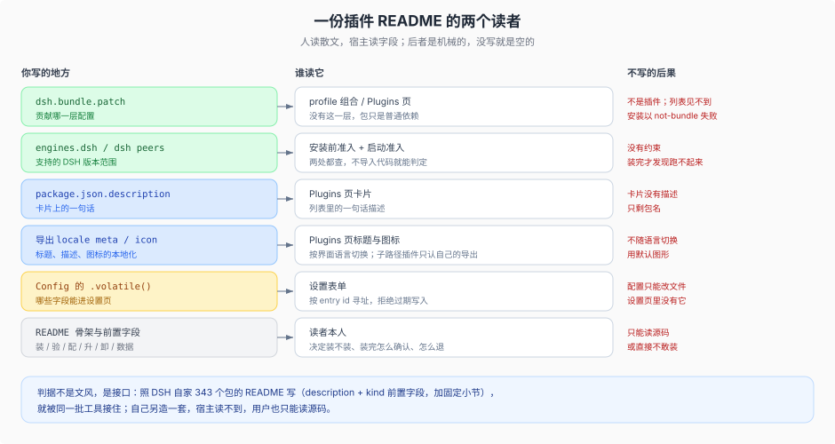

# 75 · 插件 README 与安装说明：宿主读你哪几行，人需要你回答什么

## 为什么这一篇不是"文档风格建议"

一份插件 README 有两个读者，他们的判据完全不同：

- **人**：决定装不装、装完怎么确认、出问题怎么退。
- **宿主**：Plugins 页、`plugin_manager`、设置表单、文档生成器。它们不读你的散文，只读 `package.json` 和导出面里的几个字段。

第二个读者是机械的：字段没写，界面上就是空的；格式不对，工具就当它不是插件。所以这一篇写的不是文风，是**接口**。照着 DSH 自己的包写最省事——仓库里 343 个包的 README 是同一个形（`description` + `kind` 前置字段，加固定小节），照它写就自动被同一批工具接住。

## 宿主会读你的什么



| 你会写的地方 | 谁读它 | 不写会怎样 |
|---|---|---|
| `dsh.bundle.patch` | profile 组合、Plugins 页 | 不是插件，只是普通依赖；列表里见不到，安装以 `not-bundle` 失败 |
| `engines.dsh`（或 `@deepseek-ai/dsh*` 的 `peerDependencies`） | 安装前准入、启动准入 | 没有任何版本约束，装完才发现跑不起来 |
| `package.json.description` | Plugins 页卡片的一句话 | 卡片没有描述，只剩包名 |
| 导出的 locale `meta`（title / description / icon） | Plugins 页的多语言标题与图标 | 只有包名，且不随界面语言切换 |
| `package.json` 的 `icon` 或导出的 `./icon` | 卡片图标 | 用默认图形 |
| `Config` 里的 `.volatile()` 字段 | 设置表单 | 配置只能改文件，设置页里没有它 |
| README 前置字段 `description` / `kind` | 文档生成与检索 | 与 DSH 自家包的 README 不同形，工具不认 |

两条容易忽略的细则：

- **子路径插件读不到 `package.json`**。以包名 + 子路径注册的行（如 `@acme/plugin/tools`）只认它自己导出的 `<subpath>/icon` 与 `meta`，不会回退去读包的 `package.json`。要显示，就在那个子路径上导出。
- **`description` 有两个**。`package.json.description` 是给 Plugins 页的一句话；README 前置字段里的 `description` 是给文档生成器的。两者受众不同，别互相复制粘贴凑数。

显示字段的完整作者格式见 `docs/cookbook/adding-a-package.md` 的 plugin display metadata 一节。

## README 骨架

````markdown
# <插件名>

一句话：它替用户做什么；什么情况下不该用它。

## 装什么、装到哪
- 包名与版本；它是 bundle（贡献一层配置）还是普通依赖
- 支持的 DSH 版本（`engines.dsh`；没有就写 peer 的实际含义）
- 装到哪个 profile：`web` / `desktop`（应用内 Plugins 页）/ 自定义名

## 安装
默认：在 **Plugins** 页找到 <插件名> 并启用。
CLI（仅 `dsh web` 的自动化场景）：

```sh
dsh plugin --profile <profile> add <包名>@<版本>
```

## 验证
```sh
dsh --profile <profile> --dump-config      # 找 <entry-id> 那一行
```
再说清界面上看到什么算成功（工具出现、设置页出现、端口起来）。

## 配置
- 哪些是 `Config` 字段、默认值是什么、在哪一层改（bundle / profile / home / `--patch`）
- 哪些字段标了 `.volatile()`，因此能在设置页改
- 密钥走 env 或 credentials，不要写进 patch

## 升级
- 新版本要求什么；bundle 成员变化要重启 profile
- **没有命令级回滚**：回退是把旧版本重新装一次，升级前记下当前版本与 lock

## 卸载与数据
```sh
dsh plugin --profile <profile> remove <包名>
```
删掉什么（包与 patch 层）；留下什么（数据、Session、设置），留在哪。

## 排障
三条最常见的失败：怎么判断、怎么修。
````

骨架里没有"架构说明"和"贡献指南"——它们该在别处。README 的第一屏要解决的是"我能不能装、装了会不会毁掉我的东西"。

## 安装说明必须回答的七问

| 问题 | 不合格的写法 | 合格的写法 |
|---|---|---|
| 1. 这是插件还是依赖？ | 只说"安装本包" | 说明它声明了 `dsh.bundle`，会插入哪些 entry id |
| 2. 装到哪个 profile？ | 只给一条 `dsh plugin add` | 默认写 Plugins 页；CLI 显式写 `--profile <名>`，并注明 Desktop 走应用内 |
| 3. 前置与版本？ | "需要较新的 dsh" | 写出 `engines.dsh` 范围；构建脚本需要批准时提前说明 |
| 4. 怎么确认生效？ | "重启即可" | 给出 `--dump-config` 要找的 entry id，以及界面上可见的变化 |
| 5. 配置落在哪一层？ | 只列字段名 | 说清默认值在 bundle patch、用户覆盖在 profile patch，以及哪些能进设置页 |
| 6. 升级与回退？ | "更新到最新版" | 写清要重启；写清回退是重装旧版本，DSH 没有命令级回滚 |
| 7. 卸载删什么、留什么？ | "卸载即可" | 列出会消失的（包、patch 行）与留下的（数据、Session、设置）及位置 |

## 反例

| 写法 | 问题 |
|---|---|
| "把本包放进 `~/.dsh/profiles/x/package.json` 的 bundles" | 教用户手写 profile；下次工具一写就漂移 |
| "`node dist/index.js` 启动" | 绕过 launcher，不是受支持入口，也拿不到启动诊断 |
| "装完立即生效" | bundle 成员变化要重启 profile |
| "升级后可以回滚到旧版" | 没有命令级回滚；只能重装旧版本 |
| "所有数据会在卸载时清除" | 卸载只回收包与 patch 层；数据默认留下 |
| "支持所有 DSH 版本" | 等于没有 `engines.dsh`；一旦不兼容，用户装完才发现 |
| 只有英文标题，没有 locale `meta` | 界面切到中文后仍是包名，且与 DSH 自家插件不同形 |
| README 只贴一段架构图 | 回答了"它多漂亮"，没回答"我该怎么装、怎么退" |

## 与相邻章节的分工

- [60](./60-packaging.md)：**包**该怎么打包、版本怎么钉、签名与离线怎么做。
- [70](./70-install-docs.md)：**发行版**的安装手册（多 app surface、运行时来源、容器、Desktop、排障），面向把整份发行版交出去的人。
- 本篇：**单个插件**的 README 与安装说明，面向把一行插件交出去的人。

一份发行版手册里可以引用多个插件的 README；但插件 README 不能假设自己只活在某一份发行版里——这是它在 web、desktop 与自定义 profile 之间可迁移的前提。
