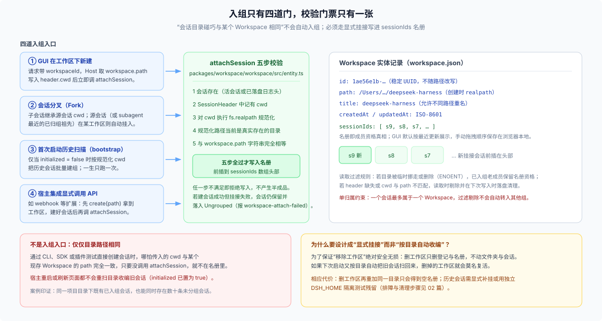
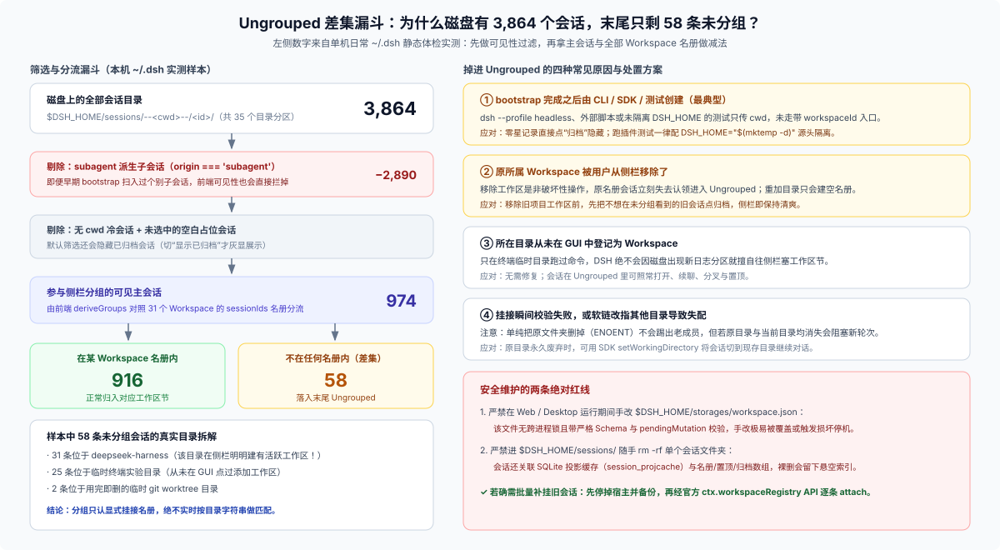
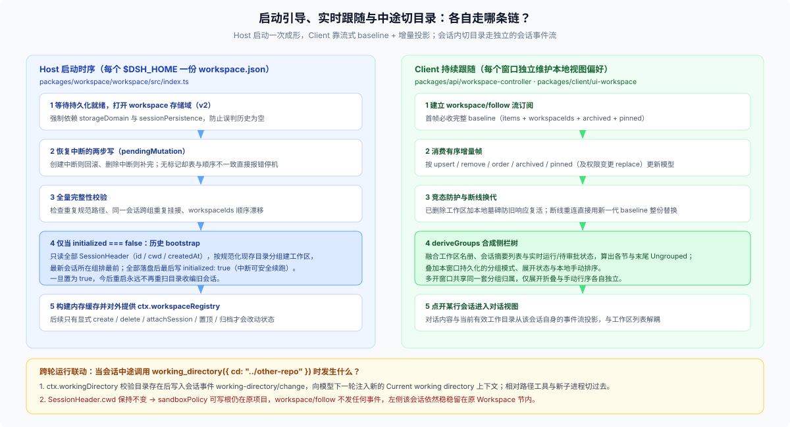

# 01 · Workspace 实体、侧栏分组投影与跨轮工作目录联动

`answer.md` 给出了“登记簿 + 显式挂接 + 前端减法”的全局心智模型。本篇顺着源码把四件事拆到底层：`workspace.json` 里到底存了什么、会话挂入名册要过哪几关、客户端怎么算出侧栏每一行与 `Ungrouped`，以及进程启动到对话中途切换目录时各组件如何配合。

---

## 一、`Workspace` 实体与存储结构

工作区子系统集中在 [`@deepseek-ai/dsh-workspace`](https://github.com/deepseek-ai/deepseek-harness/blob/master/packages/workspace/workspace/README.md)（暴露宿主服务 `ctx.workspaceRegistry`），只在 [`web-app`](https://github.com/deepseek-ai/deepseek-harness/blob/master/packages/bundle/web-app/cordis.patch.yml) 等带界面的组装中挂载，`headless` 组装根本不加载它。

### 1. 一条 `Workspace` 记录长什么样？

在 [`packages/workspace/workspace/src/types.ts`](https://github.com/deepseek-ai/deepseek-harness/blob/master/packages/workspace/workspace/src/types.ts) 中，每个工作区实体只暴露五个只读属性与五个操作方法：

| 字段 / 方法 | 契约说明 |
|---|---|
| `id`（`WorkspaceId`） | 创建时生成的稳定 UUID，**绝不用目录路径充当主键**（避免路径规范化或重命名破坏引用锚点） |
| `path` | 创建时经 `fs.realpath` 规范化后的绝对路径（解开尾斜杠、`..` 与符号链接），落盘后永不改写 |
| `title` | 界面显示名，默认取路径最后一段；底层注册表允许不同路径同名，但通过控制器重命名时若与已有工作区重名会报 `workspace/name-conflict` |
| `createdAt` / `updatedAt` | ISO-8601 时间戳；每次持久写入（改名、挂接、移除、调序）都会刷新 `updatedAt` |
| `sessionIds` | **已登记会话名册**（有序 `SessionId[]`）：成员归属的唯一权威来源，读取时同步剔除路径失配项 |
| `setTitle` / `attachSession` / `insertSessionBefore` / `detachSession` / `status` | 改标题、挂接会话（前插到头部）、调整名册内顺序、解除挂接（不动会话日志）、实时检查物理目录是否仍在（返回 `'ok'` 或 `'missing-dir'`） |

这里有一条很关键的去重规则：**路径唯一性按 `fs.realpath` 后的字符串严格判等**。对同一个真实目录（包括指向它的符号链接）重复调用 `workspaceRegistry.create(path)`，不会报错也不会新建第二条，而是原样返回已有实体、保持原标题不变。

### 2. 落盘格式、崩溃恢复与归档准入

通过 `storage-domain` 的 JSON 后端，整个注册表持久化在 `$DSH_HOME/storages/workspace.json`（[`spec.ts`](https://github.com/deepseek-ai/deepseek-harness/blob/master/packages/workspace/workspace/src/spec.ts)，`version: 2`）：

```text
domain: workspace (version 2)
├── table: workspaces                    # 主键 = WorkspaceId
│   └── { path, title, sessionIds, createdAt, updatedAt }
└── global
    ├── initialized: boolean             # 一次性历史 bootstrap 是否已完成
    ├── workspaceIds: WorkspaceId[]      # 工作区节的权威显示顺序（新建前插）
    ├── archivedSessionIds: SessionId[]  # 全局归档集合（与是否入组无关）
    ├── pinnedSessionIds: SessionId[]    # 全局置顶集合（最近置顶排最前，与归档互斥）
    ├── defaultWorkspaceId?: WorkspaceId # 首启默认工作区身份，删掉后也不再自动重建
    └── pendingMutation?: { operation: 'create' | 'delete', workspaceId }
```

两处防御性设计值得留意：

- **两步写标记（`pendingMutation`）**：创建和删除工作区都要同时改 `workspaces` 表和 `global.workspaceIds` 顺序数组。写之前先落盘 `pendingMutation` 标记；万一中途进程崩溃，下次启动时按标记把中断的删除补完、或把中断的创建回滚。若没有标记却发现表与顺序数组对不上，直接按数据损坏报错停机（fail loud），绝不静默乱猜。
- **归档拒绝藏匿活任务（Archive admission）**：归档是全局集合（归档后不抹除原 `sessionIds` 槽位，但会同步清除该会话的置顶状态）。调用 `archiveSession(sessionId)` 时，注册表会先派发 `workspace/session-activity` waterfall 事件询问当前组装里的各执行方——只要该会话还有正在跑的模型轮次（`turn`）、子智能体（`subagent`）、后台任务（`job`）或定时提醒（`schedule`），默认直接抛 `WorkspaceActiveSessionError`（映射为 `workspace/session-active`）拒绝归档；除非调用方显式传入 `{ stopActivity: true }` 先落盘归档集锁住后续唤醒，再并发派发 `workspace/session-stop` 正常取消在途工作。

---

## 二、会话挂入 Workspace 的四道门与五步校验

一个会话不会因为“建在某个文件夹下”就自动成为对应工作区的成员。写入成员名册的唯一入口是 `Workspace.attachSession(sessionId)`，整个系统只有四个时机调用它：



1. **GUI 在工作区下新建会话**：前端调用 [`session.create`](https://github.com/deepseek-ai/deepseek-harness/blob/master/packages/api/session-controller/src/commands.ts) 传入 `workspaceId`（与显式 `cwd` 互斥；前端还会优先复用同工作区下未归档的空白会话，避免连点新建堆出一串空行）。后端取出 `workspace.path` 写入新会话不可变的 `SessionHeader.cwd`，随后立即调 `workspace.attachSession(sessionId)`。如果挂接步骤意外失败，已建好的会话不会回滚销毁，而是保留下来并掉进 `Ungrouped`（同时返回 `session/workspace-attach-failed`）。
2. **会话分叉（Fork）**：子会话直接继承源会话的 `SessionHeader.cwd`。若源会话本身已挂在某个工作区名册里，子会话自动挂入同一工作区；若源会话是侧栏不可见的 `subagent`，则顺着父链往上找最近的已归组祖先工作区挂入；都找不到则留在 `Ungrouped`。
3. **首次启动的一次性历史扫描（`bootstrap`）**：仅当 `initialized === false` 时，注册表在启动阶段扫描全部已有会话的 `SessionHeader`（只读 `id`、`cwd`、`createdAt` 三个头字段，绝不解压读取庞大的事件体），把 `cwd` 仍指向现存目录的历史会话按规范化路径分组，每组创建一条工作区（按组内最新会话时间倒序排列），全部写完后才落盘 `initialized: true`。此后无论重启多少次，都不会再重跑扫描。
4. **外部宿主集成显式挂接**：例如实验性的 [`webhook`](https://github.com/deepseek-ai/deepseek-harness/blob/master/packages/experimental/webhook/src/session.ts) 插件，先调 `workspaceRegistry.create(workspacePath)` 拿到工作区，以 `workspace.path` 创建会话后再手动调用 `workspace.attachSession(sessionId)`。

### 为什么老成员遇 `ENOENT` 能留任，新会话却挂不进去？

每次调用 `attachSession` 挂接新会话时，[`entity.ts`](https://github.com/deepseek-ai/deepseek-harness/blob/master/packages/workspace/workspace/src/entity.ts) 都会严格执行五步校验：**会话存在 → 日志头带 `cwd` → `fs.realpath` 解析成功 → 目标当前是目录 → 与 `workspace.path` 字符串完全相等**。缺任何一步都直接拒绝写入。

但对**已经写进 `sessionIds` 的老成员**，读取过滤特意留了一条人性化豁免：如果老成员的绝对路径在做 `realpath` 或 `stat` 时报 **`ENOENT`（目录不存在，含悬空符号链接）**，它的成员资格会**原样保留**；只有日志头损坏、路径非目录、或者符号链接被改指向了另一个真实目录导致路径不等时，才会在读取时隐藏并在下次写入时落盘剔除。这样一来，用户把项目文件夹临时改名或挪走再挪回来，原来的几百条历史会话不会瞬间散落一地；同时目录不在期间又绝不允许新会话混进来。

---

## 三、客户端如何算出 `Ungrouped` 与侧栏每一行？

先对齐一个常被叫混的词：左侧边栏里的每一行是一个 **Session（会话）**；而 DSH 文档里的 **[Conversation](https://github.com/deepseek-ai/deepseek-harness/blob/master/docs/subsystems/conversation.md)** 指的是点开某一行之后，客户端把会话事件流装配成聊天消息卡片的视图投影层——`Conversation` 不管分组，分组全在 `Session` 列表上完成。

在前端 [`packages/client/ui-workspace/src/client/tree.ts`](https://github.com/deepseek-ai/deepseek-harness/blob/master/packages/client/ui-workspace/src/client/tree.ts) 中，`deriveGroups` 按一条非常干净的漏斗算出侧栏结构：



1. **前置过滤（不进侧栏的会话）**：服务端 [`list.ts`](https://github.com/deepseek-ai/deepseek-harness/blob/master/packages/api/session-controller/src/list.ts) 先跳过没有 `cwd` 的历史冷会话；客户端可见性规则再剔除所有 `origin === 'subagent'` 的子智能体会话，以及未处于当前选中态的空白占位会话；默认筛选下还会隐藏已归档会话。
2. **按名册分流与差集兜底**：遍历当前工作区列表，把属于各工作区 `sessionIds` 的可见会话分进对应节；最后剩下的**既可见、又不在任何工作区 `sessionIds` 里**的会话，只要非空，就在列表最末尾拼出一个 `key = ''`（`UNGROUPED_KEY`）的分桶，显示多语言词条 `group.ungrouped`（中文“未分组”，英文“Ungrouped”）。当用户当前选中的会话恰好是未分组会话时，前端还会自动展开这个分桶，防止当前对话行被折起来找不到。
3. **节内行序合成**：无论在普通工作区节还是 `Ungrouped` 里，行序都遵循固定优先级——**当前选中的空白新会话排最前 → 已置顶（PIN）会话次之 → 普通会话殿后**。普通会话默认按最近更新时间（`updatedAt`）降序排列；切到手动排序时则读取浏览器本地存储。

### 哪些操作写回 Host，哪些只改当前浏览器窗口？

[`stores.ts`](https://github.com/deepseek-ai/deepseek-harness/blob/master/packages/client/ui-workspace/src/client/stores.ts)（持久化键 `dsh.workspace.view.v5`）与 [`WorkspaceBrowser.tsx`](https://github.com/deepseek-ai/deepseek-harness/blob/master/packages/client/ui-workspace/src/client/rows/WorkspaceBrowser.tsx) 把服务端持久状态和窗口本地偏好切得很清楚：

| 用户动作 | 写入位置 | 多开窗口 / 换浏览器是否同步？ |
|---|---|---|
| 添加、重命名、删除工作区 | Host（`workspace.json`） | **实时同步**（通过 `workspace/follow` 增量帧广播） |
| 上下拖拽调整**工作区节**顺序 | Host（调用 `workspace.insertBefore` 改 `workspaceIds`） | **实时同步** |
| 新建会话、分叉会话 | Host（建日志 + `attachSession`） | **实时同步** |
| 置顶 / 取消置顶、归档 / 取消归档 | Host（改 `pinnedSessionIds` / `archivedSessionIds`） | **实时同步** |
| 上下拖拽调整**节内会话**顺序 | **仅当前浏览器本地**（改 `sessionOrderByAccount`） | **不同步**（GUI 拖拽不调宿主的 `insertSessionBefore`） |
| 切换分组模式（并列工作区 / 路径树 / 单列表）、展开折叠、归档筛选 | **仅当前浏览器本地** | **不同步**（切到“平铺单列表”时没有分节，`Ungrouped` 也随之消失） |

---

## 四、从启动跟随到对话中途切目录：完整运行联动

把时间轴拉长，从宿主进程启动、浏览器连上流，到用户在某轮对话里让模型切换工作目录，三条数据链互不干扰：



1. **Host 启动阶段一次成形**：`WorkspaceRegistry` 强制等待 `storageDomain` 与 `sessionPersistence` 双双就绪后才开始初始化（绝不把“持久化还没挂好”误判成“历史为空”而提前写下 `initialized: true`），依次完成崩溃标记恢复、完整性校验和首次历史 `bootstrap`。
2. **Client 流式跟随与断线自愈**：浏览器订阅 [`workspace/follow`](https://github.com/deepseek-ai/deepseek-harness/blob/master/packages/api/workspace-controller/src/index.ts)，首帧拿到完整的 `baseline` 快照，后续只收 `upsert`、`remove`、`order`、`archived`、`pinned` 增量帧（若远程访问权限变更导致可见范围收缩，则收到整包替换的 `replace` 帧）。客户端在内存里为已删工作区保留删除标记，防止在途旧请求把刚删掉的工作区“诈尸”写回；一旦网络断线重连，直接用新一代 `baseline` 整份覆盖，不依赖补齐断线期间丢失的帧。
3. **对话中途调用 `working_directory` 切目录时发生什么？**
   假设你在 `repo-a` 工作区下新建了一个会话（`SessionHeader.cwd = "/work/repo-a"`），聊到第三轮时模型调用 [`working_directory({ cd: "../repo-b" })`](https://github.com/deepseek-ai/deepseek-harness/blob/master/packages/session/tool-working-directory/README.md)：
   - [`ctx.workingDirectory.set`](https://github.com/deepseek-ai/deepseek-harness/blob/master/docs/subsystems/working-directory.md) 通过文件系统校验 `/work/repo-b` 存在后，往该会话日志追加一条 `working-directory/change` 事件，并在下一轮请求的用户上下文快照里向模型注入 `Current working directory: "/work/repo-b".`（不改动稳定的系统提示词前缀，保护 KV 缓存复用）。
   - 此后该会话里的相对路径文件读写、新拉起的命令子进程、`AGENTS.md` 指令发现与技能扫描全部切到 `/work/repo-b`（此前已打开的持久终端仍保留各自进程目录；如果后来 `/work/repo-b` 被删掉，`ctx.workingDirectory.ensure` 会自动回退到仍存在的原始项目 `/work/repo-a`）。
   - **与此同时，`SessionHeader.cwd` 依然是 `"/work/repo-a"`**：因此 [`sandboxPolicy`](https://github.com/deepseek-ai/deepseek-harness/blob/master/packages/sandbox/sandbox-policy/README.md) 在 `workspace-write` 模式下免审可写的根依然锁在 `/work/repo-a`（模型若直接改 `/work/repo-b` 里的文件会触发沙箱拦截与提权审批），`workspace.json` 更是连一个字节都不会变——该会话在左侧边栏里稳稳留在原来的 `repo-a` 工作区下。
