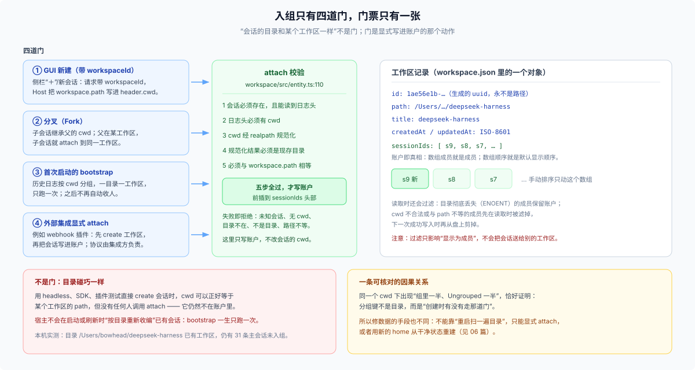

# 03 · 入组：四道门，一张门票，一次性的历史扫描

## 这一篇回答什么

一个会话要怎样才能“属于”某个工作区？为什么目录相同不算？删除工作区之后会话去哪？把目录挪走再挪回来，成员资格还在吗？

## 总图



入组只有一个写入口：`Workspace.attachSession(sessionId)`。四道门只是四个**调用它的时机**：

| 门 | 触发者 | 会话的 cwd 从哪来 |
|---|---|---|
| ① GUI 新建 | 侧栏“＋” / 新会话 | `workspace.path`（Host 解析后写入日志头） |
| ② 分叉 Fork | 会话菜单 | 继承源会话的 `header.cwd` |
| ③ 历史 bootstrap | 第一次成功启动 | 日志头里已有的 cwd |
| ④ 外部集成 attach | webhook 等宿主集成 | 集成方自行创建（通常是它刚登记的工作区路径） |

## 门票：五步校验

`attachSession`（`packages/workspace/workspace/src/entity.ts:110`）在写入前做五件事，任何一步失败都拒绝且不写：

1. 会话必须存在：活会话，或持久层能读到日志头；
2. 日志头必须有 `cwd`；
3. `cwd` 经 `realpathNormalize` 规范化；
4. 规范化结果必须是一个现存目录；
5. 必须与 `record.path` 字符串相等。

通过后把 id **前插**到 `sessionIds` 头部，并刷新 `updatedAt`。已经登记过的 id 走快速路径：不重复校验、不重复写。

这里有一个刻意的例外：**已登记成员**在读取时如果目录解析失败（`ENOENT`，包括悬空符号链接），会保留账户；但**新 attach** 不做这个宽容——目录不在就是不在。所以“目录临时挪走”不会把老会话踢出去，“目录已经没了”也不会让新会话混进来。

## 门 ①：GUI 新建

Client 的“＋”最终发一个 `session.create { workspaceId }`（`packages/client/ui-workspace/src/client/navigation.ts` 的 `createInWorkspace`）。Host 侧（`packages/api/session-controller/src/commands.ts:111`）：

1. 校验请求：`workspaceId` 与 `cwd` 互斥；
2. `workspaceRegistry.get(workspaceId)`，未知则报 `workspace/not-found`；
3. `cwd = workspace.path ?? request.cwd ?? defaultCwd`；
4. `agents.createSession({ cwd, ... })`，cwd 落进日志头；
5. `workspace.attachSession(sessionId)`；失败则抛 `session/workspace-attach-failed`。

第 5 步失败时有一个重要事实：**会话已经建好了**，只是没进账户。这类会话会出现在列表里，然后落进 Ungrouped。错误信息会把两个 id 都带上，方便定位。

还有一个“复用空白会话”的细节：Client 会先找同一工作区里、`cwd === workspace.path`、未归档的空白会话；找到就复用，找不到才新建。所以在同一个窗口里反复点“＋”不会堆出一串空白会话。

## 门 ②：分叉

Fork 的 cwd 直接继承源会话的 `header.cwd`。工作区归属（`commands.ts:550` 的 `forkWorkspace`）：

1. 源会话**自己**在某条记录里 → 就用那条；
2. 源会话不在任何记录里、且 `origin === 'subagent'` → 沿谱系找最近的、登记过的祖先；
3. 都找不到 → 子会话不 attach，仍然 Ungrouped。

第 2 步是为 subagent 准备的：子会话本身不显示在侧栏，但它的分叉应该回到“人类看得见的那条工作区”。

## 门 ③：历史 bootstrap（一生一次）

第一次成功启动且 `initialized = false` 时，registry 读**全部**会话日志头，按规范化 cwd 分组（`src/index.ts:650`）：

- 一组 = 一条新工作区，标题取目录最后一段；
- 组内按创建时间排序，账户顺序是“新的在前”；
- 工作区之间的顺序按“组内最新会话的创建时间”倒序；
- 只读 `id / cwd / createdAt`，不读事件体；
- cwd 缺失、目录不存在、不是目录的会话**不入组**；
- 全部写完后才落 `initialized: true`，所以中断可以续跑。

关键在“一次”：`initialized` 一旦为真，后续启动只加载记录，**不会重新扫目录**。这解释了为什么“目录明明有工作区，会话还是没进去”——它是在 bootstrap 之后创建的，又没有走另外三道门。

## 门 ④：外部集成

以实验性 webhook 插件为例（`packages/experimental/webhook/src/session.ts:131`）：

```text
workspaceRegistry.create(workspacePath)   // 没有就建，有就复用
agents.create({ meta: { cwd: workspace.path } })
workspace.attachSession(sessionId)
```

顺序是先有工作区、再按它的路径建会话、最后 attach。集成方对“入组”负责；DSH 不会因为平台上出现了某个目录就自动建记录。

## 不是门：目录碰巧一样

这是最容易误解的一条。宿主**没有**“按目录自动收编”的行为：

- 启动时不扫；
- 刷新列表时不扫；
- 创建会话时不匹配；
- 工作区被删之后，也不会有“孤儿回收”。

所以出现下面这种分布是正常的（本机实测）：

```text
/Users/bowhead/deepseek-harness
├── 工作区 deepseek-harness：若干个已登记会话
└── 同一目录下 31 条主会话：未登记 → Ungrouped
```

它们与组内的会话共享同一个 cwd、同一个沙箱边界、同一个项目文件树；唯一的差别是创建时有没有人调用 `attachSession`。

## 删除、重加、目录丢失

| 动作 | 记录 | 会话 | 目录/日志 | 会话的归属 |
|---|---|---|---|---|
| 删除工作区 | 删除 | 保留 | 保留 | 立即变成 Ungrouped |
| 重加同一目录 | 新建一条空记录 | 保留 | 保留 | 仍是 Ungrouped；不会自动回来 |
| 目录被临时移走 | 保留 | 保留 | 暂缺 | 已登记成员保留账户；UI 可能显示目录状态异常 |
| 目录被永久删除 | 保留 | 保留 | 缺失 | 已登记成员仍保留账户；新 attach 一律拒绝 |
| 重命名工作区 | 标题变 | 不变 | 不变 | 不变 |
| 拖动会话 | 不变 | 不变 | 不变 | 只改浏览器本地显示顺序 |

“删除只动账户”是产品明确的设计：移除项目不删除文件夹、文件与会话历史。代价就是**账户不会自愈**：重新加回目录只得到一条空记录，旧会话需要显式 attach 才能回来；而当前 GUI 没有“把某个会话移入某个工作区”的入口（会话菜单只有分叉、归档、置顶、复制 id）。

## 失败与恢复

- **两写标记**：创建/删除都要写“记录 + 顺序”两处，先落 `pendingMutation`；启动时只完成或回滚被标记的那一次。没有标记却顺序不一致 → 直接报损坏。
- **attach 失败**：会话已创建，错误码 `session/workspace-attach-failed`，附带 `sessionId` 与 `workspaceId`；不会回滚已建的会话。
- **顺序写失败**：`insertSessionBefore` 的账户错误抛 `WorkspaceMoveInvalidError`，存储错误原样抛；成功的变更都会刷新 `updatedAt` 并顺手剪掉不再合规的成员。

## 边界

- “会话只能属于一个工作区”由唯一的 `attachSession` 路径与读取时的单账户假设保证；注册表校验会拒绝同一 id 出现在两条记录里。
- 当前没有任何“批量补登记”的产品入口；04 篇会讨论这意味着什么，06 篇给出可执行的处置方式。
- 归档是另一套全局集合：归档会保留账户名额（取消归档要回到原位置），但不参与“入组”判断。
