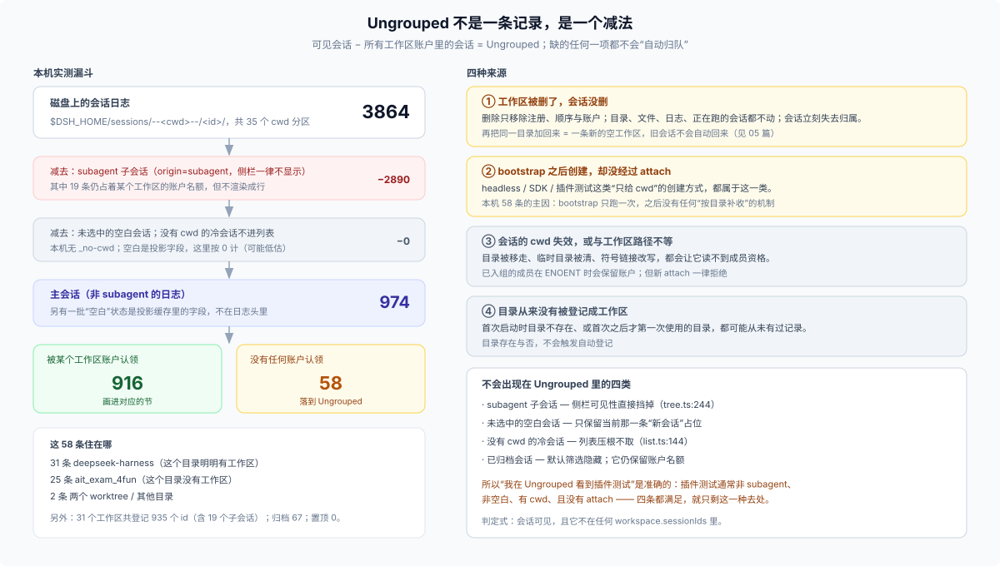

# 04 · Ungrouped：一个减法，而不是一条记录

## 这一篇回答什么

左侧末尾的 Ungrouped 是谁造出来的？为什么我的测试插件会话会掉进去？它和“没有 cwd”“被删的工作区”“subagent”分别是什么关系？为什么同一个目录的会话可以一半在组里、一半在这里？

## 它不在 Host 里

在 Host 的记录中找不到“Ungrouped”这条工作区：它没有 uuid、没有路径、没有标题、没有创建时间。它是 Client 在 `deriveGroups` 里的最后一个分组（`packages/client/ui-workspace/src/client/tree.ts:334`）：

```text
groups = 按 workspaceIds 顺序，为每条记录建一节
members(g) = g.sessionIds ∩ 当前会话列表
accounted = 所有被任何一节取走的 id
stray = 列表里可见、但不在 accounted 里的会话
if stray 非空: 末尾追加 key = '' 的一节（UNGROUPED_KEY）
```

所以它的判定式只有一句：**可见，且不被任何工作区账户认领**。

三个随之而来的属性：

- **没有工作区菜单**（不能重命名/删除）、**没有悬浮卡片**（没有路径可显示）、**右上“＋”是惰性的**（不知道该往哪个目录建）；
- 标签不是 Host 数据，而是字典里的 `group.ungrouped`（中文“未分组”，英文“Ungrouped”）；
- 默认按“最近更新”现算顺序；只有切到手动排序时，才用浏览器本地保存的那份顺序（`sessionOrderByAccount` 里 key 为 `''` 的数组）。

## 什么会进来，什么不会

| 会话状态 | 会进 Ungrouped？ | 原因 |
|---|---|---|
| 主会话、有 cwd、未登记 | 会 | 唯一真正的来源 |
| 主会话、有 cwd、已登记 | 不会 | 被对应工作区取走 |
| 主会话、有 cwd、已归档、未登记 | 默认不显示 | 归档筛选默认隐藏；切到“显示已归档”会出现 |
| 空白会话、当前选中 | 会（若未登记） | 可见性保留当前空白 |
| 空白会话、未选中 | 不会 | 可见性规则挡掉 |
| `origin = subagent` | 不会 | 可见性规则直接排除 |
| 没有 cwd 的冷会话 | 不会 | 列表阶段就不取（`session-controller/src/list.ts:144`） |
| 没有 cwd 的活会话 | 可能 | 活会话不经过冷列表过滤，但会因“无记录”落到 Ungrouped |

这张表解释了一个常见误会：**Ungrouped 不是“无家可归会话”的完整集合**。它只是“进入了列表、又没有账户”的那一部分；subagent、未选中空白、无 cwd 冷会话根本不参与这个减法。

## 四种来源



### ① 工作区被删了

删除只移除注册、顺序与账户；目录、文件、会话日志、正在跑的会话都不动。于是原来的成员在一瞬间变成“可见但无账户”，落到 Ungrouped。这是设计使然，不是故障。

### ② bootstrap 之后创建，却没经过 attach

这是最常见、也最容易被误认为 bug 的一种。bootstrap 一生只跑一次；之后：

- headless / CLI 跑出来的会话；
- SDK、脚本、自动化创建的会话；
- 插件测试、端到端测试创建的会话；
- 任何只传 `cwd`、不传 `workspaceId`、也不显式 attach 的创建路径；

都只拥有 cwd，不拥有账户。**它们与目录里已有的工作区毫无关系**，哪怕路径一模一样。

### ③ 会话的 cwd 失效，或与工作区路径不等

目录被移走、临时目录被清、符号链接被改写，都会让成员资格校验失败。已登记成员在 `ENOENT` 时保留账户；但“从来没有登记过”的会话不会因为目录恢复而获得账户。

### ④ 目录从来没有被登记成工作区

bootstrap 时目录不存在、或首次之后才第一次使用的目录，都可能从未有过记录。目录存在与否不会触发自动登记；只有 `create` 才会。

## 本机实测：58 条，分布本身就是证据

方法：静态读取 `$DSH_HOME/storages/workspace.json` 与会话日志首行（Node 的 `zstdDecompressSync` 解第一帧），统计 `origin / parentSession / cwd`，再与账户并集求差；时间 2026-10-27。

| 步骤 | 数量 |
|---|---|
| 磁盘会话目录 | 3864 |
| 其中 subagent 子会话 | 2890 |
| 主会话 | 974 |
| 已登记主会话 | 916 |
| **未登记主会话** | **58** |
| 其中位于 `/Users/bowhead/deepseek-harness` | 31（该目录有工作区） |
| 位于 `ait_exam_4fun` | 25（该目录没有工作区） |
| 位于两个 worktree 目录 | 2 |
| cwd 分区总数 | 35 |
| 工作区 / 已登记 id / 归档 | 31 / 935 / 67 |

前 31 条是决定性的：同一个目录、同一套文件、同样的 cwd 合法性，仍然留在 Ungrouped。**如果分组是“按目录实时匹配”，这 31 条不可能存在。**

## 为什么偏偏是“测试插件”

把插件测试的典型做法对到上表：

1. 测试直接在进程内用宿主 API 建会话（`ctx.agents.createSession(...)` 或等价路径），传一个临时目录或仓库目录作 cwd；
2. 它不经过 GUI 的 `session.create`，因此没有 `workspaceId`，也没有 `attachSession`；
3. 如果测试跑在**同一个** `$DSH_HOME` 下，这些日志就与日常会话混在同一个列表里；
4. 它们不是 subagent、不是空白、有 cwd —— 四条可见性条件全过，只剩 Ungrouped 一个去处。

反过来，如果测试用独立的 `DSH_HOME`（或独立的 profile home），这些会话根本不会进你的侧栏——这也是 06 篇推荐的做法。

## 顺带解释三个界面现象

**为什么 Ungrouped 有时自动展开？** 当当前选中的会话正好是未登记的松散会话时，Client 会把这个桶展开，否则用户会看不到自己正在看的行；这条行为有测试钉住（`workspace-browser.client.spec.tsx` 的 “auto-expands the Ungrouped bucket for a loose current session”）。

**为什么它没有“…”菜单？** 菜单里的重命名与删除都要求一个 backing Workspace；Ungrouped 的 `workspaceId` 是 `undefined`，渲染器据此不挂菜单（`rows/Rows.tsx` 的 `ProjectRowItem`）。

**为什么搜索结果里也写着 Ungrouped？** 搜索结果是扁平的，每行带一个工作区名作上下文；未登记会话没有工作区名，就用同一个字典标签兜底（`Rows.tsx:516`）。

## 它不是回收站

Ungrouped 里的会话可以正常打开、继续、分叉、归档；只有“工作区级”的动作缺失。它也不承担“删除”语义：删工作区不会把会话移到这里就算完，会话本身仍然完整地躺在 `$DSH_HOME/sessions/--<cwd>--/<id>/` 里，日志一行不少。

真正意义上的“删除会话”在当前产品里并不存在；能做的只有归档（隐藏但保留）。这也是为什么“删工作区”必须是非破坏性的：否则删错一条记录就会连带毁掉一批日志。

## 边界

- 本机读数是一次静态快照；“58”没有扣除 UI 可能隐藏的空白行（本机这些 id 在投影缓存里没有元数据，按 `blank ?? false` 处理为可见）。
- Ungrouped 只存在于“按工作区 / 按工作区树”两种分组方式；切到“单列表”时没有分组，也就没有这个桶。
- 远程访问会先裁剪可见工作区与会话，再进入这个减法；被裁剪掉的会话不会以 Ungrouped 的形式泄露。
