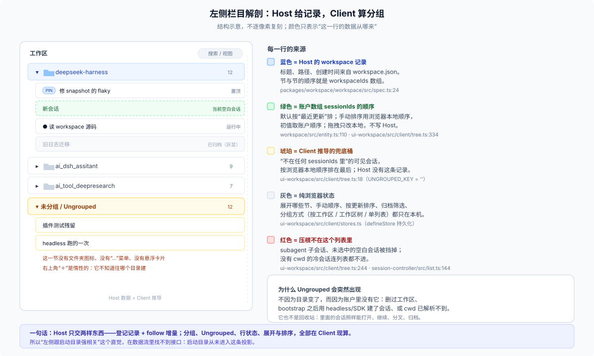
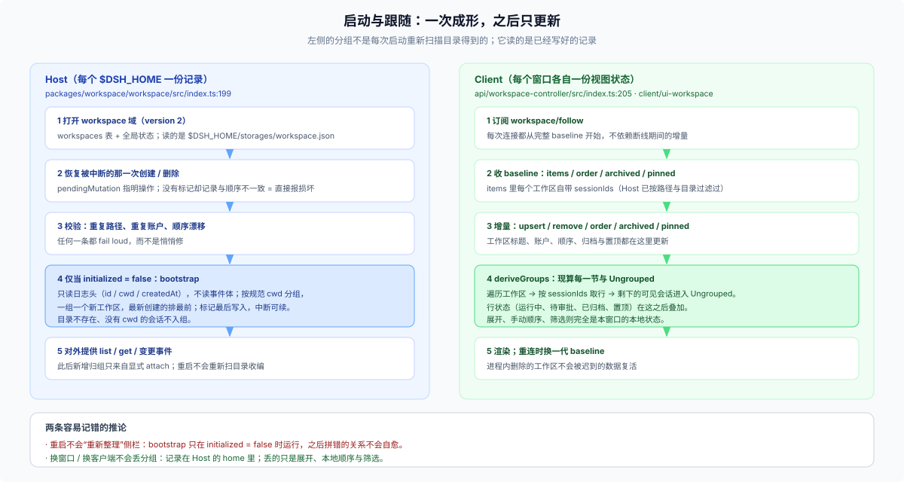

# 05 · 左侧栏目的每一行：谁给的，谁算的

## 这一篇回答什么

左侧的节、行、顺序、置顶、灰显、空白会话，分别来自 Host 还是浏览器？为什么“最近更新”和“手动排序”会给出不同顺序？换窗口、断线重连、删除工作区时，界面上的东西为什么会/不会消失？

术语先对齐：左侧每一行是一个 **Session**（会话）。DSH 文档里的 **Conversation** 指客户端把会话事件装配成对话视图的那一层（[conversation.md](../../docs/subsystems/conversation.md)），它不参与分组，也不拥有工作区关系，只是“打开某一行之后怎么渲染”。下文说“行/会话”都指 Session。

## 数据从 Host 到界面的三段



三段的分工可以先用一张时序图记住：Host 一侧启动时成形，Client 一侧持续跟随。



### 第一段：Host 的记录与流

Host 暴露 `workspace/follow` 流（`packages/api/workspace-controller/src/index.ts:205`）：

- 每次连接先给一份**完整 baseline**：`items`（每个工作区连同 `sessionIds`）、`workspaceIds` 顺序、`archivedSessionIds`、`pinnedSessionIds`；
- 之后只发增量：`upsert`、`remove`、`order`、`archived`、`pinned`，必要时发 `replace`（权限裁剪变化时用，语义等同新 baseline）；
- 断线重连不保证补齐断线期间的每一条增量，但一定会重发 baseline，所以客户端不依赖“没漏帧”。

`WorkspaceView` 的字段就是记录字段的投影：`workspaceId / path / title / sessionIds / createdAt / updatedAt`。Host 在投影时已经按成员资格过滤过 `sessionIds`（目录丢失保留、非法剔除），所以 Client 拿到的就是“可显示的账户”。

### 第二段：Client 的数据模型

`ClientWorkspaceModel` 维护：

- 工作区行、注册顺序；
- 归档与置顶两个全局 id 集合；
- 一元变更（重命名、删除、拖动）的本地回显；
- 流与一元响应的竞态：较新的 Host 行按 `updatedAt` 胜出；已提交的流顺序压过旧的一元响应；**被删除的 id 不能被迟到的数据复活**（进程内删除标记）。

### 第三段：`deriveGroups` 现算

`packages/client/ui-workspace/src/client/tree.ts:436` 的 `deriveGroups(list, workspaces, rowState, statuses, view)` 做四件事：

1. 按 `workspaces` 顺序建节；
2. 每节按 `sessionIds` 取行，过滤不可见项；
3. 剩下未被认领的可见会话组成末尾的 Ungrouped；
4. 叠加置顶、归档、运行状态、待交互状态。

## 两种排序，两个层级

左侧有**两层顺序**，由不同的东西决定：

| 层级 | 由谁决定 | 选项 |
|---|---|---|
| 节与节之间 | 并列模式下是 Host 的 `workspaceIds`；树模式再按路径嵌套 | 拖拽同层工作区写 Host；没有“按最近更新排工作区”的开关 |
| 节内行之间 | 浏览器视图状态 + 账户 | `orderBy: 'updated'`（默认）或 `'manual'` |

节内的两种模式：

- **按最近更新**（默认）：每节把成员按 `updatedAt` 降序重排，账户顺序不参与；
- **手动排序**：用浏览器本地保存的每账户顺序；第一次切换时以当前显示顺序为初值；之后就靠拖拽，拖拽会写 `insertSessionBefore`，所以 Host 的账户顺序也跟着变。

两条容易被忽略的规则：

- **置顶行永远领跑本节**：`sectionMembers` 先放当前空白占位，再放置顶，再放其余；无论哪种排序都如此。
- **归档不改变账户槽位**：归档只把 id 加进全局集合，不改 `sessionIds`；手动顺序下取消归档会回到本地保存的位置，默认按最近更新时则按时间重排。默认筛选隐藏，切到“显示已归档”会灰显且不可打开。

## 行的状态：Client 合成，Host 只给一半

| 行上的东西 | 来源 |
|---|---|
| 标题、是否空白 | 会话列表（投影缓存 / 日志） |
| 运行中、子代理数量、待审批/待计划/待回答、完成未读 | 会话状态快照与投影（`useSessionStatus`） |
| 置顶 | Host 的 `pinnedSessionIds` |
| 已归档 | Host 的 `archivedSessionIds` |
| 选中高亮、所在节高亮 | 当前主视图引用（`retainedBy.mainView`） |
| 展开/折叠 | 浏览器本地 `groupExpansion` |

所以“一个会话在跑”不需要 Host 专门给工作区流发事件：行状态由会话侧的状态源提供，工作区流只负责“它在哪一节、什么顺序、是否置顶/归档”。

## 三种分组方式

| 模式 | 长什么样 | Ungrouped |
|---|---|---|
| 按工作区（默认） | 并列的工作区节 | 末尾一节 |
| 按工作区树 | 按路径前缀嵌套的工作区树 | 末尾一节 |
| 单列表 | 不分节，所有会话一个列表 | 无（没有节） |

三种模式共用同一份会话列表与同一套行状态，切换只改变投影结构；`groupBy` 存在浏览器本地，不写 Host。树模式的父子关系取“最近的、已登记祖先目录”（`owningParentFolder`），不是任意字符串前缀；根层顺序仍按 `workspaceIds`。

## 交互动词：哪些写 Host，哪些只写本地

| 动作 | 写到哪 | 备注 |
|---|---|---|
| 添加工作区 | Host（`workspaceRegistry.create`） | 目录选择器选一个已存在目录 |
| 重命名 / 删除工作区 | Host | 删除只移除注册；不删目录与会话 |
| 拖动工作区 | Host（`insertBefore`） | 改 `workspaceIds` |
| 拖动会话 | 浏览器本地 | 只改本窗口的手动顺序；Host 的 `sessionIds` 不变（API 有 `insertSessionBefore`，当前 GUI 不调用） |
| 新建会话 | Host（`session.create { workspaceId }`） | 复用可复用的空白 |
| 分叉 | Host（`session.fork`） | 子会话继承工作区 |
| 归档 / 取消归档 | Host | 归档会拒绝仍有运行工作的会话，除非显式停掉 |
| 置顶 / 取消置顶 | Host | 置顶要求会话已知且未归档；归档会在同一次写入里清掉置顶 |
| 展开 / 折叠、筛选、分组方式、手动顺序快照 | 浏览器本地 | 换窗口不共享 |

## 断线、重连、多窗口

- **重连**：换一代 baseline，整份替换；不会因为“少收了一条 remove”而留下幽灵工作区。
- **多窗口**：记录与增量共享（同一个 Host、同一个 home），视图状态各自独立（包括手动会话顺序）；A 窗口删掉的工作区，B 窗口收到 `remove` 后整节消失。
- **删除后立刻重加**：新记录的 id 与旧的不同，Client 看到的是 `remove` + `upsert` 两条，不会把旧账户带回来。
- **迟到的一元响应**：删除标记保证被删 id 不会被旧响应复活；这是进程内的保护，重启后以持久状态为准。

## 一个具体的渲染顺序

以本机数据为例，一个会话从“新建”到“出现在某节第一行”要经过：

```text
Host: create session (cwd = workspace.path) → attach (前插 sessionIds)
  → domain/changed → workspace/follow: upsert(workspace, sessionIds 新数组)
Client: 更新工作区行 → deriveGroups
  → 按 updated 排序（新会话 updatedAt 最大）→ 节内第一
  → 空白状态：只显示当前那一个，且置于置顶之前
```

如果这个会话是空白且未选中，它不会显示；如果它被归档，会按筛选隐藏或灰显；如果它从未 attach，它在 Ungrouped 里。

## 边界

- 本节不描述视觉样式；行的具体像素、颜色、间距由 UI 主题决定。
- 远程访问会先裁剪工作区与会话，再进入同一套推导；非 owner 看到的是裁剪后的 baseline 与 `replace` 帧。
- 会话列表当前是一次完整拉取：请求类型保留了 `cursor` 字段，但 Host 的 `list` 忽略它。账户可能先于某条会话摘要到达，这时该行暂时缺席，摘要落地后自动出现。
