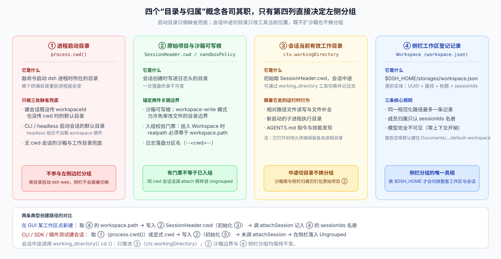
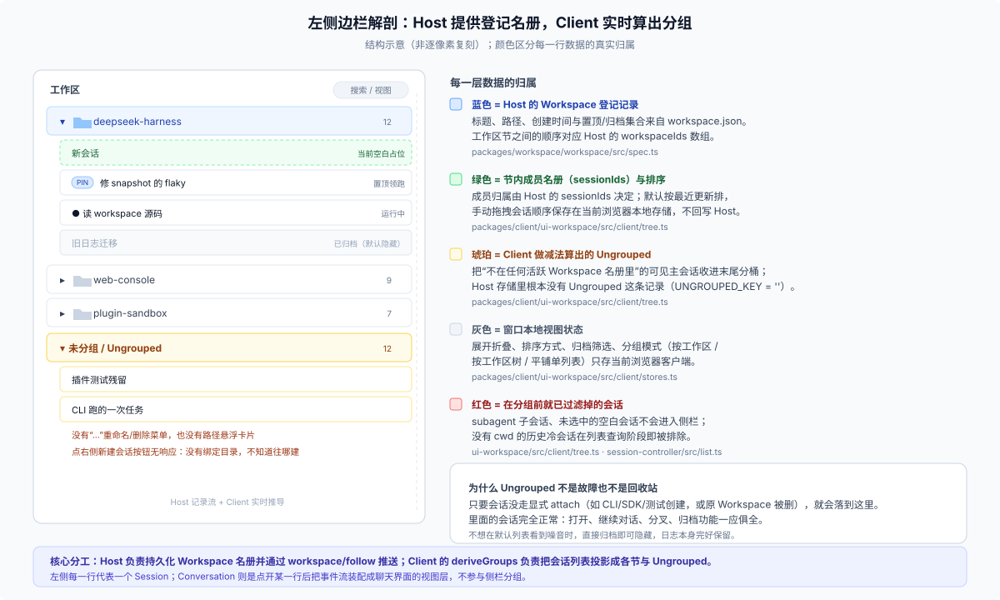

# Answer 25 · Workspace 不是物理目录锁，而是 `$DSH_HOME` 里的登记簿：会话靠显式挂接归组，Ungrouped 是前端做减法

## 一句话结论

想在 30 秒内理顺左侧边栏和工作目录的关系，记住三条核心机制就够了：

1. **`Workspace` 不是磁盘上的文件夹，也不是启动命令时的目录，而是 `$DSH_HOME/storages/workspace.json` 里的一条实体登记记录**：它拥有独立的稳定 UUID、显示标题、经 `fs.realpath` 规范化后的目录路径，以及一份有序的**已登记会话列表（`sessionIds`）**。模型对它完全无感知——不注册工具、不注入提示词、不写会话事件，零上下文开销。
2. **四个经常被混为一谈的“目录与归属”各管一摊**：启动进程时的 `process.cwd()` 只做缺省兜底；会话创建时写死在日志头的 `SessionHeader.cwd` 锁定**原始项目与沙箱可写边界（`sandboxPolicy`）**；会话内可随 `working_directory` 工具切换的 `ctx.workingDirectory` 决定**当前轮工具执行的有效工作目录**；而左侧边栏分组只认 **`Workspace` 记录里的 `sessionIds` 名册**。
3. **会话靠显式 `attach` 挂进工作区，`Ungrouped` 是前端实时算出来的差集**：目录路径一致只是入组校验的门票，只有真正调用过 `attachSession` 的会话才会进入 `sessionIds` 名册；后端根本不存在叫 `Ungrouped` 的分组，它是客户端用“侧栏可见主会话 − 所有活跃 Workspace 已认领的会话”做减法得出的兜底视图。

想看底层存储结构、入组校验与会话中途切目录的完整联动，跳读 [`01-workspace-entity-and-sidebar-grouping.md`](./01-workspace-entity-and-sidebar-grouping.md)；想排查与清理本机 `$DSH_HOME` 里的未分组残留，直接看 [`02-diagnosing-and-cleaning-up-sessions.md`](./02-diagnosing-and-cleaning-up-sessions.md)。

---

## 一、先拆清四个“目录与归属”概念

很多困惑都源于把“目录”当成了同一个变量。在 DSH 运行时里，下面四样东西的生命周期和职责完全独立：

| 概念 | 权威持有者 | 什么时候确定 / 会不会变 | 真正决定什么 | 会影响左侧分组吗？ |
|---|---|---|---|---|
| **1. 进程启动目录** `process.cwd()` | 操作系统进程 | 启动 `dsh` 命令时确定；换目录重启进程才变 | CLI / headless 会话的默认目录；API 建会话既未传 `workspaceId` 也未传 `cwd` 时的兜底值 | **不会**（换目录启动 `dsh web`，侧栏不变） |
| **2. 原始项目与沙箱根** `SessionHeader.cwd` + [`sandboxPolicy`](https://github.com/deepseek-ai/deepseek-harness/blob/master/packages/sandbox/sandbox-policy/README.md) | 会话日志头 | **创建会话时写入，此后终身不可变** | `workspace-write` 模式下沙箱免审可写的目录边界；挂入 `Workspace` 时的路径校验门票；日志磁盘分区名 | **只当门票**（路径相同但没挂接，照样进 `Ungrouped`） |
| **3. 会话当前有效工作目录** [`ctx.workingDirectory`](https://github.com/deepseek-ai/deepseek-harness/blob/master/docs/subsystems/working-directory.md) | 会话事件流投影 | 初始等于 `SessionHeader.cwd`；会话中途可调 `working_directory({ cd })` 切换并写事件 | 相对路径文件读写、新启动的子进程、文件补全、`AGENTS.md` 指令与技能发现的当前目录（已打开的持久终端保留原进程目录） | **不会**（中途 `cd` 到别的仓库，既不换分组也不扩沙箱） |
| **4. 侧栏工作区登记项** [`Workspace`](https://github.com/deepseek-ai/deepseek-harness/blob/master/docs/subsystems/workspace.md)（`ctx.workspaceRegistry`） | `$DSH_HOME/storages/workspace.json` | 用户添加/删除工作区或首次启动引导时变更；随 `$DSH_HOME` 持久保存 | 左侧边栏有哪些项目节、节的排列顺序，以及哪些会话属于哪个节（`sessionIds` 名册） | **直接决定** |

> **补充两个环境坐标**：
> - **`$DSH_HOME`（默认 `~/.dsh`）**：同时装着 `storages/workspace.json` 和 `sessions/` 日志。切换 `DSH_HOME` 环境变量，才会整套切换侧栏工作区与会话历史（多环境隔离做法见 [FAQ 23](../23_standalone-vs-web-release-forms/answer.md)）。
> - **首次启动的 `default-workspace`**：当工作区注册表和全部会话历史都为空时，GUI 会自动在 `<Documents>/deepseek-harness/default-workspace` 下建目录并登记默认工作区（界面按当前语言显示为“默认工作区”），同样与启动目录无关。

---

## 二、为什么有的会话进了 Workspace，有的掉进 Ungrouped？

会话日志在磁盘上虽然按 `--<normalized-cwd>--` 分目录存放，但**那只是文件存储布局，侧栏分组绝不扫描目录或实时比对路径**。

一个会话要想出现在某个 `Workspace` 下面，必须走过**四道显式挂接门**之一，通过路径一致性校验（`realpath(header.cwd) === workspace.path`）后把 ID 写进该工作区的 `sessionIds` 名册：

1. **在 GUI 某个工作区下点新建**：前端传 `workspaceId`，后端把 `workspace.path` 写入新会话的 `SessionHeader.cwd`，随即调用 `attachSession` 前插进名册。
2. **从已归组的会话分叉（Fork）**：子会话继承源会话的 `cwd`，并自动挂入源会话（或 `subagent` 最近的已归组祖先）所在的工作区。
3. **每个 `$DSH_HOME` 一生一次的历史 `bootstrap`**：仅在 `workspace.json` 尚未初始化（`initialized === false`）的第一次启动时，宿主读取全部现存会话头，按规范化 `cwd` 自动建组归档；一旦写下 `initialized: true`，**后续重启永远不再按目录自动补收**。
4. **宿主侧扩展显式调用 API**：例如外部集成插件先 `workspaceRegistry.create(path)`，建好会话后再显式调用 `workspace.attachSession(sessionId)`。

凡是没走这四道门的可见主会话——最典型的就是 **`bootstrap` 完成之后用 CLI / headless、SDK 脚本或共用 `~/.dsh` 的插件测试直接传 `cwd` 建出来的会话**，或者**原本所属的 Workspace 被用户从侧栏移除了**——在前端 [`deriveGroups`](https://github.com/deepseek-ai/deepseek-harness/blob/master/packages/client/ui-workspace/src/client/tree.ts) 计算分组时不属于任何 `sessionIds` 名册，就会统一落入最底部的 `Ungrouped`。（至于 `subagent` 子会话、未选中的空白占位会话、以及无 `cwd` 的冷会话，在进入分组前就会被过滤掉，连 `Ungrouped` 都不会进。）

---

## 三、五个最容易踩空的直觉误区

1. **“换个目录敲 `dsh web`，左边的项目就会跟着切过去”**
   不会。Web / Desktop 侧栏读的是 `$DSH_HOME/storages/workspace.json`，启动目录 `process.cwd()` 根本不进侧栏数据流。想把新目录加进侧栏，直接在界面里点添加工作区即可。
2. **“让模型在对话里切到另一个目录，沙箱写权限和侧栏分组也会跟着搬家”**
   都不会。调用 `working_directory({ cd })` 只更新该会话的 `ctx.workingDirectory`，方便后续工具用相对路径读写；但 `sandboxPolicy` 的 `workspace-write` 边界和 `Workspace` 名册校验始终锚定创建时的 `SessionHeader.cwd`，越出原项目写文件照样会触发沙箱拦截与审批。
3. **“在侧栏删掉一个 Workspace，会把本地代码或历史聊天记录删掉”**
   绝对不会。`workspaceRegistry.delete` 是纯非破坏性操作：只移除这条登记记录、排序位置和名册引用，磁盘文件夹、源码文件和 `sessions/` 日志原封不动，原名册里的会话立刻变成 `Ungrouped`。
4. **“误删了 Workspace，把同一个文件夹重新加回来就能找回原来的分组”**
   不会自动找回。重新添加同一路径会生成一条全新 UUID、空 `sessionIds` 的新工作区；之所以不在启动时“按目录自动收编旧会话”，正是为了防止用户刚删掉的工作区在下次重启时又幽灵般复活。
5. **“`Ungrouped` 是报错提示或回收站，掉进去的会话不能用了”**
   完全不是。`Ungrouped` 里的会话在打开、继续聊天、分叉、置顶、归档上与普通会话没有任何区别；唯一的差异是没有绑定的 `Workspace` 实体，因此顶栏不显示重命名/删除菜单和路径悬浮卡，点它的新建会话按钮也不会有反应。

---

## 四、四个高频细节快答

| 日常疑问 | 一句话真相 |
|---|---|
| **左侧一行代表 `Conversation` 吗？** | 左侧每一行是一个 **Session（会话）**；`Conversation` 是点开某行后把事件流渲染成聊天气泡的前端视图层，不参与侧栏分组。 |
| **为什么跑了几千个 `subagent` 却没把 `Ungrouped` 撑爆？** | 侧栏可见性过滤直接排除了 `origin === 'subagent'` 的子会话、未选中的空白占位会话以及无 `cwd` 的历史冷会话，它们压根不参与差集计算。 |
| **同一个 `$DSH_HOME` 开两个浏览器窗口，侧栏同步吗？** | 工作区增删改排、新建会话、置顶和归档通过 `workspace/follow` 流**实时同步**；展开折叠、分组视图模式和会话手动排序则**各窗口独立保存**。 |
| **两个不同路径的文件夹重名（比如都叫 `app`）能同时加吗？** | 可以。底层按 `realpath` 判唯一，默认取末段目录名做标题时允许同名；但通过界面重命名工作区时会拦截与现有工作区重名（`workspace/name-conflict`）。 |

---

## 五、诚实边界

- **无跨进程文件锁**：`workspace.json` 走单文件 JSON 存储后端，没有跨进程写锁；切勿在 Host 运行期间手改该文件，也不要让多个独立 Host 进程并发读写同一个 `$DSH_HOME`。
- **界面暂不支持拖拽改归属或跨端同步会话手动顺序**：当前 GUI 会话右键菜单提供分叉、置顶、归档和复制 ID，尚未提供“将未分组会话移入某工作区”的按钮；在节内上下拖拽会话只修改当前浏览器本地保存的手动顺序（`dsh.workspace.view.v5`），不会调用宿主的 `insertSessionBefore` 改写服务端名册。
- **外部删改物理目录延迟感知**：`ctx.workspaceRegistry` 不常驻监听文件系统事件；外部进程删掉目录后，已入组老会话在读取时遇到 `ENOENT` 会保留名册位置（防临时移动目录导致掉组），但禁止新会话继续挂入，目录缺失状态在下一次查询或刷新时体现。

---

## 继续阅读

| 你想了解什么 | 去哪篇看 |
|---|---|
| `workspace.json` 存储结构、四道入组门与五步校验、前端 `deriveGroups` 投影细节，以及启动跟随与中途切目录的完整时序 | [`01-workspace-entity-and-sidebar-grouping.md`](./01-workspace-entity-and-sidebar-grouping.md) |
| 为什么日常 `~/.dsh` 会攒出几十个工作区与未分组会话（含 31 工作区 / 58 未分组会话实测拆解），以及分角色安全清理手册 | [`02-diagnosing-and-cleaning-up-sessions.md`](./02-diagnosing-and-cleaning-up-sessions.md) |
| 子系统文档、前后端源码路径、历史决策记录（Agent Notes）与只读排查脚本汇总 | [`reference.md`](./reference.md) |

> 核验状态见 [核验基线登记](../00-baseline.md)。
