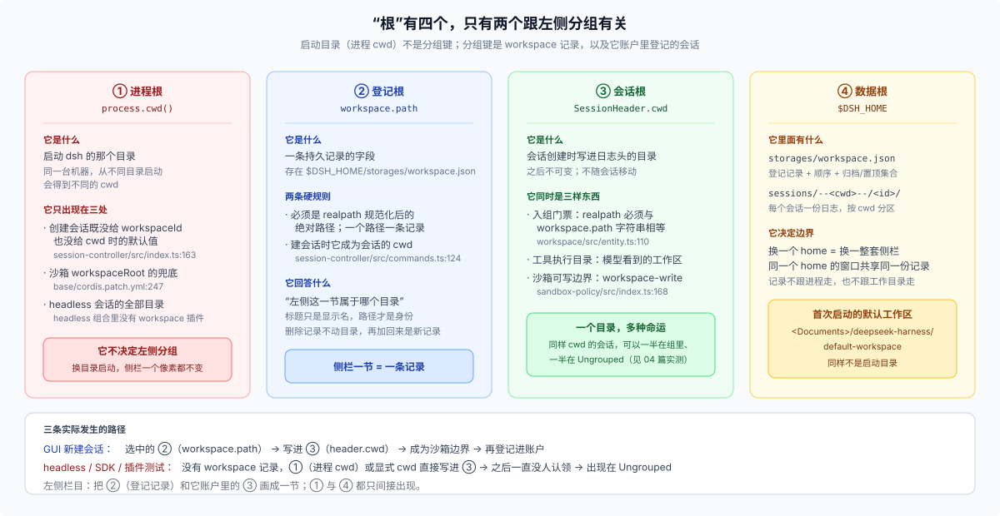

# 25 · Workspace 到底是不是“启动时的那个目录根”？左侧会话为什么跟它绑定？

源码核验基线：`dsh-v0.2.1-rc.3`（`1f81c047fc48fa190a683e469daa699857e9afe8`），与 `_digested/` 同一基线。本篇的产品行为结论来自仓库内产品文档、包 README 与源码；本机读数来自对 `$DSH_HOME` 的一次静态读取（2026-10-27），不是对 UI 的像素级测量。

## 问题从哪来

我在 Web GUI 左边看到两件事：

1. 有一列 **Workspaces**，每个工作区下面挂着一串会话；
2. 有一个叫 **Ungrouped / 未分组** 的节，我一些测试插件跑出来的会话就躺在那里。

于是我有两个很自然的假想：

- **H1：Workspace 就是 DSH 启动时的工作目录根。** 我理解成“我在哪个目录启动 `dsh web`，左侧就对应哪个项目”；工作区只是这个根在界面上的名字。
- **H2：左侧的 Conversation 跟这个根强相关。** 既然会话都显示在根下面，它们大概是通过“会话在哪个目录跑”被实时归到这个根里的；换个目录启动，或者把目录挪走，分组就会跟着变。

这两个假想合起来很顺：进程根 → 工作区 → 会话，一条链。但它们解释不了几件我在数据里看到的事：

- 同一个目录下，有的会话在工作区里，有的在 Ungrouped；
- 我没删过目录，Ungrouped 却越攒越多；
- 从另一个目录启动 Web，左侧并没有换成另一个项目；
- 首次启动时冒出来的工作区，不在我启动的目录，而在 `~/Documents/deepseek-harness/default-workspace`。

## 追问到源码之后，问题变成五个

| # | 具体问题 | 主回答 |
|---|---|---|
| Q1 | Workspace 这条记录到底是什么？存在哪、谁读它、模型能不能看见？ | [01 篇](./01-what-a-workspace-is.md) |
| Q2 | “根”这个词在 DSH 里其实指几个不同的东西？启动目录在哪一步真正起作用？ | [02 篇](./02-where-the-root-enters.md) |
| Q3 | 一个会话是怎样进入某个工作区的？为什么“目录一样”不算入组？ | [03 篇](./03-how-a-session-joins.md) |
| Q4 | Ungrouped 是谁算出来的？我的测试插件为什么会掉进去？ | [04 篇](./04-ungrouped.md) |
| Q5 | 左侧栏目每一节、每一行的顺序和状态，分别由 Host 还是 Client 决定？ | [05 篇](./05-sidebar-anatomy.md) |

另有一篇 [06](./06-what-to-do.md) 讲实际处置：看到 Ungrouped 之后该做什么、不该做什么，插件作者和测试作者各自怎么避免污染。

## 一句话预告

**Workspace 不是“启动时的目录根”，而是一条持久记录**：稳定 id + 规范化路径 + 标题 + 一个有序的会话账户。**会话与它的关系是登记关系，不是路径关系**：创建时显式走那道门（或者一次性 bootstrap 时被扫进来），才会写进账户；仅仅把会话建在同一个目录下，不会自动入组。左侧的 Ungrouped 则是 Client 现算的兜底桶：可见会话减去所有账户成员，剩下的都归它。

## 不回答什么

- 不评测 GUI 的视觉设计；只解释数据来源与投影顺序。
- 不讨论远程访问（`remoteAccess`）对工作区可见性的裁剪，那属于部署与权限话题，只在 05 篇提一句。
- 不把 `workspace-files`（右侧文件树）混进来：它读的是会话工作目录里的文件，不是工作区记录。
- 不复述 `_digested/` 里已有的会话日志格式；需要时直接引用。

## 阅读顺序

只想知道“为什么我的测试会话在 Ungrouped”，读 [04](./04-ungrouped.md) 和 [06](./06-what-to-do.md)。想纠正“根”的概念，读 [02](./02-where-the-root-enters.md)。想理解左侧栏目每一行的来源，读 [05](./05-sidebar-anatomy.md)。三篇都建立在 [01](./01-what-a-workspace-is.md) 的记录模型与 [03](./03-how-a-session-joins.md) 的入组路径上。

