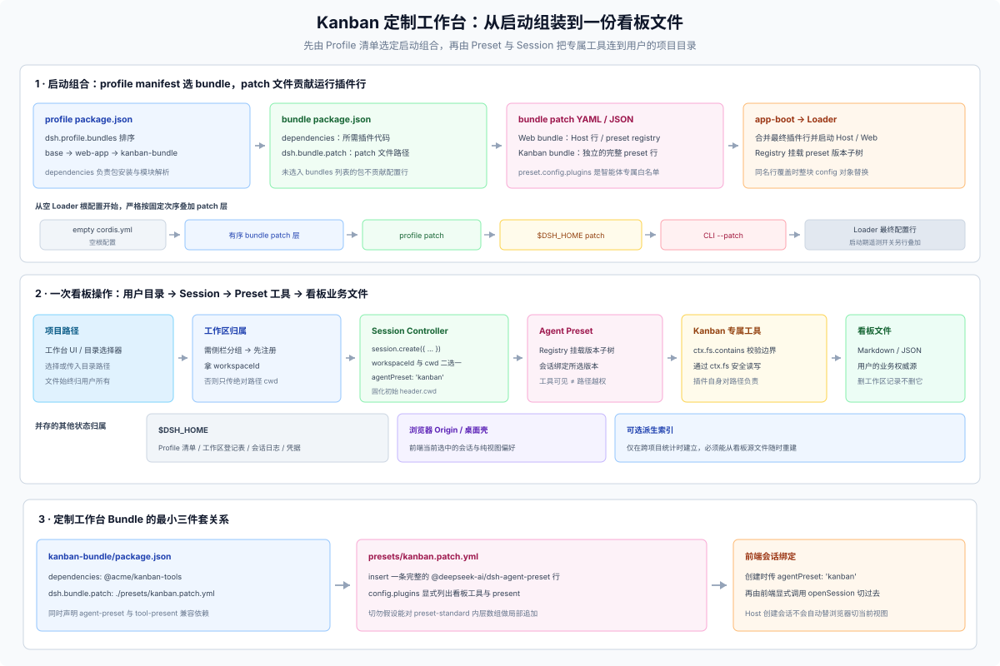

# 01 · 端到端实战走查：把 Kanban Studio 组装成一套定制工作台

抽象谈 Profile 叠层很容易看晕。本篇用一个具体的假想案例 **Kanban Studio**（DSH 仓库内并无此内置包，以下配置展示真实的清单与接口衔接关系），从头到尾串起：**怎样初始化专属 Profile → 怎样挂入定制 Bundle 与 Preset → 怎样把用户的项目目录连进会话 → 怎样安全读写看板文件并划清数据归属**。



---

## 一、第一步：用 CLI 派生专属 Profile 并装入工作台 Bundle

假设我们要在隔离环境里创建一个名为 `kanban` 的自命名工作台 Profile，基于官方 `web` 模板起步并挂上 `@acme/kanban-bundle`：

```sh
# 仅在首次创建全新 Profile 时使用 --from-default-profile（它会重置同名 Profile 的依赖与用户 Patch！）
export DSH_HOME="$HOME/.kanban-studio-dsh"
dsh --profile kanban --from-default-profile web --dump-default-config

# 安装定制工作台 Bundle（自动更新 dependencies 与有序 dsh.profile.bundles）
dsh plugin --profile kanban add @acme/kanban-bundle@1.0.0

# 检查合成后的完整配置行及每行来源注释
dsh --profile kanban --dump-config
```

执行完后，`$DSH_HOME/profiles/kanban/package.json` 的核心结构如下（由 `dsh plugin` 自动维护，无需手改）：

```json
{
  "name": "dsh-profile-kanban",
  "private": true,
  "dependencies": {
    "@acme/kanban-bundle": "1.0.0"
  },
  "dsh": {
    "profile": {
      "bundles": [
        "@deepseek-ai/dsh-base",
        "@deepseek-ai/dsh-web-app",
        "@acme/kanban-bundle"
      ]
    }
  }
}
```

这里有两个关键细节：
- `dsh-base` 与 `dsh-web-app` 直接由当前运行的 DSH 安装底座解析提供，不必重复装进 Profile 的 `dependencies`；
- `dsh.profile.bundles` 的数组顺序就是启动时叠放基础 Patch 的顺序——你的 `@acme/kanban-bundle` 排在后面，既能新增插件行，也能按需覆盖前序行。

---

## 二、第二步：编写工作台 Bundle 与独立 Preset 声明

在 `@acme/kanban-bundle` 内部，我们通过 `package.json` 指向前端模块、Host 服务行以及看板智能体 Preset：

```json
{
  "name": "@acme/kanban-bundle",
  "version": "1.0.0",
  "type": "module",
  "exports": {
    ".": { "types": "./lib/index.d.ts", "default": "./lib/index.js" },
    "./client": { "types": "./lib/client.d.ts", "default": "./lib/client.js" },
    "./cordis.patch.yml": "./cordis.patch.yml",
    "./presets/kanban.patch.yml": "./presets/kanban.patch.yml",
    "./package.json": "./package.json"
  },
  "files": ["lib", "cordis.patch.yml", "presets/kanban.patch.yml"],
  "dependencies": {
    "@acme/kanban-tools": "1.0.0"
  },
  "peerDependencies": {
    "@deepseek-ai/cordis": "^0.2.0",
    "@deepseek-ai/dsh-agent-preset": "^0.2.0",
    "@deepseek-ai/dsh-tool-present": "^0.2.0"
  },
  "dsh": {
    "bundle": {
      "patch": ["./cordis.patch.yml", "./presets/kanban.patch.yml"]
    },
    "client": {
      "platform": "web",
      "inject": ["@deepseek-ai/dsh-client-ui-workspace", "@deepseek-ai/dsh-client-sessions"]
    }
  },
  "engines": {
    "dsh": ">=0.2.0 <0.3.0"
  }
}
```

先挂一条 Host 根插件行（`cordis.patch.yml`），这样前端模块扫描器才会把 `@acme/kanban-bundle/client` 打进 Web 界面：

```yaml
# cordis.patch.yml
- insert:
    - id: kanban-studio-host
      name: '@acme/kanban-bundle'
```

再插入一条独立的 `@deepseek-ai/dsh-agent-preset` 行（`presets/kanban.patch.yml`）：

```yaml
# presets/kanban.patch.yml
- insert:
    - id: preset-kanban
      name: '@deepseek-ai/dsh-agent-preset'
      config:
        id: kanban
        name: Kanban Studio
        order: 10
        plugins:
          - id: tool-kanban
            name: '@acme/kanban-tools'
          - id: present
            name: '@deepseek-ai/dsh-tool-present'
```

**组装纪律**：
1. **显式白名单**：`preset-kanban` 不会自动继承出厂 `standard` 预设里的 bash 或通用文件工具。看板智能体只应该拥有看板操作工具和交付展示工具 `present`；如果还需要读写普通文档或跑技能，必须显式补上对应插件行并审视权限。
2. **设成全局默认预设的做法**：如果希望新建会话默认就选中 `kanban` 而不是 `standard`，需要在 Patch 里按根上 `agent-preset-registry` 的行 id 覆盖整份 `config: { default: 'kanban' }`（同时留意用户在设置里手选过的 `selectedDefault` 仍具有更高优先级）。

---

## 三、第三步：把项目目录、会话与前端当前视图串起来

用户选定一个存放看板文件的本地目录（例如 `/Users/alice/projects/roadmap-board`）后，定制工作台要完成“登记目录 → 创建会话 → 切换前端界面”三步衔接：

1. **按需注册侧栏工作区（幂等）**：
   - 如果希望该目录出现在左侧边栏工作区分组里，先调 `workspaceController.create({ path: '/Users/alice/projects/roadmap-board' })` 拿到 `workspaceId`（同一规范化路径重复调用会幂等返回已有 `workspaceId`），再创建会话：
     ```json
     { "workspaceId": "<registered-workspace-id>", "agentPreset": "kanban" }
     ```
   - 如果你的定制界面完全自己管项目列表、不需要 DSH 侧栏分组，直接传绝对路径 `cwd` 即可：
     ```json
     { "cwd": "/Users/alice/projects/roadmap-board", "agentPreset": "kanban" }
     ```
   - **切记两者互斥**：同时传 `workspaceId` 和 `cwd` 会被网关直接拒绝（`session.create accepts workspaceId or cwd, not both`）。另外若遇到极少见的 `session/workspace-attach-failed` 错误，说明会话本身已建好但挂接分组失败，错误体里会带回已生成的 `sessionId`，应保留该 ID 做恢复而不是盲目重发创建请求。
2. **显式切换前端当前视图**：
   - Host 侧 `sessionController.create` 只负责在后端把会话建出来，**不会自动驱动已打开的浏览器标签页跳过去**。你的前端客户端插件拿到返回的 `sessionId` 后，必须显式调用工作区导航接口（如 `uiWorkspace.openSession(sessionId)`）把当前视图切到新会话。

---

## 四、第四步：看板工具的路径边界校验与数据归属账单

千万别以为“会话创建时传了 `workspaceId` 或 `cwd`”，自己写的 Host 工具就能放心读写用户传入的任意相对路径。直接调用底层 `ctx.fs` 不会自动套用内置 `tool-fs` 的逐会话写审批流，**看板工具必须自己锁死项目根目录边界**：

```ts
// 在 @acme/kanban-tools 内部以会话不可变的初始目录 header.cwd 为唯一权威项目根
const projectRoot = session.header.cwd
if (!projectRoot) {
  throw new Error('Kanban session requires an explicit project directory')
}

const rootTarget = await ctx.fs.resolve(projectRoot, { signal })
const boardTarget = await ctx.fs.resolve(boardRelativePath, { cwd: projectRoot, signal })

if (!ctx.fs.contains(rootTarget, boardTarget)) {
  throw new Error(`Refusing to access path outside board root: ${boardRelativePath}`)
}
// 通过校验后再经 ctx.fs 读取或用 replaceIfVersion 安全写回看板文件
```

最后，在动手写代码前把 Kanban Studio 涉及的每一份状态列成一张清晰的**归属账单**，就不会出现升级丢数据或多端串状态：

| 数据内容 | 权威归属方 | 物理位置与使用机制 | 卸载或删记录后的命运 |
|---|---|---|---|
| **看板卡片与列文件**（如 `board.json` / `cards/*.md`） | **终端用户** | 用户自己的项目目录，工具通过 `ctx.fs` 限界读写；交付预览用 `present`（不复制文件） | 永久保留在用户目录；在 UI 移除工作区记录也绝不删文件 |
| **对话记录与工具调用轨迹** | **DSH Session** | `$DSH_HOME/sessions/` 追加式压缩日志；模型可见输入严格留痕 | 随 `$DSH_HOME` 保留，支持跨重启恢复 |
| **跨项目看板最近打开列表 / 派生统计索引** | **定制工作台插件** | `$DSH_HOME/storages/` 下的 `ctx.storageDomain`（索引可随时从看板源文件重建） | 卸载 Bundle 后仍留在 `storages/`，重装可无缝接续 |
| **模型供应商 API Key** | **凭据服务** | `$DSH_HOME/.credentials.yaml`，经 `ctx.credentials` 动态解析 | 归属当前 `$DSH_HOME`，严禁打进安装包或镜像 |
| **看板列折叠、筛选器与当前打开的会话** | **浏览器 / 桌面壳** | 当前访问 Origin 的 `localStorage`（或 Electron `userData`） | 换端口或换浏览器即重置，不存任何业务真值 |
