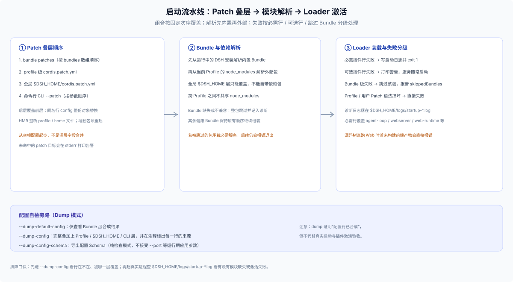

# 02 · Profile 所有权模式、启动叠层流水线与数据隔离

要做一套稳健的定制工作台，必须把下面三件事彻底摸透：**哪些 Profile 归谁管、启动时四层 Patch 到底怎么合成、以及为什么换一个 Profile 名字并不等于隔离了数据**。

---

## 一、三类 Profile 所有权模式：哪些能用 CLI 管，哪些不能碰？

在 `$DSH_HOME/profiles/` 下，不同名字的 Profile 拥有完全不同的创建与管理所有权（详见 [`apps/cli/reference/README.md`](https://github.com/deepseek-ai/deepseek-harness/blob/master/apps/cli/reference/README.md#profile-boot)）：

| Profile 类型 | 代表名称 | 谁负责创建与维护 | CLI 能否启动或装卸插件？ | 适用定位 |
|---|---|---|---|---|
| **官方出厂 CLI 模板** | `web`、`headless`、`sdk`、`acp`（及实验态 `tui`） | 首次运行对应 `dsh` 命令时由启动器按内置模板自动初始化 | **完全支持**（如 `dsh web`、`dsh plugin --profile web add`） | 用户日常默认环境；若直接往 `web` 装包，会与用户自己的日常 Web 环境共用同一个 Profile |
| **派生自命名 Profile** | 任意合规自定义名（如 `kanban`、`team-advisor`） | 发行方引导脚本或用户通过 `--from-default-profile <template>` 初始化 | **完全支持**（如 `dsh --profile kanban`、`dsh plugin --profile kanban add`） | **CLI / Web 定制工作台首选**；拥有独立的 `bundles` 列表与独立的 Profile 级 `cordis.patch.yml` |
| **桌面应用独占 Profile** | `desktop` | 由 Electron 桌面应用自身创建并管理生命周期 | **CLI 明确拒绝**（`dsh --profile desktop` 与 `dsh plugin --profile desktop ...` 均直接报错拦截） | 仅由桌面壳内部进程和桌面端界面内的 **Plugins** 页操作，外部脚本不得接管 |

> **铁律重申（应用启动边界）**：DSH 架构明文规定 **只有 `dsh` 命名 Profile 是受支持的 Node 应用启动入口**（见 [`docs/architecture.md`](https://github.com/deepseek-ai/deepseek-harness/blob/master/docs/architecture.md#application-launch)）。不要在自己的 npm 包里写 `bin` 直接去 `new Loader()` 绕过 `app-boot`——正确做法永远是提供薄启动脚本设置环境变量，最后 `exec dsh --profile kanban "$@"`。

---

## 二、启动叠层流水线与两个最容易踩的配置陷阱

当执行 `dsh --profile kanban` 时，`app-boot` 从一份**完全空白的根配置**起步，严格按以下四个阶段合成并装载插件树：



### 陷阱 1：普通插件行的 `config` 是“整块替换”，写死字面量会废掉命令行参数

Cordis 的 `include` / Patch 叠层在处理已存在的同名插件行（按行 `id` 匹配）时，**不会对 `config` 对象做深层字段合并，而是用后一层的 `config` 整块替换前一层的 `config`**。

这在定制工作台里会引发一个极经典的线上故障：官方 `dsh-web-app` 在配置 `webserver` 和 `web-startup` 时，内部使用了受控的 `!!js` 表达式去读取运行时的 `--host`、`--port`、`--no-open` 等命令行参数。如果你为了改默认端口，在自己的 Bundle Patch 或 Profile Patch 里写了一段纯静态覆盖：

```yaml
# ❌ 错误示范：整块替换掉了官方行里的 !!js 参数读取表达式，导致运行期传 --port 8080 完全失效！
- update:
    id: webserver
    config:
      host: 127.0.0.1
      port: 3900
```

**正确做法**：凡是不需要强改底层内置行配置的场景，优先通过外层薄启动脚本传递标准命令行参数（如 `dsh --profile kanban --port "${KANBAN_PORT:-3900}"`）；确需覆盖已有插件行时，先跑 `dsh --profile kanban --dump-default-config` 看清原行的完整 `config` 字段与 `!!js` 表达式，把需要保留的字段完整重述出来（注意 YAML 里只允许双感叹号 `!!js`，绝不能写单感叹号 `!js`）。

### 陷阱 2：全局 `$DSH_HOME/cordis.patch.yml` 没有自己的依赖目录

叠层顺序里的第 3 层 `$DSH_HOME/cordis.patch.yml` 会作用于该主目录下的**所有 Profile**。但模块解析器在加载插件包时，只会查**当前运行的 DSH 内置包**和**当前 Profile 自己的 `node_modules/`**，不会去别的 Profile 目录里借包。

因此：
- `$DSH_HOME/cordis.patch.yml` **只适合覆盖所有 Profile 都共有的内置插件配置**（例如统一设置默认模型提供商参数）；
- **千万不要在 `$DSH_HOME/cordis.patch.yml` 里 `insert` 一个只安装在 `profiles/kanban` 里的第三方包**——否则用户一旦切回 `dsh web` 启动，就会因为找不到模块抛出 `ERR_MODULE_NOT_FOUND` 告警（可选行被跳过，必需行直接退出）。

### 命令行参数归属与 Dump 旁路检查

并不是所有 `dsh` 参数对所有 Profile 都有效：`--port`、`--host`、`--no-open` 等参数是由 `dsh-web-app` 里的 `web-startup` 插件注册消费的；如果一个自定义 Profile 基于 `headless` 派生、没装 `web-app`，传 `--port` 就会报未知参数错误。同样，`--dump-config-schema` 是纯静态 Schema 导出模式，不接受运行期应用参数。

---

## 三、数据隔离矩阵：光换 `--profile` 远远不够

很多团队以为用了 `dsh --profile kanban` 就跟用户的 `dsh web` 完全隔开了。对照下面的真实存储矩阵就能看清，**不换 `DSH_HOME` 时到底有哪些东西是混在一起的**：

| 状态类别 | 只换 `--profile kanban`（共用默认 `~/.dsh`） | 显式设置独立 `DSH_HOME`（如 `~/.kanban-studio`） | 补充说明与额外隔离项 |
|---|---|---|---|
| **已装 Bundle 与 `node_modules`** | **已隔离**（在 `profiles/kanban/` 下） | **已隔离** | 重新启用曾禁用的 Bundle 会排到列表末尾，改变覆盖次序 |
| **设置页开关（`Config.volatile()`）** | **已隔离**（写 `profiles/kanban/cordis.patch.yml`） | **已隔离** | 单 Profile 作用域 |
| **会话历史日志（`sessions/`）** | **未隔离（共用！）** | **已隔离** | 共用 `~/.dsh` 时，工作台建的会话会直接出现在用户日常 DSH 历史列表里 |
| **侧栏工作区登记表（`workspaces`）** | **未隔离（共用！）** | **已隔离** | 共用时会混入用户日常代码仓分组 |
| **插件持久账本（`storages/`）与附件** | **未隔离（共用！）** | **已隔离** | 同进程单写者假设，严禁两个常驻 Host 进程并发写同一个 `DSH_HOME` |
| **API 密钥（`.credentials.yaml`）** | **未隔离（共用！）** | **已隔离** | 共用可免去用户重复填 Key，独立则实现凭据隔离——需按产品定位主动取舍 |
| **跨工具共享技能与指令（`~/.agents`）** | 默认共用 | 默认仍共用，需另设 **`DSH_AGENTS_HOME`** 才隔离 | 故意独立于 `DSH_HOME` 之外的设计 |
| **浏览器 `localStorage` / Cookie** | 按 `protocol + host + port`（Origin）隔离 | 同左（若均绑 `localhost:默认端口` 仍会撞 Origin！） | 定制 Web 工作台建议固定独立端口；封装 Electron 桌面壳必须同时指定独立的 **`--user-data-dir`** |

**一句话决策**：如果你交付的是“融入用户日常研发流的增强模式”，保留默认 `DSH_HOME` + 自命名 `--profile` 可以直接复用用户的模型凭据与历史项目；如果你交付的是“独立品牌、双开运行、互不干扰的专属工作台”，启动脚本必须同时锁定独立的 **`DSH_HOME` + 独立端口（或独立 Electron `userData`）**。
