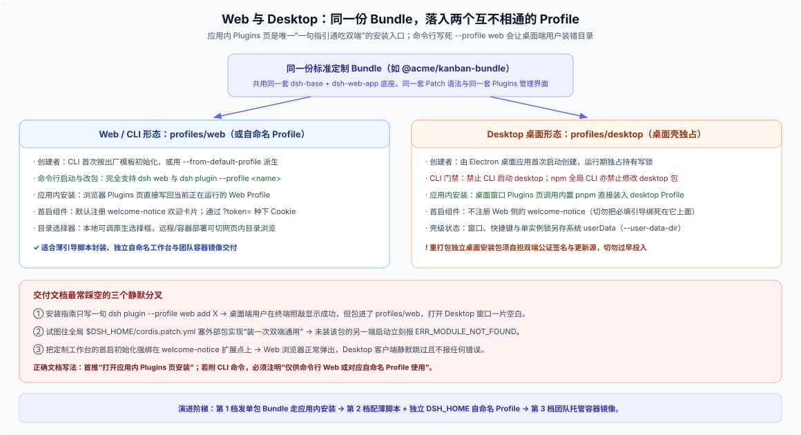

# 03 · 终端用户全生命周期：安装形态、首启引导、设置优先级与升级卸载

把定制工作台交到真实用户手里，考验的往往不是核心工具逻辑，而是**第一次怎么装、第一次打开浏览器怎么进目录、改了设置存在哪、以及升级出错怎么救回来**。本篇按用户生命周期把每个环节的真实机制拆开讲清。

---

## 一、安装形态选择：为什么应用内 Plugins 页是唯一跨端通用入口？

同样一份定制能力 Bundle，送到 Web 用户和 Desktop 桌面端用户手里时，底层落入的是两个截然不同的 Profile：



对照四种常见交付路径的真实体验与限制：

1. **应用内 Plugins 页安装（双端通用首选）**：
   - 用户打开正在运行的 DSH（不管是浏览器里的 Web 还是桌面上的 Desktop 客户端），进入 **Plugins** 页面输入包名或市场源点击安装。
   - 因为前端页面直接向当前挂载它的宿主发起 `install_bundle`，在 Web 上会自动装进当前运行的 `web`（或自命名）Profile，在 Desktop 上会自动装进壳独占的 `desktop` Profile。**文档只需写一句话，永远不会装错地方。**
2. **CLI 预装与薄引导脚本（仅面向 Web / Headless / 自命名 Profile）**：
   - 适合内部工程团队发一键启动脚本或开发机初始化脚本。脚本先检查 `$DSH_HOME/profiles/<name>` 是否存在——**不存在时才调用 `--from-default-profile web` 初始化**（切记每次启动都带 `--from-default-profile` 会把用户后来安装的插件和保存的设置全部洗白！），然后执行 `dsh plugin --profile <name> add` 并拉起服务。
   - 在安装文档里必须明确标出：**该 CLI 命令仅供命令行 Web 模式使用，Desktop 桌面端用户请直接在应用内 Plugins 页安装**。
3. **容器镜像整包交付**：
   - 构建期把 Node、指定版本的 `dsh` 以及预装好定制 Bundle 的 Profile 一次性固化在镜像层；运行期把宿主机目录挂载到容器工作目录，把持久化数据卷挂载到容器内的 `$DSH_HOME`，并通过 `--host 0.0.0.0` 配合反向代理或内置鉴权暴露服务。
4. **独立桌面端重打包的现实成本**：
   - 如果想交付一个换了图标和应用名的独立 Electron 安装包（见 [FAQ 23](../23_standalone-vs-web-release-forms/answer.md)），不仅要维护 `profiles/desktop` 组装和独立 Electron `userData` 目录，还要独立承担 macOS 公证与 Windows 代码签名（见 [`windows-signing`](https://github.com/deepseek-ai/deepseek-harness/blob/master/apps/desktop/windows-signing/README.md)）及自动更新服务器——在做这个决定前，先确认“官方 Desktop + 应用内安装你的 Bundle”是否真的满足不了需求。

---

## 二、首次启动（First-Run）：鉴权门禁、四个目录概念与首屏会话

用户第一次拉起 Web 形态工作台时，会依次经过三道初始化关卡：

### 1. 本地一次性 Token 门禁（`?token=...` → 303 种下 Cookie）

`dsh web`（或基于 `web` 模板的定制 Profile）默认在本地启动带访问门禁的 HTTP 服务：终端日志会打印形如 `http://127.0.0.1:<port>/?token=<secret>` 的首启链接。浏览器首次访问该链接时，服务端校验一次性查询参数后返回 `303 See Other` 重定向到干净根路径，同时在当前 Origin 种下 HttpOnly 会话 Cookie。

**给包装脚本作者的提醒**：如果你的外层启动脚本加了 `--no-open` 并打算自己弹浏览器或打印入口地址，必须转发或解析带 `?token=` 的完整启动 URL，直接打开裸 `http://127.0.0.1:<port>/` 会被鉴权页拦住。

### 2. 别把“四个目录”混为一谈

首次建会话时，很多定制工作台会在目录问题上产生混乱。务必把下面四个概念彻底拆开：

| 目录概念 | 谁持有它 | 真实语义与变化规则 |
|---|---|---|
| **1. 定制业务项目目录** | 定制工作台插件 / 用户 | 比如你的工作台配置里记录的看板文件夹路径；DSH 内核对它一无所知，需你主动传给 Workspace 或 Session 接口 |
| **2. DSH 工作区登记项（`WorkspaceId`）** | `ctx.workspaceRegistry`（`$DSH_HOME`） | 仅用于在左侧边栏展示项目分组并归拢关联会话（UUID 标识）；**不拥有磁盘文件，也不提供模型读写工具** |
| **3. 会话初始目录（`header.cwd`）** | 会话持久化头（不可变） | 创建 Session 时固化在日志头部，决定会话日志分桶目录名与默认沙箱写根；**一旦创建终身不可修改，换项目等于新建 Session** |
| **4. 会话当前工作目录** | `ctx.workingDirectory`（随事件演进） | 模型在对话中途调用 `working_directory` 工具切换后的当前目录；影响后续内置文件/终端工具的相对路径，但**不改变 `header.cwd` 和初始沙箱根** |

在出厂默认 Web 首启流程中，若用户尚未登记任何工作区且满足首次使用条件，前端会引导或回退使用宿主默认工作目录（通常位于用户文稿目录下的 `Documents/deepseek-harness/default-workspace`）。同时注意目录选择器的环境差异（[`directory-picker-auto`](https://github.com/deepseek-ai/deepseek-harness/blob/master/packages/host/directory-picker-auto/README.md)）：本机桌面/本地浏览器可调起操作系统原生文件夹选择框（`pick`），而远程/容器 Web 或自动化测试场景则需切换为网页内目录浏览选择器（`list` / `createDirectory`）。

### 3. 首屏引导卡片的跨端差异与会话自动选中

- **不要把核心首启流程绑死在 `welcome-notice` 上**：Web 模板默认注册了欢迎提示插件，但 Desktop 的 `profiles/desktop` 并不注册它——如果把必填的初始化引导塞进依赖它的钩子，桌面端用户打开只会看到一片空白且没有任何报错。
- **建好会话还要让前端“看见”**：如 [`01-kanban-walkthrough.md`](./01-kanban-walkthrough.md) 所述，Host 启动插件在后端调 `sessionController.create` 建出会话后，老浏览器标签页会停留在它上次记住的会话，全新浏览器也只会按默认规则挑空白会话；唯有前端客户端模块主动调 `openSession(sessionId)`，才能百分之百把用户带进你预备好的定制工作台界面。

---

## 三、设置优先级：用户在界面上点保存，到底改了哪一层？

定制工作台交付后，同一个配置项可能同时出现在你的 Bundle、Profile、全局目录和命令行里。当发生冲突时，真实生效顺序从低到高如下：

1. **Bundle 内置 Patch 层**（按 `dsh.profile.bundles` 从前到后叠加，适合放发行方的出厂默认值）；
2. **Profile 级 `cordis.patch.yml`**（**用户在应用内 Settings 页面修改 `Config.volatile()` 字段时，写回的就是这一层**，带乐观并发防陈旧写保护）；
3. **全局 `$DSH_HOME/cordis.patch.yml`**（覆盖该 `$DSH_HOME` 下所有 Profile，**注意它会压过用户在第 2 层 Settings 页里保存的值！**）；
4. **命令行 `--patch <file>`**（按传入顺序叠加，最高优先级的临时覆盖，适合自动化测试或紧急排障）。

因此，**发行方的出厂默认配置永远应该放在第 1 层（自己的 Bundle Patch 里）**，把第 2 层留给用户在 Settings 页面自由调整；千万不要在安装脚本里把默认值写进第 3 层 `$DSH_HOME/cordis.patch.yml`，否则用户在界面里改完设置一刷新又会被顶回去，或者直接遇到被上层覆盖的提示。

---

## 四、平滑升级、失败回退与干净卸载

### 1. 升级与重启时机
- **升级命令**：在 CLI 下对目标 Profile 重新执行 `dsh plugin --profile kanban add @acme/kanban-bundle@1.1.0`，或在应用内 Plugins 页点击更新。
- **何时必须重启**：纯修改已有 `cordis.patch.yml` 参数或在本地 `link:` 下改代码可借助 HMR 热重组生效；但**凡涉及新增/移除 Bundle 成员、升级依赖包版本或更新前端静态打包模块，一律以重启宿主进程为可靠的完成标准**（`install_bundle` 也会显式返回 `restart-required`）。

### 2. 升级失败怎么回退？
- DSH 插件管理器**没有内置 `dsh plugin rollback` 命令**，也不会替你保留上一版 `node_modules` 快照。
- 实操回退方式是**显式指定上一个已知良好版本号执行补偿重装**：
  ```sh
  dsh plugin --profile kanban add @acme/kanban-bundle@1.0.0
  ```
- 这也是为什么定制工作台强烈建议通过 **npm 仓库**或归档好历史版本的 **离线 `.tgz` 目录**分发——如果只用浮动 Git 分支名安装，出问题时连精确回退目标都找不到。

### 3. 干净卸载的三步清单
当用户决定彻底停用并清理你的定制工作台时，文档应诚实区分两种卸载粒度：

- **仅从共享环境移除工作台扩展**：在 Plugins 页卸载或运行 `dsh plugin --profile <name> remove @acme/kanban-bundle`，再按需手动清理 `$DSH_HOME/storages/` 下以你插件命名的存储域文件（框架卸载命令默认保留所有用户与插件数据）。
- **彻底清理独立隔离的自命名工作台**：如果当初按推荐做法使用了独立的 `DSH_HOME="$HOME/.kanban-studio-dsh"`，用户只需停掉进程、删除外层包装脚本与 `~/.kanban-studio-dsh` 目录（桌面壳外加对应的独立 `userData` 目录）即可一步清零，而保存在用户自己项目文件夹里的看板与文档毫发无损。
