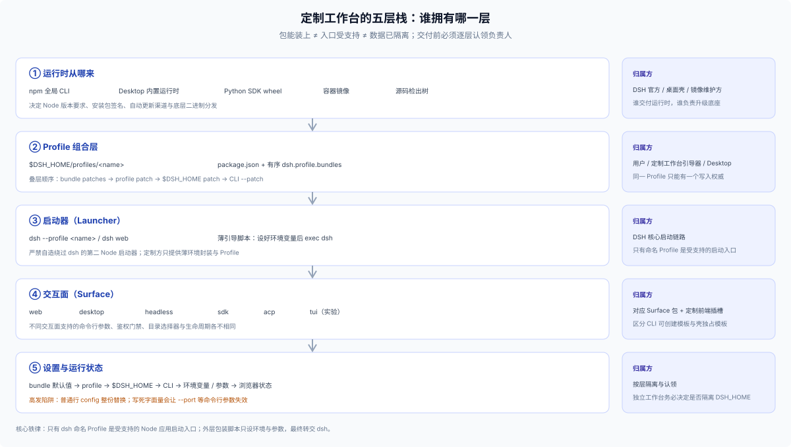

# Answer 26 · 定制工作台与发行组装：看板工作台锚点、六项归属设计与生命周期闭环

## 一句话结论

想基于 DSH 向用户交付一套领域产品（比如一套带专属看板工具、定制 Preset 和面板卡片的 **Kanban Studio**），**第一步先做减法：90% 的场景其实只需发布一个标准 Bundle 包（见 [FAQ 24](../24_plugin-publishing-and-data/answer.md)），让用户在应用内 Plugins 页一键安装即可**。只有当你确实需要**接管默认启动组合、隔离独立的数据主目录（`$DSH_HOME`）、定制首启目录引导或封装一键启动环境**时，才需要进入定制工作台发行——此时 DSH 原生包办了插件树装配与会话内核，但**入口封装、配置叠层、主目录隔离、设置优先级、首启会话绑定、升级恢复**这六块归属必须由你显式设计。

---

## 一、先立直觉锚点：从“装个插件”到“发套 Kanban 工作台”多出了什么？

拿假想的 **Kanban Studio** 来说：如果目标用户已经在用 DSH，你把看板读写工具、`kanban` 智能体预设和前端看板卡片打成一个 `@acme/kanban-bundle`，用户装进现有环境就能开新会话用起来。但如果你要把 Kanban Studio 交付给没接触过 DSH 的业务团队，希望他们“敲一条启动命令或打开容器就直达看板工作台，且不污染个人原有的 `~/.dsh`”，你就从“写单个 Bundle”跨进了“组装一套五层运行栈”（完整案例走查见 [`01-kanban-walkthrough.md`](./01-kanban-walkthrough.md)）：



在磁盘上，一个定制工作台 Profile 的核心清单其实非常薄——就是在专属 `$DSH_HOME/profiles/kanban/package.json` 里按序叠上基础底座与你的工作台 Bundle：

```json
{
  "name": "dsh-profile-kanban",
  "private": true,
  "dependencies": { "@acme/kanban-bundle": "1.0.0" },
  "dsh": {
    "profile": {
      "bundles": ["@deepseek-ai/dsh-base", "@deepseek-ai/dsh-web-app", "@acme/kanban-bundle"]
    }
  }
}
```

但看清最关键的一条架构红线：**Profile 只是启动时的插件组合清单，既不是天然的数据隔离沙箱，也不是独立的可执行程序**。弄混这两件事，是绝大多数定制工作台踩坑的根源。

---

## 二、发行方必须亲自拍板的六个归属问题

DSH 的 `app-boot` 和 `plugin-manager` 提供了稳固的微内核装载机制，但下面六件事框架无法替你做主，必须在交付前逐一认领：

| 归属领域 | DSH 原生提供什么 | 发行方必须自己决定与守住的边界 |
|---|---|---|
| **1. 可执行入口与运行时底座** | 统一的 `dsh` CLI 与内置桌面壳启动链 | 严守 **`Only dsh profiles launch supported Node apps`**：绝不手搓绕过 `dsh` 的第二套 Node 启动器。外层包装脚本、systemd 单元或容器 Entrypoint 只负责设好环境变量与参数，最终 `exec dsh --profile <name>`。 |
| **2. Profile 与 Bundle 组装** | 出厂模板（`web` / `headless` / `sdk` / `acp`）、`--from-default-profile` 派生与四层 Patch 叠加 | 选定采用哪种交付形态（应用内直装单 Bundle、CLI 自动化派生自命名 Profile，还是完整容器镜像封装）。牢记**普通插件行的 `config` 是整块对象替换**，不能对别人的内层数组做局部追加（详见 [`02-profiles-and-ownership.md`](./02-profiles-and-ownership.md)）。 |
| **3. 主目录与多端数据隔离** | 通过 `DSH_HOME` 与 `DSH_AGENTS_HOME` 环境变量重定向根路径 | **同一个 `$DSH_HOME` 下的不同 Profile 默认共享 `sessions/`、`workspaces`、`storages/` 和 `.credentials.yaml`**。若要与用户的日常 DSH 彻底隔开，必须指定独立的 `DSH_HOME` + 独立监听端口（桌面壳还须隔离 Electron `--user-data-dir`）。 |
| **4. 设置与凭据分层** | `Config.volatile()` 自动映射设置页并写回当前 Profile 的 `cordis.patch.yml`；`ctx.credentials` 管理密钥 | 出厂默认值放第 1 层 Bundle Patch，把第 2 层 Profile Patch 留给用户设置页（别写进第 3 层 `$DSH_HOME/cordis.patch.yml` 压死用户修改）；严禁写死字面量覆盖掉 `!!js` 参数表达式导致 `--port` 失效；镜像里绝不预埋明文密钥。 |
| **5. 首启引导与工作区绑定** | Web 一次性 `?token=` 换 Cookie、默认文档目录回退、`workspaceController` 与 `sessionController` | 分清**项目业务目录、`workspaceId` 侧栏分组、会话不可变 `header.cwd` 与当前工作目录**四件事；Host 侧预建了 Session **不会**自动把用户的浏览器切过去，必须配合前端插件显式调用 `openSession`（详见 [`03-first-run-install-and-upgrade.md`](./03-first-run-install-and-upgrade.md)）。 |
| **6. 升级、回退与卸载恢复** | `dsh plugin add <pkg>@<ver>` 覆盖更新、`skippedBundles` 容错跳过 | DSH 没有 `rollback` 子命令，回退靠指定旧版本号补偿重装；增删 Bundle 成员后必须重启进程；卸载 Bundle 或删除 Profile 不会清理业务目录与 `$DSH_HOME/storages` 账本，需向用户写明手动清理路径。 |

---

## 三、三种交付形态对比：按需取最轻的一档

| 交付形态 | 适用人群与场景 | 安装与启动方式 | 数据隔离与维护成本 |
|---|---|---|---|
| **1. 单 Bundle 应用内安装**（默认首选） | 已有 DSH 的个人或团队，只需增加看板/审查等专属能力 | 在 Web 或 Desktop 界面的 **Plugins** 页一键安装 `@acme/kanban-bundle` | 复用现有 `$DSH_HOME` 与凭据；**零启动器维护成本，一句指引通吃双端** |
| **2. 薄引导脚本 + 独立 Profile** | 本地研发工具链、需要独立端口与独立历史数据的定制工作台 | 薄脚本设好专属 `DSH_HOME`，首次用 `--from-default-profile web` 初始化后跑 `dsh --profile kanban` | 与个人日常 `~/.dsh` 完全隔离；需引导用户自带或随脚本准备 Node 与 `dsh` |
| **3. 容器镜像整包交付** | 团队内部托管工作台、开箱即用零本机依赖交付 | 镜像内预装 Node + `dsh` + `kanban` Profile，挂载持久卷到 `$DSH_HOME` 与项目目录 | 环境一致性最高；需自行管理容器持久卷、反向代理与访问鉴权 |

> 若考虑重打包独立品牌 Electron 桌面客户端，须自行承担跨平台构建、macOS 公证与 Windows 签名（见 [`windows-signing`](https://github.com/deepseek-ai/deepseek-harness/blob/master/apps/desktop/windows-signing/README.md)）以及 `profiles/desktop` 壳独占维护成本，切勿在验证业务价值前过早投入。

---

## 四、四条经实测验证的高频避坑提醒

以下边界均已在隔离 `$DSH_HOME` 实验与源码核对中验证（完整现象与排障方法见 [`04-verified-boundaries-and-pitfalls.md`](./04-verified-boundaries-and-pitfalls.md)）：

1. **别让桌面端用户跑 `dsh plugin --profile web add`**：Desktop 应用跑在专属的 `profiles/desktop` 上（且 CLI 明确拒绝 `--profile desktop` 的启动与改包命令）。让桌面用户在终端往 `web` 里装包，命令会显示成功，但桌面界面里什么都不会出现。
2. **别每次启动都带 `--from-default-profile`**：该标志用于从模板重建 Profile，重复执行会直接清空该 Profile 已安装的第三方依赖与用户在 Settings 页保存的修改。
3. **别把全局 `$DSH_HOME/cordis.patch.yml` 当成跨 Profile 共享安装包的地方**：全局 Patch 层没有自己的 `node_modules`。如果里面引用了只在 `kanban` Profile 装过的包，切回 `web` Profile 启动时就会报 `ERR_MODULE_NOT_FOUND`。
4. **`session.create` 不能同时传 `workspaceId` 和 `cwd`，且关联工作区不等于文件授权**：两者同传会直接触发 `gateway/bad-request`；自定义 Host 工具读写项目文件时，必须自行调用 `ctx.fs.contains(root, target)` 锁死目录边界。

---

## 五、交付前必查：四层状态回读自检

不要只看安装命令退出码为 `0` 就宣布交付就绪，发布前顺着下面四层回读一次真实状态：

1. **磁盘清单层**：打开目标 `$DSH_HOME/profiles/<name>/package.json`，确认定制包同时在 `dependencies` 与 `dsh.profile.bundles` 预期顺位上。
2. **合成配置层**：跑 `dsh --profile <name> --dump-config`，确认 Host 行与 `preset-<id>` 行均在输出中，且未破坏内置行的 `!!js` 参数表达式。
3. **宿主激活层**：拉起真实进程，核对 `$DSH_HOME/logs/startup-*.log` 中没有 `skippedBundles`、`ERR_MODULE_NOT_FOUND` 或 `Config` 校验报错。
4. **前端与会话层**：用干净浏览器经 `?token=` 首启登录，确认自定义 UI 插槽已挂载、会话绑定到 `kanban` 预设且业务文件落在用户项目目录内。

---

## 继续阅读

| 你想深入查什么 | 去哪篇看 |
|---|---|
| Kanban Studio 从 Profile / Bundle 清单、Preset 声明、创建会话到安全读写看板文件的完整走查 | [`01-kanban-walkthrough.md`](./01-kanban-walkthrough.md) |
| 三类 Profile 所有权、四层 Patch 合成流水线、`config` 整块替换陷阱与 `$DSH_HOME` 隔离矩阵 | [`02-profiles-and-ownership.md`](./02-profiles-and-ownership.md) |
| Web vs Desktop 安装分叉、首启鉴权与目录引导、设置优先级、升级回退与干净卸载 | [`03-first-run-install-and-upgrade.md`](./03-first-run-install-and-upgrade.md) |
| 隔离 `$DSH_HOME` 实测验证过的真实边界、静默失效现象、四层状态回读校验与排障手册 | [`04-verified-boundaries-and-pitfalls.md`](./04-verified-boundaries-and-pitfalls.md) |
| 对应的 DSH 启动器、控制器、子系统文档与源码索引 | [`reference.md`](./reference.md) |

> 核验状态见 [核验基线登记](../00-baseline.md)。若你只需了解单个插件包的清单字段、随包技能与运行数据落点，请回到 [FAQ 24 · 插件发布与数据边界](../24_plugin-publishing-and-data/answer.md)。
