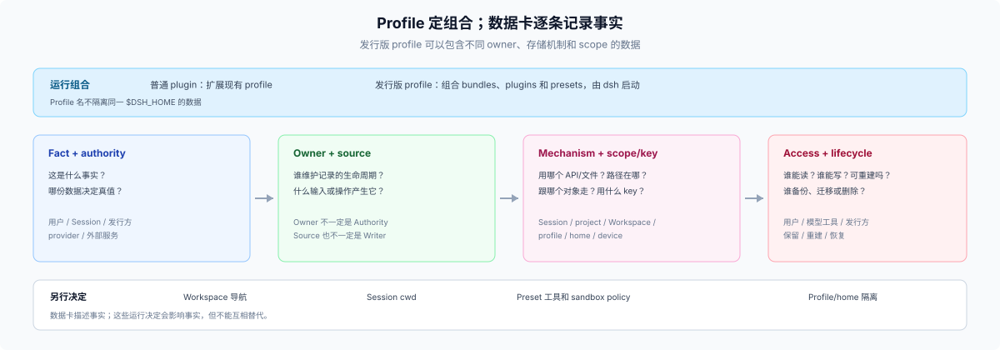

# 26 · 一组插件怎样交成一份完整可控的 Harness 发行版

本目录面向把 DSH 插件交到用户手里的发行方：从一组 plugin、bundle 和 preset 出发，交付一份**完整且可控的 Harness 发行版**。完整指六个决定点都有明确 owner；可控指改其中任何一条都不用 fork DSH。profile 决定这份发行版起哪个 app surface（[app-boot](https://github.com/deepseek-ai/deepseek-harness/blob/master/packages/boot/app-boot/README.md#profiles)），它不是发行版的边界，也不是数据隔离边界。

> **发行版路线**：先读 [10 六轴](./10-foundations/10-taxonomy.md) 定六轴 owner，再查 [34 profile 交付形态](./30-external/34-profile-delivery-forms.md) 与 [35 装配所有权](./30-external/35-profile-assembly-ownership.md) 选交付形态，安装/启动/设置查 [50 生命周期](./50-lifecycle/00-index.md)，然后从 [90 主线](./90-advisor/00-index.md) 开始，沿 [93 Kanban 文件走查](./90-advisor/93-app-plugin-walkthrough.md) 对照 JSON/YAML；数据责任见 [91 数据卡](./90-advisor/91-checklist.md)。

## 结论

- **发行版按六轴拆**：运行时、profile、patch 层、app surface、Harness home 与数据、生命周期。六轴都有明确 owner 才算**完整**；改任一条不用 fork DSH 才算**可控**。
- **profile 是 Harness home 里的具名组装**，决定发行版起哪个 app surface；它不是发布物，也不是数据隔离边界。bundle 才是可安装并自动启用的发布单位。
- **profile 有三种归属**：随包交付的模板名、自定义具名 profile（`--from-default-profile`）、application-owned profile（Desktop 保留的 `desktop`，不经 CLI profile lookup）。三者决定发行方能改多少、用户能覆盖多少。
- **每份事实分别记录** owner、authority、source、mechanism/path、scope/key、readers、writers、可重建性和保留责任；这些属性互不替代。
- `workspaceId` 加入 DSH Workspace 导航与 Session 分组；只需工作目录时可传绝对 `cwd`。`WorkspaceId` 是 registration ID，不是路径、不是项目 ID、不是权限 token。
- DSH Web 有自己的首用 Workspace；发行方自建的项目选择和数据存储由发行方维护。
- **应用内 Plugins 页是跨面安装入口**：`dsh web` 与 Desktop 同一句；CLI `--profile` 仅 web，`desktop` 双门禁闭。
- **bundle 在 roster ≠ patch 生效**：新增 row 必须 `insert:`；裸 `- id` 是 override target，找不到目标只报 `entry not found`，插件不会跑。
- **web 的 app args 归 `web-startup`**：发行方自定义 flag 需要替换 provider 并重实现全部 web flags；漏实现不会报错，只会静默丢掉该 flag 的语义——缺 TLS 即明文 listener，缺 `public-url` 只广告 listener origin，缺 `trusted-host` 则代理 authority 不被信任。
- **session 创建与 UI 选中是两层**：Host `sessionController.create` 只创建/attach；全新客户端可能自动落到最近工作区的 blank，返回用户保持 `dsh.sessions.current`；确定性要用 client `uiWorkspace.openSession`。
- **版本门在写入依赖前拒绝**：`engines.dsh`/peer 不匹配时 `nothing was installed`（profile 脚手架可能已初始化）；exemption 只对 exact package + exact dsh version。

## 术语前提

DSH repo 里 `product` 要么指**整台运行中的 dsh**（“Every part of the product is a plugin”，[architecture](https://github.com/deepseek-ai/deepseek-harness/blob/master/docs/architecture.md#cordis)），要么作形容词（`product data`、`product use`、`product-user-visible`）。它从来不修饰单个对象——没有“产品 + 对象名”这种复合类型，因为**插件本身不构成 product，整棵树才构成**。本目录因此不造 `产品型插件`／`产品 profile`／`产品 bundle`。<!-- term-policy: 本行登记退役词，校验器跳过 -->

逐词来源（哪些是 repo 定义、哪些是本目录自造）只有一处：[10 的术语来源表](./10-foundations/10-taxonomy.md#术语来源哪些是-dsh-的哪些是本目录的)。本目录只新造三个词——**Harness 发行版**、**发行方**和**六轴**——其余全部沿用 repo 定义。

**发布物（release artifact）≠ 发行版（distribution）**：发布物是单个可下载产物（npm 包、Desktop 安装包、wheel）；发行版是这些产物加上 profile、Harness home 策略和 app surface 组成的完整交付。[23](../23_standalone-vs-web-release-forms/answer.md) 回答官方有几份发布物，[24](../24_plugin-publish-and-agent-data-planes/answer.md) 回答一个插件怎样才算能发布，本目录回答**你要交付的那一份发行版怎么组**。

## 按角色阅读

- **单插件作者**：从 [91 数据卡](./90-advisor/91-checklist.md) 开始，按需查 [10–14](./10-foundations/10-taxonomy.md)、[31 社区做法](./30-external/31-external-community-patterns.md)/[32 数据设计](./30-external/32-external-ecosystem.md) 和 [92](./90-advisor/92-native-reference-architectures.md)。这一档通常没有发行版，只有插件。
- **发行方（交付整份 Harness）**：先读 [10 六轴](./10-foundations/10-taxonomy.md) 定 owner，再查 [34 profile 交付形态](./30-external/34-profile-delivery-forms.md) 与 [35 装配所有权](./30-external/35-profile-assembly-ownership.md) 定交付形态，装/起/配/首启判据查 [37 生命周期](./30-external/37-lifecycle-stages.md)，安装/启动/分发查 [50 生命周期](./50-lifecycle/00-index.md)；再走 [90 主线](./90-advisor/00-index.md) → [93 Kanban 文件走查](./90-advisor/93-app-plugin-walkthrough.md)；交付前查 [91 数据卡/验收](./90-advisor/91-checklist.md)，34 的八样本证据查 [36 台账](./30-external/36-profile-evidence-ledger.md)、37 的 16 张阶段样本证据见该篇表格，遇到存储取舍查 [92 参考矩阵](./90-advisor/92-native-reference-architectures.md)。
- **DSH 维护者**：读 [21 原生数据面](./20-native/21-native-data-landscape.md) 与 [22 历史](./20-native/22-native-data-history.md)；[31–37](./30-external/31-external-community-patterns.md) 是 DSH 外部生态研究（核心仓之外的插件与服务），不是 DSH API 合同。

## 章节地图

31–33 是单插件数据模式与案例；34–36 是 profile 交付形态、装配状态与证据；37 是装/起/配/首启的生命周期判据；50 是安装、启动、设置与分发。

| 文件 | 内容 |
|---|---|
| [00-question](./00-question.md) | 原始问题与范围 |
| [00-answer](./00-answer.md) | 摘要答案与问题索引 |
| [10 六轴](./10-foundations/10-taxonomy.md) | 发行版定义、六轴 owner、数据卡 |
| [11 存储通道](./10-foundations/11-storage-channels.md) | 内容、Session history、插件状态、派生与 Client state |
| [12 状态存储](./10-foundations/12-state-storage.md) | Storage domain、Config、credentials |
| [13 作用域与键](./10-foundations/13-scope-and-keys.md) | Session、项目根、Workspace、profile、home、device |
| [14 产物](./10-foundations/14-artifacts.md) | `present`、changes、attachments、spill、export |
| [15 资产 owner](./10-foundations/15-asset-owners.md) | bundle、用户目录、插件状态与设置的 owner |
| [16 首次启动](./10-foundations/16-startup-resolution.md) | DSH Web 首用与发行方目录选择 |
| [17 配置与工具](./10-foundations/17-config-layers.md) | Patch、runtime settings、tools 与 sandbox policy |
| [18 安装升级](./10-foundations/18-install-upgrade.md) | profile、升级、兼容与卸载 |
| [21 原生数据面](./20-native/21-native-data-landscape.md) | DSH 数据机制与 API 来源 |
| [22 原生历史](./20-native/22-native-data-history.md) | DSH 存储能力的决策背景 |
| [31 社区模式](./30-external/31-external-community-patterns.md) | 社区插件的数据做法（九个维度、18 种手法） |
| [32 发行方数据设计](./30-external/32-external-ecosystem.md) | 面向交付的插件数据结构 + 20 个目录样本；六个缺口 |
| [33 外部插件](./30-external/33-external-plugin-patterns.md) | 15 个案例；具体依赖需单独审核 |
| [34 profile 交付形态](./30-external/34-profile-delivery-forms.md) | 八种交付方式与逐卡机制 |
| [35 装配所有权](./30-external/35-profile-assembly-ownership.md) | 四层状态、身份、更新、接管、进口、资产 |
| [36 样本台账](./30-external/36-profile-evidence-ledger.md) | 34 八样本的逐样本证据、采用信号与未验证项 |
| [37 生命周期](./30-external/37-lifecycle-stages.md) | 装/起/配/首启、15 张阶段样本 + 反例、web/Desktop 分叉与发布判据 |
| [50 生命周期](./50-lifecycle/00-index.md) | 打包、发布、安装、初始化、配置、启动、更新与卸载的推荐做法；分发打包与安装文档 |
| [90 主线](./90-advisor/00-index.md) | profile 文件、启动顺序、Kanban 运行和数据归属 |
| [91 数据卡](./90-advisor/91-checklist.md) | 数据事实、装配/发行、实现和退出检查 |
| [92 参考架构](./90-advisor/92-native-reference-architectures.md) | 数据用途、DSH 能力、隔离与维护 |
| [93 Kanban 文件例子](./90-advisor/93-app-plugin-walkthrough.md) | profile JSON、bundle JSON、preset YAML 和 Session request |

## 证据

**T** 可复现实验 · **C** 当前 DSH docs/types/implementation · **H** 历史记录 · **P** 未实现提案 · **S** 第三方源码阅读 · **R** 第三方 README/作者声明 · **U** 未确认。S/R/U 不建立 DSH API 或外部依赖的兼容性保证。

34–36 用 `[SRC]`/`[DSH]` 分别对应 S/C；`[TEST]`/`[CI]` 表示读过测试/CI 记录但未执行；`[OBS]` 表示只读目录或注册表的普查记录；本轮没有 `[RUN]`（表示实际运行过）。

profile/template 的局部实验（CLI web 自动化；应用内安装未测）见 [05](./40-evidence/experiments/05-profile-bundle-install.md)；安装/启动/设置实验见 [50/90](./50-lifecycle/90-evidence.md)。证据来源见 [reference](./40-evidence/reference.md)、[research-native](./40-evidence/research-native.md) 和 [research-external](./40-evidence/research-external.md)。[Quality review](./40-evidence/quality-review.md) 记审计历史与仍开放的缺口，不是当前行为的 owner。

## 引用约定

本目录可以整份取走单独阅读，因此：

- **DSH 仓库内容一律用 GitHub 绝对 URL**（`https://github.com/deepseek-ai/deepseek-harness/blob/master/<path>`），读者只要能访问仓库就能点开原文；不写 `../../../docs/...` 这类只有在原始 checkout 里才成立的相对路径。
- **本目录内部**（含 `figures/`、各分篇）用相对路径。
- 相邻语料（`../23_...`、`../24_...`）用相对路径；它们随 `_faq_on_digested/` 一起分发。
- 外部第三方材料按 `S`/`R`/`U` 分级，不作为 DSH 合同。

## 范围

- 本目录不设计多租户、跨机器同步或统一对象存储。
- 发行方自建目录、settings 和 onboarding 由发行方承担备份、迁移与删除责任。
