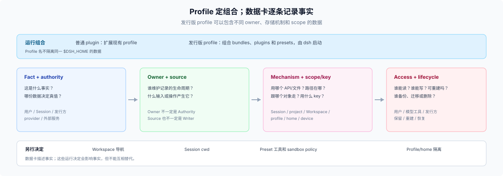

# 10 · 六轴：一份 Harness 发行版由什么组成

## 这一篇回答什么

要交付的东西叫什么、由哪几块构成、每块由谁负责。先定六轴的 owner，再谈目录、工具和数据；数据卡逐块记录事实。

## 术语来源：哪些是 DSH 的，哪些是本目录的

本目录只新造三个词，且都在下表标出来；其余全部沿用 DSH repo 的定义。

| 词 | 来源 | 说明 |
|---|---|---|
| `plugin`、`bundle`（组合包）、`profile`（具名组装） | REPO | 三个对象，定义见下一节（[architecture](https://github.com/deepseek-ai/deepseek-harness/blob/master/docs/architecture.md#profiles-and-bundles)） |
| `composition`、plugin tree、patch、patch 行／row、`dsh.profile.bundles` | REPO | 组合与 patch 层词汇（[architecture](https://github.com/deepseek-ai/deepseek-harness/blob/master/docs/architecture.md#profiles-and-bundles)） |
| shipped template、custom profile、application-owned profile | REPO | 三种 profile 归属（[app-boot](https://github.com/deepseek-ai/deepseek-harness/blob/master/packages/boot/app-boot/README.md#profiles)） |
| `app surface` | REPO | profile 决定同一个 launcher 起哪个 surface（[app-boot](https://github.com/deepseek-ai/deepseek-harness/blob/master/packages/boot/app-boot/README.md#profiles)） |
| **Harness 发行版** | 本目录 | 不是 DSH 对象，也不是新机制：指“一份交付出去、六轴各有 owner 的 Harness”。注意 repo 中文文档里的“发行版”指 DSH 自己的分发（shipped profile“作为模板随发行版交付”，[architecture.zh](https://github.com/deepseek-ai/deepseek-harness/blob/master/docs/architecture.zh.md#profile-与组合包)）；本目录加上 Harness 限定，指第三方交付的那一份，两者不混用。 |
| **发行方** | 本目录 | 角色标签，指交付这份发行版的一方。DSH 没有这个角色名；单插件作者通常不是发行方。 |
| **六轴** | 本目录 | 检查表装置，不是对象模型。DSH 的对象只有 plugin／bundle／profile 与它们的运行时数据。 |

## 三个对象，三种种类

DSH 里这三个词是三个种类，不是三个级别：

| 词 | 是什么 | 出处 |
|---|---|---|
| plugin | 向 Cordis 上下文贡献 service／event／effect 的单位；配置里由一行 patch row 挂载 | [architecture](https://github.com/deepseek-ai/deepseek-harness/blob/master/docs/architecture.md#cordis) |
| bundle | Cordis rows 及其挂载代码的分发格式，声明 `dsh.bundle.patch` | [architecture](https://github.com/deepseek-ai/deepseek-harness/blob/master/docs/architecture.md#profiles-and-bundles) |
| profile | 存在 Harness home 里的具名组装：有序 bundle + 自己的 `cordis.patch.yml` | [architecture](https://github.com/deepseek-ai/deepseek-harness/blob/master/docs/architecture.md#profiles-and-bundles) |

三者单独都不构成 product。repo 里 `product` 指整台运行中的 dsh（“Every part of the product is a plugin”，[architecture](https://github.com/deepseek-ai/deepseek-harness/blob/master/docs/architecture.md#cordis)），所以交付单位必然是一整棵树。本目录把它叫 **Harness 发行版**：上面三类对象，加上运行时来源、app surface、Harness home 策略和生命周期，作为一个交付承诺。

这解释了为什么“插件即产品”讲不通：一个 plugin 至多贡献六轴里 patch 层的一行，既不能拥有运行时，也不能拥有 app surface 和数据生命周期。

## 六轴

| 轴 | 发行方必须定 | DSH 提供的机制 | 读回方式 | 缺轴的症状 |
|---|---|---|---|---|
| **运行时** | 谁提供 dsh、版本 floor、签名与更新责任 | 用户自带 CLI、Desktop 内置精确运行时、Python wheel、源码树 | `dsh --version`；`engines.dsh` 在写依赖前拒绝 | 声明了 floor 却没检测；用户装低版本后装不上或装完才坏 |
| **profile** | 用哪个 shipped template、叫什么名、由谁拥有 | shipped template、`--from-default-profile`、application-owned profile | `$DSH_HOME/profiles/<name>/package.json` 的 `dsh.profile.bundles` | 装进 `web` 模板；用户重置模板后发行版消失 |
| **patch 层** | 哪些字段作默认、允许谁覆盖 | ordered bundle patches → profile patch → home patch → `--patch` overlays，整份替换 | `dsh --profile 
 --dump-config`；`skippedBundles` | 默认值写成代码常量，部署改不动；或只给一项，让必填字段丢失 |
| **app surface** | 起哪个 surface、带哪些 client plugins | profile 选择 web／headless／sdk／sdk-minimal／acp | 启动日志的 `dsh web:` URL 或 runner 输出 | web 起得来，Desktop 里没有对应入口；client 插件只在一种面上注册 |
| **Harness home 与数据** | 哪些状态共享、哪些自建、卸载留什么 | storage domain、Workspace registry、Session log、`header.cwd` | 数据卡（[91](../90-advisor/91-checklist.md)）逐行读回 | 用户以为卸载删干净了，数据还留在 home |
| **生命周期** | 装/更/卸的入口与数据清理责任 | 应用内 Plugins 页、`dsh plugin`、membership 变更后重启 | 安装三态：exit 0 → 依赖写入 → 进 `dsh.profile.bundles` | 文档写“可回滚”，实际没有命令级回滚 |

两句话判据：

- **完整** = 六轴都有明确 owner，没有一格写“默认应该有”。
- **可控** = 改任一条不用 fork DSH。发行版组合 DSH，不分叉 DSH；`controllable` 不是 `vendored`。

## profile 的三种归属

同一件事在 repo 里已经是三种状态，控制权依次收紧（[app-boot README](https://github.com/deepseek-ai/deepseek-harness/blob/master/packages/boot/app-boot/README.md#profiles)）：

| 归属 | 例子 | 发行方能改 | 用户能改 | 风险 |
|---|---|---|---|---|
| shipped template | `web`、`headless` | 只能建议，不能拥有 | 可整体重置 | 重置后发行版的 plugins 仍在 roster，但模板自己的 patch 层回到出厂 |
| custom profile | `kanban`、`--from-default-profile web` | 拥有 bundle 顺序与默认 patch | 可覆盖 patch、增删 bundle | 用户覆盖后，发行方默认值不再是 effective config |
| application-owned profile | Desktop 保留的 `desktop` | 由应用独占 | 不经 CLI profile lookup | `dsh plugin --profile desktop` 被门禁拒绝；CLI 自动化够不到 |

发行方要先回答“我属于哪一种归属”，再谈其他五轴；归属选错，后面每一轴都要打补丁。

## 每块事实用一张数据卡

不要为一块数据选择一个标签代替完整描述。给每份事实分别记录 owner、authority、source (input/operation)、mechanism/path、scope/key、readers、writers、rebuildability 和 retention；这些属性可以同时成立，不是互斥类别。

使用 [91 的数据卡模板](../90-advisor/91-checklist.md) 作为唯一记录格式。后续页面解释数据卡涉及的 DSH 机制，不重复分类数据。

## 参考页

- 六轴里的 Harness home 与数据：见 [11](./11-five-homes.md) 与 [12](./12-state-homes.md)。
- bundle、用户目录、插件状态与设置的 owner：见 [15](./15-four-spaces.md)。
- Session、项目根、DSH Workspace、profile、home 和 device 的生命周期/key：见 [13](./13-scope-and-keys.md)。
- 工具权限、目录和 patch：见 [16](./16-startup-resolution.md) 与 [17](./17-config-layers.md)。
- patch 层与生命周期的推荐做法：见 [50](../50-lifecycle/00-index.md)。
- “五个家”（[11](./11-five-homes.md)）与“四个空间”（[15](./15-four-spaces.md)）是两个不同的切法，不要互相替代：前者按存储通道分（内容／历史／状态／派生／客户端），后者按资产 owner 分（发布 bundle／用户目录／插件状态／运行设置）。两者都是本目录的助记，不是 DSH 的对象模型。

这些页面是查找不同机制的参考，不是固定实现管线。先定六轴 owner，再选择匹配的 API。

## 边界

- Profile 是 DSH composition，不是数据 scope、发布物或隔离边界。
- Workspace registration 不授予模型文件权限；Session cwd、有效 working directory 和发行版项目根也不同。
- DSH 不提供通用 product data root、多租户隔离或跨机器同步；发行方自建的目录不是 DSH 服务。
- 外部社区材料提供设计参考，不定义 DSH API 合同。
