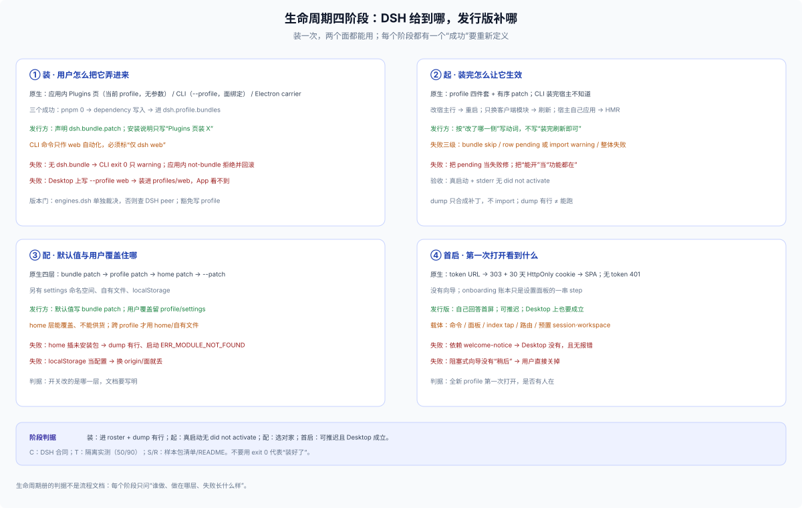
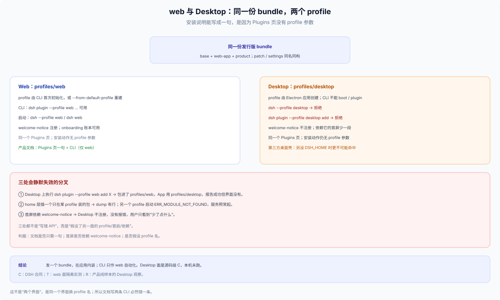

# 37 · 生命周期（参考）：装、起、配、首启的判据

## 这一篇回答什么

> **角色：外部参考层（E1/E2），按阶段而不是按交付形态切。** 来源是 2026-11-01 的 `leverage-lifecycle`：4 个阶段、15 张阶段样本卡 + 1 张反例、8 条硬结论、六类启动载体与一份发布前检查表。本篇**没有安装或运行这些样本**；行为结论按 C/T/S/R 读，样本事实按包清单/README 读。

[34](./34-profile-delivery-forms.md) 回答“装成什么形态”，[35](./35-profile-assembly-ownership.md) 回答“装配状态归谁”，[36](./36-profile-evidence-ledger.md) 是逐样本台账。本篇补的是横切的一段：**一个插件从被拿到、到第一次成功，四个阶段分别由谁做、做在哪一层、失败长什么样**。

**先定调**：分发、安装、启动只走 DSH 给出的路。需要特别的东西，用 bundle 里的插件、流程和配置实现；不靠改宿主，也不另造一套分发。

## 四阶段总表

| 阶段 | 原生给什么 | 发行方要决定 | 失败态 |
|---|---|---|---|
| ① 装 | 应用内 Plugins 页（当前 profile）/ CLI（`--profile`，web 自动化）/ Electron carrier | 声明 `dsh.bundle.patch`；写“Plugins 页装 X”；CLI 标“仅 dsh web” | CLI：exit 0 但 roster 不变；应用内：`not-bundle`；Desktop 装进 `profiles/web` |
| ② 起 | profile 四件套 + 有序 patch；CLI 装完宿主不知道 | 按“改了哪一侧”写重启/刷新/HMR；真启动验收 | row pending / import warning；应用能开但功能没有 |
| ③ 配 | bundle/profile/home/`--patch` 四层；settings/自有文件/localStorage | 默认值放 bundle；跨 profile 才用 home/自有文件 | home 供货 → `ERR_MODULE_NOT_FOUND`；localStorage 当配置 |
| ④ 首启 | token URL → 303 + cookie → SPA；无向导 | 自己回答首屏；可推迟；Desktop 上成立 | 依赖 `welcome-notice`；阻塞式向导无出口 |

## 八条硬结论

1. **应用内安装是“当前 profile 相对”的。** Plugins 页与 `plugin_manager` 工具没有 profile 参数；所以 web 与 Desktop 能够同一句话。（C）
2. **`desktop` 从普通 CLI 双门禁闭。** `dsh --profile desktop` 与 `dsh plugin --profile desktop` 都被拒；只有 Electron carrier 用程序化开关能管理。（C/T）
3. **“装成功”有三个。** pnpm 成功 ≠ dependency 写入 ≠ 成为 profile 层；只有第三个让功能存在，前两个成功时退出码仍可以是 0。（C/T）
4. **启动不是全有或全无。** 单个 row 导入失败被隔离成 warning，进程照常服务；“应用能开、我的功能没有”是合法终态。（C/T）
5. **home 层跨 profile，但不能供货。** 它能覆盖/禁用任意 profile 的行；插入没装的包，dump 有行，真启动 `ERR_MODULE_NOT_FOUND`。（C/T）
6. **原生首启只有令牌门。** token URL → 303 + 30 天 HttpOnly cookie → SPA；没有欢迎页/向导；onboarding 账本只是设置面板的 step。（C）
7. **启动体验不必另造 launcher。** 首屏注入、预置会话、工作区都在 host 服务层，写在 bundle 里即可，天然跨面。（C/T）
8. **机制对不等于发行成立。** `negative/91` 的机制齐全但无人使用；生命周期完整不是发布理由。（R/U）

## ① 装：三条通道，三个“成功”

| 通道 | 谁执行 | profile 从哪来 | 跨面吗 |
|---|---|---|---|
| 应用内 Plugins 页 / `plugin_manager` 工具 | 正在运行的宿主 | 当前 profile，**无参数** | **是**，web 与 Desktop 同一句 |
| `dsh plugin --profile 
 <pnpm 参数>` | CLI，转发 pnpm | 显式指定；首次自动初始化 | 面绑定：可管理 web/headless/sdk 等，不能 desktop |
| Electron carrier（程序化） | Desktop | 只能它碰 `desktop` | 否，第三方拿不到 |

**三个成功必须分开核**：

| 状态 | 怎么核 |
|---|---|
| pnpm 成功 | exit 0 + `+ <pkg>` |
| dependency 写入 | `profiles/
/package.json.dependencies` |
| 成为 profile 层 | `dsh.profile.bundles` 含该 bundle |

**只有第三个让功能存在。** 没声明 `dsh.bundle.patch` 的包，CLI 通道是 exit 0、dependency 写入、roster 不变、只给一句 stderr `declares no dsh.bundle — installed as a plain dependency, not a profile layer`；应用内通道则先装后判，以 `not-bundle` 失败并回滚 `package.json` 与 lockfile。本篇的隔离实测是 CLI 通道（T，见 [50/90](../50-lifecycle/90-evidence.md)）。

**patch 语义**：新增 row 用 `insert:`；裸 `- id` 是 override target，找不到目标只报 `entry "..." not found`，bundle 仍在 roster 但插件不跑。

**版本门**：`engines.dsh` 存在时**单独裁决**，忽略 peer；未写时才检查 `@deepseek-ai/dsh` 与 `@deepseek-ai/dsh-*` 的 peerDependencies（`@deepseek-ai/cordis` 不参与；第三方自造的 `dsh.compatibility` 矩阵 DSH 不读，见 [FAQ 24 §9](../../24_plugin-publish-and-agent-data-planes/06-skeleton-and-checklists.md#9-旧写法迁移)）。安装期不匹配会在写入 package 依赖前拒绝并列出 `incompatible`，同时给出 exact-version exemption 命令；exemption 写进该 profile 的 `compatibility.json`，是风险接受，不是兼容证明。

**样本的四条装阶段教训**：

| 样本 | 机制 | 可迁移 |
|---|---|---|
| `install/11` cfbridge | 五条自证命令，`files` 白名单漏掉 `scripts/` | 打包后 `npm pack --dry-run` 逐条执行 README 命令 |
| `install/12` origin-plugin | 入口工件决定“能装”，loader fiber 决定“活着” | `apply` 只做副作用、不返回值；描述走 export |
| `install/13` free-models-hub | 三条安装路径，依赖的脚本全不在包里 | 安装路径必须能从 tarball 复现 |
| `install/14` tinyfish | 覆盖宿主行只写 `id`+`config`；`name` 是断言 | 写别人包名等于冒名，不是重命名 |

## ② 起：profile 四件套、补丁序、失败三级

profile 就是四个文件加依赖树：`package.json`（bundles）、`cordis.yml`（空，注释指向 patch）、`cordis.patch.yml`（用户层）、`pnpm-workspace.yaml`。

**补丁叠加顺序**（低 → 高）：bundle 层（按 roster 顺序）→ profile patch → home patch → `--patch`（按 argv）→ telemetry 开关。根 `cordis.yml` 每次启动会被重写成空列表，避免合成树重复插入。

**失败分三级**（row 级含两种状态），别混：

| 级 | 表现 | 进程 |
|---|---|---|
| bundle 级 | `skipping profile bundle "<pkg>": <reason>` | 活 |
| row 级 · pending | `pending (waiting for service: <name>)`，既未激活也未失败 | 活 |
| row 级 · import 失败 | `warning: N entry did not activate` + import 错误 | 活 |
| 整体 | 组合失败抛错 | 死 |

**三种“生效”**：改宿主行 → 重启；只换客户端模块 → 刷新；宿主自己应用 → HMR。CLI 安装是另一个进程，**宿主不知道**；不重启就是没生效，且没有提示。应用内装才会返回 `restart-required`。

**样本的五条起阶段教训**：

| 样本 | 机制 | 可迁移 |
|---|---|---|
| `boot/21` rhine-splash | `index-inject` 在 React 前改首屏；append 不 prepend | 双转义、开屏频率、顺序都归自己 |
| `boot/22` update-checker | 结果文件 + 实例身份 + 端口探针 | 自重启后证明“新版接管”，不靠日志猜 |
| `boot/23` noema | 懒起/保活/退避/并发去重四件事 | 六个默认值表达生命周期，而不是写死 |
| `boot/24` doctor | 修复前检查点硬前置、健康检查尽力而为 | 救生链降级人工；不要自动做不可逆修复 |
| `boot/25` context-guardian | 生效做成显式一步，默认 dry-run | 装完还要一步时，把这一步做成显式交付步骤 |

## ③ 配：四类配置来源，home 能覆盖不能供货

| 层 | 位置 | 覆盖面 | 谁写 |
|---|---|---|---|
| bundle 默认值 | bundle 的 `cordis.patch.yml` | 所有用它的 profile | 包作者 |
| profile 用户层 | `profiles/
/cordis.patch.yml` | 这个 profile | 用户/插件 |
| home 层 | `$DSH_HOME/cordis.patch.yml` | 所有 profile | 用户 |
| 临时覆盖 | `--patch <file>` | 这一次启动 | 调用方 |

另有 settings 命名空间、自有文件、localStorage。**home 层能覆盖任意 profile 的行，但不能供货**：插入一个该 profile 没装的包，`--dump-config` 里好看，真启动 `ERR_MODULE_NOT_FOUND`，且**服务照常起来**。本篇隔离实测复现（T）：warning `1 entry did not activate`，随后仍打印 token URL。

**样本的三条配阶段教训**：

| 样本 | 机制 | 可迁移 |
|---|---|---|
| `config/31` isolation-gate | 四种“读不到”分开报，全部落到拒绝；坏文件不覆盖 | 权限/名单类配置 fail-closed |
| `config/32` free-search | 只接出厂默认；显式选择让路；被重置后补一次 | 接管要有三档，不是全抢 |
| `config/33` dfy-bundle | 换包装复用同 id，用户配置才活得下来 | 退役旧包留给用户层，不越权删 |

## ④ 首启：令牌门之后是空界面

原生首启只有一道令牌门：`dsh web` 打印 token URL；无 token 且无有效 cookie 时 401；带 token 则 303 + 30 天 HttpOnly cookie → SPA，此后 cookie 本身即可进。**没有欢迎页、没有向导、没有“装什么”的推荐。** 首启账本 `settings.onboarding` 只是设置面板里的一串 step，一次只挂一个，且 `welcome-notice` 在 Desktop 不注册。

因此“第一次看到什么”由已安装的 bundle 与客户端插件决定。**六类启动载体**（都在 bundle 内，不换入口）：

| 想要的效果 | 原语 | 代价 |
|---|---|---|
| 首屏注入 | `webServer.tapIndex` / `index-inject` | 顺序、转义、频率自己管 |
| 自有路由/页 | `webServer.register` / `registerFallback` | 要处理 fallback 与鉴权 |
| 另起会话 | `agents.create({ sessionId, meta: { cwd, agentPreset }, seed })` | 用户没点就多一个会话，需解释 |
| 工作区 | `workspaceRegistry.create(path, title)` | 目录不存在会 ENOENT |
| 会话目录 | `workingDirectory.set(agent, path)` | 只改有效目录，不改 header.cwd |
| 命令入口 | `commands.register(...)` | `input` 决定给人还是给模型 |

**样本的三条首启教训**：

| 样本 | 机制 | 可迁移 |
|---|---|---|
| `first-run/41` skill-cockpit | 用 doctor 退出码当首启验收面 | 没有浏览器卡片也能有首启；测试锁检查项 |
| `first-run/42` tool-guardian | 会话内命令当唯一验收面；`input` 决定路由 | 不写 `input`，带参命令会被当提问发给模型 |
| `first-run/43` 24pa | boot 建工作区 + 两个可推导会话；冲突换 id | 预设冲突不覆盖，保留历史 |

**反例 `negative/91`**：机制齐全、★1/月 763、发布后再无更新。**机制过门不等于发行成立**；不要因为“生命周期完整”就发。

## web 与 Desktop：同一份 bundle，两个 profile

- 同一套 `dsh-base` + `dsh-web-app`、同一个 Plugins 页、同一套 patch/settings。
- profile 名不同：`web` 由 CLI 创建，`desktop` 由 Electron 创建；普通 CLI 对 `desktop` 双门禁闭（启动与 `plugin` 都拒绝），只有 Electron carrier 用程序化开关能进。
- 三处静默失效：Desktop 上 `--profile web` 装错目录；home 层供货；首屏依赖 `welcome-notice`。
- 第三方桌面壳若另设 `DSH_HOME`，`--profile web` 更不可能命中；它不是 DSH 支持路径。

**判据**：安装说明是否只需一句？首屏是否依赖 `welcome-notice`？是否假设 profile 名？

## 15 张阶段样本 + 1 张反例

| 阶段 | 样本 | 载体 | 一句话机制 | 证据 | 本篇没验证的那一步 |
|---|---|---|---|---|---|
| 装 | cfbridge | 自带 CLI | 五条自证命令，`files` 漏 `scripts/` | S/R | 没跑 `npm pack --dry-run`，也没逐条执行那五条命令 |
| 装 | origin-plugin | 纯 host 行 | 入口工件决定能装，loader fiber 决定活着 | S/R | 没装一次确认 fiber 真的起来 |
| 装 | free-models-hub | 自带 CLI | 三条安装路径依赖的脚本不在包里 | S/R | 没按 tarball 复现那三条安装路径 |
| 装 | tinyfish | 纯 host 行 | 覆盖行 `name` 是断言，不是重命名 | S/R | 没装后确认被覆盖的行是否真的换了实现 |
| 起 | rhine-splash | 首屏注入 | `index-inject` 在 React 前改首屏 | S/R | 没真启动看顺序、转义与开屏频率 |
| 起 | update-checker | 自有路由 | 结果文件+实例身份+端口探针证明新版接管 | S/R | 没跑一次自重启并确认新版接管 |
| 起 | noema | 纯 host 行 | 懒起/保活/退避/并发去重 | S/R | 没观察六个默认值下的实际生命周期 |
| 起 | doctor | 自带 CLI | 检查点硬前置，救生链降级人工 | S/R | 没跑一次修复流程验证前置与降级 |
| 起 | context-guardian | 命令 | 生效是显式一步，默认 dry-run | S/R | 没确认默认 dry-run 与显式生效的差别 |
| 配 | isolation-gate | 纯 host 行 | 读不到就拒绝，坏文件不覆盖 | S/R | 没造权限/名单失败各一例 |
| 配 | free-search | 纯 host 行 | 只接出厂默认，显式选择让路 | S/R | 没确认“让路 + 重置后补一次”两个行为 |
| 配 | dfy-bundle | 纯 host 行 | 换包装保 id，退役留给用户层 | S/R | 没验证退役旧包后用户配置是否保留 |
| 首启 | skill-cockpit | 自带 CLI | doctor 退出码当首启验收面 | S/R | 没跑那个退出码 |
| 首启 | tool-guardian | 命令 | 命令即验收面，`input` 决定路由 | S/R | 没试不带 `input` 的带参命令是否被当提问 |
| 首启 | 24pa | boot hook | 预置工作区+会话，冲突换 id | S/R | 没 boot 后确认冲突换 id 的结果 |
| 反例 | bootstrap | 自带 CLI | 机制齐全但无人用，发布后停更 | R | 只读了 README，没有作者访谈或使用数据 |

> 原册对 `install/11`、`install/13`、`boot/21`、`config/31` 有隔离实测；本篇没有重跑，故不升为 T。上表最后一列是把每行的“可迁移”主张反过来说：**这些检查都还没做**，谁要用某一行就先补哪一步。

## 发布前判据

1. 包声明 `dsh.bundle.patch`；装完进 `dsh.profile.bundles`，且 `--dump-config` 有自己的 row。
2. 面向 GUI 的安装说明只有一句“在 Plugins 页装 X”；CLI 命令后标“仅 `dsh web`”；headless/SDK/ACP 用 CLI 显式 profile；全文没有 `--profile desktop`。
3. 真启动一次，stderr 没有 `did not activate`；文档写对重启/刷新/HMR。
4. 默认值在 bundle patch；跨 profile 才用 home/自有文件；home 不供货。
5. 首启可推迟；不依赖 `welcome-notice`；Desktop 上有替代路径。
6. `npm pack --dry-run` 清单包含 README 里提到的所有脚本/资源。
7. 版本门写一处就够：`engines.dsh` 单独裁决，未写时才查 DSH peer；豁免只对 exact package + dsh version。
8. 升级先升版本号再打包；同名同版本重装不会刷新。

## 与 34/35/36/50 的边界

- [34](./34-profile-delivery-forms.md)：八种交付形态；本篇不重复形态，只给阶段判据。
- [35](./35-profile-assembly-ownership.md)：四层状态、身份、更新、接管；本篇补安装三成功、失败三级、home 不能供货。
- [36](./36-profile-evidence-ledger.md)：34 的八种形态样本的证据台账；本篇的 15 张阶段样本 + 1 张反例按行记在下方阶段样本表里，不并入 36。
- [50 生命周期](../50-lifecycle/00-index.md)：DSH 约定内的做法层——打包、安装、初始化、配置、启动、更新与卸载该怎么写；本篇是外部参考层的阶段判据（15 张样本），不替代 50 的命令与实验。

## 边界

- 四阶段的 C 侧结论来自 DSH 源码与 docs；S/R 侧来自样本的包清单、源码与 README。本篇不给 DSH 规定安装流程，只给判据。
- 15 张阶段样本 + 1 张反例在本篇**没有安装、没有运行**；原册记录的隔离实测没有重跑。
- 判据面向“一套 bundle 装进 profile”的交付；单插件、终端 surface、自带运行时的独立应用不在这四阶段的覆盖内。
- 样本的版本、下载量、维护状态会漂移；引用时回到各自仓库当前版本。
