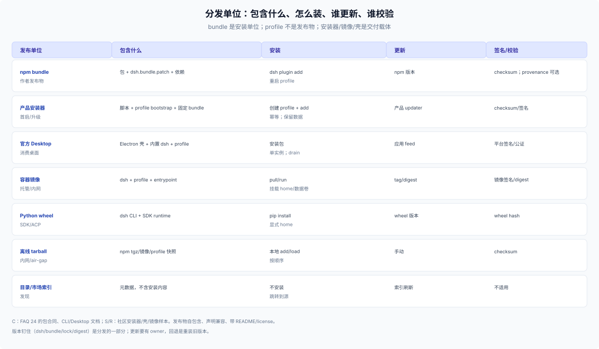

# 60 · 分发与打包：发布单位、版本、签名与离线

## 先分清发布单位

FAQ 24 已经拆过包的角色：**bundle 是唯一可安装并自动启用的作者发布物；plugin 是 patch 行；preset/skill 是 bundle 里的资源；profile 不是发布物。** 这里只讨论“发行版怎么把这些单位交付出去”。

| 发布单位 | 包含什么 | 安装方式 | 更新方式 | 谁负责签名/校验 |
|---|---|---|---|---|
| npm bundle | 包 + `dsh.bundle.patch` + 依赖 | 应用内 Plugins 页（默认）；CLI `--profile`（显式；不能 `desktop`） | npm 版本 / 发行版 updater | npm provenance（可选）/ 发行方 |
| 发行版安装器（仅 shell/自托管） | 安装脚本 + profile bootstrap + 固定 bundle 版本 | 脚本创建 profile、初始化、add；只覆盖 web | 发行版 updater | 发行版 checksum/签名 |
| 官方 Desktop | Electron 壳 + 内置 dsh + profile | 安装包 | 应用 feed / 安装器 | 平台签名/公证 |
| 容器镜像 | dsh + profile + entrypoint | `docker pull/run` | tag/digest | 镜像签名/digest |
| Python wheel | dsh CLI + SDK runtime | `pip install` | wheel 版本 | wheel hash |
| 离线 tarball | npm tgz / 离线 registry 镜像 | 本地 `dsh plugin add` | 手动 | checksum |
| 目录/市场索引 | 元数据，不含安装 | 不安装 | 索引刷新 | 不适用 |

## bundle 打包的最小要求

- `package.json` 声明 `dsh.bundle.patch`（一个文件或有序列表），否则只是普通依赖，不会自动启用。
- 自包含：不要依赖你的 workspace；`files`/`exports`/`dependencies` 要能让 profile 的 pnpm 解析。
- 兼容：声明 `engines.dsh` 或 DSH peer range；共享实例用 peer + dev 双写。
- 元数据：license、repository、README；有 Config 的写清默认值和必填项。
- 自检：`dsh --profile <scratch> --dump-default-config` 看层是否出现；`dsh plugin add` 后重启再看 roster/row。

完整包合同见 [FAQ 24 的包发布要求](../../24_plugin-publish-and-agent-data-planes/02-package-contract.md)，这里不重复。

**默认发布单位是 bundle，安装入口是应用内 Plugins 页（web 与 Desktop 同一句）。** 不要发布 profile 目录；需要 shell/自托管时再加安装器/镜像，profile 由安装器在用户机器上生成（shipped 模板或 `dsh plugin`），否则用户 patch、依赖与数据会被一份静态目录覆盖。

## 自托管/安装器要做什么（仅 shell）

1. **默认走应用内装**：bundle + Plugins 页；只有 shell/自托管才选安装器。选运行时：npm 全局、Desktop、wheel、源码；容器是 `dsh web` 的部署包装。
2. **固定版本**：dsh 版本 floor、bundle 精确版本、lockfile/镜像 digest；不要“latest 装完再看”。
3. **初始化 profile**：按 surface 选模板（web/headless/sdk/acp）；`--from-default-profile` 只限首次，它是破坏性替换；`dsh plugin` 对自定义名字只装 base。
4. **安装 bundle**：调 `dsh plugin --profile <name> add`，不要手写 `dsh.profile.bundles`。
5. **写入发行版默认值**：bundle patch 或 profile patch；不要改 bundle 内部文件。
6. **首启检查**：version、dump-config、端口、token URL、profile roster。
7. **可重复/可修复**：安装失败能重跑；已有数据不覆盖；卸载说明写清。

## 版本与更新

| 问题 | 做法 |
|---|---|
| 多个 bundle 的版本 | exact pin + lockfile/digest；区分 direct pin 与 transitive lock |
| dsh 版本 | `engines.dsh`/peer range；不匹配默认拒绝安装；exemption 只对 exact package + dsh version，且是风险接受不是兼容证明 |
| 更新通道 | npm dist-tag、Desktop feed、容器 tag/digest、发行版 updater；不要混用 |
| 回滚 | **没有命令级回滚**；保留旧 exact version/enabled，回退靠重装；写清 crash window |
| profile 写锁 | 更新/安装走 `dsh plugin` 或 Plugin Manager；不要并发写 |

## 签名、校验与离线

- Desktop：只由官方发布并签名/公证；发行版不要自建桌面壳作为主路径。
- npm：provenance/SLSA 可选（社区 `dsh-suite` 有 SLSA provenance 样本）；至少给 tarball checksum。
- 容器：image digest、签名、SBOM；固定 tag + digest。
- 离线/内网：vendor npm tarball + 依赖、预置 profile `node_modules`、或离线镜像；给 checksum 和安装顺序。实测：`npm pack` 的 bundle tarball（package.json + cordis.patch + 插件文件）可直接 `dsh plugin add ./x.tgz`，bundles 与 row 都正常。
- License/notice：bundle license、第三方 notice、模型/API 条款；随发布物分发。

## 容器 entrypoint

```sh
#!/bin/sh
set -eu
exec dsh --profile acme --no-open \
  --host "${DSH_BIND_HOST:?set a concrete container IP}" \
  --public-url "${DSH_PUBLIC_URL:?}" \
  --trusted-host "${DSH_TRUSTED_HOST:?}"
```

- 不要把 `0.0.0.0` 直接传给 `dsh web`；entrypoint 解析容器地址或要求显式 env。
- home 用卷；profile 可在镜像内或卷；更新换镜像 digest，不手改运行中的 profile。
- 反向代理负责外部 TLS；`--public-url` 只广告，`--trusted-host` 才授予信任。

## 平台矩阵

| 平台 | 运行时 | 备注 |
|---|---|---|
| macOS | Node/npm、Desktop、容器 | Desktop 签名/公证；arm64/x64 |
| Windows | Node/npm、Desktop、WSL | Desktop 安装器/签名；路径/编码 |
| Linux | Node/npm、容器 | Desktop 无官方 Linux 版；headless/容器更常见 |
| 其他 | 源码/容器 | 需要 Node 版本匹配；不承诺 Desktop |

## 发布检查清单

1. bundle 能在一个干净 profile 里 `add` → 重启 → dump 看到 row。
2. `engines.dsh`/peer 与目标 dsh 版本一致；升级路径有说明。
3. 安装器幂等，已有 profile/data 不被覆盖；`--from-default-profile` 只用于首次。
4. 版本钉住（dsh/bundle/lock/digest）；更新有 owner，回退是把旧版本重装一次，没有命令级回滚。
5. 签名/校验：Desktop 签名、npm provenance/checksum、镜像 digest 至少有一项。
6. 离线/内网方案可复现；license/notice 随包。
7. 安装/升级/卸载文档与发布物一起版本化。


