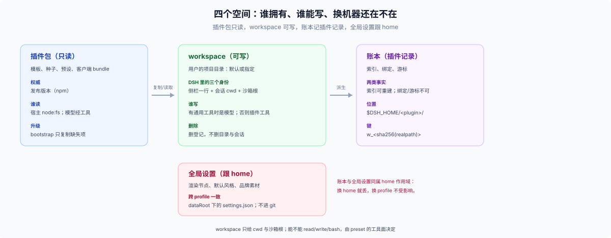

# 26 · 插件即产品：先分清四个空间，再决定安装、启动与数据归属

这不是一份"插件点评合集"，而是一张给**产品型插件作者**和 Agent 用的决策图。当 DSH 实例的用途由一个插件决定时，问题不再是"数据放哪"，而是"这个实例由哪些空间组成、启动时根从哪来、模型能写哪儿、用户改的东西记在哪"。

> **定义**：一个产品型 DSH 实例 = 一份 profile 组合（装什么）+ 一个 workspace 根（在哪干）+ 一份 home 级账本与全局设置（记住什么）。
>
> 三件事分开看：组合决定能力与默认值，根决定模型能写哪儿，home 级记录决定换 profile 之后还剩下什么。
>
> 这里的“根”是**产品自己的项目根**（`projectsRoot`）；只有架构 II 会把它登记为 DSH workspace。

> **要动手写插件？** 直接去 [90 动手](./90-advisor/00-index.md)：两条施工路线、应用插件七问、七步顺序，以及一个完整的[端到端例子](./90-advisor/93-app-plugin-walkthrough.md)。前面的章节是地图，90 是施工图。
>
> **必读三篇**：[00-answer](./00-answer.md)（结论）→ [90 动手](./90-advisor/00-index.md)（施工）→ [91 检查表](./90-advisor/91-checklist.md)（自查）。其余章节按需查，不必通读。



## 30 秒结论

1. **一个产品型 DSH 实例 = 一份 profile 组合（装什么）+ 一个 workspace 根（在哪干）+ 一份 home 级账本与全局设置（记住什么）。** 三者不可互相替代：组合给不了写权限，根给不了跨 profile 记忆，home 记录给不了项目内容。
2. **四个空间各有权威**：插件包只读、workspace 可写、账本记插件自己的东西（索引可重建、状态不可重建）、全局设置跟 home。
3. **可写性来自 preset 的工具面，不来自 workspace。** workspace 只给侧栏一行、会话 `cwd` 和沙箱可写根。
4. **启动时没有用户可问**：目录解析落成四状态，弹窗在客户端连上之后；要用侧栏时先登记占位，可以挡住 `<Documents>` 默认工作区（概率性缓解，见 16）。
5. **用户选目录后，目录零写入、profile 零写入。** 知识只在 `$DSH_HOME` 与浏览器本地；marker 是产品选择。
6. **配置五层，patch 是整对象替换。** 只覆盖一个键会把该行其余键打回 schema 默认。

## 词汇顺序：承诺 → 空间 → 家 → 键

四套词汇的顺序是固定的：**承诺 → 空间 → 家 → 作用域/键**；两条横切是工具面与启动解析。完整定义、分工表与五条常见混淆都在 [10 概念层](./10-foundations/10-taxonomy.md)，这里只给一句话：

```text
承诺（对用户） P0–P5  →  空间（归属）四个  →  家（机制）五个  →  作用域/键
                          ↓                      ↓
                    15 / 16 / 17            11–14
```

两种读者：普通插件走"承诺 → 家 → 键"；产品型实例走"承诺 → 空间 → 启动/配置 → 家"。

## 原生 vs 扩展：五级依赖

| 级别 | 是什么 | 长期策略 | 发布含义 |
|---|---|---|---|
| **N0 原生核心** | docs + 核心包 + 测试定义的 Service/事件/格式 | 首选，直接依赖 | 随 DSH 发行，最稳 |
| **N1 原生插件** | 官方随包：workspace、projcache、settings、credentials-local、session-query-sqlite、spill-local | 首选，直接依赖 | 跟 DSH 版本走，兼容成本低 |
| **N2 原生实验** | `packages/experimental/`，如 agent-team、claude-code-mods `$.store` | 只参考，不承诺稳定 | 可能改/撤，不写进发布依赖 |
| **E1 扩展插件** | 第三方社区插件/包 | **只借鉴模式，自己用原生 API 实现** | 不写进 `dependencies`；版本/许可证/卸载/供应链不受制于人 |
| **E2 外部服务** | MCP/HTTP/DB/对象存储 | 没有原生替代时短期用 | 运维/隐私/网络成本自负 |

N+ 不是第六级：它表示“借外部模式、用 N0/N1 自己实现”，是做法，不是依赖（见 [92](./90-advisor/92-native-reference-architectures.md)）。

## 一页决策画布

先填这九格，再翻到对应章节：

| 格 | 问题 | 去哪里找 |
|---|---|---|
| 工具面 | 模型要直接读写项目文件吗？ | [17 配置分层](./10-foundations/17-config-layers.md) |
| 空间 | 插件包 / workspace / 账本 / 全局设置？ | [15 四个空间](./10-foundations/15-four-spaces.md) |
| 启动 | 根从哪来？不在怎么办？ | [16 启动解析](./10-foundations/16-startup-resolution.md) |
| 权威 | 用户、会话、插件、没人（派生）、外部？ | [11 五个家](./10-foundations/11-five-homes.md) |
| 作用域 | 这次会话、这个项目、这个人、这台机器、这个安装？ | [13 作用域与键](./10-foundations/13-scope-and-keys.md) |
| 寿命 | turn、session、project、account、forever、rebuildable？ | [11](./10-foundations/11-five-homes.md) / [22](./20-native/22-native-data-history.md) |
| 读写者 | 模型、用户、插件、浏览器、没人？ | [11](./10-foundations/11-five-homes.md) |
| 配置层级 | 包默认 / profile / home / 产品全局设置？ | [17](./10-foundations/17-config-layers.md) |
| 删除/迁移 | 删了会不会丢？卸载留什么？ | [91 决策程序](./90-advisor/91-checklist.md) |

## 十一条原则

0. **先问工具面。** 模型要不要对项目目录用通用文件工具？不要，项目不必是 workspace；要，会话 cwd 必须落在项目里。
1. **先定承诺，再找 API。** 承诺 = 对用户说的话：我记住什么、在哪、删了/换机器/升级后还算不算数。
2. **一个事实一个家。** 副本、索引、缓存只能做派生；不能让两层都声称权威。
3. **用户内容不搬进你的域。** 只存路径、哈希、引用；内容留在用户能看见、能带走的地方。
4. **作用域先于存储。** session / workspace / profile / home / device 选错，换什么 API 都别扭。
5. **账本不是 workspace。** 账本目录一旦登记成 workspace，模型就能改写自己的记录。
6. **删除/保留是一等设计。** session 无删除 API、附件无 GC、插件无卸载契约；你必须自己回答"谁删、何时删、删不干净怎么办"。
7. **秘密只存引用。** 值走 `CredentialRef`/`CredentialKey`；文件权限挡其他用户，不挡同 uid 的模型工具。
8. **客户端分两层。** 纯 UI 状态用 `localStorage`/`userData`；session-derived 事实走 projection。
9. **原生优先。** N0/N1 首选；N2 只参考；E1 只借模式、自己实现，不写进 `dependencies`；E2 最后。
10. **迁移是数据设计的一部分。** 版本、兼容读、一次性迁移、失败可见、旧数据保留，四件事一起设计。

## Archetype 参考

11 个 archetype 的路线表、选型表与产品实例数据面见 [92 参考架构](./90-advisor/92-native-reference-architectures.md)；产品实例另见 [90 动手](./90-advisor/00-index.md) 与 [93 端到端](./90-advisor/93-app-plugin-walkthrough.md)。

## 按问题快速分流

| 你的问题 | 先读 | 再读 |
|---|---|---|
| 我要开始写插件（尤其是应用型） | [90 动手](./90-advisor/00-index.md) | [91 决策程序](./90-advisor/91-checklist.md) / [93 端到端](./90-advisor/93-app-plugin-walkthrough.md) |
| 产品启动时目录从哪来、用户怎么选 | [16 启动解析](./10-foundations/16-startup-resolution.md) | [15 四个空间](./10-foundations/15-four-spaces.md) |
| 模型为什么写不了项目文件 | [17 配置分层](./10-foundations/17-config-layers.md) | [sandbox](../../docs/subsystems/sandbox.md) |
| 产品全局设置放哪、跨 profile 一致 | [17](./10-foundations/17-config-layers.md) | [12 状态的家](./10-foundations/12-state-homes.md) |
| 怎么安装/升级/卸载、什么时候要重启 | [18 安装升级](./10-foundations/18-install-upgrade.md) | [17](./10-foundations/17-config-layers.md) |
| 用户选目录后要留什么 | [15](./10-foundations/15-four-spaces.md) | [13](./10-foundations/13-scope-and-keys.md) |
| 用户要打开/编辑/带走一份文件 | [14 产物](./10-foundations/14-artifacts.md) | [15 四个空间](./10-foundations/15-four-spaces.md) |
| 跨会话统计/用量面板 | [11 历史家](./10-foundations/11-five-homes.md#历史家会话日志) | [21 原生 landscape](./20-native/21-native-data-landscape.md) |
| 项目级插件状态/索引 | [13 作用域与键](./10-foundations/13-scope-and-keys.md) | [91 例 1](./90-advisor/91-checklist.md) |
| API key / token | [12 状态的家](./10-foundations/12-state-homes.md) | [22 历史 §3](./20-native/22-native-data-history.md#3-凭据引用与记录分开) |
| 删除/保留/卸载 | [91 决策程序](./90-advisor/91-checklist.md) | [18 安装升级](./10-foundations/18-install-upgrade.md) |
| 面板宽度/折叠/快捷键 | [11 客户端家](./10-foundations/11-five-homes.md#客户端家浏览器设备本地状态) | [13 作用域与键](./10-foundations/13-scope-and-keys.md) |

## 反模式清单

- 把 workspace 当可写性来源（登记了目录就以为模型能写）。
- 把账本目录登记成 workspace（模型能改写自己的注册表）。
- 目录缺失就当空目录重建（物化未挂载的卷）。
- 把用户文件复制进 home 当真相。
- 把项目清单塞进 profile（profile 是安装单位，不是数据库）。
- 用 `workspaceId` 当长期键（删重加会换）。
- 把 `realpath` 直接当 `per-record` 键（含 `/`，会被拒绝）。
- 只在一个 profile 里改配置，或以为 `Config` 是深合并。
- 把客户端 localStorage 当共享状态/身份。
- 直接物理删 session 日志目录、或直接改 session 日志 header。
- 卸载不写清理说明（domain/dataRoot/marker/workspace 登记都可能残留）。

## 读法

### 按时间预算

| 预算 | 读什么 | 跳过 |
|---|---|---|
| **5 分钟** | 本页 + [00-answer](./00-answer.md) | 其余全部 |
| **30 分钟** | + [10 概念层](./10-foundations/10-taxonomy.md)、[15](./10-foundations/15-four-spaces.md)、[16](./10-foundations/16-startup-resolution.md)、[17](./10-foundations/17-config-layers.md)、[18](./10-foundations/18-install-upgrade.md)、[90 动手](./90-advisor/00-index.md) | 21/22/31–33 |
| **2 小时** | + [91](./90-advisor/91-checklist.md)、[92](./90-advisor/92-native-reference-architectures.md)、[93](./90-advisor/93-app-plugin-walkthrough.md) | 31–33 只查 |
| **复核证据** | [40-evidence](./40-evidence/00-index.md) | — |

### 按角色

- **普通插件作者**：00-answer → 10 → 11/13/12 → 91 → 92 路线表。
- **产品型实例作者**：00-answer → 10 → 15/16/17/18 → 90 → 93 → 91。
- **架构/维护者**：21 → 22 → 92；31–33 只作对照。

### 信号

**精读**：00-answer、10 概念层、90 动手、91 检查表。**按需**：11–18、92、93。**只查**：21/22（历史与全景）、31–33（外部参考）、40-evidence（证据）。

### Agent

先问工具面（91 第 0 问），再按承诺 → 空间 → 家 → 键走；动手照 90 的七步；结论存疑查 40-evidence（T 跑命令、C 按符号 grep）。

## 目录结构

```text
26_plugin-as-product/
├── 00-index / 00-question / 00-answer
├── 10-foundations/   10 概念层 + 11–18：家、空间、启动、配置、安装
├── 20-native/        21 landscape + 22 history（参考，不通读）
├── 30-external/      31–33 外部参考（只查）
├── 40-evidence/      证据、实验与审计（复核时查）
├── 90-advisor/       施工图：00 入口、91 检查表、92 总览、93 例子
└── figures/
```

## 章节地图

| # | 文件 | 作用 |
|---|---|---|
| 00q | [00-question](./00-question.md) | 问题从哪来、为什么不能一句话回答 |
| 00 | [00-answer](./00-answer.md) | 一分钟结论、两种实例、四个空间、六种承诺、启动与配置摘要 |
| 10 | [10 概念层](./10-foundations/10-taxonomy.md) | 承诺→空间→家→作用域/键；分工表与常见混淆 |
| 11 | [11 五个家](./10-foundations/11-five-homes.md) | 内容/历史/状态/派生/客户端 + 只读层 |
| 12 | [12 状态的家](./10-foundations/12-state-homes.md) | domain / settings / credentials |
| 13 | [13 作用域与键](./10-foundations/13-scope-and-keys.md) | session/workspace/profile/home/device + 键 |
| 14 | [14 产物](./10-foundations/14-artifacts.md) | present / changes / attachments / spill / export |
| 15 | [15 四个空间](./10-foundations/15-four-spaces.md) | 插件包 / workspace / 账本 / 全局设置 |
| 16 | [16 启动解析](./10-foundations/16-startup-resolution.md) | 四状态、占位（需侧栏）、弹窗时机、三个风险 |
| 17 | [17 配置分层](./10-foundations/17-config-layers.md) | 五层配置、整对象替换、volatile、工具面 |
| 18 | [18 安装升级](./10-foundations/18-install-upgrade.md) | profile 创建、bundle 重启边界、兼容豁免、三层升级、卸载残留 |
| 21 | [21 原生 landscape](./20-native/21-native-data-landscape.md) | 33 个 DSH 侧数据落点、12 类数据场景 |
| 22 | [22 原生历史](./20-native/22-native-data-history.md) | 关键事件、数据簇、欠账 |
| 31 | [31 外部社区模式](./30-external/31-external-community-patterns.md) | 九个维度、十八种手法（E1 参考） |
| 32 | [32 外部生态对照](./30-external/32-external-adjacent-ecosystems.md) | VS Code / Obsidian / Claude Code 等 |
| 33 | [33 外部插件案例](./30-external/33-external-plugin-patterns.md) | 深度案例、反模式（E1 参考） |
| 90 | [90 动手](./90-advisor/00-index.md) | 两条施工路线、应用七问、七步顺序、一页判断 |
| 91 | [91 决策程序](./90-advisor/91-checklist.md) | 决策问题 + 数据卡 + 反模式 + 测试 |
| 92 | [92 参考架构总览](./90-advisor/92-native-reference-architectures.md) | 九格画布、路线表、选型表、数据面 |
| 93 | [93 端到端例子](./90-advisor/93-app-plugin-walkthrough.md) | 一个看板应用从 profile 到卸载的完整走法 |

## 术语

| 词 | 含义 |
|---|---|
| **四个空间** | 插件包（只读）/ workspace（可写）/ 账本（索引可重建、状态不可重建）/ 全局设置（跟 home） |
| **工具面** | agent preset 挂了哪些工具行；决定模型能不能读写，而不是 workspace 决定 |
| **五个家** | 内容 / 历史 / 状态 / 派生 / 客户端；DSH 的抽象存储层 |
| **启动四状态** | configured / adopted / default / unresolved；决定启动时用哪个根、要不要问用户 |
| **占位工作区** | 启动时先登记的默认目录，用来让 DSH 首用默认工作区失效 |
| **账本** | 插件自己的记录：**账本·索引**可重建（项目索引、缓存），**账本·状态**不可重建（会话绑定、游标、已采纳标记） |
| **产品型实例** | 由一个插件决定用途的 DSH 实例；简称“产品实例”。= 一份 profile 组合 + 一个 workspace 根 + 一份 home 级账本与全局设置 |
| **承诺** | 作者对用户说的话：记住什么、在哪、删了/换机器/升级后还算不算数 |
| **N0 / N1 / N2** | DSH 原生：核心合同 / 官方随包插件 / experimental |
| **E1 / E2** | 外部：社区插件 / 外部服务；只借模式，不作长期依赖 |

## 证据等级

**T** 可复现实验/探针（命令+输出） · **C** 当前合同（docs/源码，精确到符号） · **H** 历史事实 · **P** 提案 · **S** 第三方源码阅读 · **R** 第三方 README/作者声明 · **U** 未确认。

只有 C 能写成"DSH 现在如何"；H 只能写"当时如何"；P 不能当已实现；S/R/U 不能冒充合同。

完整来源见 [reference](./40-evidence/reference.md) 与 [research-native](./40-evidence/research-native.md) / [research-external](./40-evidence/research-external.md)。

本轮结构/一致性自查见 [quality-review](./40-evidence/quality-review.md)。

## 边界

- 单 Host、单 `$DSH_HOME` 账户；多租户/跨机器同步不在范围。
- 扩展插件没有安装实测；S 只代表源码阅读。
- 本仓库是浅克隆；2026-06 前历史靠 Note/docs 复述。
- 没有唯一答案；本目录给的是决策画布、参考架构和代价，不是教条。
