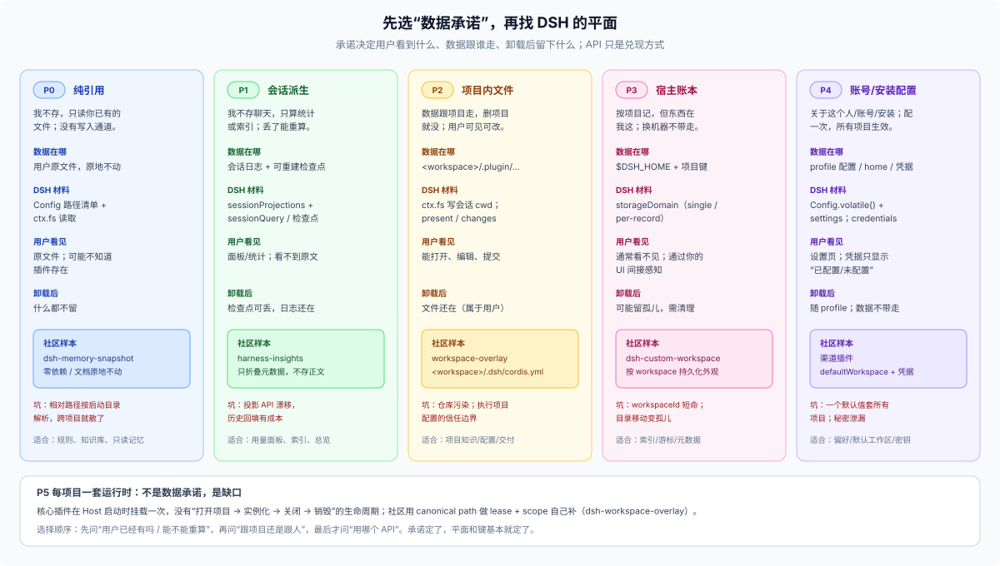

# 26 · 当一个插件就是整个 DSH：安装、启动、目录与数据该怎么分？

源码核验基线：`dsh-v0.2.1-rc.3`（`1f81c047fc48fa190a683e469daa699857e9afe8`）。本轮新增结论按当前 checkout 逐条复核；标 **R** 的是本机运行时实测（`$DSH_HOME` 静态读数与真实插件实例），其余仍以源码与 docs 为准。只讨论单 Host、单 `$DSH_HOME` 账户。

## 问题从哪来

写普通插件时，问题止于"数据放哪"：借宿主的家、按项目或按人切、用完能删。

写**产品型插件**时，问题往前挪了一大步：这个 DSH 实例为什么存在、装了什么、从哪个目录起步、模型能写哪儿，全由这个插件决定。它不是一个装在别人 harness 里的客人，而是**主人**：

- 它有自己的**出厂资产**（模板、种子、预设、客户端界面），随 npm 版本走；
- 它有自己的**项目目录**——可能是 home 下的默认目录，也可能由用户指定；
- 它有自己的**账本**（索引、游标、会话绑定）；
- 它还有一份**跨 profile 一致的全局设置**。

于是原来的问句"插件的数据放哪"被拆成四个：

1. 产品启动时，workspace 的根目录从哪来？没有怎么办？
2. 用户选了一个目录之后，DSH 到底在哪儿留了什么？要不要在目录里、profile 里留东西？
3. 插件包里的只读资产、可写 workspace、可重建账本、全局设置，边界怎么划？
4. 模型能不能直接读写 workspace？由什么决定？

## 一个真实实例

本机已经在跑一个这样的实例（只读观察，2026-10-30）：

```text
~/.dsh/profiles/deckline/        # bundles: dsh-base → dsh-web-app → dsh-plugin-deck-studio
~/.dsh/deckline/                 # 插件 dataRoot：账本、会话绑定、deck 工作目录、资源库
~/.dsh/storages/workspace.json   # DSH 自己的工作区登记（全 home 共享）
```

几条实测事实：

- 插件自己的账本根是 `dataRoot`，默认 `$DSH_HOME/deckline`；`projectsRoot` 只决定新项目落盘位置；
- 会话与项目的关联不是 `cwd`，而是插件自己的 `session-bindings.json`；抽查一个已绑定会话，它的头部是 `cwd: /Users/bowhead/ai_dsh_deep_research`、`agentPreset: deck-studio`、`sandbox/mode: workspace-write`；
- 所有落盘由插件工具的 `node:fs` 完成，preset 里没有 `tool-fs` / `tool-bash`。**R**

也就是说：**这个实例根本不需要模型对项目目录有写权限**，沙箱问题被"工具中介写"绕开了。这引出了本篇最重要的一条区分。

## 为什么不能一句话回答

因为"可写"这件事有两个来源，而它们经常被混为一谈：

- **workspace** 只给三样东西：侧栏一行登记、会话的 `cwd`、沙箱可写根；
- **preset 的工具面** 才决定模型能不能 `read` / `write` / `bash`。

一个只挂插件工具的 preset，即使会话开在项目目录里，模型也碰不到文件；一个挂了 `tool-fs` 的 preset，会话在项目目录里就能直接改文件，而沙箱只认这一个根，`cd` 不放宽，放宽只能靠一次性审批。

再加上四个空间各有权威与寿命、配置有五层、启动时没有用户可问——这些合在一起，才是"插件即产品"的完整问题。

## 本篇要回答的具体问题

| # | 问题 | 主回答 |
|---|---|---|
| Q1 | 什么时候一个插件就是整个 DSH？它和"装在别人 harness 里的插件"差在哪？ | [answer](./00-answer.md) |
| Q2 | 插件包、workspace、账本、全局设置，四个空间的边界怎么划？谁写、谁删、跨机器还在不在？ | [15 四个空间](./10-foundations/15-three-spaces.md) |
| Q3 | 启动时目录从哪来？不存在怎么办？为什么不能开机弹窗？ | [16 启动解析](./10-foundations/16-startup-resolution.md) |
| Q4 | 插件启动读的那份 config 从哪来？产品全局设置放哪？整对象替换会丢什么？ | [17 配置分层](./10-foundations/17-config-layers.md) |
| Q5 | 数据按 session / workspace / profile / home / device 怎么切？跨 workspace 用什么键？ | [13 作用域与键](./10-foundations/13-scope-and-keys.md) |
| Q6 | 宿主状态用 domain、settings 还是 credential？凭据记录是什么？ | [12 状态的家](./10-foundations/12-state-homes.md) |
| Q7 | 五个家是什么？客户端本地状态算不算？ | [11 五个家](./10-foundations/11-five-homes.md) |
| Q8 | 产物 / artifact 是什么？`present`、changes、附件、spill 各管哪一段？ | [14 产物](./10-foundations/14-artifacts.md) |
| Q9 | DSH 自己历史上为什么长成这些家？哪些是刻意、哪些是欠账？ | [22 原生历史](./20-native/22-native-data-history.md) |
| Q10 | 外部插件生态怎么切同一道题？哪些能借、哪些是坑？ | [31](./30-external/31-external-community-patterns.md) / [32](./30-external/32-external-adjacent-ecosystems.md) / [33](./30-external/33-external-plugin-patterns.md) |
| Q11 | 给我判断顺序、数据卡、反模式与参考架构。 | [41 决策程序](./40-advisor/41-checklist.md) / [42 参考架构](./40-advisor/42-native-reference-architectures.md) |

## 一句话预告

**插件即产品 = 一份 profile 组合（装什么）+ 一个 workspace 根（在哪干）+ 一份 home 级账本与全局设置（记住什么）。** 插件包只读，workspace 可写，账本可重建，全局设置跟 home；模型能不能直接写 workspace 取决于 preset 的工具面，而不是 workspace 本身。启动时没有用户可问，所以"让用户选目录"必须发生在客户端连上之后，并用占位登记挡住 DSH 自己的默认工作区。


## 不回答什么

- 不重复发布形态、bundle/profile/preset 的分工：见 [FAQ 24](../24_plugin-publish-and-agent-data-planes/answer.md)。
- 不讨论多租户、跨机器同步、对象存储；DSH 当前没有这些内置能力。
- 不把会话日志格式、compaction、归档的细节再讲一遍：只讲它们对"数据归属"的影响。
- 不给具体插件的完整实现；例子只用于说明边界。

## 阅读顺序

先读 [answer](./00-answer.md) 的四个空间与六种承诺，再读 [15](./10-foundations/15-three-spaces.md) 建立空间感、[16](./10-foundations/16-startup-resolution.md) 决定启动怎么安排、[17](./10-foundations/17-config-layers.md) 决定配置放哪；然后按需读 [11](./10-foundations/11-five-homes.md)（家）、[13](./10-foundations/13-scope-and-keys.md)（作用域与键）、[12](./10-foundations/12-state-homes.md)（状态）、[14](./10-foundations/14-artifacts.md)（产物）；想知道 DSH 为什么长成这样，读 [22](./20-native/22-native-data-history.md)；想对比别人怎么做，读 [31](./30-external/31-external-community-patterns.md) 与 [33](./30-external/33-external-plugin-patterns.md)；最后用 [41](./40-advisor/41-checklist.md) 自查、用 [42](./40-advisor/42-native-reference-architectures.md) 选骨架。


