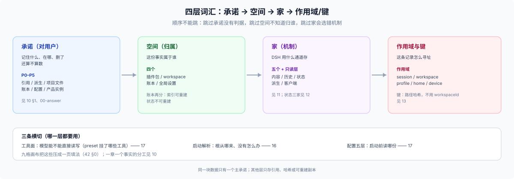

# 10 · 概念层：Profile 与数据卡

## 这一篇回答什么

产品型 profile 是启动组合；数据卡逐块说明它处理的事实。设计时先决定由什么 profile 启动，再记录每份数据的 owner、位置、作用域和保留责任。工具权限与 Workspace 导航是另外的决定。

## Profile 是运行组合

普通 plugin 为现有 DSH profile 增加能力。产品型 profile 将所需 bundles、plugins、presets 与用户配置组合为一个启动入口，仍由 `dsh --profile <name>` 启动。同一 `$DSH_HOME` 下的不同 profiles 可共享 Session、Workspace registry、credentials 和其他 home data；profile 名本身不隔离数据。

DSH package、bundle、profile 的发布关系见 [FAQ 24](../../24_plugin-publish-and-agent-data-planes/answer.md)。

## 每块事实用一张数据卡

不要为一块数据选择一个标签代替完整描述。给每份事实分别记录 owner、authority、source (input/operation)、mechanism/path、scope/key、readers、writers、rebuildability 和 retention；这些属性可以同时成立，不是互斥类别。

使用 [91 的数据卡模板](../90-advisor/91-checklist.md) 作为唯一记录格式。后续页面解释数据卡涉及的 DSH 机制，不重复分类数据。

## 参考页

- bundle、用户项目目录、产品状态和产品设置的 owner：见 [15](./15-four-spaces.md)。
- Session log、storage domain、Config、credentials、派生缓存和 Client state：见 [11](./11-five-homes.md) 与 [12](./12-state-homes.md)。
- Session、产品 project、DSH Workspace、profile、home 和 device 的生命周期/key：见 [13](./13-scope-and-keys.md)。
- 工具权限、目录和 patch：见 [16](./16-startup-resolution.md) 与 [17](./17-config-layers.md)。

这些页面是查找不同机制的参考，不是固定实现管线。先列出数据事实，再选择匹配的 API。

## 边界

- Profile 是 DSH composition，不是产品数据 scope 或隔离边界。
- Workspace registration 不授予模型文件权限；Session cwd、有效 working directory 和产品 project ID 也不同。
- DSH 不提供通用 product data root、多租户隔离或跨机器同步。
- 外部社区材料提供设计参考，不定义 DSH API 合同。
