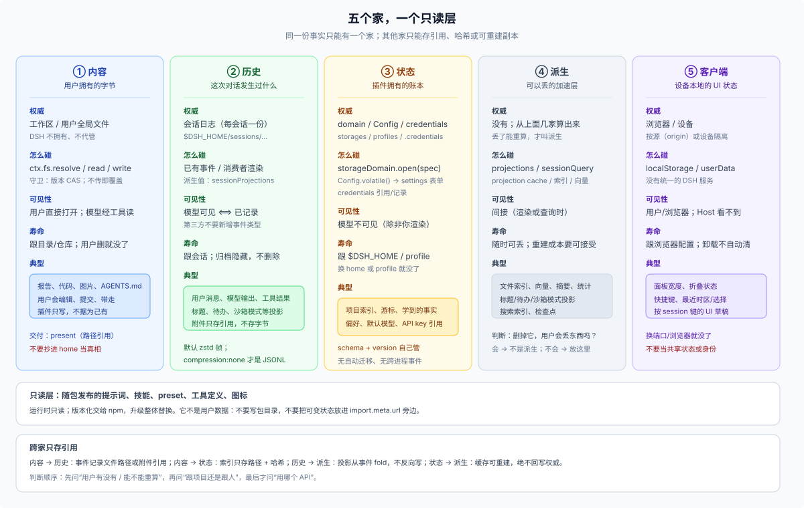

# 11 · 五个家与一个只读层：内容、历史、状态、派生、客户端

## 这一篇回答什么

为什么“数据放哪”在 DSH 里必须拆成几个互不替代的家？每个家的权威是什么、边界在哪、混用会出什么错？

本篇说明 DSH 与 Client 提供的存储机制。Profile 组合和数据卡见 [10 概念层](./10-taxonomy.md)，产品资产 owner 见 [15 四个空间](./15-four-spaces.md)，scope/key 见 [13](./13-scope-and-keys.md)。

## 一个事实只能有一个家

DSH 的持久化不是“一个数据库”，而是几条互不替代的通道：

```text
内容    → 工作区文件系统            （用户拥有字节）
历史    → 会话日志                  （模型可见的事实）
状态    → 宿主域 / 配置 / 凭据       （插件或用户拥有的状态）
派生    → 投影缓存 / 索引 / 缓存目录  （可重建的加速层）
客户端  → 浏览器 localStorage / 桌面 userData（设备本地，Host 不可见）
```

外加一个**只读层**：随包发布、升级即替换的提示词、技能、preset、工具定义。它不是用户数据，但作者经常把它和“数据”混在一起。

**“一个事实一个家”** 是贯穿整套设计的规则：同一份事实只能有一个权威。其他家如果要提到它，只能存**引用**（路径、id、哈希、附件引用、事件 seq），不能存副本。否则用户改一处、你抄一处，两边必然漂移。



| 家 | 权威 | 典型位置 | 作用域 | 寿命 | 谁看得见 |
|---|---|---|---|---|---|
| **内容** | 用户 | 工作区目录、项目内约定目录（如 `.agents/`，E1 约定）、用户 `AGENTS.md`/`skills/` | project / 用户全局 | 跟目录/仓库 | 用户；模型经工具读 |
| **历史** | 会话 | `$DSH_HOME/sessions/…` | session | 跟会话；日志不删 | 模型（surface）、Host（log-only） |
| **状态** | 插件 / 用户配置 / 凭据 provider | `$DSH_HOME/storages`、`profiles/`、`.credentials.yaml` | project 键 / profile / home | 跟 home 或 profile | 插件；用户经设置页 |
| **派生** | 无 | 投影缓存、`session_projcache`、索引 | 跟源 | 可重建 | 间接 |
| **客户端** | 浏览器 / 设备 | `localStorage`、`userData/` | origin / 设备 | 跟浏览器配置 | 用户/浏览器；Host 看不到 |
| **只读层** | npm 包 | profile 的 `node_modules` | 安装 | 升级替换 | 运行时读取；不写 |

**原生优先**是 API 选择建议，不要求每个 package 都直接依赖某个随附 bundle。DSH 核心 API 与随附 package 的组成见 [21](../20-native/21-native-data-landscape.md)。产品 bundle 可以声明实现和组合所需的 runtime package dependencies；profile 需要启用一个 package 的 Cordis rows 时，须将其 bundle 纳入组合。

三个边界不是平等的家，但作者必须知道：

- **外部服务**：MCP/HTTP/DB/对象存储；权威在外部，DSH 只存引用/配置。
- **OS 临时**：spill、workspace-changes 快照、上传暂存；进程/会话级，可能被系统清理。
- **自建产品目录**：例如 `$DSH_HOME/<plugin>/`；没有通用 DSH 插件数据根合同，目录 owner 负责迁移、配额、备份、卸载和清理。

## 内容家：用户拥有的字节

**权威**：工作区目录里的文件。DSH 不拥有它们，也不替用户保管。

- Session 的不可变 `header.cwd` 记录初始目录和原始 project identity；常规 sandbox policy 以它作为 workspace root，`workspace-write` 还允许 `/tmp` 与平台临时目录。目录登记与 sandbox policy 是不同机制。
- 插件读写文件走 `ctx.fs`：`resolve` 得到不透明目标，`readText` / `readBytes` / `writeText` / `stat` / `watch`；`writeText` 可以带 `createIfAbsent` 或 `replaceIfVersion` 守卫，省略守卫就是无条件覆盖。
- `FsTarget.targetKey` 与 `FsVersion` 都是不透明品牌类型，**不要解析**；要显示用 `displayPath`，要比较用 `contains`。
- 用户可以在 DSH 之外改文件，所以任何从内容派生的状态都必须带版本或哈希，并且**可重建**。
- 需要信任边界时，先 `lstat` 拒绝最终符号链接，再 `resolve`；`resolve` 本身会跟随符号链接。

插件直接调用 `ctx.fs` 时，不要假设自己受模型工具使用的 sandbox policy 约束。沙箱策略由接入该策略的能力调用点解析并传给文件系统；插件自己决定把什么路径交给 `ctx.fs`，部署也可能没有挂载 `dsh-fs-sandbox`。插件必须自行限制写入目标，不要以 Workspace registration 代替授权检查。

## 历史家：会话日志

**权威**：`$DSH_HOME/sessions/--<normalized-cwd>--/<escaped-id>/` 里的会话日志，一个会话一份，追加写。

- 默认物理格式是**校验和 Zstandard 帧**；只有 `compression: 'none'` 时才是可直接按行读的 JSONL。不要把默认文件当纯文本解析。
- **模型可见 ⟺ 已记录**：任何进入模型请求的输入，都必须能从日志重建；`agent.inject()` 记录 sourced `user/message` 并提供后续请求可见的内容。
- 日志是会话级事实，不是项目级事实：同一个项目有很多会话，每个会话有自己的历史。
- 归档只是从导航里隐藏，日志保留；compaction 遮蔽旧内容但不删除已提交事件（见 FAQ 22）。
- 会话日志**没有删除 API**：它会一直累积在 root 下，直到外部手动清理。外部插件有直接物理删除日志目录或改 header 的例子；这些不是推荐或受支持的 Session lifecycle API。
- 客户端/模型看到的是**投影**：从日志折叠出来的当前值（标题、统计、todo、sandbox mode 等）。投影是可重建的，不是权威。

插件什么时候用历史家？当事实**必须被模型看见**，或者**必须能回放/审计**时。对于 event extension：

1. **不要把 TypeScript declaration merging 当作 released event compatibility mechanism。** `SessionEventMap` 在类型层可扩展，但 independently released plugin event 若未被 DSH reader、persistence validator 和 compatibility flow 识别，会造成旧 reader 拒绝重开 Session。新增持久 event 应与 DSH session-format owner 协调 writer/reader/catalog/migration；不能把声明合并本身描述为第三方保证。
2. **模型可见输入应优先使用已有的消息通道。** `agent.inject()` 会记录带来源的 `user/message`；模型可见事实仍必须能从日志重建。
3. **会话级、模型不可见的插件记录**：DSH experimental package 有受仓库限制的 `appendPluginRecord()`；外部插件不应依赖这个 experimental API。外部 plugin 可以从已有事件重算，或把带 SessionId key 的状态放入 domain，并自己维护 retention。

插件私有的 Host 账本不要塞进会话日志：它会增加历史负担，并把内部 schema 变为 Session compatibility 责任。

## 状态家：宿主域、配置、凭据

**权威**：插件自己声明的持久记录，或用户可编辑的配置，或外部凭据源。

- `ctx.storageDomain`：schema 校验的 KV 域，Host 侧、模型不可见、写入先落盘再改内存；有版本、有 `domain/changed` 进程内事件。没有自动迁移、没有二级索引、没有跨表事务。
- Config / Settings：插件 Config 中标记 `.volatile()` 的字段进入 Settings 表单，写回**当前 profile 的 `cordis.patch.yml`**；它是配置，不是跨 profile database。
- 凭据分为两个 key space：`CredentialRef` 标识环境变量名，由 provider 的 `resolve(ref)` 按其优先级解析值；`CredentialKey` 标识插件拥有的 credential record，通过 `readRecord` / `modifyRecord` / `deleteRecord` 操作。它们不是可互换的“secret reference”。

细节、失败方式与迁移责任在 [12](./12-state-homes.md)。

## 派生家：可以丢的东西

**权威**：没有。它从上面几个家算出来，丢了能重算。

- 会话投影（`ctx.sessionProjections`）：纯同步 fold，从日志推导，带 `stateSchema`；持久缓存（`session_projcache`）只是为了加速。
- 跨会话读取（`ctx.sessionQuery`）：live-preferred 的列表、精确读、过滤、关系追踪；挂 SQLite provider 时还有全文检索。它的索引是派生，不是权威。
- 文件索引、向量、摘要缓存：从工作区内容算出来，必须能用内容哈希/版本失效。
- 域存储的 `layout: 'per-record'` + `invalidRecords: 'backup-and-skip'` 是给“可丢弃的派生数据”准备的：坏一条就挪走跳过，不拖垮整个域。注意它**只对能 `backupRecord` 的后端有效**（JSON per-record）；`single` 和 SQLite 没有可挪走的单条文档，会回退到拒绝打开。

判断方法：**删掉它，用户会丢东西吗？** 会 → 它不是派生；不会 → 放派生层，并写清楚重建路径。

## 客户端家：浏览器/设备本地状态

这是五个家里最容易漏掉的一个。Web 客户端插件可以把 UI 状态写进 `localStorage`，桌面端则可能写 `userData/` 下的文件。

- 客户端家要拆两层：**纯 UI 状态**（布局、快捷键、折叠、最近选择）→ `localStorage`/`userData`，可丢弃；**session-derived 客户端事实**（标题、模型、preset、subagent）→ `SessionProjectionMap`，必须能从日志重建。把后者存 localStorage 会造第二个权威。**C/H**
- Web 的 `localStorage` 按**源**（origin）隔离：`127.0.0.1:3080` 和 `127.0.0.1:3081` 是两份；换端口、换浏览器、清站点数据就没了。
- 它**不在 `$DSH_HOME` 里**，Host 进程看不到，模型更看不到；多开浏览器/多设备不会共享。
- 同一个源上跑两个不同的 `DSH_HOME`/Host，会共用同一份 `localStorage`；不要把“用户身份”或“项目身份”只存在这里。
- 卸载插件不会自动清 `localStorage`；升级时也没有自动迁移。键名、版本、清理逻辑都得你自己负责。

适合：纯展示偏好、面板宽度、折叠状态、最近选择。不适合：任何需要跨设备、跨浏览器、模型可见或卸载后可回收的数据。

## 只读层：随包发布的东西不是数据

提示词、技能、preset、工具定义、图标、模板，都是包的一部分：运行时只读，版本化交给 npm，升级时整体替换。

- 不要写进包目录（包括 `import.meta.url` 旁边的 `data/`）：安装/升级会替换，`files` 会裁剪，link 安装又直接指向 checkout。
- 需要用户可编辑的“知识”，发布成技能或让用户写 `AGENTS.md`；需要插件可写的状态，走状态家。
- 包目录里的 `node_modules` 是安装位置，不是用户数据目录。

## 为什么 Workspace 不是“存储引擎”

`Workspace` 是 DSH Host registry 中的一条目录登记，带有 id、canonical path、title 和 session account。它不提供任意项目文件读取/写入 API，也不赋予模型文件工具。目录内容属于用户；Session 初始 cwd 和 sandbox policy 是与 Workspace 分开的执行事实。

所以：

- 想要“项目级数据库”？DSH storage domain 不自动按 Workspace 建域；可使用记录键，或选择项目文件。
- 想要“每 Workspace 一套插件状态/运行时”？DSH 没有通用 per-Workspace plugin scope；通过路径 key 保存数据与创建完整 per-project runtime 是不同需求。
- 想要“删 Workspace 就删数据”？DSH `workspace.delete` 只移除 registration 与 grouping；目录、Session history 和产品自建数据都不会因此删除。
- 想要“移动 Workspace 后带走产品数据”？项目内文件会随用户移动；以 canonical path 为键的 home 数据不会自动迁移。

这正是“registration 不拥有目录”的行为结果（见 FAQ 25 的删除语义）。

## 混用会怎样：四个真实失败

1. **把用户内容抄进 home domain 当权威**：用户在编辑器里改了文件，域中的副本仍是旧内容。
2. **把索引当权威**：用户删了文件，索引仍保留，插件可能返回不存在的路径。
3. **把插件状态写进模型 surface**：内部数据可能进入模型上下文，并把插件 schema 绑定到 Session history。
4. **把浏览器本地状态当共享状态**：换端口或浏览器后状态缺失；同一个 origin 的两个 Host 反而会共用客户端值。

这些错误都来自让派生副本或设备本地状态承担了错误的权威角色。

## 一张判断图

```text
用户要打开、编辑或携带这份事实吗？
├── 是 → 用户内容：使用项目文件或用户选择的位置
└── 否 → 模型需要看到可重建的事实吗？
    ├── 是 → 记录 sourced message/已有事件，再按需投影
    └── 否 → 只服务当前浏览器 UI 吗？
        ├── 是 → 客户端状态：localStorage / userData
        └── 否 → 跨重启需要保存吗？
            ├── 否 → 内存或派生缓存
            └── 是 → 可重建吗？
                ├── 是 → 派生层，写清重建路径
                └── 否 → domain / profile Config / credentials / 产品自建状态
```

## 没有通用“插件数据根”

DSH 没有 `$DSH_HOME/plugins/<id>/` 的合同；本机或第三方 package 创建的类似目录是各自的约定。`ctx.storageDomain` 提供 schema 与写入序列化；`ctx.fs` 提供文件读写服务。它们都不会自动生成按 plugin id 的目录、配额或卸载清理规则。

- 普通插件可选择一个 domain，声明静态 domain 名与记录键。
- 产品可自建目录，但必须记录 path、schema version、并发假设、迁移、备份和清理责任。
- 不要声称 DSH 会替产品卸载或删除自建数据。

## 产品 profile 中怎么使用这些机制

| 产品里的事实 | 存储机制 | 常见作用域 | 所有者 |
|---|---|---|---|
| 项目内容、交付文件 | Workspace/项目文件 | project | 用户 |
| 会话与模型可见输入 | Session persistence | Session | 会话记录 |
| 产品索引、绑定与游标 | storage domain 或产品自建存储 | project key / SessionId | 产品插件 |
| 产品偏好 | profile Config 或产品共享设置 | profile / home | 用户与产品 |
| 浏览器布局和当前选择 | Client storage | origin/device | 浏览器用户 |
| 模板、提示词和默认 preset | bundle package | release | 发布者 |

产品 profile 不会自动改变这些机制的作用域。它只是选择了哪些 package 与 patch 一起运行。

## 边界

- 本篇区分产品所有权、存储机制和作用域；具体删除责任仍以对应 API owner 的合同为准。
- DSH Workspace 是导航与分组数据，不是用户目录的所有权凭证或模型权限。
- 会话日志当前没有通用 delete API；附件本地 backend 没有自动 GC。
- 远端 filesystem provider 可能使用与本机不同的路径表示；不要把 displayPath 当成本地绝对路径。
