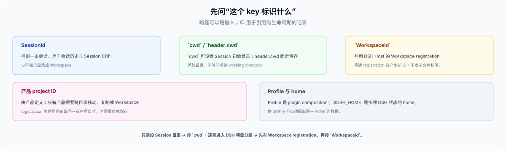

# 13 · 作用域与键：记录跟谁走

## 这一篇回答什么

同一 plugin 会服务多个 Session 和项目。作者要先决定一条数据跟哪个对象走，再选择可以代表该对象的 key。产品 project ID、Session 初始目录与 DSH Workspace ID 不是同一身份。

## 常见作用域

| 作用域 | 跟随对象 | 例子 | 常见 key |
|---|---|---|---|
| Session | 一条会话 | 对话状态、Session 绑定、附件引用 | `SessionId` |
| product project | 产品定义的业务项目 | 看板索引、项目知识、同步进度 | 产品 ID、path hash、项目标记 |
| DSH Workspace | Host 的目录 registration | 导航顺序和 Session grouping | `WorkspaceId` |
| profile | 一个 named composition | profile-local Config | profile name / entry id |
| home | 一个 Harness data home | credentials、跨 Session 状态 | 单例或产品 key |
| client/device | 一个 browser origin 或设备 | panel width、折叠状态 | origin + local key |

## `cwd` 与 `WorkspaceId`

只要指定 Session 的工作目录，显式传绝对 `cwd` 即可；Session header 保存初始 cwd。若还要把 Session 加入 DSH Workspace 的侧栏分组，传已有 Workspace 的 `workspaceId`。Host 从 registration 取得 canonical path 并 attach Session。两者互斥。

`WorkspaceId` 指向一条包含 path、title、顺序和 Session account 的 Host registration。它不是 path、产品 project ID 或权限 token。DSH 创建 Workspace 要求 path 是绝对且已经存在的目录；只传 `cwd` 不会自动创建 Workspace registration。

`ctx.workingDirectory.get(session)` 返回当前有效目录。工具可以改变它，但这不会更改不可变的 Session header cwd、既有 Workspace membership 或 sandbox writable roots。插件不要从 `process.cwd()` 猜当前项目。

## 产品 project ID 怎样选

- 若数据跟当前目录绑定，canonical-path hash 可以作为索引 key；目录移动后原 key 会成为孤儿。
- 若目录移动后仍代表同一业务项目，使用产品生成的 ID，或经用户同意写入项目标记；产品负责复制、丢失和恢复规则。
- 若只管理 DSH Workspace registration，使用 `WorkspaceId`；删除后重建 registration 会产生新 ID，不会自动恢复原 Session grouping。

没有一种 key 能同时保证可移动、可复制、跨 home 稳定且无需恢复操作。先说明接受哪种行为，再选 key。

## storage-domain key

JSON storage domain 的 `per-record` layout 把 key 用作文件名的一段，必须匹配 `[a-zA-Z0-9_-]+`。路径和含 `/`、`:` 的复合 key 会被拒绝；可用 `w_` 或 `s_` 前缀加哈希。`single` layout 允许不透明字符串，但直接使用路径仍会把存储格式绑定到文件系统路径。

Domain name 是 package 声明的静态值，不能按 Workspace 动态创建。多个 profile entry 或项目共享一个 domain 时，用 record key 区分；profile 名和 entry ID 不是产品 project ID。

## 常见数据 key

| 事实 | 作用域 | 存储 | key |
|---|---|---|---|
| 用户项目文件 | product project | 用户目录中的文件 | 相对文件路径 |
| 可重建项目索引 | product project | domain/cache | 产品 ID 或 canonical-path hash |
| DSH Workspace grouping | DSH Workspace + Session | Workspace registry | `WorkspaceId` + `SessionId` |
| 产品 Session 绑定 | 产品定义的 project + Session | 产品账本 | `SessionId` + 产品 project ID |
| 当前 UI 选择 | client/device | browser storage | origin + local key |
| Profile-local 设置 | profile | volatile Config | profile entry + field |

需要跨 profile 的设置不应假设由 profile Config 自动共享；见 [17](./17-config-layers.md)。

## 边界

- Profile 组合不是 scope，也不提供 home 隔离。
- Workspace deletion 只删除 Host registration，不删除项目目录、产品账本或 Session log。
- DSH 没有内建的多租户或跨机器 project-ID 同步服务。
