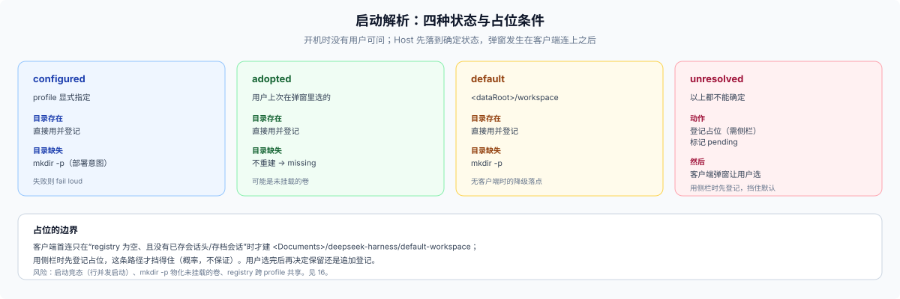

# 16 · 启动解析：目录从哪来、不存在怎么办

## 这一篇回答什么

产品型实例启动时，workspace 的根目录可能已经存在、可能由产品默认给出、可能用户上次选过但现在不在了。**开机那一刻没有用户可问**，所以"弹窗让用户选"必须被安排到正确的时机。这一篇给四状态、解析顺序、占位防抢占和三个真实风险。

## 为什么不能在启动时弹窗

| 事实 | 依据 |
|---|---|
| Host 启动时没有浏览器连着 | `webStartup` 开监听，客户端之后才连 |
| 目录选择器是**交互能力**，不是 Host 启动 API | native 后端在宿主显示器上开系统对话框（远端客户端够不着）；browse 后端只供远端客户端的应用内选择器 |
| 客户端只在"registry 为空且无会话"时自动建默认工作区 | 首用默认工作区逻辑 |

所以真实形态是：**Host 先落到一个确定状态，客户端连上后由产品的客户端插件弹窗**。不能阻塞 boot 等用户。



## 四种状态

```text
1. config.workspaceRoot      部署/安装层显式指定   → configured
2. ledger.root               用户上次在弹窗里选的   → adopted
3. $DSH_HOME/<plugin>/workspace   产品默认          → default
4. 以上都没有                                     → unresolved
```

每一步都要核实目录是否存在、是不是目录：

| 状态 | 目录存在 | 目录缺失 | 处理 |
|---|---|---|---|
| configured | 直接用 | **`mkdir -p`**（部署意图就是要建） | 失败则 fail loud |
| adopted | 直接用 | **不重建**，转 `missing` → 重新问 | 可能是未挂载的卷 |
| default | 直接用 | **`mkdir -p`** | 失败则 fail loud |
| unresolved | — | — | 进"待选"状态 |

`configured` 与 `adopted` 的差异是刻意的：**配置是"我想要那里"，记忆是"那里曾经在"。** 前者缺了就创建；后者缺了要重新问，不能悄悄用空目录覆盖一个可能只是暂时离线的卷。

## 启动算法

```text
boot:
  state = resolve()                     # 上表
  if state in {configured, default}: mkdir -p(root)
  if state == adopted and !exists(root): state = missing
  if state in {configured, adopted, default} and isDir(root):
      registry.create(root)             # 幂等
      ledger.mark(root)
  else:
      placeholder = $DSH_HOME/<plugin>/workspace
      mkdir -p(placeholder)
      registry.create(placeholder)      # 关键：让首用默认工作区失效
      ledger.mark(placeholder, pending=true)
```

**占位登记是防抢占的核心。** 客户端首连只有在"registry 为空、且既没有已存会话头也没有存档会话"时才走 `initializeDefault`（会在 `<Documents>/deepseek-harness/default-workspace` 建目录）。启动时先登记一个占位工作区，这条路径就永久失效。**C**

删占位要小心：`workspaceRegistry.delete` 只删登记，目录与已开会话不动；如果用户已经在占位目录里开过会话，删登记会让那些会话变 Ungrouped。安全做法是**保留占位、把用户选的目录追加登记**，让用户自己决定删哪个。

## 弹窗：两种形态

| 形态 | 做法 | 代价 | 适合 |
|---|---|---|---|
| **A 产品自己的 modal** | 产品带一个客户端插件：连上后读插件 Remote 的状态，`pending` 就弹窗；"选择目录"调 `remote.directoryPicker.pick()`，再调插件的 `adopt(path)` | 要写客户端插件与两个 Remote 端点 | 首启体验可控 |
| **B 复用"添加工作区"** | 不弹窗；只登记占位并提示"用左侧 + 添加你的目录"；插件通过 `workspaceController.follow()` 或客户端回调感知并采纳 | 少写 UI，但用户要自己找入口 | 内部工具、迭代早期 |

两种都要回答"用户取消 / 关掉弹窗"：保持占位可用，下次连接再提示，不要卡死。

## 编排时机

| 时机 | 能做什么 | 不能做什么 |
|---|---|---|
| 启动 `apply`（T1） | 扫根、注册、写脚手架 | 反应不了用户刚选的目录；与客户端首连有竞态 |
| `agent/created` / `session/created`（T2） | 按会话 cwd 采纳、写脚手架；`agent/created` 是 serial，抛错会让会话创建失败 | 只在已有会话时触发；不能改 cwd |
| 客户端选目录后回调（T3） | 立刻采纳、提示 | 要客户端插件；用户取消就没发生 |
| 显式命令/设置页（T4） | 全量重建、修复 | 要用户主动 |

Host 侧**没有** `workspace/created` 事件；唯一增量来源是 `workspaceController.follow()`，它是面向客户端的长流（baseline + upsert/remove），不要当插件事件总线用。

## 选择记在哪

| 载体 | 语义 | 问题 |
|---|---|---|
| **全局设置**（推荐） | `dataRoot` 下的设置文件；跨 profile 一致 | 用户不可见；但正是"弹窗里选的那个" |
| 账本·状态 | 跨项目但不跨 profile 的记录 | 适合会话绑定；不适合"产品根" |
| profile patch | 安装参数 | 运行时选择混进安装文件；插件写自己那一行还要额外接口 |
| DSH registry | "这也是个工作区" | 跨 profile 共享，不能当私有记忆 |

原则：**安装默认值放 profile，用户运行时选择放全局设置。** 账本只放与项目绑定的记录（索引与绑定），不承担"这个产品从哪起步"。

## 无客户端时

headless / SDK / 纯 CLI 没有浏览器：

- 有 `configured` → 用；
- 否则用 `default`，并在启动日志里打一行（例如 `<plugin>: using default workspace <path>`）；
- `pending` 保留，等下一次有客户端时再问。

不要为了"等用户"阻塞启动，也不要因为问不到就起不来。

## 三个真实风险

1. **启动竞态**：Loader 的行并发启动，占位登记与 web 监听没有先后保证。`dsh web` 默认会自动打开浏览器，慢盘或慢插件下，客户端可能在占位登记完成前就连上并建出 `<Documents>` 默认工作区。缓解：插件行排在 web 行之前、`apply` 里只做 `mkdir` + `create`，并实测一次带自动打开浏览器的冷启动；行是并发启动的，这个顺序只是提高概率。**U（未保证）** 实验设计见[实验 01](../50-evidence/experiments/01-startup-race.md)。
2. **挂载点被物化**：`session.create` 会对 cwd 执行 `mkdir -p`。如果 `adopted` 目录位于未挂载的卷，新建会话会**在挂载点造一个空目录**，卷再挂上时被遮住，现场极难排查。缓解：`missing` 状态不登记该路径，或登记前校验卷存在。**C**
3. **跨 profile 可见**：registry 全 home 共享，产品登记的工作区会出现在通用 `web` 的侧栏里，没有过滤机制。缓解：接受并写进 README，或改走独立 `DSH_HOME`。**C**

## 核对结论

- 客户端插件的加载顺序由**模块图拓扑序**决定（`orderByModuleGraph`，同层按扫描序），不是行序，也不是可控的同步点；`ui-workspace` 在 `apply` 里就启动导航。**C** 所以不要指望弹窗先于默认选择——靠占位关掉"默认工作区"这条路径才是确定做法。
- 客户端插件可以调用 `uiWorkspace.connectWorkspace(id)`：服务名 `uiWorkspace`、方法是公开面；顺序不保证，且调用会创建或复用 blank 会话。**C** 见[实验 02](../50-evidence/experiments/02-client-connect-workspace.md)。
- 插件可以用 `ctx.fiber.entry` 定位自己那一行，再调 `ConfigEditor.edit` 回写；仍推荐把运行时选择放全局设置文件。**C** 见[实验 03](../50-evidence/experiments/03-profile-writeback.md)。

## 与其它篇的关系

- 四个空间与账本的键：[15](./15-four-spaces.md)
- 启动配置从哪来：[17](./17-config-layers.md)
- workspace 的登记、删除、首用默认：[workspace 子系统](docs/subsystems/workspace.md)
