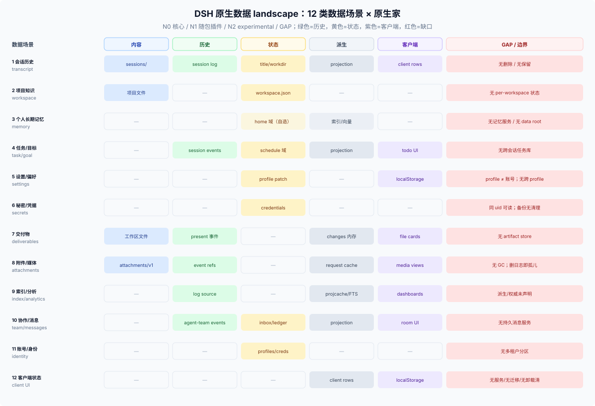

# 21 · DSH 原生数据 landscape：核心、原生插件、experimental

## 这一篇回答什么

先把**DSH 自己**的数据落点铺开：哪些是核心合同（N0）、哪些是官方随包插件（N1）、哪些是 experimental（N2），哪些根本没有家。扩展插件（E1）只作参考，统一放在 [31](../30-external/31-external-community-patterns.md)/[32](../30-external/32-external-adjacent-ecosystems.md)/[33](../30-external/33-external-plugin-patterns.md)，不混进这张图。

**口径。** DSH 侧：343 个包、约 1,265 篇英文 Agent Note（298 implemented / 42 proposed / 925 archived）、67 篇 subsystem、49 篇 persistence-change、43 篇 upgrade guide、4 篇 postmortem、6 篇 defensive-pattern；本机 `$DSH_HOME` 4.0 GB / 28,443 文件（只看结构）。证据标签 T/C/H/P/S/R/U 见 [research-native](../50-evidence/research-native.md)。

> **两层说法**：`11` 的“五个家”是抽象层（内容/历史/状态/派生/客户端）；这里列的 33 个是具体落点（日志、旁表、对象、目录、客户端键）。不要把“33 个落点”和“五个家”当成同一层级。

> **第三层**：产品视角的“四个空间”（插件包 / workspace / 账本 / 全局设置）见 [15](../10-foundations/15-four-spaces.md)；它回答“哪些落点属于一个产品实例”，不替代这里的落点清单。

## 原生分级

| 级别 | 含义 | 长期策略 |
|---|---|---|
| **N0 原生核心（核心合同）** | `docs/` + 核心包 + 测试定义的 Service/事件/格式 | 首选；插件应依赖这些 |
| **N1 原生插件（官方随包）** | 仓库内、由 base/web 等官方 bundle 挂载的插件（如 workspace、projection-cache、settings、credentials-local、session-query-sqlite、spill-local） | 首选；能力通常够用 |
| **N2 原生实验（experimental）** | `packages/experimental/` 下的官方实验（agent-team、claude-code-mods `$.store`、webworker runtime 等） | 可参考，不承诺稳定 |
| **GAP** | 没有核心/原生插件提供 | 作者自建或等核心；扩展插件只作参考 |

## 七个轴

| 轴 | 取值 |
|---|---|
| **落点类别** | 内容 / 历史 / 状态 / 派生 / 客户端 / 外部服务 / OS 临时 / 包目录 / 进程内存 |
| **作用域** | session / workspace / profile / home / device / external |
| **权威** | 用户 / 会话 / 插件 / provider / 无（派生） / 外部 |
| **寿命** | turn / session / project / account / forever / rebuildable |
| **可见/可编辑** | 模型 / 用户 / 插件 / 浏览器 / 没人 |
| **介质** | 文件 / journal / KV domain / SQLite / 向量 / settings / credentials / localStorage / 外部 API |
| **成熟度** | N0 / N1 / N2 / GAP |

## 表 L1：12 个 archetype × 原生家

| # | Archetype | 原生落点（N 级别） | 权威 | 作用域 | 缺口 |
|---|---|---|---|---|---|
| 1 | 会话历史/transcript | `sessions/`（N0）、`sessionQuery`（N0）、projections（N0） | 会话日志 | session | 无删除/保留；旧世代累积 |
| 2 | 项目/工作区知识 | 工作区文件（N0）、`workspace.json`（N1）、项目 `AGENTS.md`/skills（N0/N1） | 用户/项目 | workspace | 无 per-workspace plugin state |
| 3 | 个人长期记忆 | **GAP**（只能 P0 引用 / P3 home 域 / 外部） | 插件/用户 | home | 无记忆服务、无稳定 data root |
| 4 | 任务/待办/目标 | 会话事件 + todo/goal/plan 投影（N0）、schedule 域（N1） | 会话日志 | session / home | 无跨会话任务库；schedule 落点 U |
| 5 | 设置/偏好 | profile patch（N1）、旧 `settings.yaml`（已废）、客户端 localStorage（平台能力） | profile / 设备 | profile / device | 无跨 profile 共享；无客户端迁移 |
| 6 | 秘密/凭据 | `.credentials.yaml`（N1）、`.env`（N1）、OS keychain（GAP/deferred） | provider | home | 无硬隔离；备份无清理 |
| 7 | 交付物/文档 | 工作区文件（N0）+ `present`（N1）；changes 内存（N1） | 用户/日志 | session / workspace | 无 artifact store；present 只记路径 |
| 8 | 附件/媒体 | `attachments/v1`（N1）+ request cache（N1） | 内容寻址对象 | session | 无 GC；日志删除即孤儿 |
| 9 | 索引/缓存/分析 | projcache（N1）、sessionQuery FTS5（N1）、`cache/`（N1）、`llm-deepseek/files-v3`（N1） | 无 | session/语料 | 派生/权威未声明；索引默认无家 |
| 10 | Agent 间消息/协作 | agent-team session events/projection（N2）；jobs 记录（N1） | 会话日志 | team/session | 无持久消息服务 |
| 11 | 账号/租户/身份 | anonymous id（N1）、credentials（N1）、profiles（N1）、remoteAccess（N0） | 安装/账号 | home/external | 无多租户分区 |
| 12 | 客户端/UI 状态 | localStorage/userData（平台，不是 DSH 服务）；session-derived 投影（N0） | 浏览器/设备 | device | 无统一服务/迁移/卸载清理 |

## 表 L2：33 个 DSH 侧数据落点，收敛成 7 组（表中列代表 ID）

完整 ID、位置与证据见 [research-native](../50-evidence/research-native.md) 的 33 行表；下表按组列代表，不重复全部 ID。

| 组 | 家（id） | 四空间 | 级别 | 权威 | 寿命 | 主要风险 |
|---|---|---|---|---|---|---|
| **一条日志** | SESS-LOG、SESS-GEN、SESS-LOCK、SESS-TMP、SESS-TITLE、SESS-WORKDIR、DELIV、jobs/goal/todo/plan | 历史（会话） | N0/N1 | 会话日志 | 永久 | 无删除；旧世代累积；插件不能扩展事件 |
| **旁表与 KV 域** | WORKSPACE、PROJCACHE、PROJCACHE-LEGACY、SCHED、KV-SQLITE | 账本 + DSH 登记 | N1 | workspace/schedule/domain 权威；projcache/legacy 派生 | 永久；projcache 可重建 | 派生与权威同目录；legacy 无清理；schedule 落点 U |
| **附件对象/缓存** | ATT-OBJ、ATT-FILEOBJ、ATT-REQ、ATT-FILES、ATT-TMP、ATT-CACHE | 历史（附件库） | N1 | 对象内容寻址；请求图/缓存/暂存是派生 | 对象永久；缓存/暂存可清 | 对象无 GC；日志删除即孤儿 |
| **组合/设置** | PROFILES、PROFILE-NM、SETTINGS-LEGACY | profile + 全局设置 | N1 | profile | 永久 | 迁移一次性；patch pin 字段；无跨 profile |
| **秘密** | CREDS、CREDS-BAK、ENV-USER | 全局设置（凭据） | N1 | provider | 永久 | 同 uid 可读；备份含历史值 |
| **home 外临时** | SPILL、QIDX（默认 `:memory:`）、workspace-changes temp | —（派生） | N1 | 会话/可重建 | 进程/启动 sweep | 跨进程不可见；长跑不 sweep |
| **无主区** | PLUGIN-DATA、`auto-approval-llm/`、`clutch-dsh-worktree/`、`company-workspace/` | 账本（自造） | GAP | 插件自述 | 插件自述 | 无契约/配额/清理/卸载 |

## 表 L3：原生模式 × 成熟度

| 模式 | 原生实现 | 级别 | 备注 |
|---|---|---|---|
| 模型可见 ⟺ 日志 | session events + projections | N0 | 第三方不要新增事件类型 |
| 派生检查点 | `session_projcache` per-record | N1 | 可重建；`invalidRecords` 仅 JSON per-record |
| 通用宿主 KV | `ctx.storageDomain`（N0 服务）+ backend（N1） | N0 服务 / N1 后端 | 无 scope/迁移/跨进程 |
| 工作区注册 | `ctx.workspaceRegistry` | N1 | 只在 shipped Web 组合；不拥有目录 |
| 内容寻址附件 | `ctx.attachments` | N1 | 不 GC；先持久化再写事件 |
| 大文本溢出 | `ctx.spillStore` | N1 | OS temp；启动 sweep |
| 交付声明 | `present` | N1 | 只记路径；不复制 |
| 变更摘要 | `workspaceChanges` | N1 | Host 内存；会话销毁即止 |
| 跨会话读取 | `ctx.sessionQuery` | N1 | live-preferred；FTS 可选 provider |
| 客户端可见投影 | `SessionProjectionMap` | N0 | 标题/模型/preset/subagent |
| 插件私有会话记录 | `appendPluginRecord` | N2 | 只限 experimental；不承诺迁移 |
| 插件 per-plugin store | claude-code-mods `$.store` | N2 | bridge 内部，4 MiB；不是通用 API |

## 表 L4：原生时间线（压缩）

22 个关键事件在 [22 原生数据历史](./22-native-data-history.md)；44 条完整清单在 [research-native](../50-evidence/research-native.md#5-附录44-事件清单)。关键节点：2026-06 会话持久化 → 2026-07 home 单根/settings seam/domain KV 提案 → 2026-07-22 持久附件 → 2026-08-19 per-record 投影缓存 → 2026-08-27 handle 持久化 → 2026-08-31 已发布格式流式迁移 → 2026-09-08 present 只记路径 → 2026-09-19 settings 并入 profile patch → 2026-10-09 存储凭据优先。

## 十个原生观察

1. **真实数据面是“一条日志 + 三张旁表 + 两类不可变对象”**，不是一个通用数据库。
2. **没有插件数据根**：`$DSH_HOME/plugins/<id>/` 只是惯例；根下已有第三方目录。
3. **没有 per-workspace plugin state**：`DomainSpec` 无 scope；proposed 明确 out-of-scope。
4. **删除是系统性空白**：session、attachment、`.bak`、legacy cache 都没有核心回收路径。
5. **派生/权威未声明**：projcache 与 workspace 同目录同后端；没有 authority 字段。
6. **秘密无硬边界**：同 uid 可读；`.bak` 绕过“不 hoist”。
7. **客户端状态分两层**：纯 UI 在 localStorage；session-derived 在 projection。
8. **settings 是 profile 作用域**：不是账号；`settings.yaml` 只 import 一次。
9. **迁移只增不删**：旧会话世代、legacy projcache、`.bak-*` 都留在磁盘。
10. **原生插件是主力**：workspace、projcache、settings、credentials-local、session-query-sqlite、spill-local 已覆盖大部分家；缺的是“scope + 清理 + 插件数据根”，不是“再写一个数据库”。

## 外部参考

扩展插件/社区模式**不进入这张原生图**，统一放在 [31](../30-external/31-external-community-patterns.md)/[32](../30-external/32-external-adjacent-ecosystems.md)/[33](../30-external/33-external-plugin-patterns.md)，并明确标注“参考，不作长期依赖”。长期优先 N0/N1；N2 可参考；E1/E2 只在没有原生替代时短期使用。

## 产品型实例视角

把 33 个落点按四个空间收一遍，产品型实例实际只用到这些：

| 空间 | DSH 提供 | 插件自己提供的 |
|---|---|---|
| 插件包 | 无（npm 包） | 模板、种子、预设（只读） |
| workspace | 目录 + 会话 `cwd` | 项目内脚手架（可选） |
| 账本 | 可选 `storageDomain` | `$DSH_HOME/<plugin>/` 下的索引与绑定 |
| 全局设置 | 无 | `$DSH_HOME/<plugin>/settings.json` |
| 登记/历史 | `workspace` domain、`sessions/` | 会话 → 项目的绑定记录 |

结论：产品型实例把 DSH 的登记与会话落点当基础设施，自己的账本与设置落在**自造目录**——它不在上面的 33 个落点里，这正是 N+ 的含义：迁移、清理、配额都要自己承担。参考架构见 [42 §11](../40-advisor/architectures/11-product-instance.md)。

## 边界

- 本图是 DSH 原生数据面的广度稿；T/C/H/P/S/R/U 标注见 [research-native](../50-evidence/research-native.md)。
- 本机 `$DSH_HOME` 统计只用于验证结构，不代表所有部署。
- 原生插件是否挂载取决于组合（base/web/headless/SDK）；“N1”不等于每个 profile 都有。
