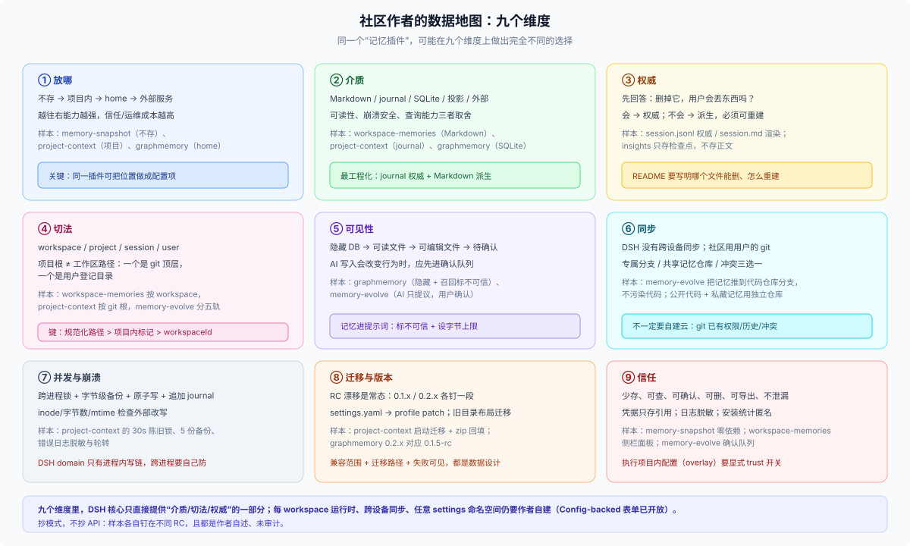

# 31 · 外部社区模式（参考）：九个维度、十八种手法与已核出的坑

## 这一篇回答什么

本 FAQ 第一版把社区做法压成“五种承诺”，够用但太粗；这一版扩成九个维度。这一篇换九个维度重新看同一批插件：**放哪、用什么介质、谁是权威、按什么切、给谁看、怎么同步、怎么防并发、怎么迁移、怎么取得信任**。最后给一份作者策略库、按插件类型的选型矩阵，以及这次核出的三处版本漂移。

> **外部参考，不是原生方案。** 本文件只记录第三方插件/社区模式；长期优先 [21 原生 landscape](../20-native/21-native-data-landscape.md) 的 N0/N1。外部插件只借模式，不作依赖；E1/E2 的迁移/清理/兼容成本要自己承担。

**验证口径（2026-10-27）。** 对九个仓库做了 README 与源码阅读，并对照本仓 `dsh-v0.2.1-rc.3` 的源码；**没有安装、没有运行**，所以“已验证”只代表源码层面能对上，不代表行为已在你的环境成立。星数/目录条目只能说明曝光，不能说明质量或安全；不同目录的计数互相矛盾（13,882 / 20,006 / 23,307），本篇不选边。

## 观察样本

| 插件 | 类型 | 数据位置 | 关键手法 | 核出的问题 |
|---|---|---|---|---|
| `dsh-memory-snapshot` | 只读记忆注入 | 用户已有 markdown，原地 | 零依赖、无数据库、无写入通道 | 它说“DSH 只读 `~/.dsh/AGENTS.md`”是错的：还有 `<agentsHome>/AGENTS.md`（默认 `~/.agents`） |
| `dsh-workspace-memories` | 工作区记忆 | 默认 `~/.dsh/workspace-memory/<workspace-key>/`，可选 `<workspace>/.dsh/memory/` | 存储位置做成用户可选项；工具写 + 侧栏面板 | 源码硬编码 `os.homedir()/.dsh`，**忽略 `DSH_HOME`**；普通 `writeFile`，没有锁/原子写；没有声明兼容版本 |
| `dsh-memory-evolve` | 长期记忆/待办/技能 | `~/.dsh/memories/` 文件树 | `§` 条目 + 隐藏 `[id:…]` 合并锚点、锁 + tmp/rename + `.bak`、git 分支同步 | README 的发布标签与 `package.json` 的 `0.1.0/private` 不一致；按快照标签而非 semver 声明兼容 |
| `dsh-graphmemory` | 知识图谱记忆 | `~/.dsh/graph-memory/graph-memory.db` | SQLite + WAL + `_migrations` + FTS/向量 + LLM 抽取；凭据只收引用 | 0.2.x 对应 DSH 0.1.5-rc，版本映射容易装错；描述里的“2026-04 清华”早于仓库创建 |
| `dsh-project-context` | 项目上下文/交接 | 项目内 `.agents/memory/` 与 `.agents/skills/` | journal 权威 + Markdown 派生、跨进程锁、备份、回填、设置命名空间 | 没有核出与当前 DSH 冲突的说法；200 行索引上限会丢行（它自己保留旧索引兜底） |
| `dsh-workspace-overlay` | 每项目运行时 | `<workspace>/.dsh/cordis.yml` | `ctx.workspaceCordis` + canonical path lease + 热重载；配置是只读输入 | `trustWorkspaceConfig` 默认 `true`：克隆一个仓库就可能挂载并执行代码 |
| `dsh-custom-workspace` | 每项目外观 | `custom-workspace` 设置命名空间 + loopback RPC | 按 workspace 持久化；浏览器侧校验 | README 的 `$DSH_HOME/settings.yaml` 对 0.2.x 已过期；当前 settings 写 profile patch |
| `harness-insights` | 用量面板 | 只存派生检查点 | 只折叠元数据，不存正文，可重建 | 绑定投影/持久化 API 的演进；同一包还有一个独立镜像仓库，URL 不唯一 |
| 渠道插件（Feishu/DingTalk/WeCom/iMessage） | 消息接入 | profile/env + `defaultWorkspace` | 账号级配置、凭据只存引用 | 一个默认 workspace 套所有项目；凭据仍在 profile/env 层 |

这九个样本覆盖了“记忆、上下文、面板、渠道、运行时、外观”六类插件，足够看出模式，但不足以代表整个生态。

## 维度一：放哪——从“不存”到“外部服务”的光谱

| 位置 | 谁拥有 | 典型 | 代价 |
|---|---|---|---|
| 不存（只引用） | 用户 | memory-snapshot | 无法写、无法保证存在 |
| 项目内 | 用户 + 团队 | project-context、overlay、workspace-memories 的 opt-in | 仓库污染、信任边界、多人冲突 |
| 宿主 home | 插件/本机 | workspace-memories 默认、graphmemory、memory-evolve | 孤儿、不可移植、换机丢 |
| 客户端本地 | 浏览器/设备 | 侧栏宽度、快捷键、最近时区 | Host 看不到、换源就丢、卸载不自动清 |
| 外部服务/DB | 第三方或用户自建 | Honcho、OpenViking 一类记忆引擎 | 运维、隐私、网络依赖、账号 |

社区里最值得注意的不是“选哪个”，而是 **workspace-memories 把位置做成了配置项**：`storage: home` 默认（服务器地址、环境怪癖、个人约定不适合进仓库），`storage: workspace` 可选（团队想随代码提交的记忆）。同一个插件，两种承诺，用户按内容敏感度选。抄这个思路时别抄它的硬编码 home：用 `resolveDshHome()`。

## 维度二：介质——Markdown、Journal、SQLite、外部服务

| 介质 | 优点 | 缺点 | 样本 |
|---|---|---|---|
| Markdown 文件 | 人可读、可 diff、可 git、可手改 | 解析脆弱、并发写麻烦、无查询 | workspace-memories、memory-snapshot |
| Journal + 渲染视图 | 追加写、崩溃安全、权威明确 | 要自己写折叠/备份/锁 | project-context（`memory.jsonl` → `MEMORY.md`）、memory-evolve |
| SQLite | 查询、索引、向量、事务 | 需要 schema/迁移；不可读 | graphmemory |
| 会话投影/检查点 | 零额外状态、天然派生 | 只能算已有事件，不能存额外事实 | insights、session_projcache |
| 外部服务 | 能力强、跨设备 | 运维/隐私/网络/账号 | Honcho、OpenViking |

**journal → 渲染视图**是这批样本里最工程化的一招：`memory.jsonl` 是唯一权威，`MEMORY.md` 是给人看和注入的派生渲染；写入顺序固定为“锁内备份 → 追加 journal → 渲染”，崩溃只会让渲染落后，不会让权威丢；用户手改 `MEMORY.md` 且比 journal 新时，下一次整理会把它收进 journal。这套做法把“用户可编辑”和“机器可追加”这两个矛盾需求同时满足了。

## 维度三：权威与派生——先回答“删了会不会丢”

同一个插件里往往有多个层次，必须点名谁是权威：

- project-context：`session.jsonl` 是会话存档权威，`session.md` 是渲染；`memory.jsonl` 是记忆权威，`MEMORY.md` / `CONTEXT.md` 是渲染；`INDEX.md` 是机械索引。
- graphmemory：会话事件是源，图谱是抽取派生；源还在，图谱可重建（但抽取调用有成本）。
- insights：只存投影检查点，源是会话日志。
- workspace-memories：Markdown 文件本身就是权威，没有第二层。
- memory-evolve：`~/.dsh/memories/` 文件是权威；git 同步是显式批处理，不是每次写入都提交。

判断方法没变：**删掉它，用户会丢东西吗？** 会 → 权威；不会 → 派生。社区里做得好的插件，README 都会写清楚“哪个文件是权威、哪个可以删、怎么重建”。

## 维度四：按什么切——workspace、project、session、user

| 切法 | 样本 | 键/位置 | 注意 |
|---|---|---|---|
| 每 workspace 一份 | workspace-memories | `~/.dsh/workspace-memory/<workspace-key>/` | 键要稳定；目录移动会孤儿；该样本用 `workspaceId`，重加会换 |
| 每项目一份（项目内） | project-context、overlay | `<project>/.agents/…`、`<workspace>/.dsh/…` | 项目根 = git 顶层，不是任意 cwd |
| 每会话一份 | project-context 的 `session-logs/<id>/` | SessionId | 会话归档/删除策略要跟上 |
| 每用户/全局 | memory-evolve 的用户档案/全局事实 | 本地文件 | 跨项目共享；同步另做 |
| 每账号 | 渠道插件 | profile/env | 一个默认 workspace 套所有项目 |
| 每设备 | 客户端 UI | localStorage / userData | 不跨设备、不跨源 |

project-context 的项目根取 `git rev-parse --show-toplevel`，非 git 目录回退 cwd——这与 DSH 的“工作区路径”不是同一个概念。**工作区可以是仓库子目录，项目根是 git 顶层**；作者要明确自己用哪个。

## 维度五：给谁看——隐藏、可读、可编辑、可确认

| 可见性 | 样本 | 用户能做什么 |
|---|---|---|
| 完全隐藏 | graphmemory 的 DB、insights 的检查点 | 只能通过面板/统计间接感知 |
| 可读文件 | workspace-memories、project-context | 直接打开、diff、备份 |
| 可编辑文件 | workspace-memories、project-context 的 MEMORY.md | 手改；下一次整理收编 |
| 待确认队列 | memory-evolve | AI 提议，用户采纳/拒绝后才生效 |
| 注入内容标记不可信 | graphmemory、kb-manager | 召回材料标成“不可信参考”，不得压过当前指令 |
| 软删除 + 确认令牌 | kb-manager | 删除先标记；破坏性操作要 `confirm_token`（绑定对象、60 s TTL） |

这里有两个值得抄的设计：

1. **AI 只提议，用户确认**（memory-evolve 的三条原则之一）。记忆写入会改变 AI 行为，属于“有后果的写”，不该静默。
2. **把召回内容标成不可信**（graphmemory、kb-manager）。记忆库可能被污染，召回文本不能获得比当前用户指令更高的优先级。

## 维度六：怎么同步——用用户自己的 git，而不是再建一个服务

- memory-evolve 的记忆同步：默认把记忆推到代码仓库的专属分支（不污染代码）；代码公开但记忆想私藏时，填一个**共享记忆仓库**，每项目一条分支；两台机器 clone 后按仓库地址“认亲”，冲突时选本机/远端/两者都要。写路径仍然本地即时，同步是显式的 fetch → merge → atomic write-back → 两父提交。
- workspace-memories：`storage: workspace` 模式下，记忆随项目 git 走；默认 home 模式不同步。
- project-context：会话存档在项目内，`.gitignore` 默认忽略整个 `session-logs/`；要不要提交由用户决定。
- DSH 本身没有跨设备同步；home 数据不跟着走。

**启示**：跨设备不一定要自建云；把 git 当传输层，用户已经有仓库、权限、历史和冲突解决。代价是冲突语义要自己设计（memory-evolve 就做了三选一），而且同步不能挡住本地写。

## 维度七：并发与崩溃——作者真正花时间的地方

project-context 的 README 几乎是这份地图里最细的工程说明：

- **跨进程文件锁**：`MEMORY.md.lock` / `session-index.lock`，30 s 陈旧、35 s 等待，`claim` 防双抢；旧构建不遵守锁的宿主重启后才受约束。
- **原子写 + 字节级备份**：覆写前备份最新 5 份，1 小时内不删。
- **journal 追加**：崩溃只会让渲染落后；读取以 journal 折叠为准。
- **inode + 字节数 + mtime 三件套**：外部改写（回填、手截断）后下一次写入整份重建，不把新事件接到别人内容后面。
- **错误日志脱敏 + 截断 + 轮转**：单条 8000 字符，>1 MB 保留最新 64k。
- **回填幂等**：zip/jsonl/目录导入，已归档默认跳过，`--replace` 才覆盖，全程不调模型。

memory-evolve 的锁参数更短（10 s 陈旧、5 s 等待、25 ms 重试），写入同样是 tmp → rename → `.bak`。workspace-memories 则**没有锁、也没有原子写**，普通 `writeFile` 会 last-write-wins——这是一个明确的“别抄”点。

对照 DSH 的 domain：每域一条写链、写先落盘再改内存、`domain/changed` 只在进程内；**跨进程没有锁**。所以需要跨进程的作者只能自己像 project-context 这样做文件锁，或者接受“单 Host”假设。

## 维度八：迁移与版本——RC 漂移是常态

样本的兼容声明能说明问题：

- memory-snapshot 要求 DSH **0.2.x**（实测 0.2.0-rc.2）；
- workspace-memories **没有声明**任何 DSH 版本；
- graphmemory 0.2.x 对应 **0.1.5-rc**，0.1.x 对应 **0.1.2**；
- custom-workspace 目标 **0.1.0-rc.6**，README 的 settings 路径仍停在旧版；
- project-context 按 **0.1.7-rc.2** 写，明确不兼容 0.1.5–0.1.7-alpha；
- workspace-overlay 基线 **0.2.1-rc.1**；
- insights 同时支持旧 projection-cache API 与 0.1.5+ session-persistence API。

同时，settings 从 `~/.dsh/settings.yaml` 迁到 profile patch，旧插件要处理导入与重命名；project-context 在启动时迁移旧目录布局，类型冲突时两侧都保留并记日志。

**启示**：DSH 是 pre-stable，插件作者必须把“兼容范围 + 迁移路径 + 失败可见”当成数据设计的一部分，而不是发布后再补。声明 `engines.dsh` 或用 peer 下限，比 README 里写“实测某 RC”更可执行。

## 维度九：怎么取得信任——少存、可查、可删、可导出

社区里有效的信任手法：

- **少存**：memory-snapshot 的零依赖、无写入；
- **可查**：workspace-memories 的侧栏面板、project-context 的 Markdown；
- **可确认**：memory-evolve 的待确认队列、kb-manager 的 confirm token；
- **可删/可带走**：明确的卸载/清理说明、导出、`.gitignore` 托管；
- **不泄漏**：graphmemory 的凭据只收引用、日志脱敏、召回标不可信；
- **可审计**：错误日志轮转、安装统计匿名化（dshbase 的实例 ID）。

反过来，最大的信任杀手是“安装即执行”：workspace-overlay 的 `trustWorkspaceConfig: true` 让一个克隆的仓库能把代码挂进 Host。它明确写了这个取舍，但默认值值得每个作者重新想一遍。

## 作者策略库：十八种可抄的手法

| # | 手法 | 适用 | 样本 | 抄的时候注意 |
|---|---|---|---|---|
| 1 | 不存，只引用 | 已有文件、只读知识 | memory-snapshot | 路径要绝对化或 `~`；说明文件缺失时的行为 |
| 2 | 存储位置做成配置 | 同一数据有敏感/共享两种用法 | workspace-memories | 用 `resolveDshHome()`，别硬编码 `~/.dsh` |
| 3 | journal 权威 + 渲染派生 | 需要追加、崩溃安全、用户可读 | project-context、memory-evolve | 读路径以 journal 为准；手改要能被收编 |
| 4 | 锁内备份 + 原子写 | 多进程/多 Host 写同一项目 | project-context、memory-evolve | 锁要能 steal；备份要在锁内；写用 tmp + rename |
| 5 | home + 稳定项目键 | 纯账本、用户不必编辑 | workspace-memories、custom-workspace | 不要用 `workspaceId`；per-record 键要哈希 |
| 6 | 项目内 + `.gitignore` 托管 | 项目级数据、怕污染仓库 | project-context | 只忽略插件自己的目录，不动项目根 ignore |
| 7 | 项目配置作为只读输入 | 每项目运行时/组合 | workspace-overlay | `write()` no-op；默认不要 trust 仓库配置 |
| 8 | 每项目 scope lease | 需要每项目进程/连接 | workspace-overlay | canonical path 做键；最后一个租约释放时 dispose |
| 9 | SQLite + 迁移表 | 查询、召回、图谱 | graphmemory | `_migrations(v, at)`；凭据只收引用 |
| 10 | git 做同步 | 跨设备、已有仓库 | memory-evolve | 写路径不碰 git；冲突三选一；同步显式触发 |
| 11 | 条目 id 做合并锚点 | 多设备合并同一条记忆 | memory-evolve | id 不可见、不可复用于展示 |
| 12 | 确认队列 | AI 写入会改变行为 | memory-evolve | 采纳/拒绝都要有回执；不要把拒绝当失败 |
| 13 | 召回标不可信 | 记忆/检索进入上下文 | graphmemory、kb-manager | 标记要进入模型可见文本，不能只在 UI |
| 14 | 软删除 + compact + confirm token | 知识库、可恢复删除 | kb-manager | token 绑定对象、短 TTL；清理要真能回收 |
| 15 | 派生-only 检查点 | 用量/统计面板 | insights、session_projcache | 写清重建路径；升级后重建而不是迁移 |
| 16 | 导出/导入包（manifest + 去重） | 迁移、备份、跨机器 | kb-manager | 包要带版本/manifest；导入去重；不打包凭据 |
| 17 | 物理删除 + 宽限 + 审计 | 归档会话保留期 | archive-retention | 绝不删 live；先父后子；审计清单；失败保守 |
| 18 | 只改日志首帧 header | 工作区搬家 | session-workspace-organizer | 只改必要字段、后续帧不动、无 live 才允许；普通插件不要模仿 |

## 按插件类型的选型矩阵

| 插件类型 | 推荐承诺/落点 | 介质 | 位置 | 必做防护 |
|---|---|---|---|---|
| 只读知识注入 | P0 | 用户文件 | 原地 | 路径绝对化、字节预算、缺失行为 |
| 项目记忆/上下文 | P2 + P1 | Markdown + journal | 项目内（可 opt-in home） | `.gitignore`、锁、备份、手改收编 |
| 个人长期记忆 | P3 + P4 | Markdown/SQLite | home | 稳定项目键、确认队列、同步 |
| 图谱/向量记忆 | P1 + P3 | SQLite | home | 迁移表、抽取成本、不可信标记 |
| 用量/统计面板 | P1 | 检查点 | home/项目 | 不存正文、可重建 |
| 渠道/账号集成 | P4 | profile/env | home | 凭据引用、去重状态 |
| 每项目运行时 | P5（运行时落点，不是承诺） | 项目配置 | 项目内 | trust 开关、lease/dispose |
| UI/主题 | 客户端落点或 P4 | 配置/localStorage | 浏览器/home | 卸载清理、跨设备预期 |

## 三个核心缺口，社区怎么补

1. **没有“每 workspace 一套插件实例”**。社区用 `ctx.workspaceCordis` + canonical path lease 补（workspace-overlay），或用项目内配置 + 自己解析（project-context），或用 home + 自定义 RPC（custom-workspace）。
2. **没有“插件数据根”**。社区各自造 `~/.dsh/<plugin>/`、项目内 `.agents/`、SQLite 文件；没有统一的位置、配额、GC 或导出。Claude Code 的 `${CLAUDE_PLUGIN_DATA}` 是一个直接对照（见 32 篇）。
3. **没有“第三方任意设置命名空间”**。注意：**Config-backed 的 volatile 表单是开放的**，第三方插件导出 `Config` 就能在设置页出现；缺的是“与 Loader 条目无关的任意键值命名空间”。custom-workspace 在 0.1.0-rc.6 上因此造了自定义 RPC；新插件应先试 `Config.volatile()`，不要直接复制这个 workaround。

## v2 市场补充（2026-10-27）

- **凭据有三种互斥的家**：OS keychain（codex-keychain，root account = `SHA-256(DSH_HOME)`）、`ctx.credentials` seam（credential-manager、credentials-mysql 三表 + AES-GCM + 行锁）、明文 JSON/settings（api-key-pool、ark-quota）。迁移路径不明，卸载也常不清理。
- **卸载不是数据生命周期**：credential-manager 明确保留 metadata+secrets；cursor-theme 改 OS 光标注册表不还原；archive-manager 物理删日志目录。生态里“清理”既可能缺失，也可能过度。
- **客户端状态跨源会丢**：theme 8/8 落 localStorage；beauty-persist 专门把 `dsh-dream-skin:*` 迁到 `~/.dsh/beauty-persist-state.json`，因为端口变化换 origin。PromptRecall 则用 host JSONL + 锁。
- **迁移只出现在“严肃数据”**：credentials-mysql 数值 schema fail-closed、task-board localStorage v1 + migration、kb-manager 每 KB SQLite + compact；多数插件没有迁移概念。
- **声明质量与数据风险无关**：55 个 runtime/account/UI 样本只有 1 个声明 `engines.dsh`；同名克隆/近似实现大量存在，选型不能看星数。

完整的 15 个深读与反模式见 [33 篇](./33-external-plugin-patterns.md)。

## 五个反直觉的结论

1. **最受欢迎的记忆插件可能根本不存数据。** memory-snapshot 的全部卖点是“文档原地不动”；它把“记忆”做成了引用，而不是数据库。对用户，这比多一个需要备份的库更有吸引力。
2. **可编辑的 Markdown 比数据库更难做。** 一旦允许用户手改，你就要处理“用户改的比 journal 新”“外部截断”“并发写”“崩溃后渲染落后”这些情况；project-context 用 journal + 锁 + 备份 + 三件套校验才把这条路走通。
3. **跨设备同步最省的办法可能是用户的 git。** memory-evolve 没有自建云，而是把记忆推到代码仓库的专属分支；用户已经有权限、历史、冲突解决。你只需要设计冲突语义。
4. **“每项目一套运行时”的缺口，最后会变成数据键的问题。** overlay 用 canonical path 做 lease，本质上是在没有 per-workspace 实例时，自己造一个稳定键；数据放哪、跟谁走，仍然是同一个问题。
5. **版本兼容不是发布问题，是数据问题。** 旧 settings 文件、旧目录布局、旧事件格式都会变成迁移与回填；project-context 的 `/session-log import` 和启动迁移，和它的记忆功能一样重要。

## 四条可验证的作者自查实验

1. **删除实验**：删掉工作区记录、再删掉项目目录，分别看你的数据是否还在、是否变成孤儿、README 说的和实际是否一致。
2. **换 home 实验**：用 `DSH_HOME=$(mktemp -d)` 启动，确认哪些数据消失、哪些跟着项目走；把结果写进 README。
3. **双写实验**：两个 Host/两个进程同时写同一份数据，看是丢更新、报错，还是靠锁串行；如果没有保护，就在文档里写明“单 Host”。
4. **换源实验**（客户端）：用两个端口/两个浏览器打开，确认 `localStorage` 状态是否按预期隔离。

## 边界

- 样本是作者自述 + README/源码阅读，没有安装实测；星数、目录计数不是质量证据。
- 九个仓库的版本声明会随 RC 漂移，引用时按各仓库当前 README 为准；本篇不承诺它们在你安装的版本上仍成立。
- 部分插件体量很大（project-context 的 README 本身有数百行工程细节），本篇只摘与数据归属有关的部分。
- 社区补丁不是 DSH 的 API 合同；`ctx.workspaceCordis`、`/custom-workspace` RPC、`.agents/memory` 目录都不是核心保证。
