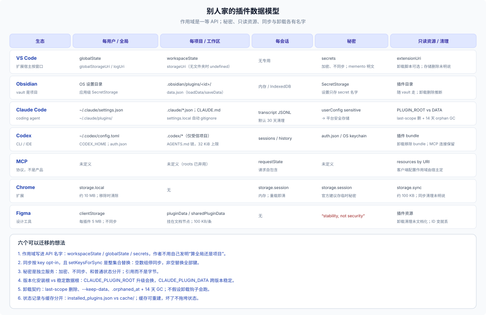

# 32 · 外部对照：VS Code、Obsidian、Claude Code、Codex、MCP、Chrome、Figma、JetBrains

## 这一篇回答什么

> **只作对照，不是依赖。** 这些生态的做法用于校准 DSH 的缺什么/该借什么；长期仍优先 DSH 原生 N0/N1，外部插件/服务只作短期过渡或模式参考。

DSH 没有“插件数据目录”，这不是它独有的难题。成熟的插件生态都遇到过同一个问题，只是各自用不同的 API 名字把它拆开了。把它们的切法放在一起看，能校准两件事：

1. 哪些家是**普遍存在**的（不是 DSH 发明出来的）；
2. 哪些是 DSH **故意没给**、要插件作者自己补的。

**来源口径（2026-10-27）。** 只取官方文档/API reference；能核到源码的核到源码。标注“未确认”的是官方文档没有明说、只能从行为推断的部分。不同生态的版本不同，下面的名字以各自当前文档为准。

## 一张总表

| 生态 | 每用户/全局 | 每工作区/项目 | 每会话 | 秘密 | 只读发布资源 | 同步 | 卸载清理 |
|---|---|---|---|---|---|---|---|
| **VS Code** | `globalState`；`globalStorageUri`；`logUri` | `workspaceState`；`storageUri` | 无专用 | `ExtensionContext.secrets`，加密，不同步 | `extensionUri` + `asAbsolutePath()` | 只有 `globalState` 里 `setKeysForSync` 声明的键 | 扩展目录删除；可选 `vscode:uninstall` 脚本；globalStorage 是否自动删未确认 |
| **Obsidian** | OS 全局设置目录；`SecretStorage` | 每个 vault 的 `.obsidian/`；插件目录 + `data.json` | 内存 Component 树；IndexedDB 缓存 | `SecretStorage` 存值，设置只存名字 | 插件目录 | 内置无；`.obsidian` 可被 Sync/第三方同步 | 卸载从 vault 移除；`data.json` 在插件目录里，随目录走（推断） |
| **Claude Code** | `~/.claude/settings.json`；`~/.claude.json`；`~/.claude/plugins/` | `.claude/settings.json`；`.claude/settings.local.json`；`.mcp.json`；CLAUDE.md 链 | 会话 transcript JSONL + 临时 scratchpad | `userConfig.sensitive` → 平台安全存储；transcript 明文 | `${CLAUDE_PLUGIN_ROOT}`（版本化安装目录） | 可提交 marketplace/enabledPlugins；本地数据不自动同步 | 最后一个 scope 卸载时删 options + secrets + `plugins/data/<id>/`，除非 `--keep-data`；旧版本 `.orphaned_at` + 14 天 GC |
| **Codex CLI** | `~/.codex/config.toml`；`CODEX_HOME`；`auth.json`；`history.jsonl`；`sessions` | `.codex/config.toml`；`.codex/hooks.json`；AGENTS.md 链（仅受信项目） | 会话 transcript/history | `auth.json` 明文或 OS keychain | 插件 bundle（skills/MCP/assets） | 内置无；config/AGENTS 可提交 | 卸载移除 bundle；单独接入的 MCP 连接保留 |
| **MCP** | 未定义 | 未定义（roots 已弃用） | 请求自包含；`requestState` 跨多轮 | 未定义 | resources by URI | 未定义 | 未定义 |
| **Chrome** | `storage.local` | 无 | `storage.session`（内存） | 推荐用 `storage.session` | 扩展包文件 | `storage.sync` 约 100 KB | `local` 在移除时清除；`sync` 清理未明说 |
| **Figma** | `clientStorage`（每插件 ID，5 MB） | 文档节点上的 `pluginData` / `sharedPluginData` | 无 | “stability, not security” | 插件资源 | `clientStorage` 不同步；文档数据随文件走 | 文档未写；插件 ID 变了就丢 |
| **JetBrains** | IDE config/plugins/system/logs 目录 | `.idea`（未确认） | — | — | 插件安装目录 | settingsSync 目录 | 手动/残留目录提示 |

## VS Code：把“作用域”做成 API 名字

VS Code 是这套问题最干净的答案：它不做“插件数据目录”，而是给五个有名字的家，外加一个只读安装根。

| API | 作用域 | 是什么 | 同步 | 备注 |
|---|---|---|---|---|
| `workspaceState` | 当前工作区 | `Memento`，键值 | 不同步 | 没打开文件夹时不可用 |
| `globalState` | 当前用户 | `Memento`，键值 | **只有 `setKeysForSync` 声明的键** | memento 是明文，不能放秘密 |
| `secrets` | 当前用户 | 加密存储 | 不同步 | 桌面用 Electron `safeStorage`，Web 用 DKE |
| `storageUri` | 当前工作区 | 插件私有目录 | 不同步 | 没有打开文件夹时是 `undefined`；目录可能还不存在，要自己创建 |
| `globalStorageUri` | 当前用户 | 插件私有目录 | 不同步 | 同上，可能不存在 |
| `logUri` | 当前工作区 | 日志目录 | 不同步 | 名字是 `logUri`，不是 `logsUri` |
| `extensionUri` | 安装 | 只读扩展目录 | 随扩展版本 | 用 `asAbsolutePath()` 拼资源 |

三个值得直接借的点：

1. **作用域写在 API 名字里**：作者不需要发明“这个键到底算全局还是项目”，选 API 就是选作用域。
2. **同步是按 key opt-in，而且 `setKeysForSync` 是整集合替换**：空数组=停止同步，非空=替换全部键。它不是“再加一个键”。
3. **秘密是独立服务**：`secrets` 加密、不同步、和 `globalState` 分开；文档明确说 memento 是明文。

卸载语义没有想象中完整：扩展目录会被删除，`vscode:uninstall` 脚本可选，但 `globalStorageUri` 是否自动删除官方文档没有明说（未确认）。这本身是个教训：**“卸载后留下什么”必须由作者写清楚**。

## Obsidian：插件数据就在 vault 里

Obsidian 的模型几乎是 DSH 的反面：

- 插件装在 `<vault>/.obsidian/plugins/<id>/`，`loadData()`/`saveData()` 读写同目录的 `data.json`；`loadData()` 在从未保存时返回 `null`。
- `.obsidian` 是 vault 的一部分，配置文件夹名可以改；移动 vault 时 `.obsidian` 跟着走，复制 `.obsidian` 就带走了插件设置。
- 应用级全局设置放在 OS 配置目录（`~/Library/Application Support/obsidian`、`%APPDATA%\Obsidian`、`$XDG_CONFIG_HOME/obsidian`），不在 vault 里。
- `SecretStorage`（1.11.4）按 vault 隔离，值不写进 `data.json`；设置里只存 secret 的名字。

这给了一个很清楚的对照：**“项目内数据”不一定脏**。Obsidian 用户接受插件数据在 vault 里，因为它在明处、跟着文件走、复制/备份/同步都自然。代价是插件数据会污染文档目录、多人共享 vault 时会冲突、明文 `data.json` 不能放秘密。DSH 的项目内文件（P2）走的是同一条路，只是没有 `.obsidian` 这种统一约定。

## Claude Code：版本化安装根 + 稳定数据根 + 卸载契约

Claude Code 是离 DSH 最近的 coding-agent 生态，它的数据模型有几个可以直接对照的设计：

- **设置分层**：`~/.claude/settings.json`、项目 `.claude/settings.json`、`.claude/settings.local.json`、managed；优先级 managed > CLI > project-local > project > user。
- **CLAUDE.md 链**：managed policy → `~/.claude/CLAUDE.md` → `./CLAUDE.md` / `.claude/CLAUDE.md` → `./CLAUDE.local.md`，按 broad→specific 拼接；父目录在启动时加载，子目录按需加载。
- **transcript**：`~/.claude/projects/<project>/<session>.jsonl`，明文，默认 `cleanupPeriodDays: 30`。
- **插件安装根 vs 数据根**：`${CLAUDE_PLUGIN_ROOT}` 是版本化安装目录，升级会换；`${CLAUDE_PLUGIN_DATA}` 指向 `~/.claude/plugins/data/<id>/`，**跨版本稳定**。这正是 DSH 缺的那一层。
- **插件状态与缓存分开**：`installed_plugins.json` / `known_marketplaces.json` 是状态，`cache/` 是缓存；缓存坏了可以重建。
- **卸载契约**：最后一个 scope 卸载时删除 options、secrets 和插件数据目录，除非 `--keep-data`；旧版本目录打 `.orphaned_at`，14 天后 GC；启动时做 orphan 清理，因为卸载钩子可能根本没跑。

这套设计直接回答了 DSH 作者的三个痛点：安装根不能放数据、数据根要跨版本稳定、卸载/升级要有明确的保留与清理语义。

## Codex：信任门控的项目层

Codex 的配置模型比 Claude Code 简洁，但有一条 DSH 社区插件经常忽略的规则：

- 用户配置在 `~/.codex/config.toml`（`CODEX_HOME` 可换根）；项目配置在 `.codex/config.toml`，从项目根到 cwd 逐层加载，**只有受信项目才加载**。
- 优先级 CLI > project > profile > user > cloud > `/etc/codex` > defaults；不可信项目会跳过 `.codex/` 的 config/hooks/rules。
- `AGENTS.md` 是全局一个文件 + 每个目录一个文件，root→cwd 拼接，总上限 32 KiB。
- `auth.json` 可明文或 OS keychain；会话在 `~/.codex/sessions`，`history.jsonl` 是另一份记录。
- hooks 的信任按 hook 内容哈希记录：文件改了就要重新信任。

对照 DSH：`workspace-overlay` 的 `<workspace>/.dsh/cordis.yml` 是“项目层可执行配置”，但 `trustWorkspaceConfig` 默认 `true`。Codex 的默认相反——项目层只有明确信任后才生效。这不是说 DSH 应该照抄，而是说**默认值本身就是数据/安全设计的一部分**。

## MCP：状态归服务器，协议本身不提供存储

MCP 当前 revision（2026-07-28）明确说它是**无状态协议**：每个请求自包含，携带自己的协议版本与 capabilities；多轮请求之间的状态用不透明的 `requestState` 传递；resources 有 `cacheScope`（public/private）。Roots 和 Sampling 在这个 revision 已弃用。

MCP 不定义客户端的配置作用域或存储位置；这些是宿主自己的事。对 DSH 插件的含义：

- 如果你接 MCP server，**不要把“用户记忆”默认塞进 server**：server 可能无状态、可能换实现、可能没有持久化承诺。
- 需要跨会话状态时，由 DSH 插件自己拥有（domain/文件），或明确选择一个有持久化契约的外部服务。
- 不要把 `requestState` 当长期存储；它是单次多轮请求内的不透明状态。

## Chrome：配额把“作用域”变成了产品约束

Chrome 扩展的存储模型很小，但每个家都有明确配额和生命周期：

- `storage.local`：约 10 MB，移除扩展时清除；`unlimitedStorage` 可申请更大。
- `storage.sync`：约 100 KB 总量、8 KB/项、512 项、1800 次写/小时、120 次/分钟；跨设备同步，但不是无限数据库。
- `storage.session`：内存，扩展重载/更新/浏览器重启即清，默认对 content script 隐藏；官方建议用它存临时秘密。
- `storage.managed`：企业策略只读。

这提醒的是：**同步和配额不是实现细节，是 API 的一部分**。VS Code 的 `setKeysForSync` 也是同一类设计——同步是按 key 选择的，不是整个 store 的开关。

## Figma：同一份文档里的两种可见性

Figma 把“插件数据”拆成两个完全不同的东西：

- `clientStorage`：按插件 ID、按用户、本地、5 MB、不同步；“stability, not security”，插件 ID 变了就丢。
- `pluginData`：挂在文档节点上，只有当前插件能读，100 KB/条；随文档文件走。
- `sharedPluginData`：带 namespace，所有插件可读，100 KB/条。

这是一个很有用的对照：**“跟文档走”和“跟用户走”可以是同一插件里的两种数据**。DSH 的项目内文件 ≈ `pluginData`（随项目走、用户可见），home 域 ≈ `clientStorage`（本机、用户不可见），但 DSH 没有“namespace 共享数据”的概念——多个插件要共享项目数据，只能约定文件格式。

## 六个可以迁移的想法

1. **作用域是一等 API 选择，不是约定。** VS Code 的 `workspaceState`/`globalState`/`secrets` 把作用域写进名字；DSH 的 `storageDomain` 只给“home + 记录键”，项目/会话作用域要作者自己编码。这是 DSH 插件作者感到“没有落脚点”的根源。
2. **同步按 key opt-in，不是整库开关。** `setKeysForSync` 的整集合替换语义值得抄；DSH 目前没有内建同步，但插件设计导出/导入时可以按 key 做。
3. **秘密是独立服务，不是状态里的一个字段。** VS Code、Obsidian、Claude Code 都收敛到“引用 + 专用存储”；DSH 的 `CredentialRef`/`CredentialKey` 是同一方向。
4. **版本化安装根 vs 稳定数据根。** Claude Code 的 `CLAUDE_PLUGIN_ROOT` / `CLAUDE_PLUGIN_DATA` 是最直接可抄的结构；DSH 的包目录是版本化的，但没有稳定的插件数据根。
5. **卸载/升级要有契约：orphan 标记、延迟 GC、keep-data。** Claude Code 的 `.orphaned_at` + 14 天 GC、`--keep-data` 是成熟做法；DSH 的 domain/附件/localStorage 都没有统一的卸载清理。
6. **状态记录与缓存分开，缓存可重建。** Claude Code 的 `installed_plugins.json` vs `cache/`、DSH 的 `session_projcache` vs session log 是同一个原则。

## 哪些假设不能迁移

- **一个工作区一个进程/窗口**：VS Code 的扩展宿主按窗口，Obsidian 按 vault；DSH 是一个 Host 服务所有 workspace，且会话可以 `/cd`。所以 `workspaceState` 那种“窗口级全局”不能直接照搬。
- **可靠的生命周期钩子**：IDE 能保证 deactivate，DSH 可能被 SIGKILL、headless 退出；清理只能靠启动时扫描 + 显式操作。
- **GUI 存储**：`localStorage`/`clientStorage` 只适合 UI 状态，不能当共享数据；DSH 的 Web/Desktop 也一样。
- **厂商账号与同步冲突 UI**：VS Code/Claude 的同步基于账号体系；DSH 没有内建账号同步。
- **交互式文件夹信任**：Codex 可以在打开项目时问“信任吗”；DSH 的 Web 有工作区概念，但没有统一的 trust 交互，插件要自己设计。
- **永久插件 ID 与卸载脚本**：DSH 的插件可能被 link、重装、换包名；不能假设 ID 永久，也不能假设卸载钩子会跑。
- **MCP roots/sampling**：已弃用，不要围绕它们设计新数据流。
- **Chrome 的字面配额**：数字不可迁移，但“配额是 API 的一部分”这个原则可以。

## 映射回 DSH

| 能力 | DSH 现状 | 作者要做什么 |
|---|---|---|
| 每用户 KV | `storageDomain` 单例/global 槽 | 声明域，用固定键 |
| 每项目 KV | `storageDomain` + 路径键 | 规范化路径、哈希、`lastSeenAt`、清理 |
| 每会话 KV | 无受支持的第三方私有存储 | 从事件重算，或 home 域按 session id 建键并清理 |
| 每项目文件 | `ctx.fs` + 项目内目录 | 约定目录、`.gitignore`、锁/原子写 |
| 秘密 | `CredentialRef` / `CredentialKey` | 只存引用，调用点解析 |
| 只读发布资源 | 包目录 / `extensionUri` 类比 | 不要把可变数据写进包目录 |
| 每项目运行时 | 无核心实现 | 社区 `workspaceCordis` 或自己建 scope |
| 稳定插件数据根 | 无 | 用 home 域，或自造 `$DSH_HOME/<plugin>` 并写清清理 |
| 卸载/升级契约 | 无统一机制 | README 数据卡 + 启动清理 + 版本化键名 |
| 同步 | 无内建 | 用户自己的 git / 导出导入 |

## 一句话

成熟生态的共同点不是“有一个数据库”，而是**把作用域、可见性、秘密、只读资源和清理契约分别命名**；DSH 给了其中一半（内容、历史、状态、派生），另一半（项目级状态、稳定数据根、卸载清理、同步）要插件作者自己补——补的时候，先选承诺，再选家。

## 边界

- 本篇是跨生态对照，不是 DSH 的产品建议书；各生态的 API 以官方文档为准。
- 标注“未确认”的条目（VS Code 的 globalStorage 卸载删除、Obsidian 的 data.json 卸载删除、Claude 的具体 OS 凭据后端、Codex 的 rollout 文件布局、Figma 的卸载清理、JetBrains 的 `.idea`）没有在本文档中当作事实使用。
- 各生态的版本、配额、默认值会变；引用时回到原始文档。
