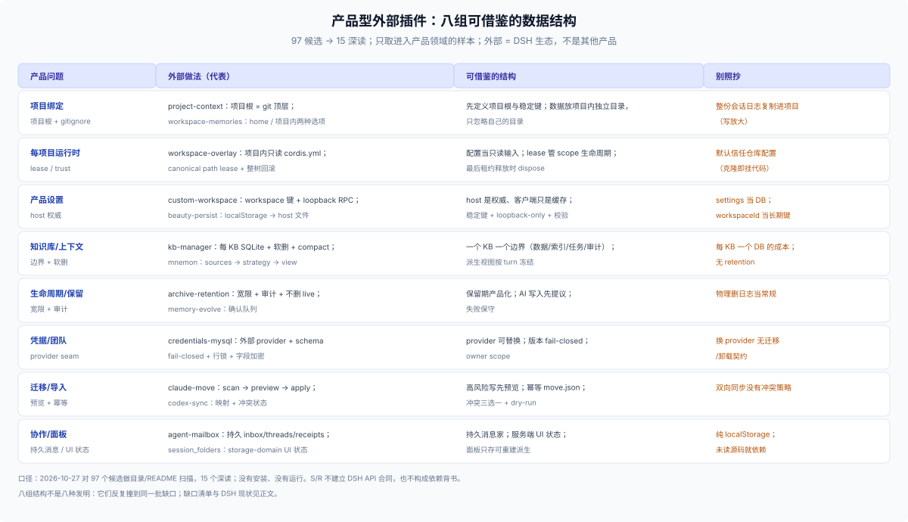

# 32 · 产品型外部插件的数据设计（参考）：八种可以借鉴的结构

## 这一篇回答什么

> **角色：外部参考层（E1/E2）。** 本篇只看核心仓之外的 DSH 生态，并且只挑已经走进产品领域的插件：它们自己定义了产品级状态（项目绑定、设置、生命周期、迁移、团队凭据、协作），而不只是给已有 composition 加一个工具。外部指 DSH 生态的外围，不是其他产品的插件体系。

DSH 原生插件覆盖基础层（内容、历史、状态、派生、客户端五个家）；外部插件在补的往往是产品层：项目怎么绑定、设置放哪、数据跟谁走、卸载后留什么。本篇从 15 个深读样本里挑出八组可以借鉴的数据结构；[31](./31-external-community-patterns.md) 给单插件的九个维度和十八种手法，[33](./33-external-plugin-patterns.md) 给逐个案例与证据，[34](./34-profile-product-forms.md) 看 profile 的交付形态，[35](./35-profile-assembly-ownership.md) 看装配状态与所有权。

**口径。** 深读 2026-10-27：97 个候选（memory/session 23、workflow/tools/notify 19、runtime/account/UI/theme 55）里选 15 个，读过源码或 README（S/R）。目录 2026-10-24：awesome-dsh-plugin 6704 条元数据，只读作者描述（R），没有安装。样本不是 census，U = 未确认。

## 谁在外面

| 层 | 是什么 | 典型 | 数据含义 |
|---|---|---|---|
| E1 插件包 | npm 包 + Cordis 插件或 bundle patch | project-context、workspace-overlay、kb-manager、渠道插件 | 运行在 Host/Client，自己挑数据家 |
| E2 服务 | 插件调用的外部能力 | MCP server、HTTP API、外部 DB、对象存储 | 权威在外部，DSH 侧只存引用和配置 |
| 分发与目录 | 让用户找到并安装 | npm、profile bundle、awesome-deepseek-harness-plugins、dshbase | 目录计数只说明曝光，不是质量证据 |

E1 与 E2 的分界是数据权威在哪。本篇讨论的结构几乎都在 E1：插件自己写文件或 DB，权威在本机，生命周期也由插件承担。

## 八种可以借鉴的数据结构

| 产品问题 | 外部做法（代表） | 可借鉴的结构 | 别照抄 |
|---|---|---|---|
| 项目绑定 | project-context：项目根 = git 顶层；`.agents/` + `.gitignore`；workspace-memories：存储位置做成 home / 项目内两种选项 | 先定义项目根与稳定键；插件数据放项目内独立目录，只忽略自己的目录 | 把整份会话日志复制进项目（写放大） |
| 每项目运行时 | workspace-overlay：项目内只读 `cordis.yml` + canonical path lease + single-flight + 整树回滚 | 配置当只读输入；lease 管 scope 生命周期；最后租约释放时 dispose | `trustWorkspaceConfig: true`：克隆仓库就能挂代码 |
| 产品设置 | custom-workspace：按 workspace 存设置 + loopback RPC；beauty-persist：把 localStorage 迁到 host 文件；PromptRecall：host JSONL + 会话内快照 | host 是权威、客户端只是缓存；稳定键 + loopback-only + 响应校验 | 把 `settings.yaml` 当 DB；用 `workspaceId` 当长期键 |
| 知识库/上下文 | kb-manager：每 KB SQLite + 软删 + compact + confirm token；mnemon：sources → strategy → view | 一个 KB 一个边界（数据/索引/任务/审计）；派生视图按 turn 冻结 | 每 KB 一个 DB 的运维成本；无 retention |
| 生命周期/保留 | archive-retention：宽限期 + 审计清单 + 绝不删 live；memory-evolve：确认队列 | 保留期产品化；AI 写入先提议、用户确认；失败保守 | 物理删日志当常规操作 |
| 凭据/团队 | credentials-mysql：外部 provider + schema fail-closed + 行锁 + 字段加密；codex-keychain | provider seam 可替换；版本 fail-closed；owner scope | 换 provider 没有迁移/卸载契约 |
| 迁移/导入 | claude-move：scan → preview → apply + 幂等 `move.json`；codex-sync：映射 + 冲突状态 | 高风险写先预览；幂等标记；冲突三选一 + dry-run | 双向同步没有冲突策略 |
| 协作/面板 | agent-mailbox：持久 inbox/threads/receipts；session_folders：storage-domain UI 状态；insights：只存派生检查点 | 持久消息家；服务端 UI 状态；面板只存可重建的派生 | 纯 localStorage；未读源码就依赖 |

### 项目与运行时

产品最先要回答“数据跟谁走”。project-context 用 git 顶层定义项目根，把记忆和上下文放进 `<project>/.agents/`，会话归档也留在项目内（`.gitignore` 默认忽略 `session-logs/`）；workspace-memories 把存储位置做成配置，默认 home、可选项目内——同一份数据两种承诺，由用户按敏感度选。运行时侧，workspace-overlay 把项目内 YAML 当只读输入，canonical path 做 lease 键，single-flight、整树回滚、最后租约 dispose，是“每项目一套配置/工具面”的完整样板。

要借鉴的是结构：先定义项目根和稳定键，再用 lease 管生命周期。不要照抄它的 `trustWorkspaceConfig: true`，也不要照抄 workspace-memories 硬编码 `~/.dsh`（忽略 `DSH_HOME`）。

### 设置与客户端状态

custom-workspace 按 workspace 持久化外观，只走 loopback RPC，写失败回读 host；beauty-persist 把 `localStorage` 里的皮肤状态迁到 host 文件；PromptRecall 用 `$DSH_HOME/prompt-history.jsonl` 加会话内快照。三者指向同一个结构：**host 是权威，客户端只是缓存**。

可借鉴的是稳定键 + loopback-only + 响应校验。别把 `settings.yaml` 当 DB，也别用 `workspaceId` 当长期键——重加 workspace 会换 uuid。

### 知识与生命周期

kb-manager 把“一个知识库”做成一个单元：数据、索引、任务与审计共享同一套 KB 生命周期，软删 + `compact_index` + `confirm_token`；archive-retention 给归档会话加保留期、宽限和审计清单，绝不删 live、失败保守。可借鉴的是把破坏性操作做成带令牌的产品流程，把保留期当产品能力而不是运维脚注。

代价也要看见：每 KB 一个 SQLite、每份归档靠物理删除，都是核心没有对应 API 时的补丁，不是产品级服务的替代品。

### 凭据、迁移与协作

credentials-mysql 证明凭据 provider 可以换：外部 DB、schema 版本 fail-closed、行锁、字段加密、owner scope；但卸载不清理 DB，迁移契约没人写。claude-move 用 scan → preview → apply 和幂等 `move.json`；codex-sync 暴露了双向同步真正的难点——映射和冲突策略。agent-mailbox 补持久 inbox/threads/receipts，session_folders 把 UI 状态放进 storage-domain。可借鉴的是“换后端、搬数据、跨会话消息”都被当成产品功能来设计，而不是一次性脚本。

## 目录扫描：产品型样本池

从 6704 条目录元数据里做关键词扫描后人工筛出的产品型样本（只读作者描述，R 级；没有安装、没有读源码）。它们补上了八种结构没覆盖的账号、备份、回滚和账本。

| 样本 | 类别 | 数据设计 | 可借鉴 |
|---|---|---|---|
| [ui-auth](https://github.com/0QwQ0/dsh-ui-auth) | security | 登录门禁、每用户 Key 加密、管理员不可读、JSONL 审计、fail-closed | 身份、凭据、数据按用户隔离；未配置即阻断 |
| [team-cost](https://github.com/1569126506-sudo/dsh-team-cost) | usage | 按成员/工作区计费、预算、阈值 Webhook、超支拦截 | 团队成本当产品状态 |
| [backup](https://github.com/xiaoyuyu6420/dsh-backup) | dev | 全 home 备份/恢复、分级保留、sha256、失败回滚、凭据脱敏、救援页 | 备份带校验与回滚 |
| [backup-sync](https://github.com/Arlenman/dsh-backup-sync) | dev | tar.gz + sha256、三方合并、凭据黑名单、导入前快照、WebDAV | 换机迁移做三方合并 |
| [dsh-webdav](https://github.com/GaoHu1997/dsh-webdav) | dev | profile 五份、AES-256-GCM、分份三方合并、冲突留档 | 同步只存密文 |
| [dsh-vault](https://github.com/soberkeen/dsh-vault) | tools | 加密分卷、口令/恢复码/DPAPI、GFS 四档保留、回收站 | 保留策略与恢复槽 |
| [session-delete](https://github.com/wenhao4126/dsh-session-delete) | session | 归档/删除、按工作区批量、恢复时重建工作区 | 删除前备份工作区信息 |
| [session-move](https://github.com/hwangjunjie/dsh-session-move) | session | 改 header cwd、迁日志、更新账目；删除先停 agent | 迁移/删除是同一事务 |
| [session-migrate](https://github.com/EIGHTfs/dsh-session-migrate) | session | v0/.zstd/.zip 迁移、header 绑定、打开时升级 | 旧格式迁移与预检 |
| [context-archive](https://github.com/kingofpowers/dsh-context-archive) | tools | 大结果存 `archives/` + 存根、原文留日志 | 大对象出上下文 |
| [rollback](https://github.com/Taler97/dsh-rollback) | tools | write/edit 改前映像、`rollback_files` | 变更前留映像 |
| [time-machine](https://github.com/zjukop/dsh-time-machine) | dev | 内容寻址快照、差异预览、两阶段恢复 | 恢复要二次确认 |
| [risk-guard](https://github.com/shuxue6662-a11y/dsh-risk-guard) | security | 工具调用审计、规则评分、保险丝、脱敏账单 | 审计 + 只拦不可逆 |
| [secret-guard](https://github.com/JohnXu22786/secret-guard) | security | 敏感文件拦截、结果掩码、审计、永不输出原值 | 秘密不进日志/上下文 |
| [model-gateway](https://github.com/Leafyezi233/dsh-model-gateway) | model | OpenAI 兼容网关、Key 只存 SHA-256、删最后钥匙仍锁定 | 哈希存储 + 锁定语义 |
| [all-usage](https://github.com/ParticleLight/dsh-all-usage) | usage | 独立账本、删除前持久化、revision 增量、已删除工作区聚合 | 派生账本独立于源 |
| [team-rooms](https://github.com/PerryLink/dsh-team-rooms) | workflow | 持久团队房间、消息总线、共享任务板、时间线 | 跨会话持久消息 |
| [workspace-hub](https://github.com/Jadramcool/dsh-workspace-hub) | usage | 工作区分组/排序、每工作区 token/成本、30s 刷新 | 工作区当产品对象 |
| [worktree-panel](https://github.com/HeathHe/dsh-worktree-panel) | git | worktree → 会话分组、脏树/活跃会话保护、存储迁移 | 迁移有保护 |
| [trilogy](https://github.com/TodayJin/dsh-trilogy) | memory | 每工作区三份 Markdown、溢出归档、导出/导入 JSON、两步清除 | 溢出可读、可恢复 |

## 这些结构在补哪六个缺口

| 缺口 | 对应结构 | DSH 现状 |
|---|---|---|
| 每 workspace 插件实例 | 每项目运行时 | 无通用 per-workspace 实现 |
| 插件数据根 | 项目绑定、产品设置 | 无；位置由作者自定，无配额、GC 或导出 |
| Session 删除与保留 | 生命周期 | 无 `session.delete` / retention；归档只进不出 |
| 秘密的共享与隔离 | 凭据/团队 | `ctx.credentials` 只有本地文件一方实现 |
| 客户端状态跨源 | 产品设置 | 无客户端状态服务；`localStorage` 换 origin 就丢 |
| 第三方设置命名空间 | 产品设置 | `Config.volatile()` 有表单，缺与 Loader 无关的键空间 |

八个结构不是八种发明，它们反复撞到同一批缺口。对产品作者，缺口决定“哪些要自建、自建时抄哪个结构”；对 DSH 维护者，缺口就是需求信号：同一件事已经被不同插件用互不兼容的方式补了多次。

## 声明质量

声明 `engines.dsh` 的插件很少：55 个 runtime/account/UI 样本里只有 1 个。深读样本的兼容基线从 0.1.0-rc.6 横跨到 0.2.1-rc.1，README 里的 settings 路径也有停在 `~/.dsh/settings.yaml` 的。

这直接影响产品的数据设计：旧 settings 文件、旧目录布局、旧事件格式都会变成迁移与回填。逐个插件的版本漂移见 [31](./31-external-community-patterns.md) 的维度八，迁移实现见 [33](./33-external-plugin-patterns.md) 的 project-context、credentials-mysql 和 kb-manager。

## 怎么读这个生态

- **先写数据卡，再选结构。** 用 [91](../90-advisor/91-checklist.md) 记下每份事实的 owner、scope/key、readers/writers、可重建性和保留责任，再决定抄哪个结构。
- **抄结构，不抄实现。** journal + 锁 + 原子写、lease、confirm token 是结构；具体插件的目录名、键名和 RPC 名是当时的实现。
- **样本只支持 S/R。** 读过源码不等于在你安装的版本上成立；要依赖具体包，另行核对兼容、license、数据生命周期和维护状态。
- **缺口是需求信号，不是 API。** 社区补洞的方式没有核心契约，升级就可能失效；产品自建部分要写进 README 和卸载说明。

## 边界

- 本篇挑的是产品型样例，不覆盖 15 个深读里的全部插件；逐案例见 [33](./33-external-plugin-patterns.md)。
- 不评价具体 package 的安装性或运行质量；依赖决定见 [92](../90-advisor/92-native-reference-architectures.md)。
- 其他产品的插件生态不在本篇范围；它们的宿主模型、生命周期和 API 不能直接迁移成 DSH 数据卡。
- 外部源码与 README 不得支撑 C 级结论（标签规则见 [40-evidence](../40-evidence/00-index.md)）。
