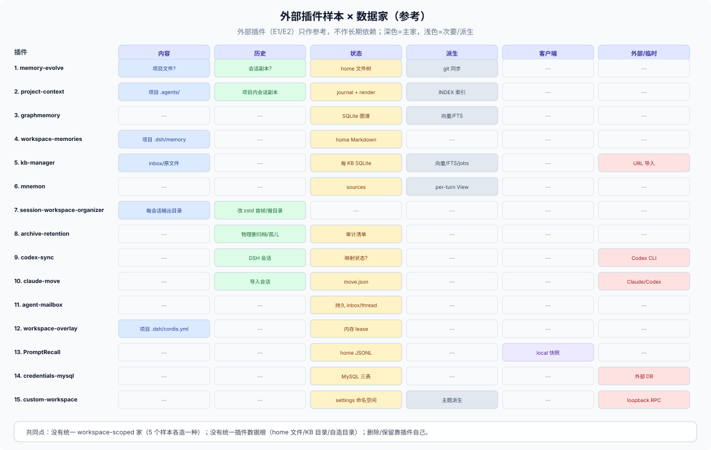

# 33 · DSH 外部插件案例（参考）：15 个复杂插件在补什么缺口

## 这一篇回答什么

**角色：外部参考层（E1/E2）。** 本篇不评定 package 是否适合作为依赖；DSH 的结论以 [10](../10-foundations/10-taxonomy.md)–[18](../10-foundations/18-install-upgrade.md) 为准。外部指 DSH 生态的外围（核心仓之外的插件与服务）；它比较这些样本解决了哪些数据问题，以及哪些模式值得进一步评估。

外部来源分为 **E1 package/plugin** 与 **E2 service**（MCP/HTTP/DB/对象存储）。本篇的代码与 README 样本仅支持 S/R 级模式观察；若要依赖某个具体 package/service，需另行审查其兼容、license、安全、数据迁移和维护责任。

**口径。** 2026-10-27 对 97 个候选做了目录/README 扫描（memory/session 23、workflow/tools/notify 19、runtime/account/UI/theme 55），选 15 个深读；产品型样例与缺口汇总见 [32](./32-external-ecosystem.md)，profile 交付形态见 [34](./34-profile-product-forms.md)，装配状态见 [35](./35-profile-assembly-ownership.md)。

**没有安装、没有运行**；S = 读过源码，R = README/作者声明，U = 未确认。样本不是 census。所有结论只描述 DSH 外部插件，不是 DSH 合同。

## 外部模式 → 原生替代

| 外部模式 | 代表 | 原生替代 | 结论 |
|---|---|---|---|
| journal + render | project-context、memory-evolve | 项目文件 + `ctx.fs`；锁/备份要自写 | 模式可借，依赖不借 |
| home 记忆文件树 | memory-evolve、workspace-memories | `ctx.storageDomain` 或项目文件 | 原生 domain 够用；键/清理自写 |
| 每 KB SQLite + 向量/FTS | kb-manager、graphmemory | `ctx.storageDomain` + sqlite backend；向量/FTS 无原生 | 需要 RAG 时短期借；长期等核心 |
| 每项目 scope/lease | workspace-overlay | 无原生 per-workspace 实例 | 原生缺口；短期借 |
| 服务端 UI 状态 | session_folders | `ctx.storageDomain` + client 投影 | 原生可做，但无官方插槽 |
| 物理删/归档会话 | archive-retention、archive-manager | 无 `session.delete` | 原生缺口；不建议普通插件模仿 |
| 改日志 header | session-workspace-organizer | 无 move API | 原生缺口；高风险 |
| host JSON 输入历史 | PromptRecall | localStorage 或 `ctx.storageDomain` | 原生可做 |
| MySQL/OS keychain 凭据 | credentials-mysql、codex-keychain | `ctx.credentials`（本地文件） | 共享/跨机才借；长期等核心 provider |
| 跨 origin 迁移 | beauty-persist | 无客户端状态服务 | 原生缺口；短期借 |

## 15 个案例

### 1. dsh-memory-evolve（S）——把“长期记忆”做成文件树 + git 合并

- **问题**：跨会话记忆、待办、技能、多 Agent 协作，还要跨设备。
- **数据**：`~/.dsh/memories/`；`MEMORY.md`/`USER.md` 用 `§` 分隔条目，每条带不可见 `[id:…]` 合并锚点；`SUGGESTIONS.jsonl`、`skills-state.json`、`aliases.json`、`session-bookmarks.json`、`broadcast/`、`session-orch/`、per-project tracks。**R/S**
- **权威/作用域**：文件权威，实时写；git 同步是显式批处理，不是写路径。home + per-project。
- **生命周期**：锁 10 s 陈旧/5 s 等待/25 ms 重试；tmp→rename→`.bak`；确认队列；卸载说明“效果随插件卸载清理”（未核）。
- **设计理由**：AI 只提议、用户确认；条目 id 让三方合并能区分“两边都新增”和“两边都改同一条”。
- **暴露的 DSH 缺口**：没有 home 级记忆服务、没有跨设备同步、没有稳定条目 id。
- **可抄**：条目 id、git 作为传输层、锁+原子写、确认队列。
- **不要抄**：发布标签与 `package.json` 版本不一致；功能面过宽；卸载数据声明不清。

### 2. dsh-project-context（S）——journal 权威 + Markdown 派生

- **问题**：项目级持久上下文、会话归档、记忆整理、技能沉淀、交接。
- **数据**：`<project>/.agents/memory/` + `.agents/skills/`；`memory.jsonl` 权威，`MEMORY.md` 派生；`CONTEXT.md`、`HANDOFF.md`、`autolearn-state.json`、`skill-candidates/`、`session-logs/<id>/{session.jsonl,session.md}`、`INDEX.md`、`.gitignore`、`errors.log`。**S**
- **权威/作用域**：journal 权威；手改 `MEMORY.md` 且比 journal 新时被采信并折回；项目根 = git 顶层，非 git 回退 cwd。
- **生命周期**：进程内写链 + 跨进程锁（30 s 陈旧/35 s 等待）；备份最新 5 份；inode+字节数+mtime；`session/flush` 90 s；旧布局启动迁移。
- **设计理由**：journal+render 同时满足“用户可编辑”和“机器可追加”；崩溃只让渲染落后。
- **暴露的 DSH 缺口**：没有项目级记忆服务、没有 per-workspace scope、没有稳定 data root、没有跨进程原语。
- **可抄**：journal+render、锁内备份、inode/bytes/mtime、`.gitignore` 托管、幂等回填。
- **不要抄**：把整份会话日志复制进项目（写放大）；200 行索引上限；依赖侧栏插槽。

### 3. dsh-graphmemory（S）——SQLite 图谱 + 向量/FTS 召回

- **问题**：跨会话知识图谱，新问题召回子图而不是重放历史。
- **数据**：`~/.dsh/graph-memory/graph-memory.db`；WAL；`gm_nodes/gm_edges/gm_node_sources/gm_messages/gm_signals/gm_vectors/gm_communities` + `_migrations(v, at)`。**S**
- **权威/作用域**：DB 权威；向量/社区/召回派生；home 跨项目。
- **生命周期**：`migrate(db)` + column probe；WAL；`gm_maintain`；无明确 retention。
- **设计理由**：把抽取、索引、召回放在一个本地 DB；召回进提示词标“不可信参考”。
- **暴露的 DSH 缺口**：没有 memory/vector 服务、没有内建 SQLite domain、没有 embedding provider。
- **可抄**：显式迁移表、凭据引用、不可信召回、后台抽取队列。
- **不要抄**：单 SQLite 无备份/retention；旧 RC 版本映射。

### 4. dsh-workspace-memories（S）——存储位置做成配置

- **问题**：每 workspace 的 Markdown 记忆；服务器地址/环境怪癖不该进仓库，团队记忆可以进。
- **数据**：默认 `~/.dsh/workspace-memory/<workspace-key>/`；opt-in `<workspace>/.dsh/memory/`；一个 `.md` 一条。**S**
- **权威/作用域**：文件权威；注入文本派生（32K/文件、20 文件）；workspace 键。
- **生命周期**：普通 `fs.writeFile`，无锁/原子写，last-write-wins；无迁移；无卸载清理声明。
- **设计理由**：位置是产品选择，不是实现细节；默认 home 避免仓库污染。
- **暴露的 DSH 缺口**：没有 workspace-scoped data home；`workspaceId` 重加会换。
- **可抄**：存储位置配置、面板+工具、注入上限。
- **不要抄**：硬编码 `~/.dsh`（忽略 `DSH_HOME`）、无锁写、用 `workspaceId` 当长期键。

### 5. dsh-kb-manager（R）——每 KB 一个 SQLite 的完整生命周期

- **问题**：本地知识库：多格式导入、分块、向量+FTS、混合检索、引用、删除、快照、导出。
- **数据**：`~/.dsh/kb-manager/`；每 KB `kb.db`（sqlite-vec + FTS5）；软删 + `compact_index`；`confirm_token`（绑 kb_id，60 s TTL）；异步 job/审计/快照/`kbpack`。**R**
- **权威/作用域**：KB 目录权威；索引/向量派生；home，按 KB 分。
- **生命周期**：导入白名单 + SSRF guard；软删可恢复；compact 物理回收；快照/导出/导入去重。
- **设计理由**：把 RAG 的“数据 + 索引 + 任务 + 审计”收在一个 KB 边界；检索结果永远 `untrusted: true`。
- **暴露的 DSH 缺口**：没有 KB/RAG 服务；没有通用 job/audit/快照原语。
- **可抄**：每 KB 一个 SQLite、软删+compact、confirm token、异步 job、untrusted、path/SSRF 白名单。
- **不要抄**：每 KB 一个 DB 的运维成本；ONNX/PDF 仍是占位实现（作者自述）。

### 6. dsh-mnemon（R）——sources → strategy → view

- **问题**：多层记忆源（项目/用户/会话），每轮组合成一个不可变 View。
- **数据**：Sources 拥有 memory；Strategy 决定 resident vs searchable；Core 校验一个 per-turn View。**R**
- **权威/作用域**：源权威；View 是派生、按 turn 冻结。
- **设计理由**：把“记忆从哪来”和“这轮注入什么”分开；View 不落盘，避免第二个权威。
- **暴露的 DSH 缺口**：没有分层记忆/上下文组合服务。
- **可抄**：源/策略/视图三层；per-turn 不可变 View；只注入必要部分。
- **不要抄**：未读源码，不能评价并发/迁移；标 R。

### 7. dsh-session-workspace-organizer（R）——直接改日志以满足“搬工作区”

- **问题**：工作区目录搬家、每会话输出目录、移动/删除会话、重启。
- **数据**：改每条日志 zstd 首帧 header 的 `cwd`，后续帧字节不变；日志目录从 `--old--` 搬到 `--new--`；`<workspace>/sessions/<date>_<title>/` + `.dsh-session` 标记；删除有预览/确认；重启日志保留 20 对。**R**
- **权威/作用域**：日志是权威；插件做离线重写；要求目标 workspace 无运行会话。
- **设计理由**：DSH 没有 `session.delete`/move，也没有“每会话输出目录”；插件自己补。
- **暴露的 DSH 缺口**：session 删除/移动、per-session artifact folder、workspace 重定位。
- **可抄**：只改必要字段、后续帧不动、无 live session 才允许、先写新位置再删旧、跨盘复制校验/回滚、`.dsh-session` 标记。
- **不要抄**：普通插件直接改日志 header；这是高风险反模式，应该由核心提供受支持操作。

### 8. dsh-archive-retention（R）——物理删除归档会话 + 审计

- **问题**：归档只进不出，Web GUI 列表变慢；需要保留期。
- **数据**：`sessions-archive/<workspace>/<id>/`、页面归档名单、`sessions/` 孤儿子 agent；删除清单 `sessions-archive/_manifests/retention-*.json`；cron。**R**
- **权威/作用域**：会话日志目录；home；按 workspace。
- **生命周期**：默认 7 天宽限；绝不删未归档/内存中/正在运行/头部读取失败的目录；父目录还在则等下一轮。
- **设计理由**：核心没有 retention/delete，插件只能按目录布局做物理删除。
- **暴露的 DSH 缺口**：session 删除/保留/级联、归档语义、孤儿检测。
- **可抄**：宽限期、审计清单、绝不删 live、父/子顺序、失败保守。
- **不要抄**：依赖 `sessions/` 目录布局做核心生命周期；没有核心契约的物理删除。

### 9. dsh-codex-sync（R）——双向同步的映射问题

- **问题**：Codex 与 DSH 双向同步 skills/sessions/workspaces/MCP。
- **数据**：外部 Codex 配置/会话 ↔ DSH 会话/配置；映射/冲突状态（落点 U）。**R**
- **权威/作用域**：两边都是权威？需要冲突策略；home/workspace。
- **设计理由**：用户同时用两个 agent 工具，想把历史/技能带过来。
- **暴露的 DSH 缺口**：没有导入/导出/同步协议；没有稳定外部 id 映射。
- **可抄**：显式映射表、幂等、冲突三选一、dry-run。
- **不要抄**：双向同步没有冲突策略；把外部格式当 DSH 合同。

### 10. dsh-claude-move（R）——多来源迁移向导

- **问题**：Claude Code/Codex/OpenCode/Hermes → DSH 的会话、记忆、技能、命令。
- **数据**：外部日志/配置 → DSH 会话事件；`move.json` 幂等/审批；扫描只读、不回传正文/凭据。**R**
- **权威/作用域**：外部源只读；DSH 会话为目标；home/workspace。
- **设计理由**：迁移是高风险写操作，需要 preview/approval/幂等标记。
- **暴露的 DSH 缺口**：没有标准导入格式/会话构造 API；插件只能写日志或走内部接口。
- **可抄**：scan→preview→apply、幂等 `move.json`、审批门、不回传正文/凭据。
- **不要抄**：依赖外部私有格式；没有版本/回滚。

### 11. dsh-agent-mailbox（R）——DSH 没有的持久消息家

- **问题**：跨会话 Agent 消息：线程、回执、搜索、在线状态。
- **数据**：持久 inbox/thread/receipt（落点 U，可能文件/SQLite）。**R**
- **权威/作用域**：插件自有消息库；跨会话/团队。
- **设计理由**：`agent-team` 只有 session 事件/投影；需要离线投递和回执。
- **暴露的 DSH 缺口**：没有持久消息/收件箱服务；跨会话消息只在实验性 agent-team。
- **可抄**：线程/回执/离线投递；消息 id 幂等。
- **不要抄**：未读源码，不能评价持久化/清理；标 R。

### 12. dsh-workspace-overlay（S/R）——把 workspace 变成运行时 scope

- **问题**：每 workspace 一套 Cordis 配置、preset、MCP。
- **数据**：`<workspace>/.dsh/cordis.yml` 只读输入（`write()` no-op）；`ctx.workspaceCordis` 用 canonical path 做 lease；全局 MCP 行在 profile patch。**S/R**
- **权威/作用域**：workspace YAML 权威；scope/MCP/工具面派生；workspace。
- **生命周期**：single-flight、150 ms debounce、watcher 锚在 workspace root；失败回滚整树但保留 scope/lease；最后租约释放 dispose。**R**
- **设计理由**：核心没有 per-workspace 实例；用 lease 自己造一个稳定 scope。
- **暴露的 DSH 缺口**：per-workspace plugin instance/scope、项目层 trust。
- **可抄**：只读配置、canonical path key、lease 生命周期、watcher 锚点、回滚。
- **不要抄**：`trustWorkspaceConfig: true` 默认；整树 reload 不 drain in-flight 工具。

### 13. dsh_PromptRecall（S）——输入历史的 host/client 分家

- **问题**：Codex 风格 ↑/↓ 输入历史，跨会话/重启。
- **数据**：`$DSH_HOME/prompt-history.jsonl`（全局、纯文本）；会话内 local 快照；单调 id；10 MB 裁剪整行；`io.withLock` 跨进程读改写；`clear()` 写空文件。**S**
- **权威/作用域**：host JSONL 权威；local 快照缓存；home。
- **设计理由**：localStorage 换源就丢；host 文件跨重启。
- **暴露的 DSH 缺口**：没有输入历史服务；没有“客户端状态跨源”方案。
- **可抄**：单调 id、跨进程锁、整行裁剪不重编号、host/client 分工。
- **不要抄**：全局历史不按 workspace 分；无 secret/injection 扫描；卸载清理未说明。

### 14. dsh-credentials-mysql（S）——把凭据 provider 换成外部 DB

- **问题**：团队/多机共享凭据，不想用本地 `.credentials.yaml`。
- **数据**：MySQL 三表 `<prefix>credential_refs/_records/_meta`；`rec_key=<scope>/<id>`；`SCHEMA_VERSION=1`；AES-256-GCM 字段加密；`SELECT … FOR UPDATE`。**S**
- **权威/作用域**：MySQL 权威；credentials seam provider；home/团队。
- **生命周期**：数值 schema 版本 fail-closed；行锁；DB 行持久；卸载不清理 DB。
- **设计理由**：远程 provider 是 settings seam 的合法兄弟；字段加密 + 行锁解决并发/泄漏。
- **暴露的 DSH 缺口**：没有共享/远程 credential provider；本地文件是唯一一方实现。
- **可抄**：schema 版本 fail-closed、行锁、字段加密、owner scope。
- **不要抄**：替换 seam 后没有迁移/卸载契约；密钥管理未说明。

### 15. dsh-custom-workspace（S）——按 workspace 的 UI 设置

- **问题**：每个 workspace 自己的背景、字体、行高、间距。
- **数据**：0.1.0-rc.6 用 `$DSH_HOME/settings.yaml` 的 namespace `Record<workspaceId, appearance>`；当前 0.2.x 应走 profile patch；自定义 `/custom-workspace` loopback RPC。**S**
- **权威/作用域**：settings provider；按 workspaceId/Host path；UI。
- **生命周期**：失败写重新读 host；非 loopback 不可用；无迁移；settings 条目持久。
- **设计理由**：不想改 session/workspace 模型；loopback-only 降低风险。
- **暴露的 DSH 缺口**：没有 workspace-scoped settings；没有第三方任意 namespace；workspace key 不稳定。
- **可抄**：loopback-only、响应校验、回退主题。
- **不要抄**：`settings.yaml` 当 DB；`workspaceId` 当长期键；自定义 RPC 优先于 Config 表单。

## 横向模式与缺口

| 模式 | 样本 | 成熟度 | 说明 |
|---|---|---|---|
| journal 权威 + 渲染派生 | project-context、memory-evolve | L2 | 手改收编；崩溃只落后 |
| 锁内备份 + 原子写 | project-context、memory-evolve、PromptRecall | L2 | 文件类必备 |
| 每 KB/项目一个 SQLite | kb-manager、graphmemory | L2 | 边界清晰；运维成本 |
| 软删 + compact + confirm token | kb-manager | L2 | 可恢复删除 |
| 不可信召回 | kb-manager、graphmemory | L2 | 防提示注入 |
| 条目 id + git 同步 | memory-evolve | L2 | 跨设备合并 |
| workspace scope/lease | workspace-overlay | L2 | 核心缺 per-workspace 实例 |
| 服务端 UI 状态 | session_folders | L1 | 侧栏无插槽 |
| 直接改日志 header | session-workspace-organizer | L3 | 高风险需求信号 |
| 物理删日志 | archive-retention、archive-manager、archive-purge | L3 | 核心无删除契约 |
| 外部 DB 做凭据 | credentials-mysql | L2 | 共享凭据；迁移/卸载缺口 |
| 明文秘密 | api-key-pool、ark-quota | L3 | 应走 credentials |
| 无锁写 | workspace-memories | L3 | last-write-wins |
| 跨 origin 迁移 | beauty-persist | L2 | localStorage 缺口 |

上表是案例层的收敛；跨样本的六个缺口、对应结构与 DSH 现状见 [32 产品型数据设计](./32-external-ecosystem.md)。这里只强调一条：workspace 级数据与运行时在四个样本里有四种互不兼容的表示，说明它不是某一家没设计好，而是核心没有给出位置。

## 反模式

- 直接改 session 日志（首帧 header、目录名）——只有核心/离线工具才该做。
- 物理删 session 日志目录——绕过 projection cache、附件引用、搜索索引。
- 硬编码 `~/.dsh`——忽略 `DSH_HOME`。
- 无锁 `writeFile`——last-write-wins。
- 明文 secret 存 settings/JSON——应走 credentials。
- 卸载不清理/不声明——metadata/secrets/DB 行残留。
- 双向同步无冲突策略——两边都权威。
- 用 `workspaceId` 当长期键——重加换 uuid。

## 外部案例与数据卡

| 外部案例 | Owner/authority | 机制参考 | 仍需记录 |
|---|---|---|---|
| 项目记忆 / 项目上下文 | 用户项目文件 | 项目文件 + `ctx.fs` | 是否可编辑、重建规则、仓库冲突 |
| 跨项目记忆 / 画像 | plugin | `storageDomain` + 产品定义的 key | home 共享范围、迁移与删除 |
| 用量统计 / 索引 | Session history | 可重建 checkpoint | 重算来源和成本 |
| 渠道 / 账号路由 | profile 与 credential provider | Config + credentials API | 凭据 owner、轮换和授权撤销 |
| 产品级工作台 | 多个 owner | named profile + ordered bundles，见 [92](../90-advisor/92-native-reference-architectures.md) | Session cwd、Workspace 导航和数据隔离 |

## 边界

外部源码与 README 不得支撑 C 级结论；标签规则见 [40-evidence](../40-evidence/00-index.md)。

- S：memory-evolve、project-context、graphmemory、workspace-memories、workspace-overlay（部分）、PromptRecall、credentials-mysql、custom-workspace。
- R：kb-manager、mnemon、session-workspace-organizer、archive-retention、codex-sync、claude-move、agent-mailbox、session_folders、以及 research-external 中的多数账号/UI 样本。
- U：mailbox/mnemon 的落点、codex-sync 映射状态、部分 localStorage 键。
- 没有安装/运行；探针结果另列（如执行）。
- 样本不是 census；同名克隆已排除（记录见 [quality-review](../40-evidence/quality-review.md)）。
